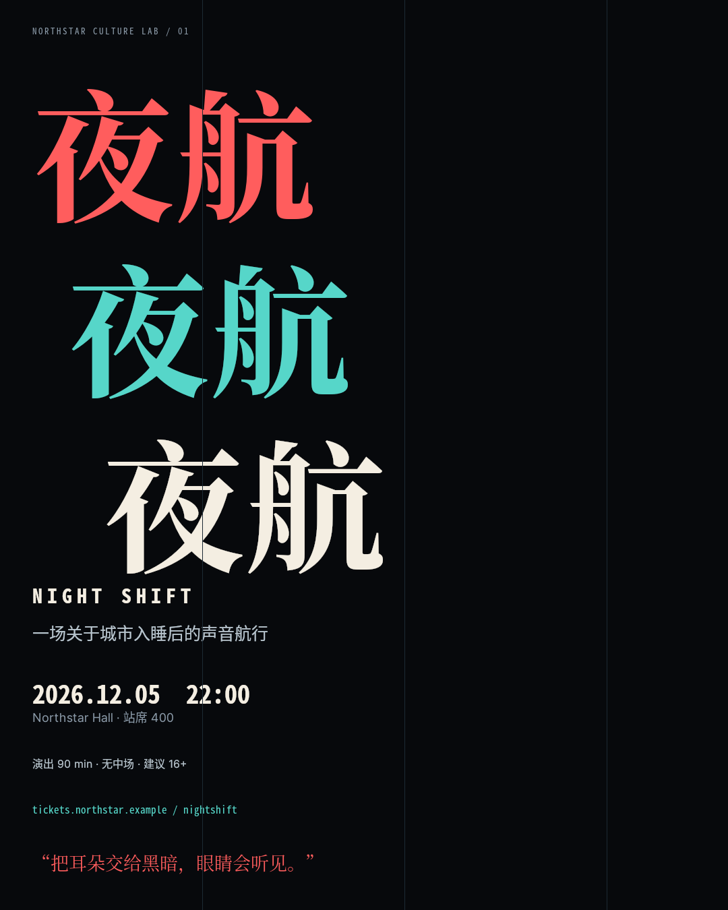
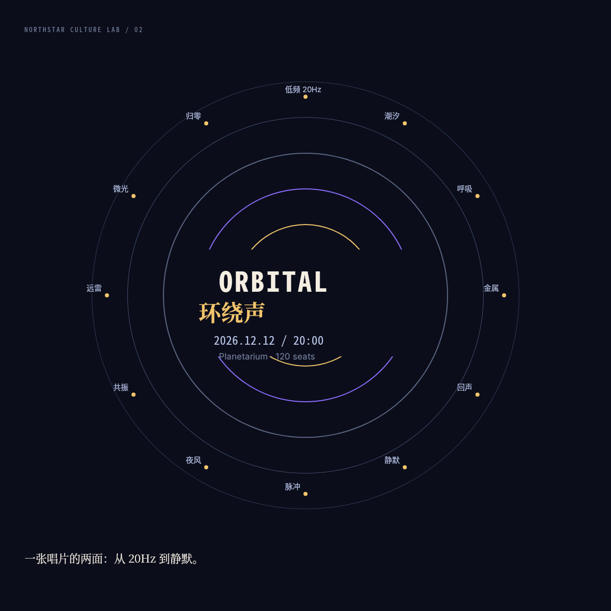
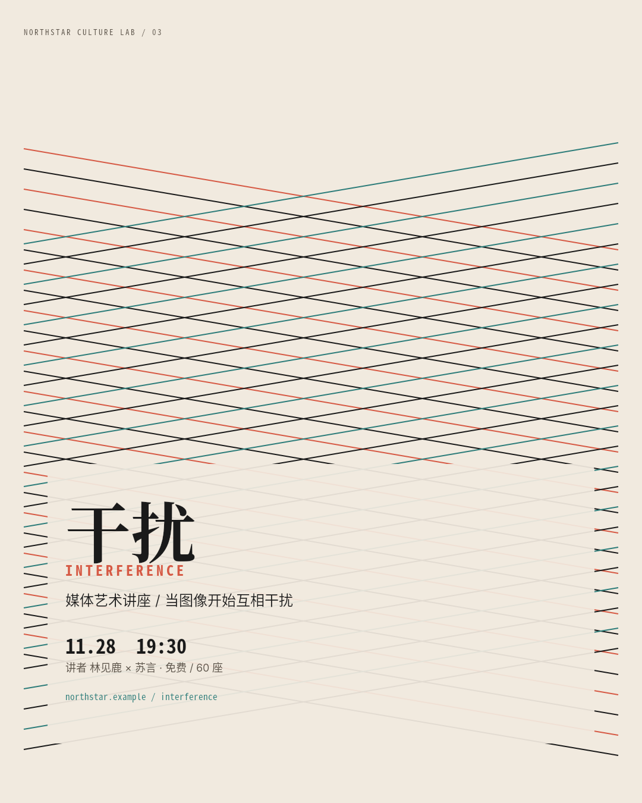
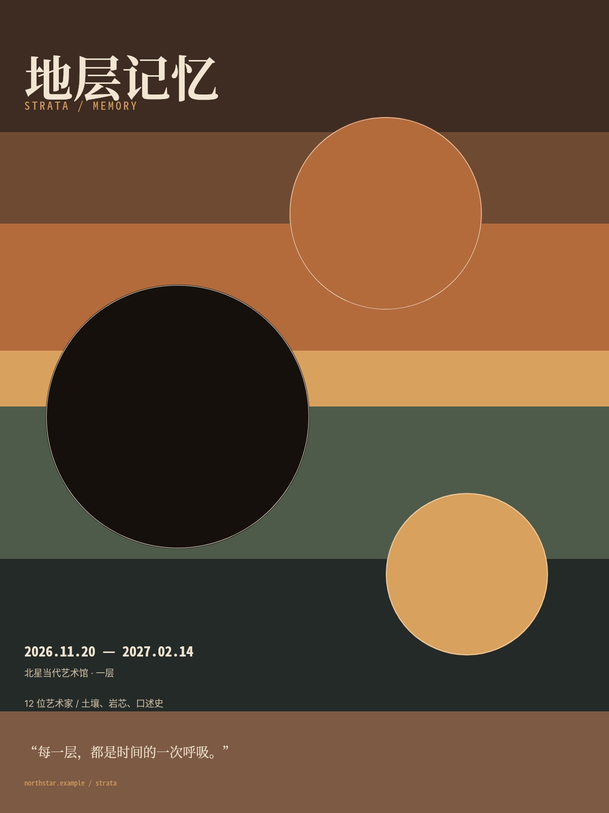
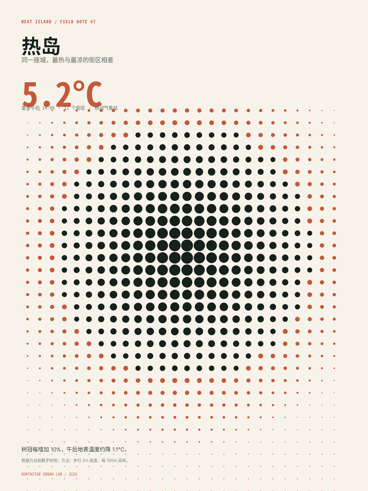
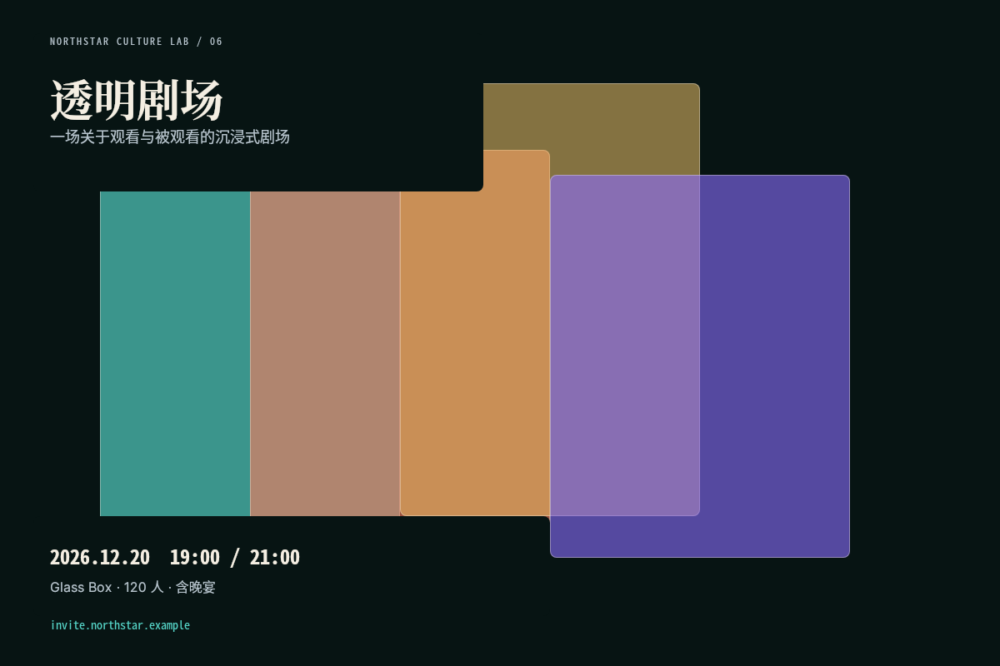
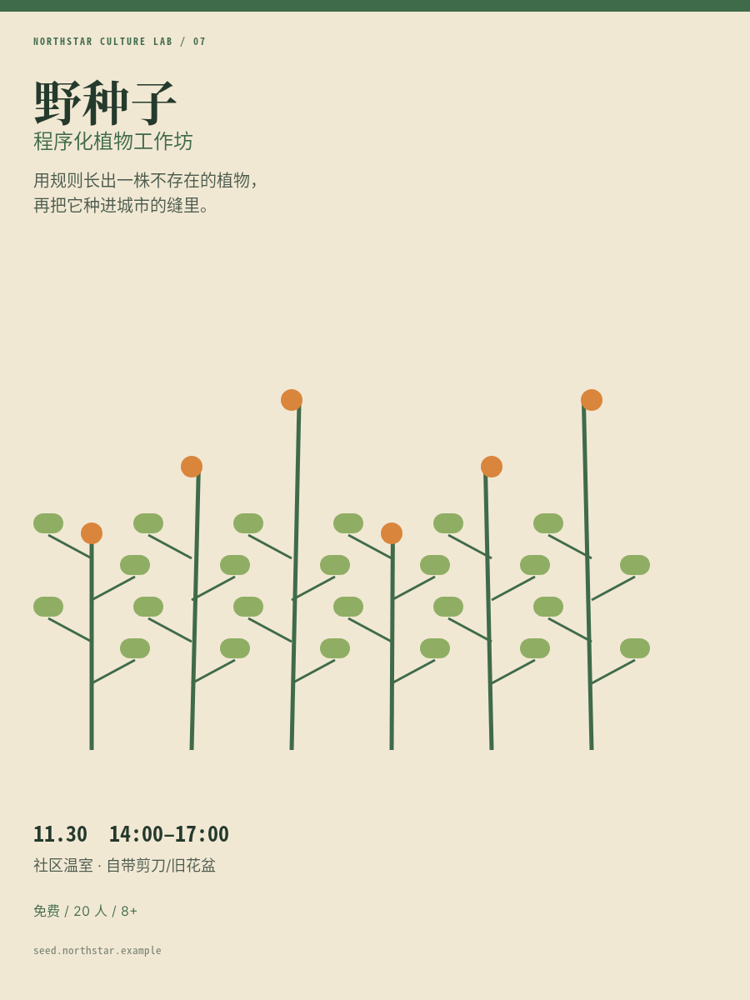
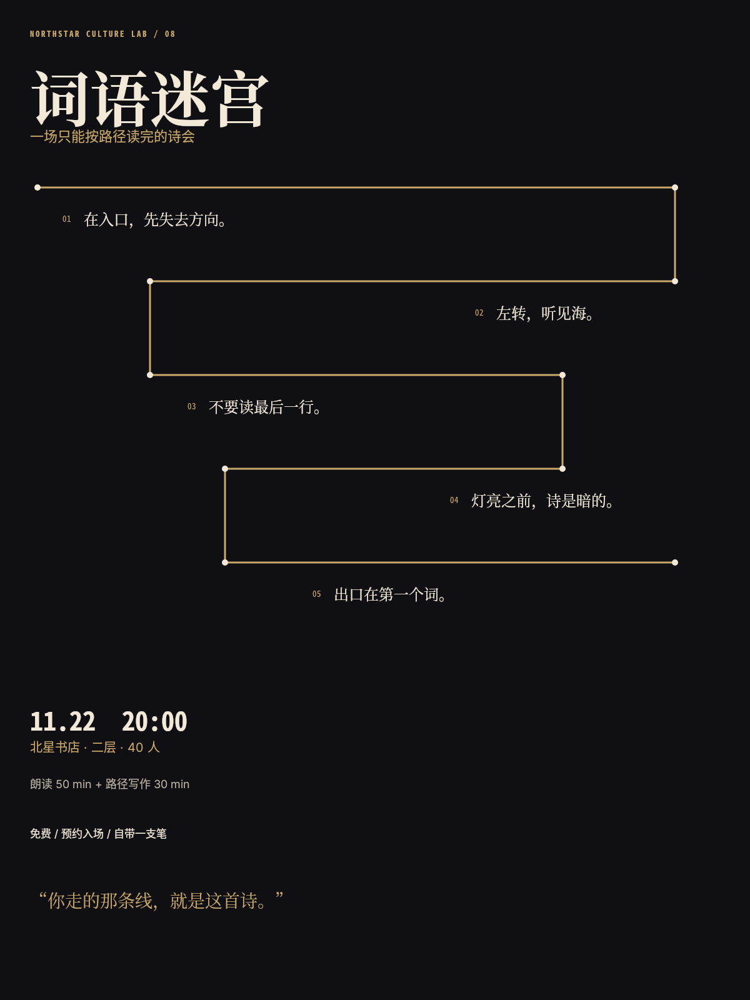
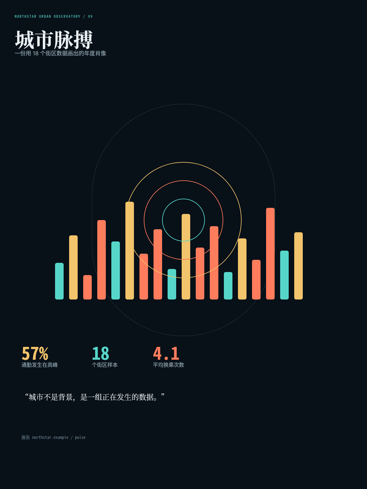
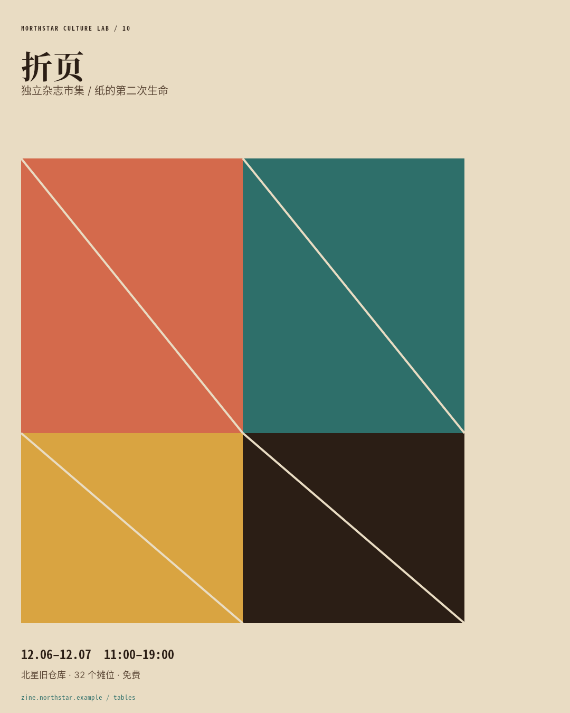

# B03 全画廊

十件实验排版，链接相对本题输出根。

## case-01 · 夜航：滑移字海报

- 原图：[case-01/final.png](case-01/final.png)
- DSL：[case-01/final.snapshot](case-01/final.snapshot)

## case-02 · 环绕声：轨道字

- 原图：[case-02/final.png](case-02/final.png)
- DSL：[case-02/final.snapshot](case-02/final.snapshot)

## case-03 · 干扰：摩尔纹讲座

- 原图：[case-03/final.png](case-03/final.png)
- DSL：[case-03/final.snapshot](case-03/final.snapshot)

## case-04 · 地层记忆：层带海报

- 原图：[case-04/final.png](case-04/final.png)
- DSL：[case-04/final.snapshot](case-04/final.snapshot)

## case-05 · 热岛：半调数据封面

- 原图：[case-05/final.png](case-05/final.png)
- DSL：[case-05/final.snapshot](case-05/final.snapshot)

## case-06 · 透明剧场：玻璃叠层邀请函

- 原图：[case-06/final.png](case-06/final.png)
- DSL：[case-06/final.snapshot](case-06/final.snapshot)

## case-07 · 野种子：程序化植物工作坊

- 原图：[case-07/final.png](case-07/final.png)
- DSL：[case-07/final.snapshot](case-07/final.snapshot)

## case-08 · 词语迷宫：诗歌夜

- 原图：[case-08/final.png](case-08/final.png)
- DSL：[case-08/final.snapshot](case-08/final.snapshot)

## case-09 · 城市脉搏：数据肖像

- 原图：[case-09/final.png](case-09/final.png)
- DSL：[case-09/final.snapshot](case-09/final.snapshot)

## case-10 · 折页：独立杂志市集

- 原图：[case-10/final.png](case-10/final.png)
- DSL：[case-10/final.snapshot](case-10/final.snapshot)

