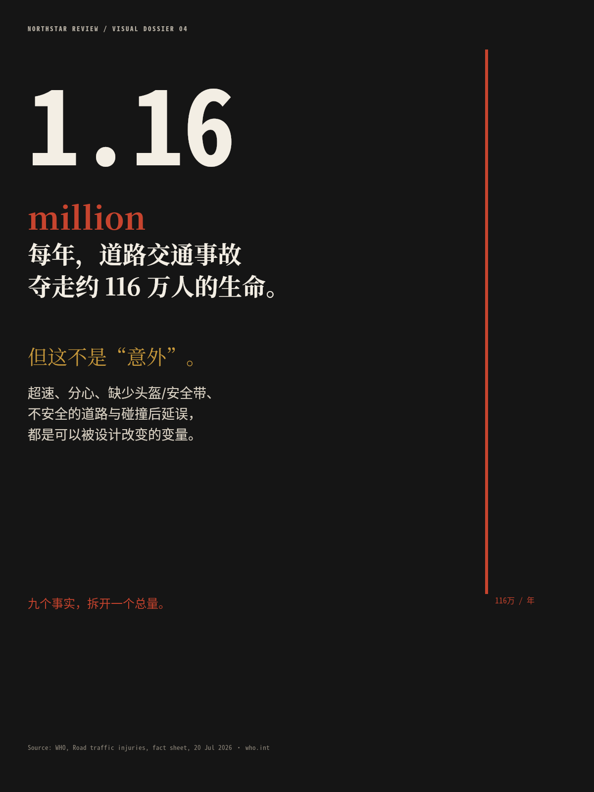
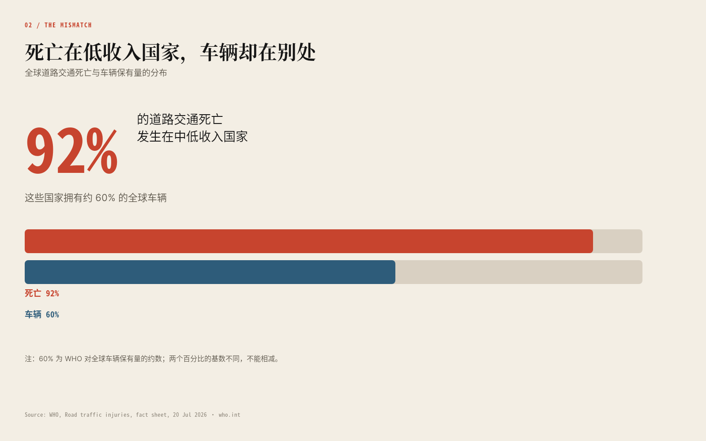
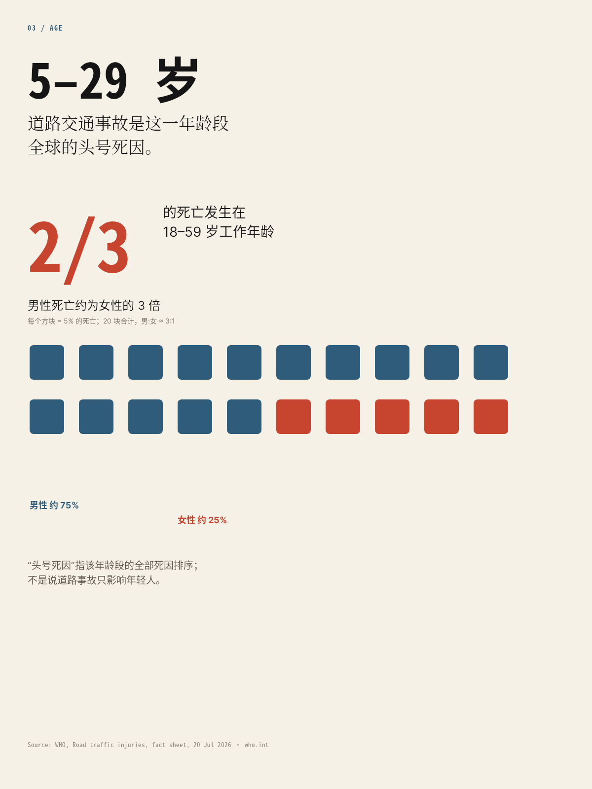
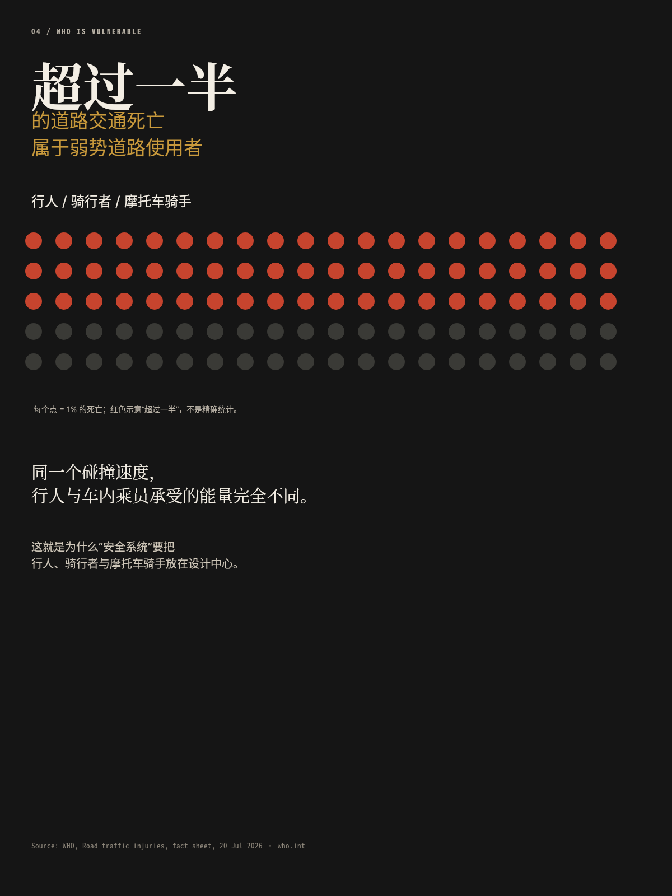
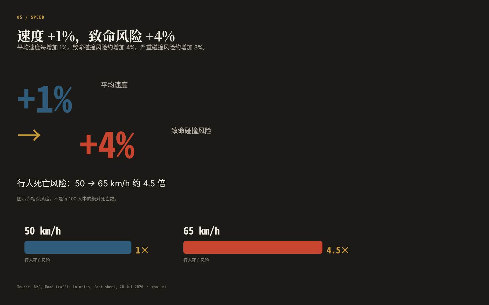
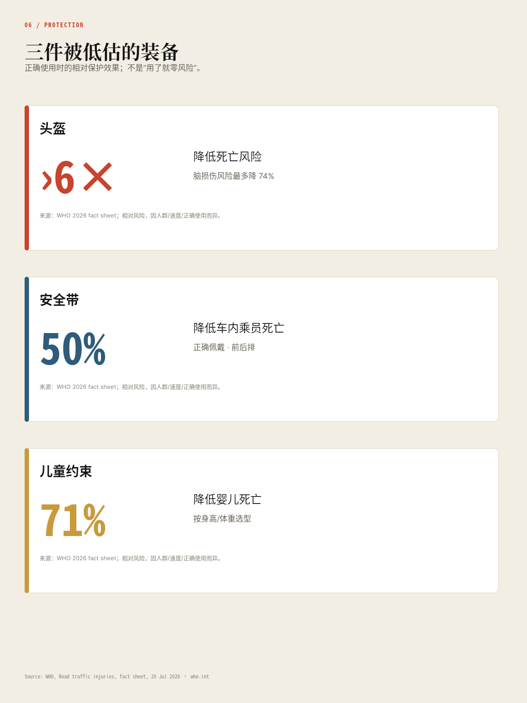
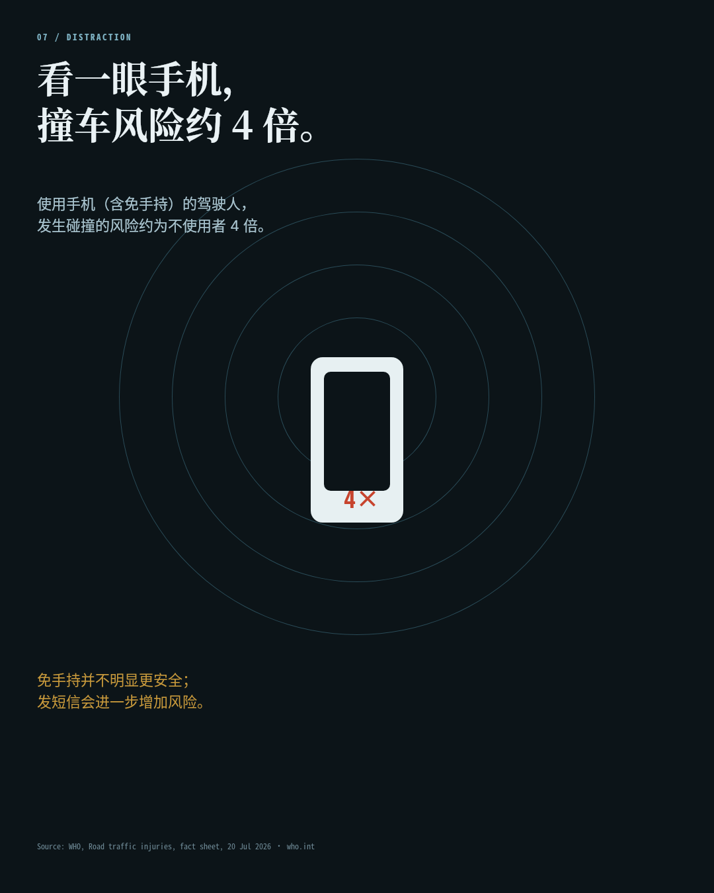
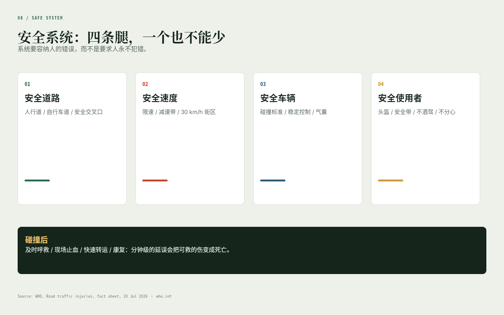
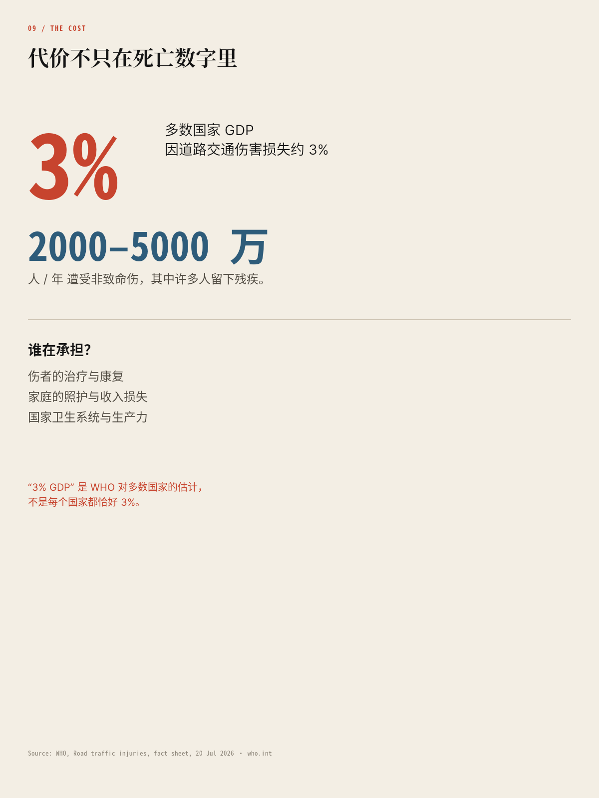
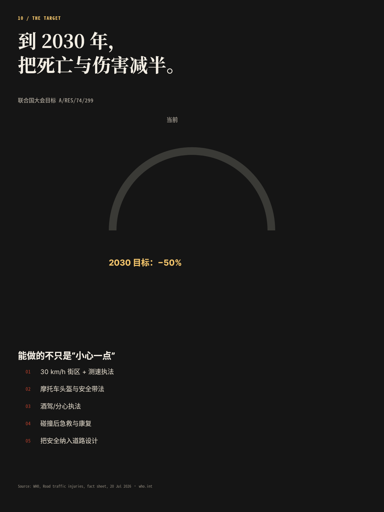

# B04 全画廊

十页研究特辑，链接相对本题输出根。

## case-01 · 封面：1.16 million

- 原图：[case-01/final.png](case-01/final.png)
- DSL：[case-01/final.snapshot](case-01/final.snapshot)
- 来源：[sources.json](sources.json)

## case-02 · 92% / 60%：死亡与车辆的错位

- 原图：[case-02/final.png](case-02/final.png)
- DSL：[case-02/final.snapshot](case-02/final.snapshot)
- 来源：[sources.json](sources.json)

## case-03 · 5–29 岁的头号死因

- 原图：[case-03/final.png](case-03/final.png)
- DSL：[case-03/final.snapshot](case-03/final.snapshot)
- 来源：[sources.json](sources.json)

## case-04 · 超过一半是弱势道路使用者

- 原图：[case-04/final.png](case-04/final.png)
- DSL：[case-04/final.snapshot](case-04/final.snapshot)
- 来源：[sources.json](sources.json)

## case-05 · 速度 +1%，致命风险 +4%

- 原图：[case-05/final.png](case-05/final.png)
- DSL：[case-05/final.snapshot](case-05/final.snapshot)
- 来源：[sources.json](sources.json)

## case-06 · 头盔、安全带、儿童约束

- 原图：[case-06/final.png](case-06/final.png)
- DSL：[case-06/final.snapshot](case-06/final.snapshot)
- 来源：[sources.json](sources.json)

## case-07 · 手机让 crash 风险 ×4

- 原图：[case-07/final.png](case-07/final.png)
- DSL：[case-07/final.snapshot](case-07/final.snapshot)
- 来源：[sources.json](sources.json)

## case-08 · 安全系统：四条腿 + 碰撞后

- 原图：[case-08/final.png](case-08/final.png)
- DSL：[case-08/final.snapshot](case-08/final.snapshot)
- 来源：[sources.json](sources.json)

## case-09 · 3% GDP 与 2000–5000 万伤者

- 原图：[case-09/final.png](case-09/final.png)
- DSL：[case-09/final.snapshot](case-09/final.snapshot)
- 来源：[sources.json](sources.json)

## case-10 · 2030：把死亡减半

- 原图：[case-10/final.png](case-10/final.png)
- DSL：[case-10/final.snapshot](case-10/final.snapshot)
- 来源：[sources.json](sources.json)

