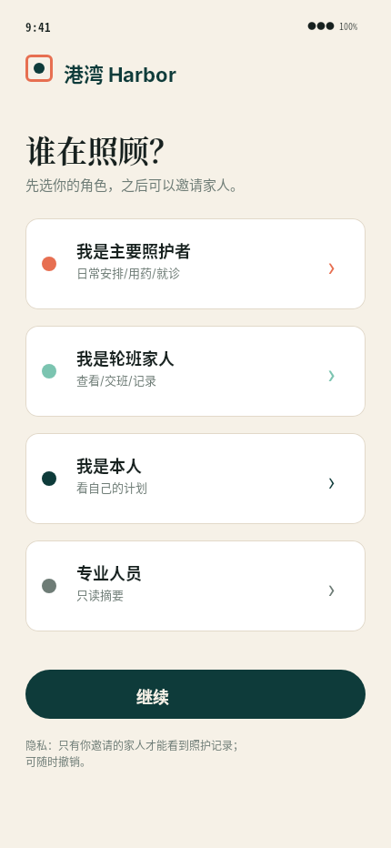
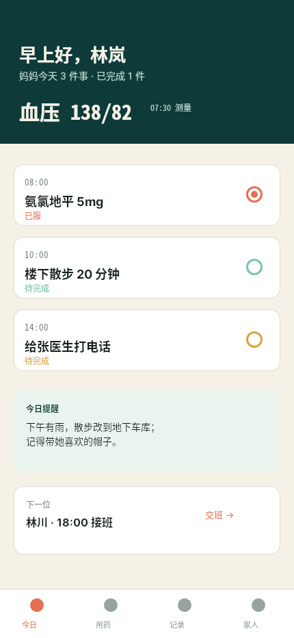
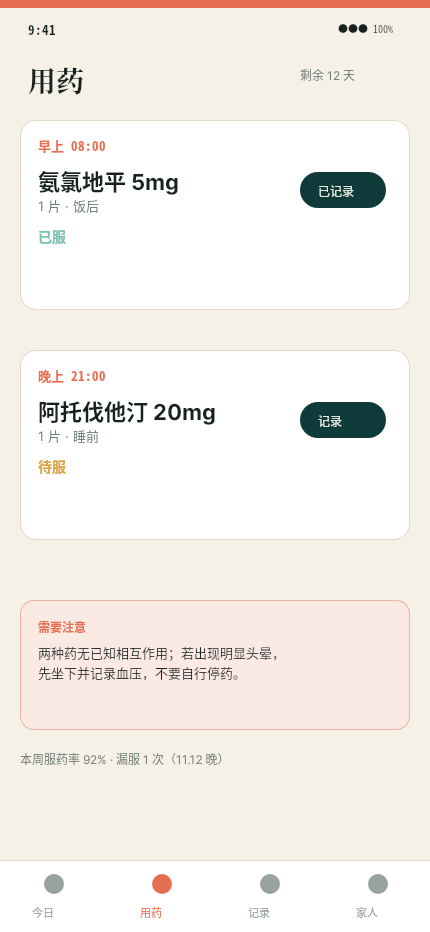
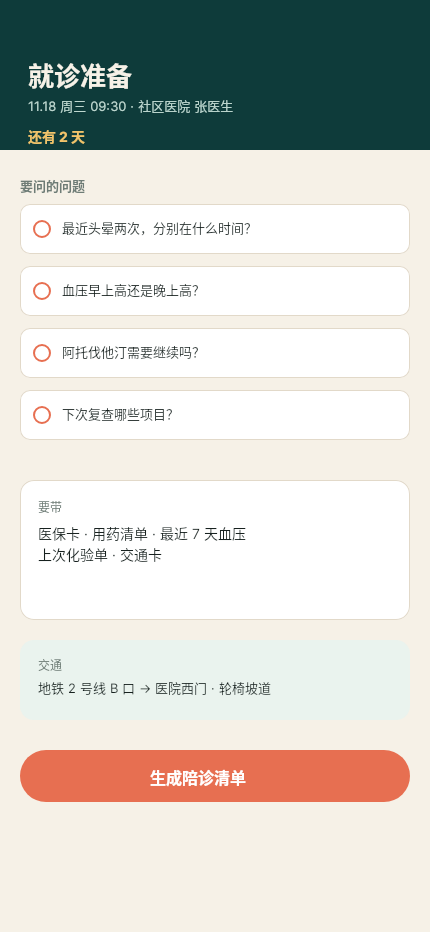
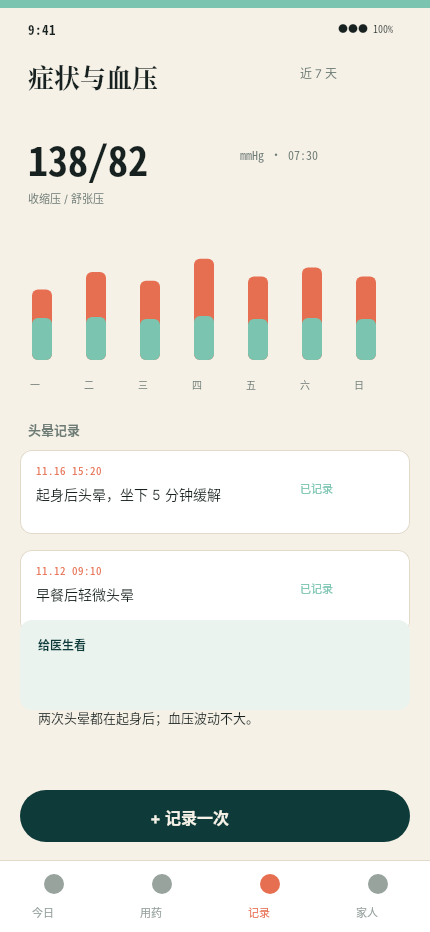
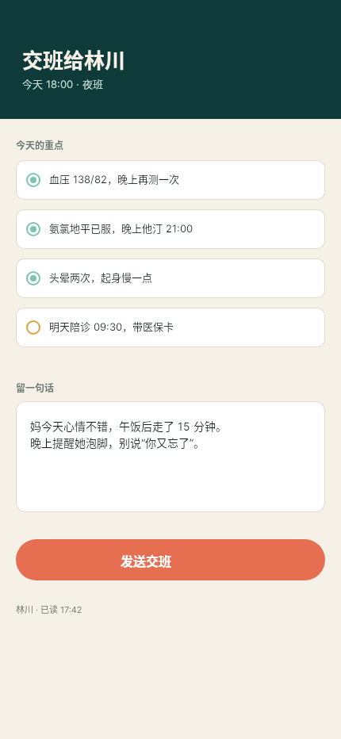
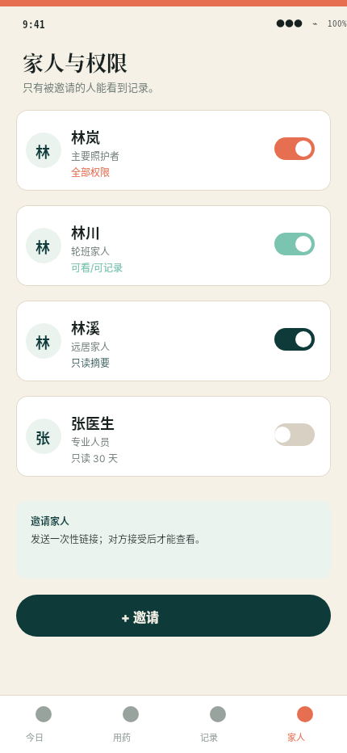
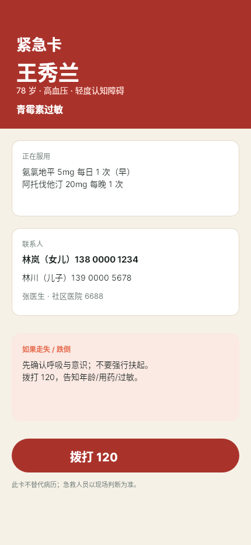
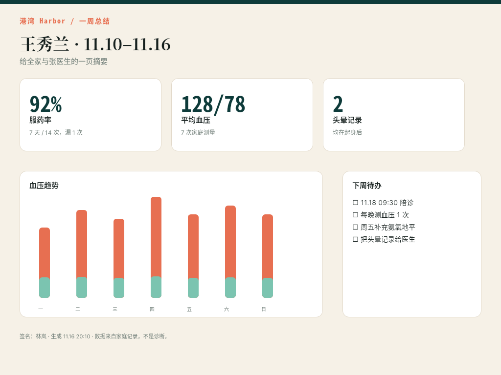
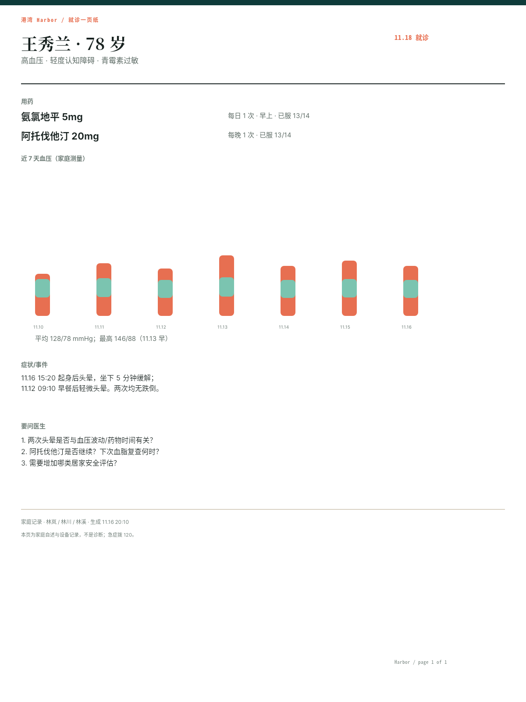

# B05 全画廊

十屏产品体验，链接相对本题输出根。

## case-01 · 欢迎/角色选择

- 原图：[case-01/final.png](case-01/final.png)
- DSL：[case-01/final.snapshot](case-01/final.snapshot)

## case-02 · 今日照护简报

- 原图：[case-02/final.png](case-02/final.png)
- DSL：[case-02/final.snapshot](case-02/final.snapshot)

## case-03 · 用药时间线

- 原图：[case-03/final.png](case-03/final.png)
- DSL：[case-03/final.snapshot](case-03/final.snapshot)

## case-04 · 就诊准备

- 原图：[case-04/final.png](case-04/final.png)
- DSL：[case-04/final.snapshot](case-04/final.snapshot)

## case-05 · 症状与血压记录

- 原图：[case-05/final.png](case-05/final.png)
- DSL：[case-05/final.snapshot](case-05/final.snapshot)

## case-06 · 家庭交班

- 原图：[case-06/final.png](case-06/final.png)
- DSL：[case-06/final.snapshot](case-06/final.snapshot)

## case-07 · 权限管理

- 原图：[case-07/final.png](case-07/final.png)
- DSL：[case-07/final.snapshot](case-07/final.snapshot)

## case-08 · 紧急卡

- 原图：[case-08/final.png](case-08/final.png)
- DSL：[case-08/final.snapshot](case-08/final.snapshot)

## case-09 · 一周总结

- 原图：[case-09/final.png](case-09/final.png)
- DSL：[case-09/final.snapshot](case-09/final.snapshot)

## case-10 · 就诊一页纸

- 原图：[case-10/final.png](case-10/final.png)
- DSL：[case-10/final.snapshot](case-10/final.snapshot)

