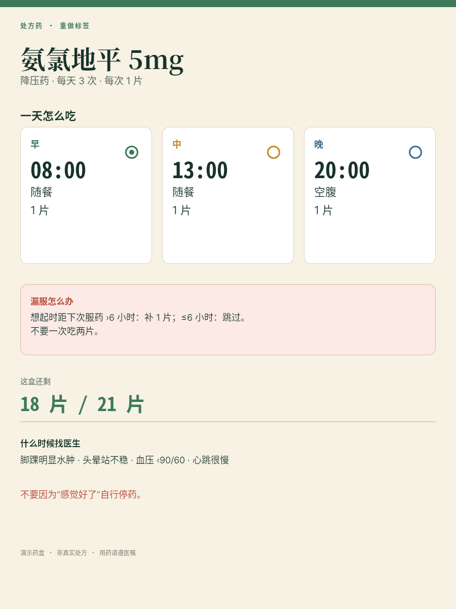
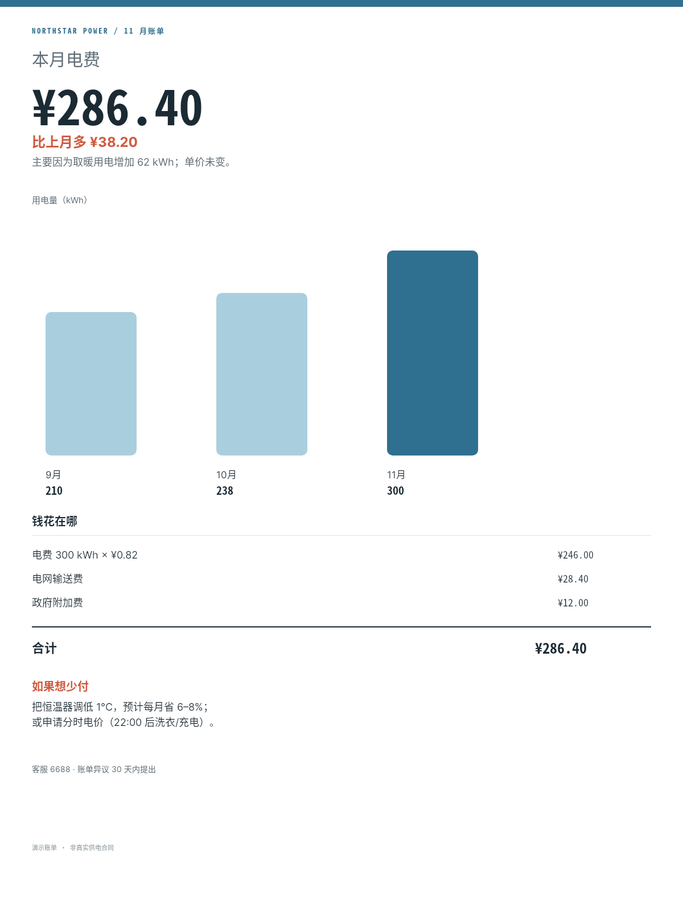
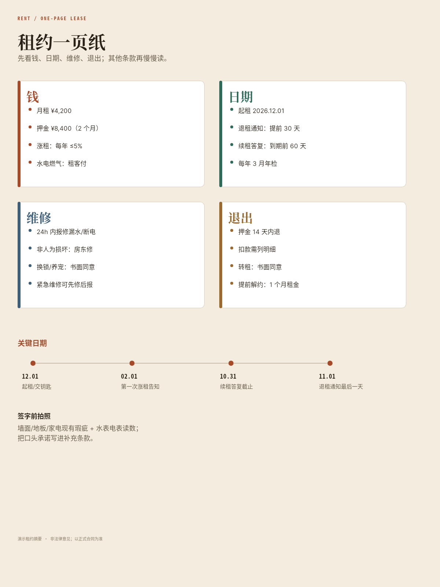
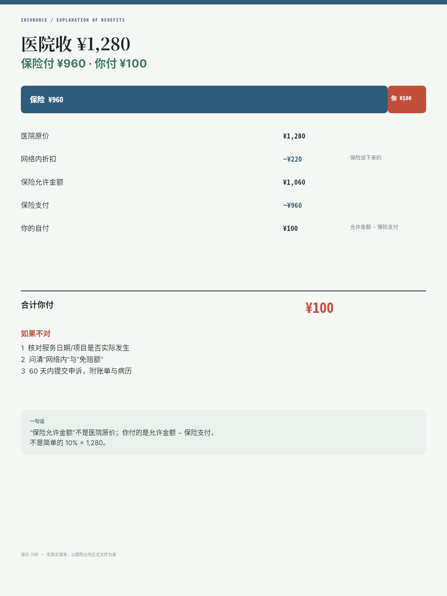
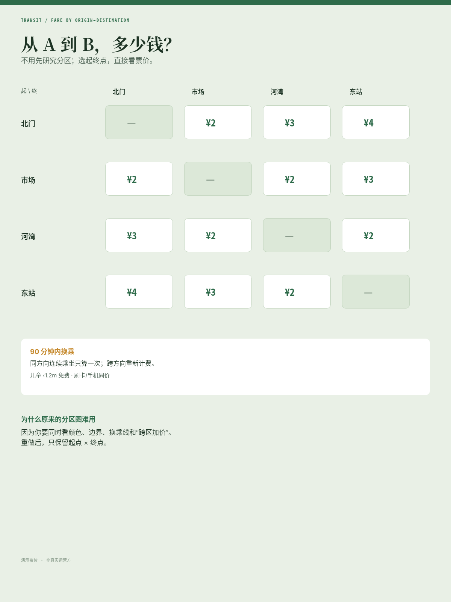
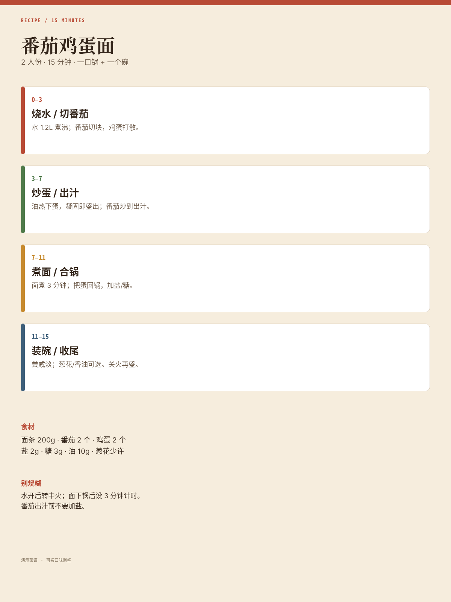
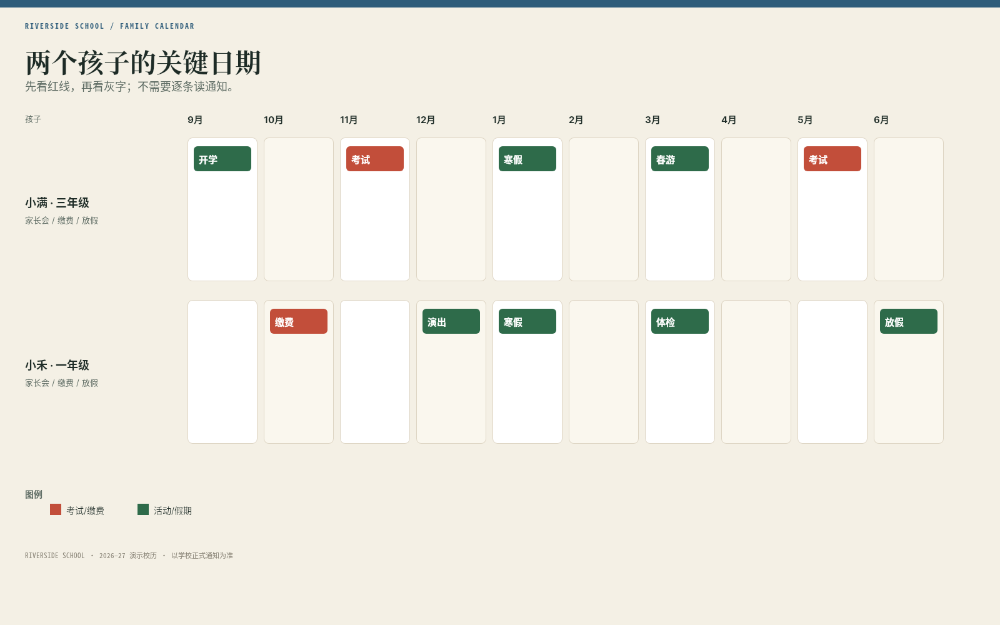
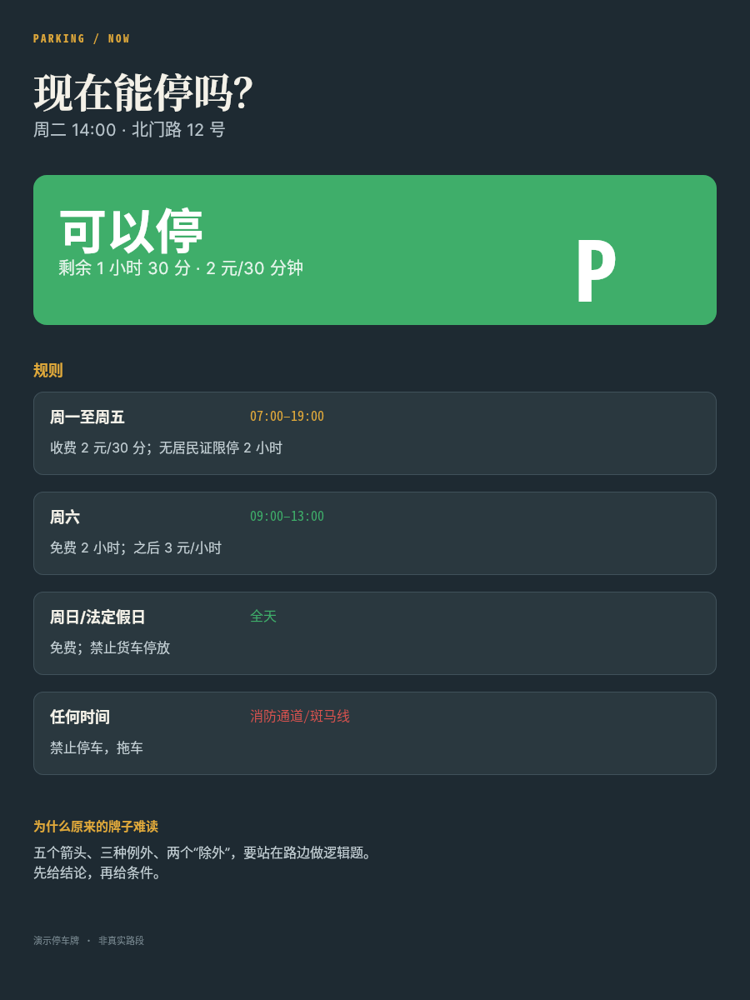
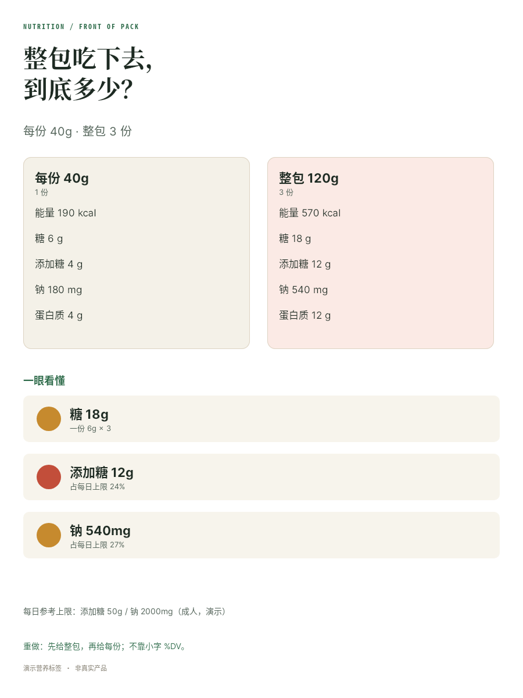
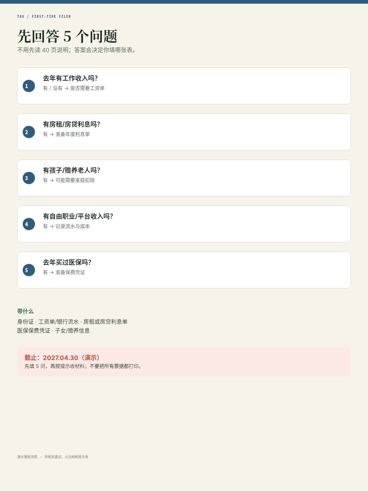

# B06 全画廊

十件日常信息重做，链接相对本题输出根。

## case-01 · 药盒标签：把“一日三次”变成时间

- 原图：[case-01/final.png](case-01/final.png)
- DSL：[case-01/final.snapshot](case-01/final.snapshot)

## case-02 · 电费单：这个月为什么多付

- 原图：[case-02/final.png](case-02/final.png)
- DSL：[case-02/final.snapshot](case-02/final.snapshot)

## case-03 · 租约一页纸：押金/涨租/维修

- 原图：[case-03/final.png](case-03/final.png)
- DSL：[case-03/final.snapshot](case-03/final.snapshot)

## case-04 · 保险 EOB：医院收多少/你付多少

- 原图：[case-04/final.png](case-04/final.png)
- DSL：[case-04/final.snapshot](case-04/final.snapshot)

## case-05 · 公交票价：从 A 到 B 多少钱

- 原图：[case-05/final.png](case-05/final.png)
- DSL：[case-05/final.snapshot](case-05/final.snapshot)

## case-06 · 菜谱：一眼看清先做什么

- 原图：[case-06/final.png](case-06/final.png)
- DSL：[case-06/final.snapshot](case-06/final.snapshot)

## case-07 · 校历：两个孩子的关键日期

- 原图：[case-07/final.png](case-07/final.png)
- DSL：[case-07/final.snapshot](case-07/final.snapshot)

## case-08 · 停车牌：现在能不能停

- 原图：[case-08/final.png](case-08/final.png)
- DSL：[case-08/final.snapshot](case-08/final.snapshot)

## case-09 · 营养标签：整包吃下去多少

- 原图：[case-09/final.png](case-09/final.png)
- DSL：[case-09/final.snapshot](case-09/final.snapshot)

## case-10 · 报税表：先回答 5 个问题

- 原图：[case-10/final.png](case-10/final.png)
- DSL：[case-10/final.snapshot](case-10/final.snapshot)

