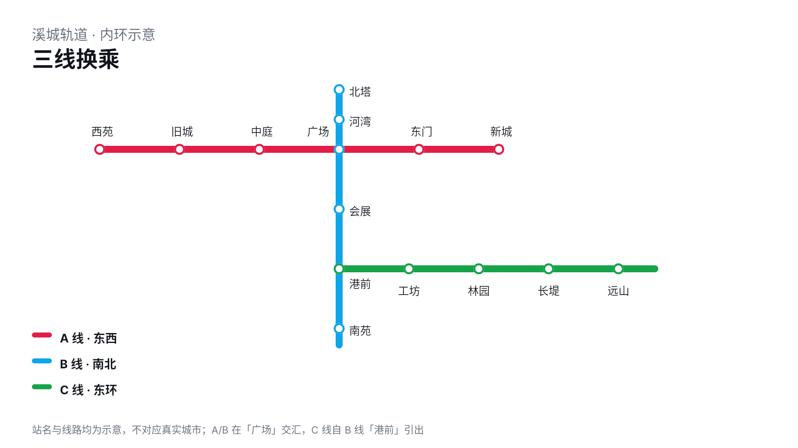
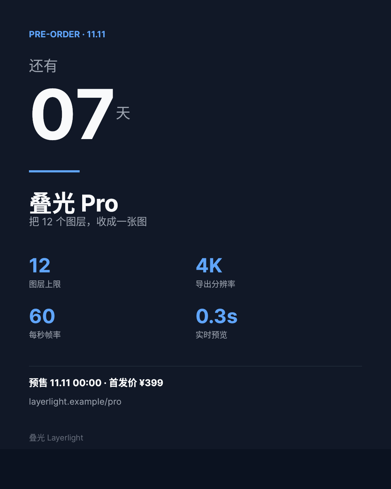

# B01 作品集 · 2 件真实场景

自拟品牌「叠光 Layerlight」，数据均为演示，不代表任何真实客户的已部署作品。

## 01 城市轨道示意图

- 尺寸：1600×900　类别：交通/导览
- 场景：城市轨道三线换乘示意图
- 为什么适合：看懂三条线在哪换乘、各站顺序
- 最有辨识度的选择：三色正交线路 + 空心站点，换乘站用交汇点表达；站名按线路方向放在线外

[原 PNG](case-04/final.png) · [DSL](case-04/final.snapshot) · [说明](case-04/case.md)

## 02 新品倒计时海报

- 尺寸：1080×1350　类别：营销/发布
- 场景：新品预售倒计时海报
- 为什么适合：知道还有几天、卖点是什么、多少钱
- 最有辨识度的选择：超大天数占视觉中心，四项规格两列排布，底部价格与网址收口

[原 PNG](case-09/final.png) · [DSL](case-09/final.snapshot) · [说明](case-09/case.md)

