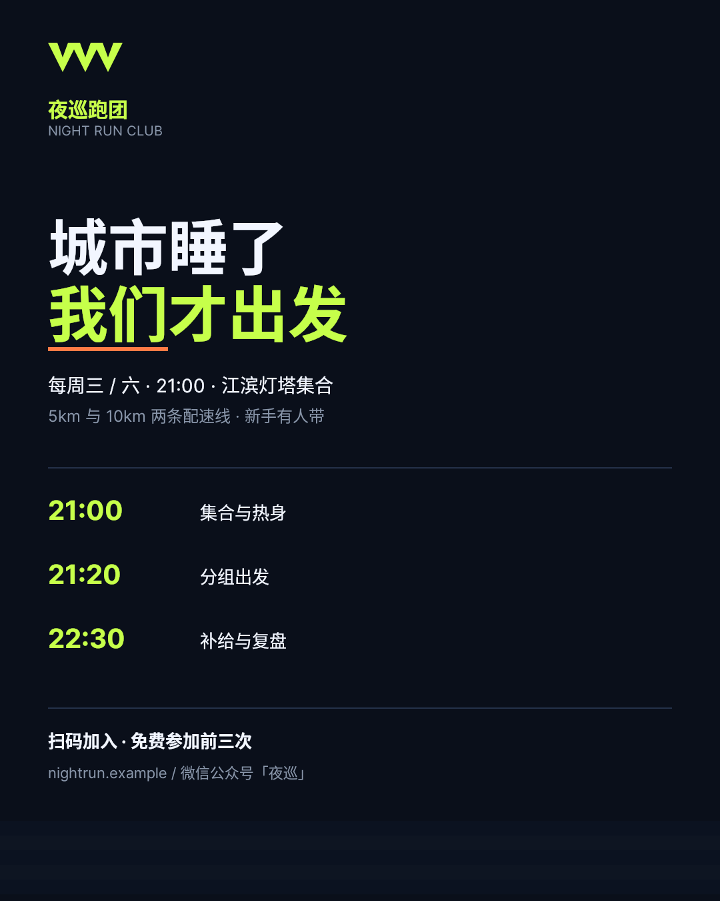
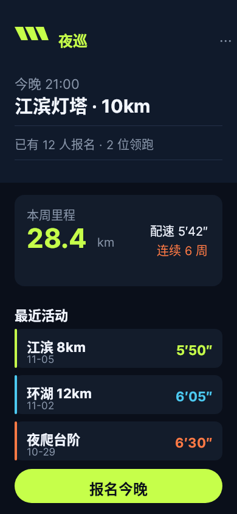
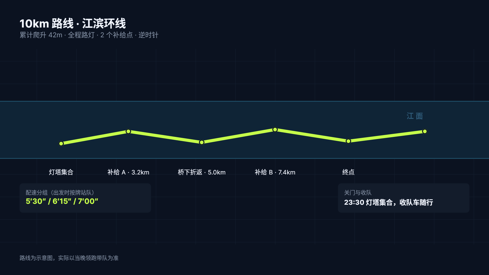
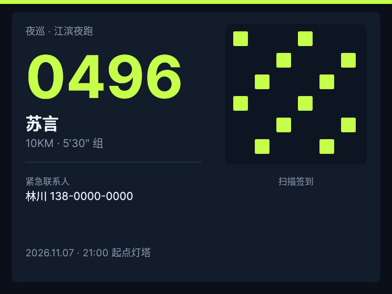
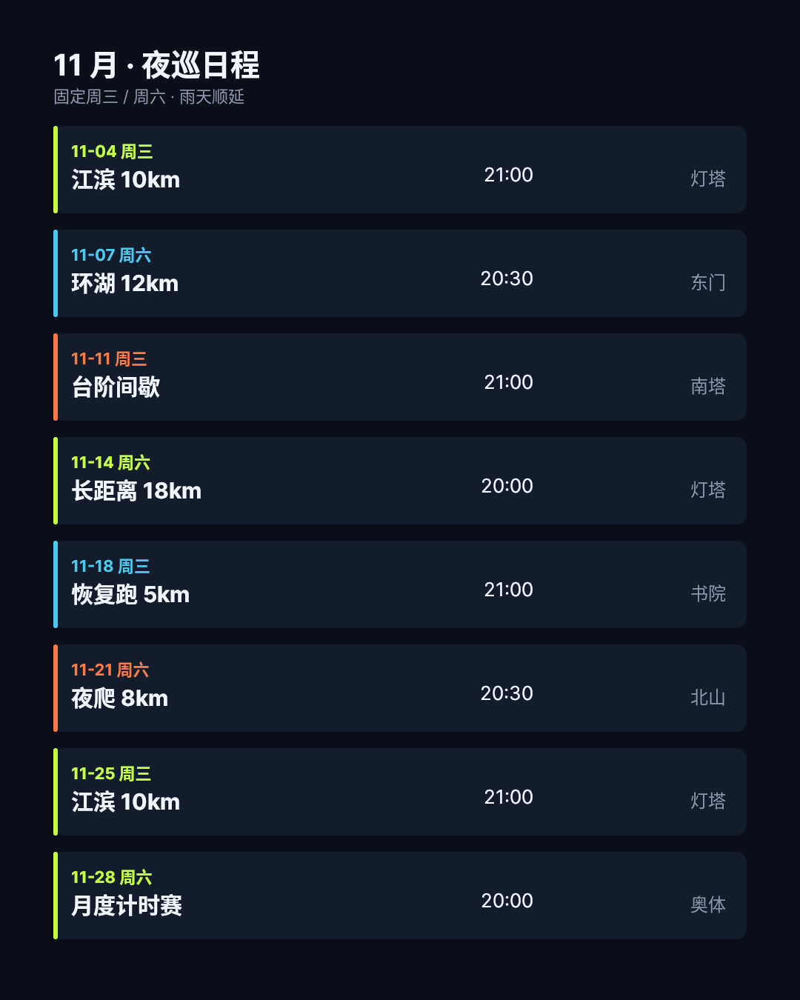
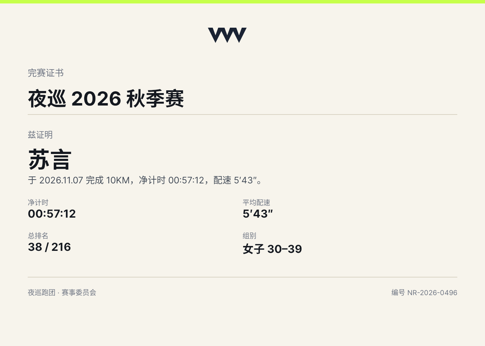
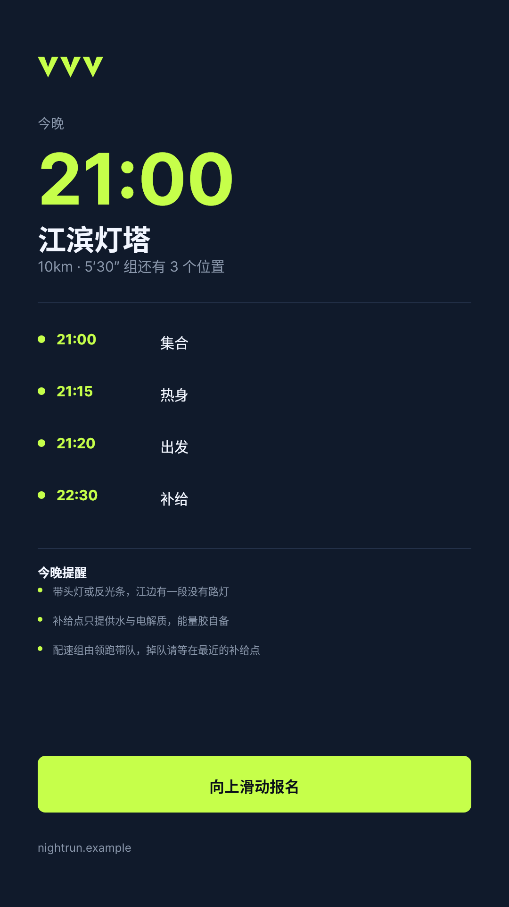
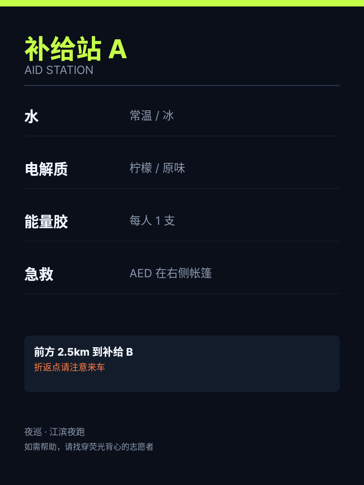
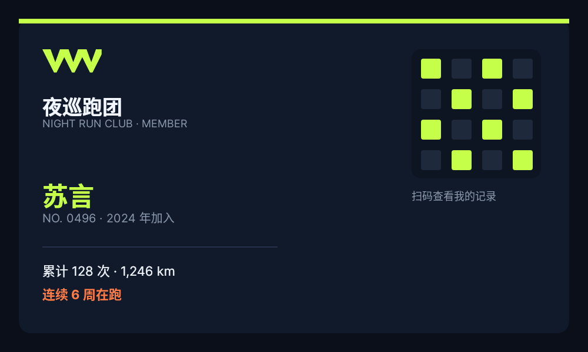
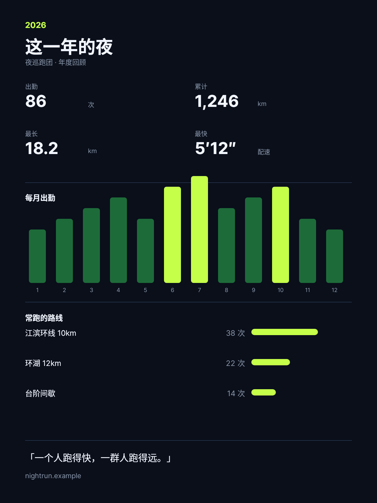

# B02 画廊

共 10 件触点，按旅程顺序排列。

## 招新海报（awareness）

[原 PNG](case-01/final.png) · [DSL](case-01/final.snapshot) · [case.md](case-01/case.md)

## 小程序首页（usage）

[原 PNG](case-02/final.png) · [DSL](case-02/final.snapshot) · [case.md](case-02/case.md)

## 路线图（usage）

[原 PNG](case-03/final.png) · [DSL](case-03/final.snapshot) · [case.md](case-03/case.md)

## 号码布（event）

[原 PNG](case-04/final.png) · [DSL](case-04/final.snapshot) · [case.md](case-04/case.md)

## 月度日程卡（planning）

[原 PNG](case-05/final.png) · [DSL](case-05/final.snapshot) · [case.md](case-05/case.md)

## 完赛证书（feedback）

[原 PNG](case-06/final.png) · [DSL](case-06/final.snapshot) · [case.md](case-06/case.md)

## 社交故事卡（reminder）

[原 PNG](case-07/final.png) · [DSL](case-07/final.snapshot) · [case.md](case-07/case.md)

## 补给站指示牌（event）

[原 PNG](case-08/final.png) · [DSL](case-08/final.snapshot) · [case.md](case-08/case.md)

## 会员卡（retention）

[原 PNG](case-09/final.png) · [DSL](case-09/final.snapshot) · [case.md](case-09/case.md)

## 年度回顾（feedback）

[原 PNG](case-10/final.png) · [DSL](case-10/final.snapshot) · [case.md](case-10/case.md)

