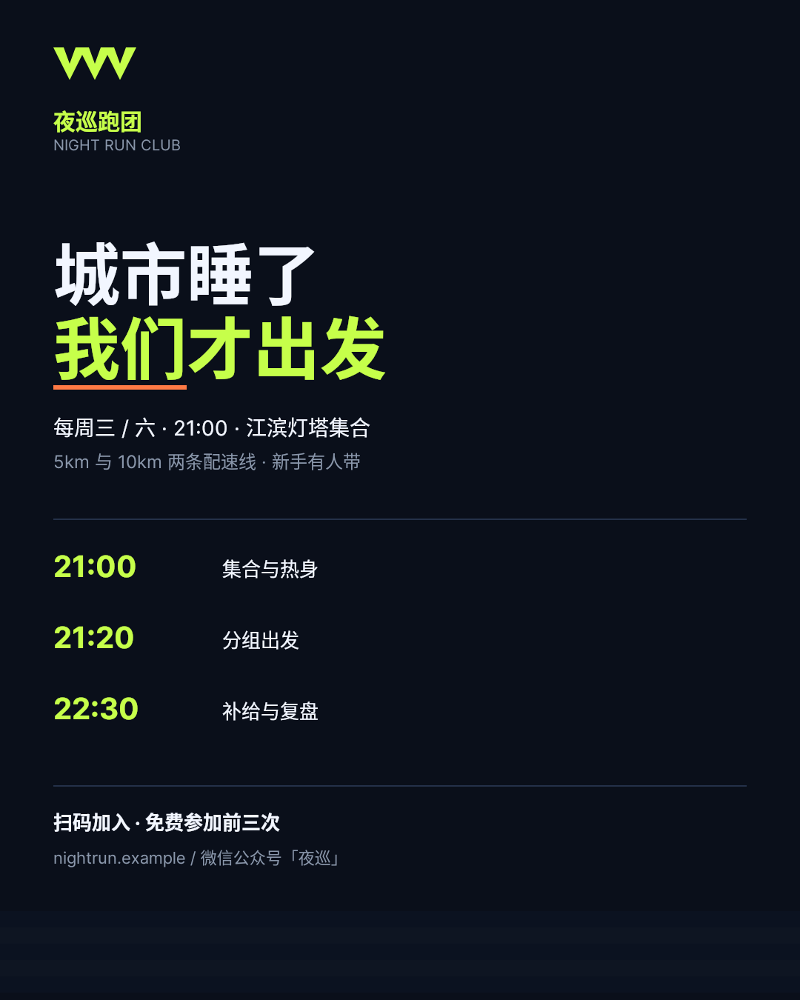
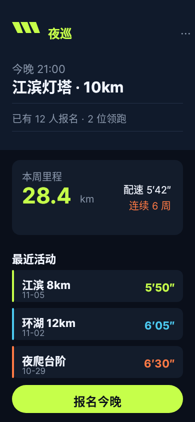
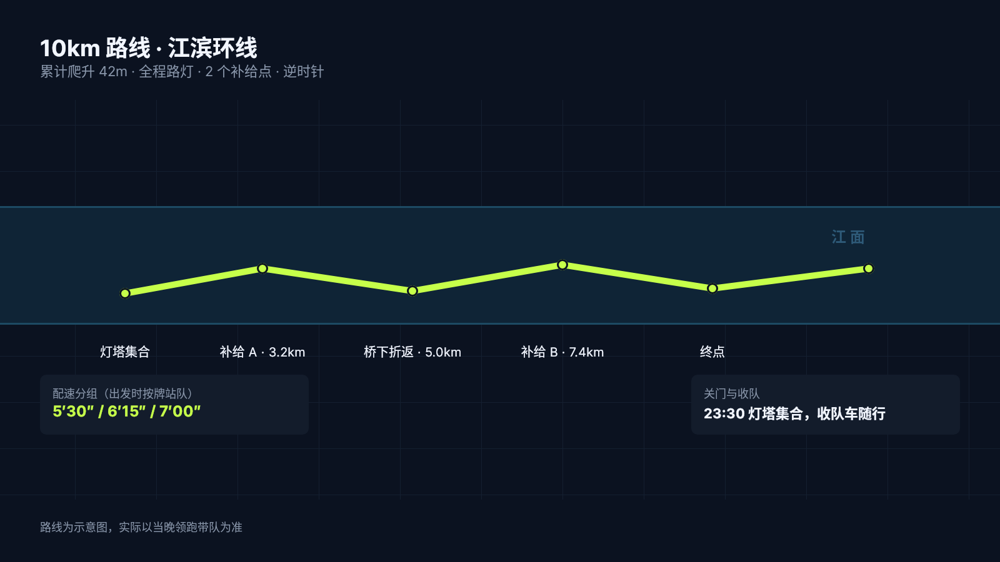
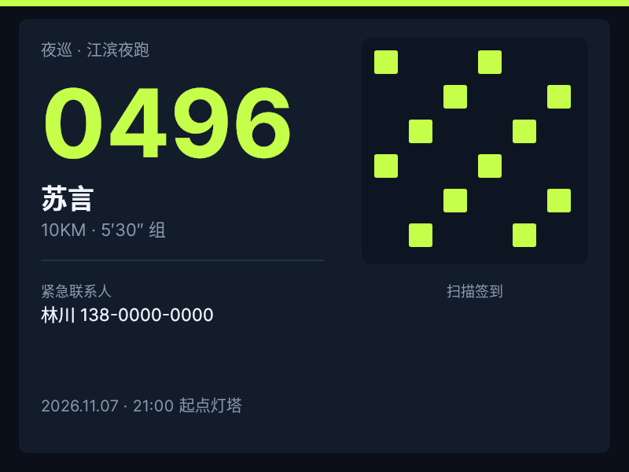
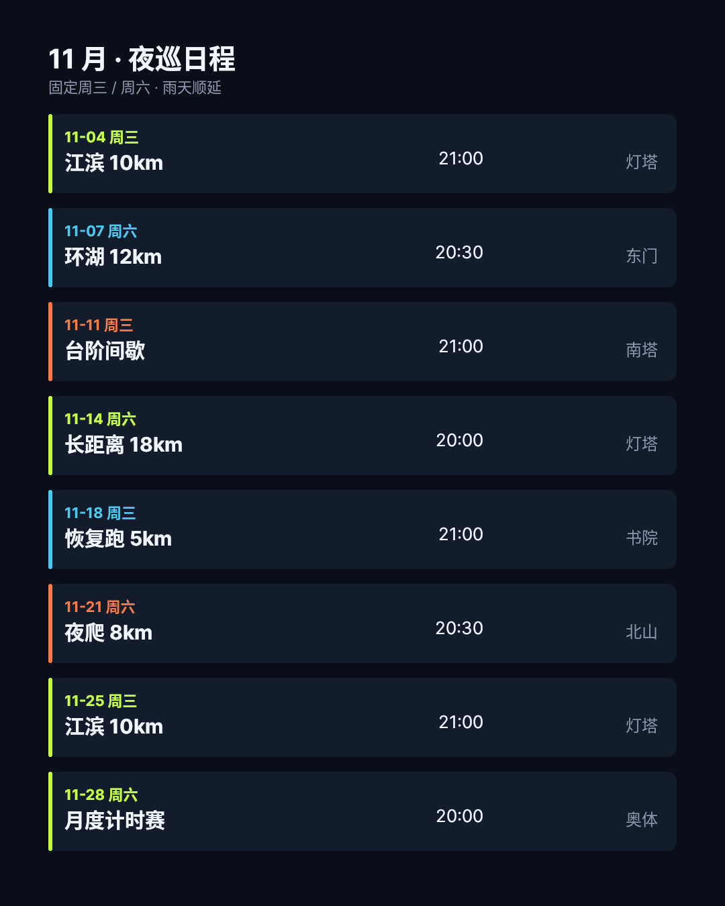
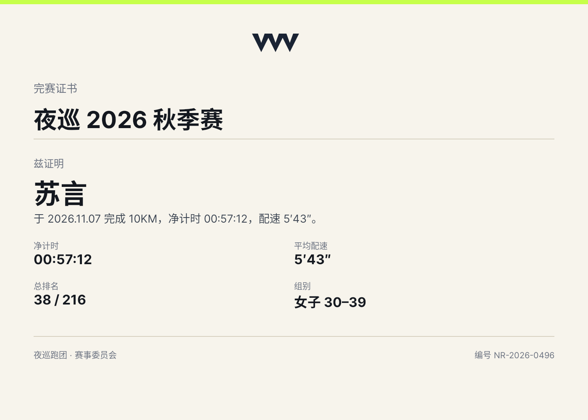
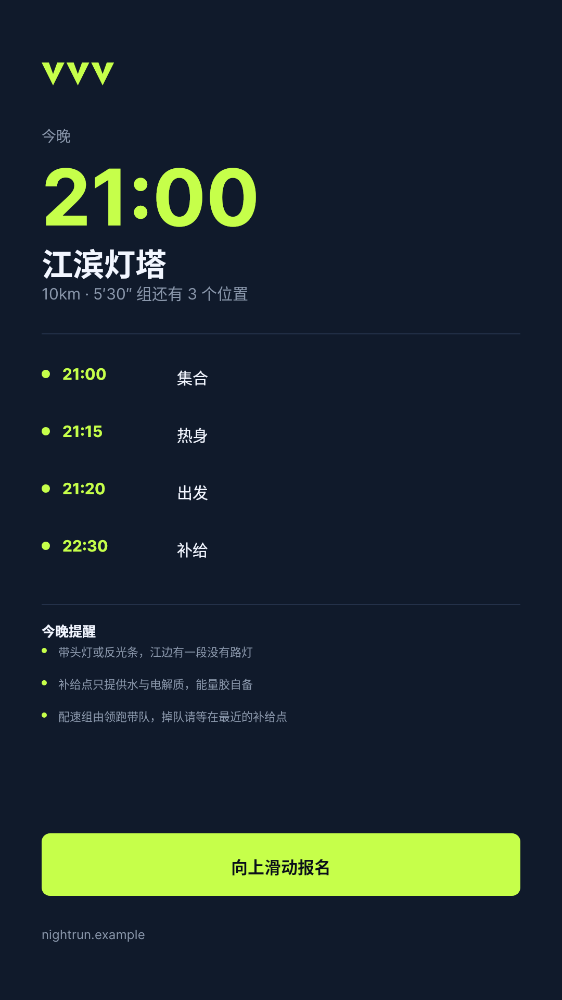
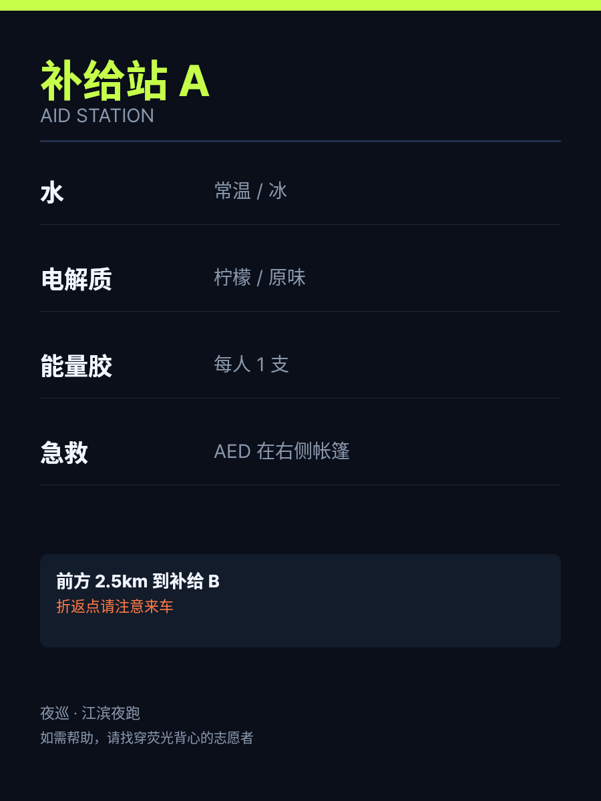
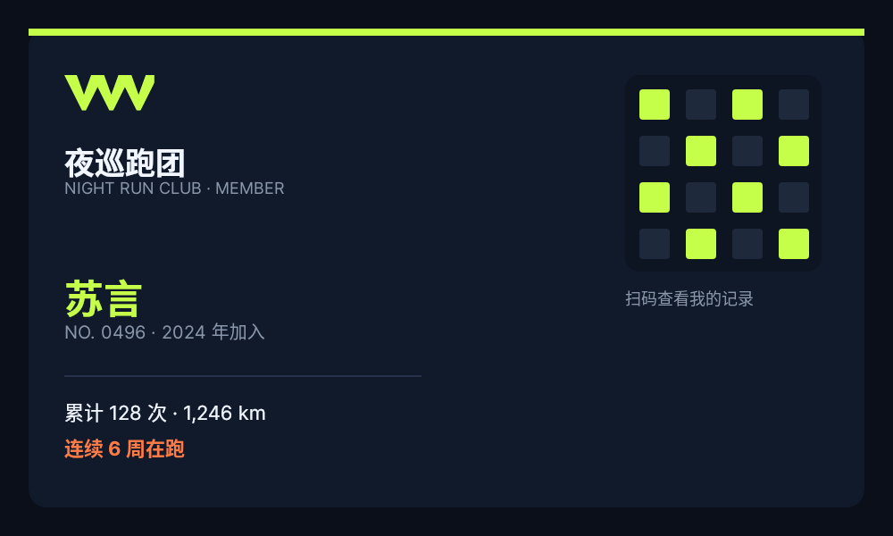
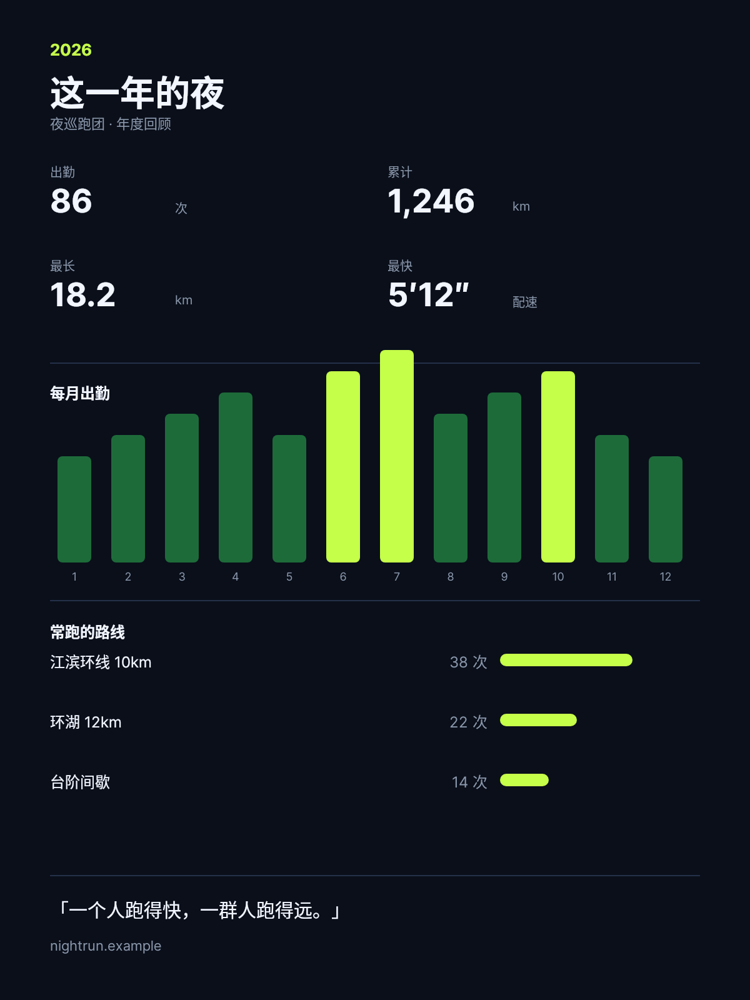

# B02 作品集 · 夜巡跑团视觉生态

一个城市夜跑社群的十个触点。自拟品牌，数据为演示。

旅程：认知 → 了解 → 参与 → 现场 → 反馈 → 留存

## 01 招新海报

- 阶段：awareness　渠道：微信公众号与线下张贴　尺寸：1080×1350
- 要完成：3 秒内讲清时间、地点、门槛
- 设计决定：巨大双行标题 + 荧光强调 + 时间轴

[原 PNG](case-01/final.png) · [DSL](case-01/final.snapshot) · [case.md](case-01/case.md)

## 02 小程序首页

- 阶段：usage　渠道：手机随身处　尺寸：390×844
- 要完成：报名与周里程一屏可见
- 设计决定：深色卡片流 + 荧光主按钮

[原 PNG](case-02/final.png) · [DSL](case-02/final.snapshot) · [case.md](case-02/case.md)

## 03 路线图

- 阶段：usage　渠道：集合点展板与群内图片　尺寸：1600×900
- 要完成：看清 10km 路线与补给点
- 设计决定：江面横带 + 折线路径 + 等距标签

[原 PNG](case-03/final.png) · [DSL](case-03/final.snapshot) · [case.md](case-03/case.md)

## 04 号码布

- 阶段：event　渠道：比赛现场佩戴　尺寸：800×600
- 要完成：现场识别身份与组别
- 设计决定：超大号码 + 二维码块 + 紧急联系人

[原 PNG](case-04/final.png) · [DSL](case-04/final.snapshot) · [case.md](case-04/case.md)

## 05 月度日程卡

- 阶段：planning　渠道：群公告与朋友圈　尺寸：1080×1350
- 要完成：一次看完整月安排
- 设计决定：八行日程卡，类型色条区分

[原 PNG](case-05/final.png) · [DSL](case-05/final.snapshot) · [case.md](case-05/case.md)

## 06 完赛证书

- 阶段：feedback　渠道：赛后分享与打印　尺寸：1400×1000
- 要完成：把完赛变成可留存凭证
- 设计决定：浅底证书 + 四宫格成绩

[原 PNG](case-06/final.png) · [DSL](case-06/final.snapshot) · [case.md](case-06/case.md)

## 07 社交故事卡

- 阶段：reminder　渠道：朋友圈 / 小红书　尺寸：1080×1920
- 要完成：当天提醒并给出时间线
- 设计决定：竖屏大字 + 时间线 + 提醒清单

[原 PNG](case-07/final.png) · [DSL](case-07/final.snapshot) · [case.md](case-07/case.md)

## 08 补给站指示牌

- 阶段：event　渠道：赛道现场　尺寸：900×1200
- 要完成：夜间远距离可读
- 设计决定：超大标题 + 四行物资 + 下一站提示

[原 PNG](case-08/final.png) · [DSL](case-08/final.snapshot) · [case.md](case-08/case.md)

## 09 会员卡

- 阶段：retention　渠道：入会礼与电子卡　尺寸：1000×600
- 要完成：身份感与累积成就
- 设计决定：横版卡片 + 荧光点阵 + 累计数据

[原 PNG](case-09/final.png) · [DSL](case-09/final.snapshot) · [case.md](case-09/case.md)

## 10 年度回顾

- 阶段：feedback　渠道：年末推送　尺寸：1200×1600
- 要完成：数据化回看一年
- 设计决定：四宫格统计 + 月度柱 + 路线排行

[原 PNG](case-10/final.png) · [DSL](case-10/final.snapshot) · [case.md](case-10/case.md)

