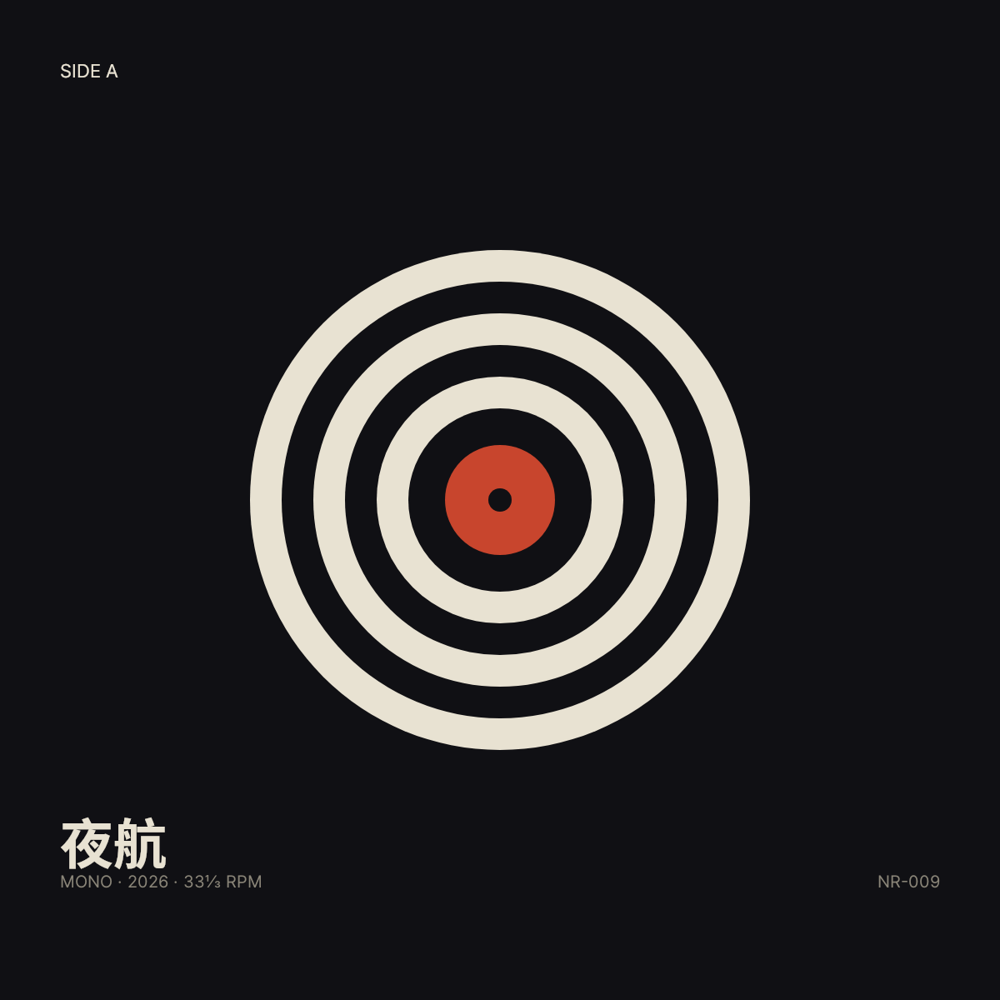
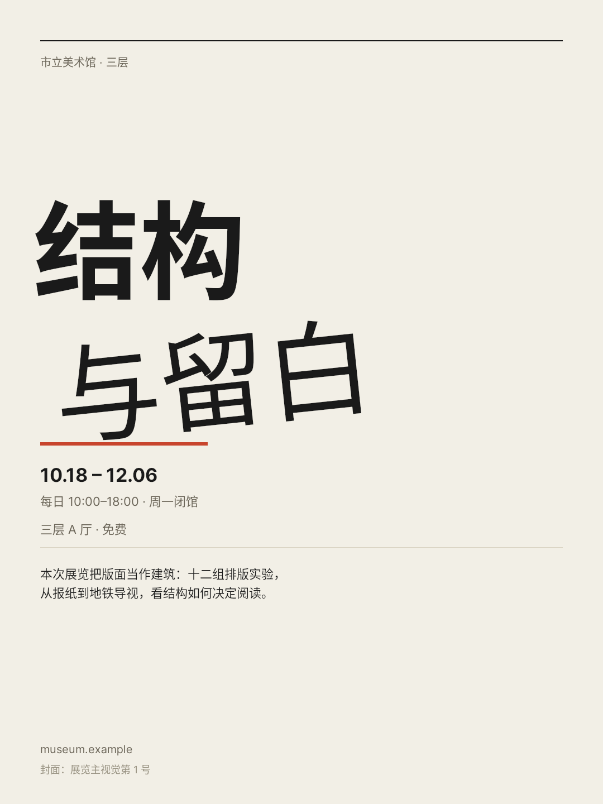
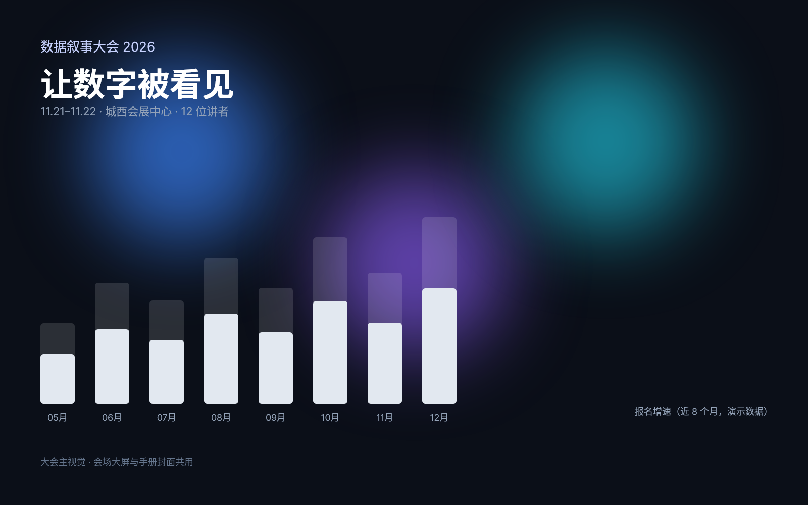
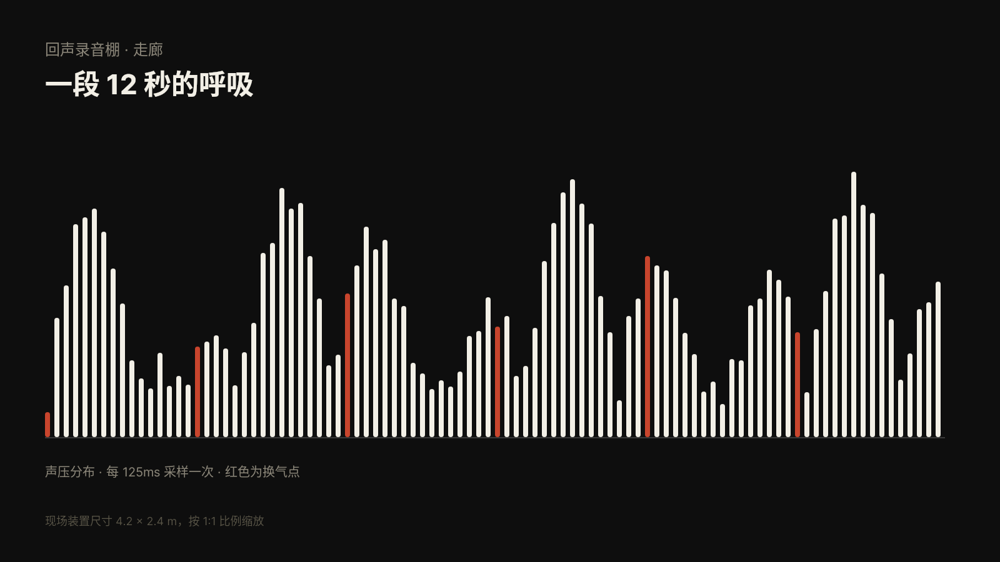
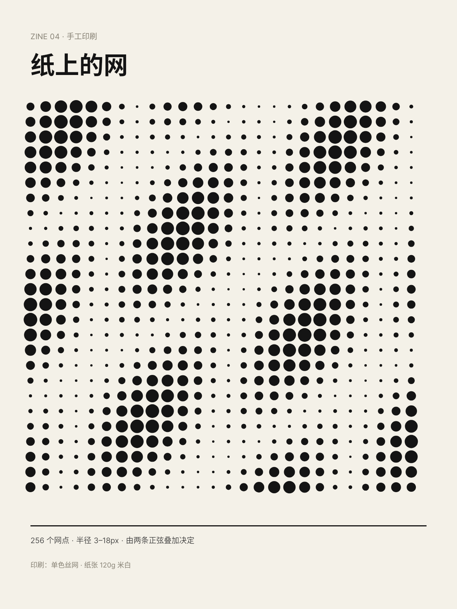
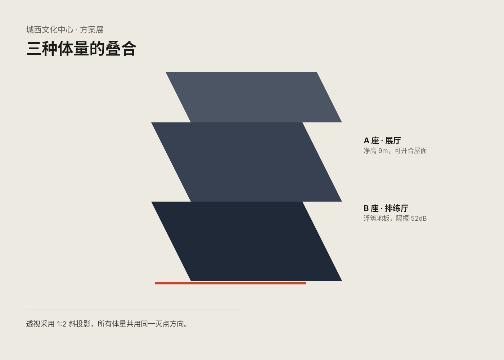
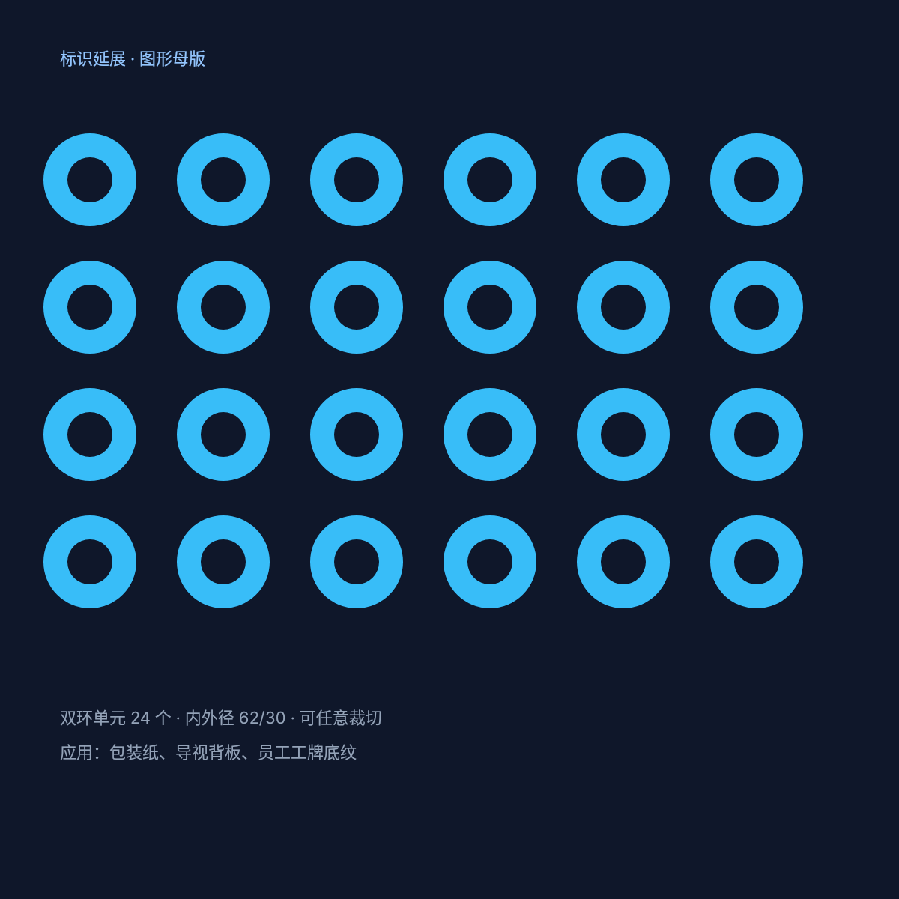
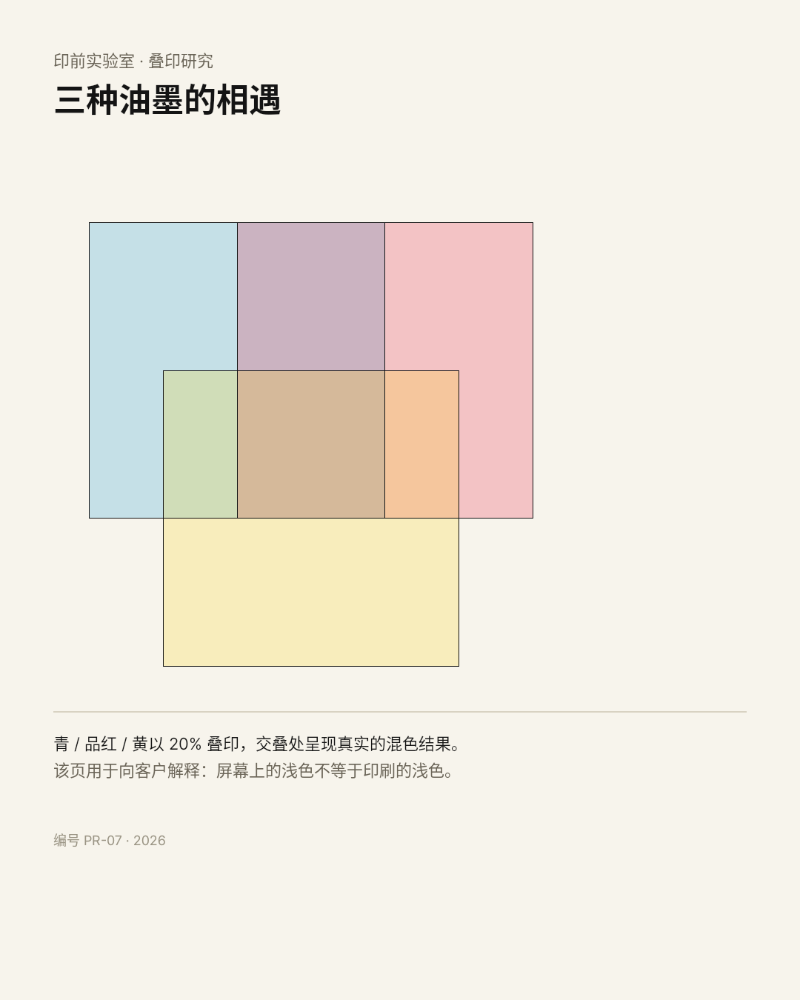
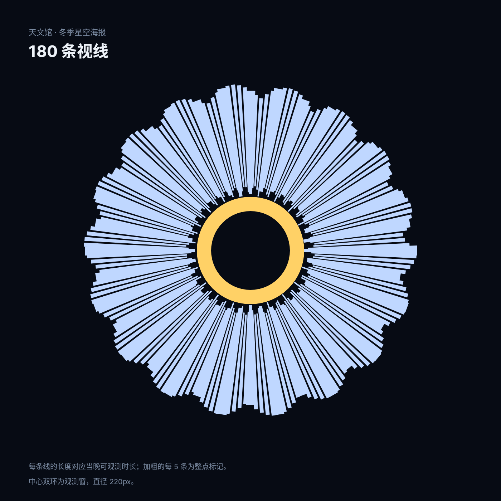
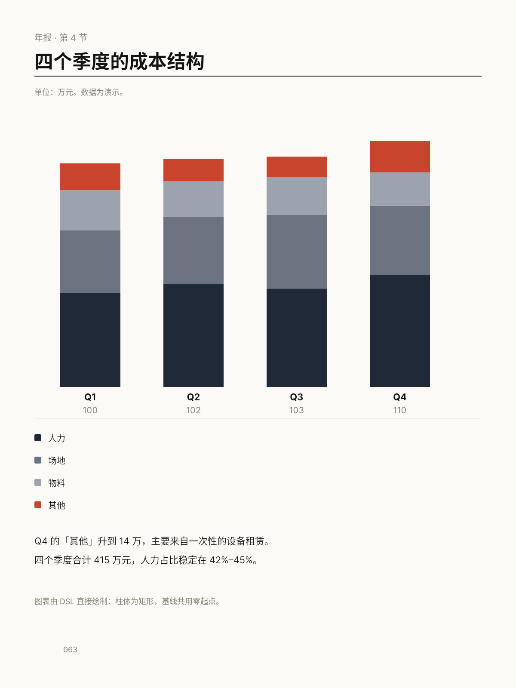

# B03 画廊

共 10 件，按手法排列。

## 唱片封套 · 同心环 · ClipPath 多子路径 + EVEN_ODD

[原 PNG](case-01/final.png) · [DSL](case-01/final.snapshot) · [case.md](case-01/case.md)

## 展览海报 · 旋转标题 · Transform 旋转 + 文字层级

[原 PNG](case-02/final.png) · [DSL](case-02/final.snapshot) · [case.md](case-02/case.md)

## 大会主视觉 · 模糊光斑 · ImageFiltered + SizedBox 包裹

[原 PNG](case-03/final.png) · [DSL](case-03/final.snapshot) · [case.md](case-03/case.md)

## 录音棚墙面 · 声波 · 程序化几何（正弦叠加）

[原 PNG](case-04/final.png) · [DSL](case-04/final.snapshot) · [case.md](case-04/case.md)

## 独立杂志封面 · 半调 · 单路径 676 个圆的半调

[原 PNG](case-05/final.png) · [DSL](case-05/final.snapshot) · [case.md](case-05/case.md)

## 建筑展板 · 斜投影 · Transform 斜切矩阵

[原 PNG](case-06/final.png) · [DSL](case-06/final.snapshot) · [case.md](case-06/case.md)

## 品牌母版 · 镂空双环 · EVEN_ODD 挖空 + 重复单元

[原 PNG](case-07/final.png) · [DSL](case-07/final.snapshot) · [case.md](case-07/case.md)

## 印前研究 · 叠印 · 8 位 alpha 叠色

[原 PNG](case-08/final.png) · [DSL](case-08/final.snapshot) · [case.md](case-08/case.md)

## 天文馆海报 · 放射 · 单路径 180 个四边形

[原 PNG](case-09/final.png) · [DSL](case-09/final.snapshot) · [case.md](case-09/case.md)

## 年报内页 · 堆叠柱 · 真实数据 + 共用零起点

[原 PNG](case-10/final.png) · [DSL](case-10/final.snapshot) · [case.md](case-10/case.md)

