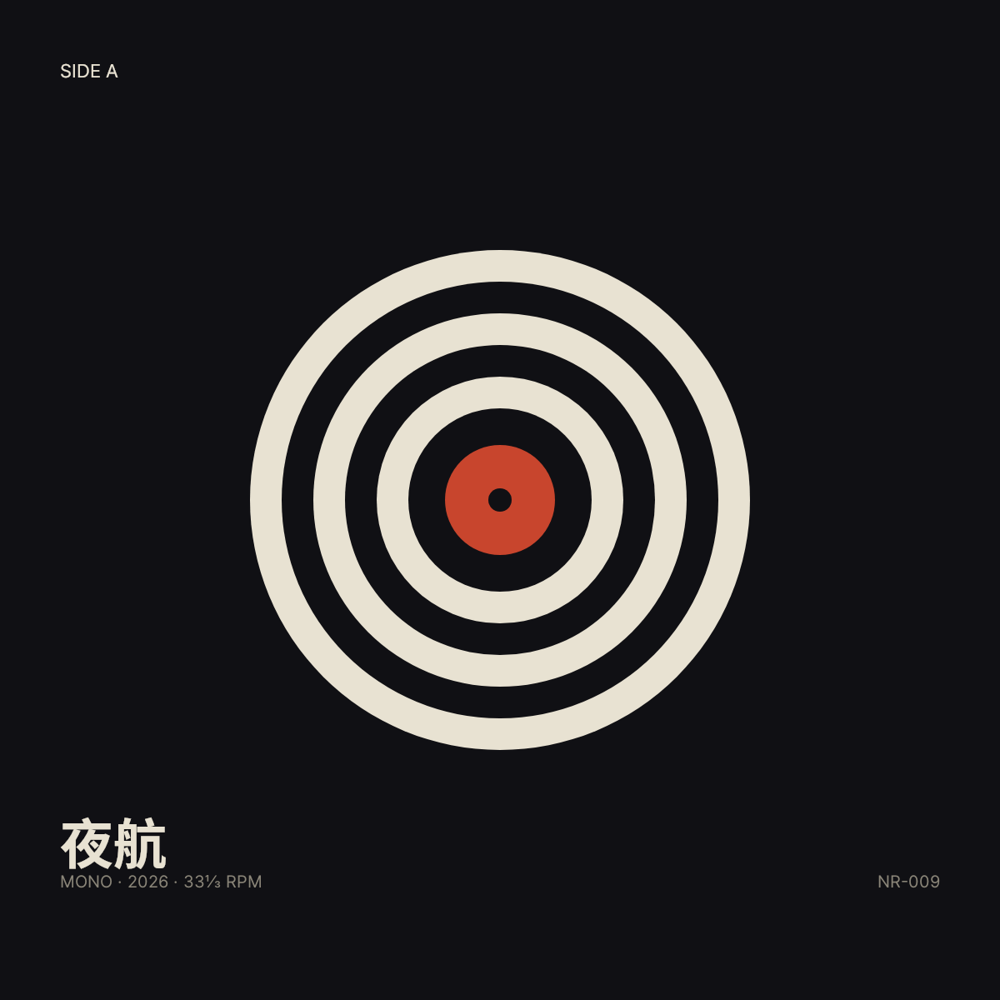
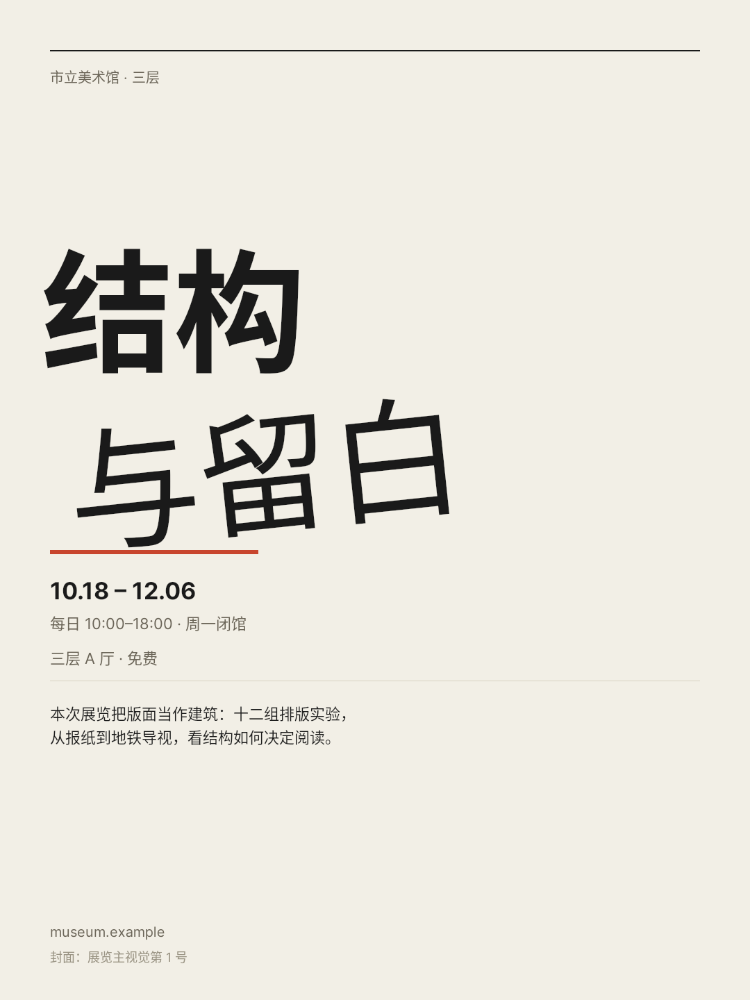
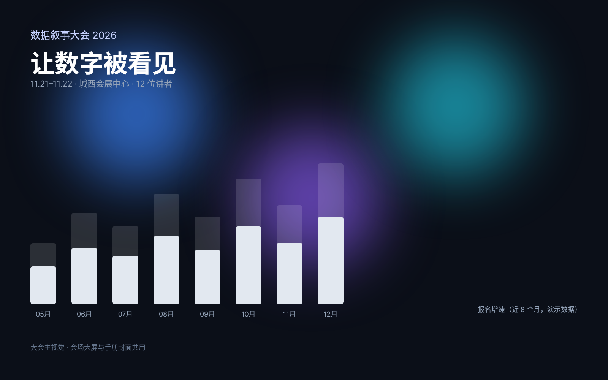
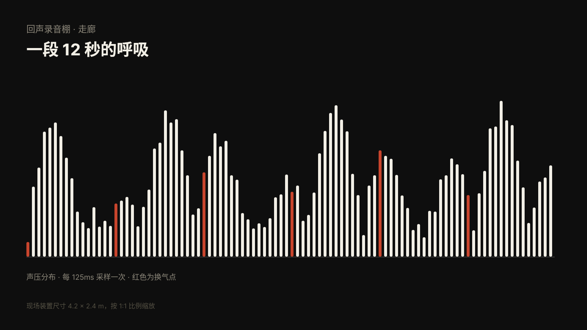
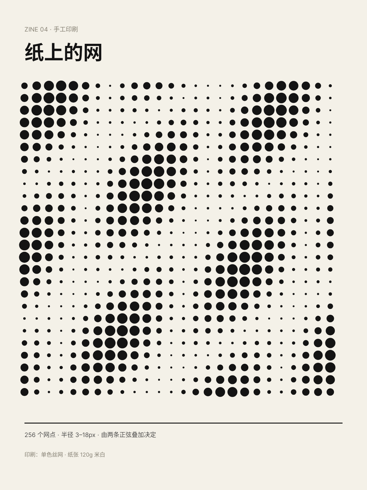
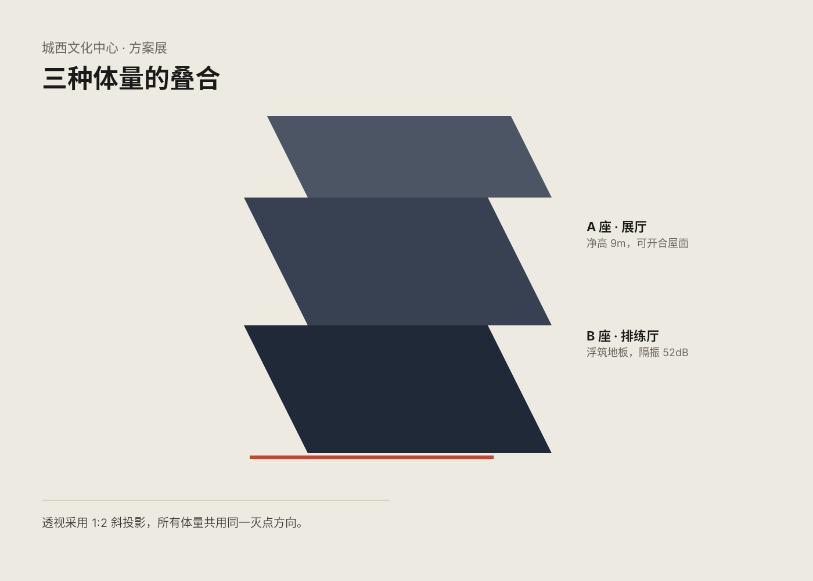
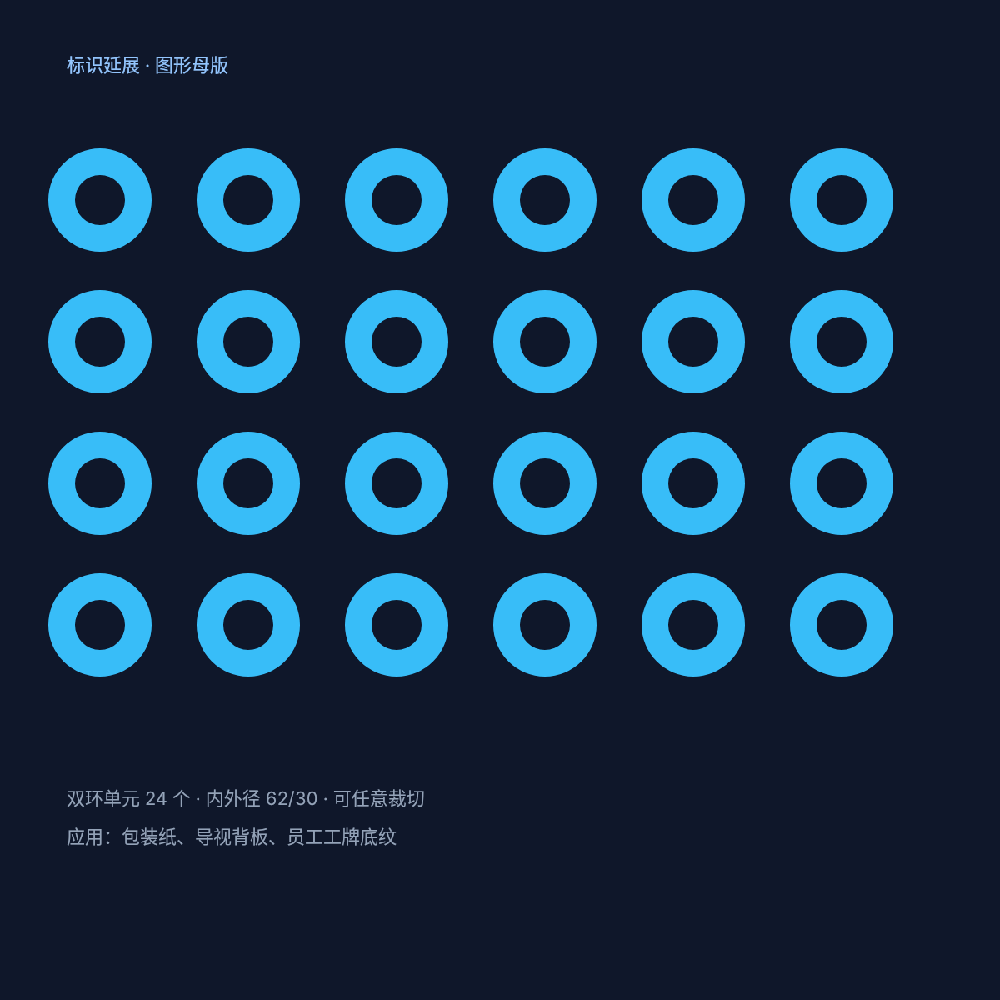
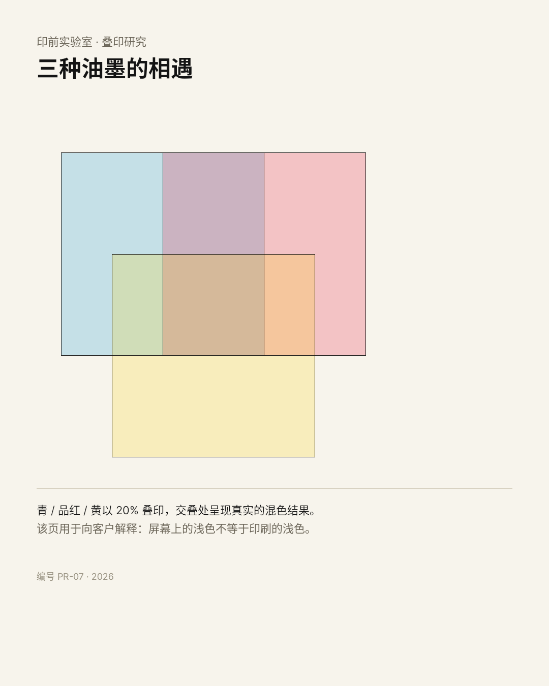
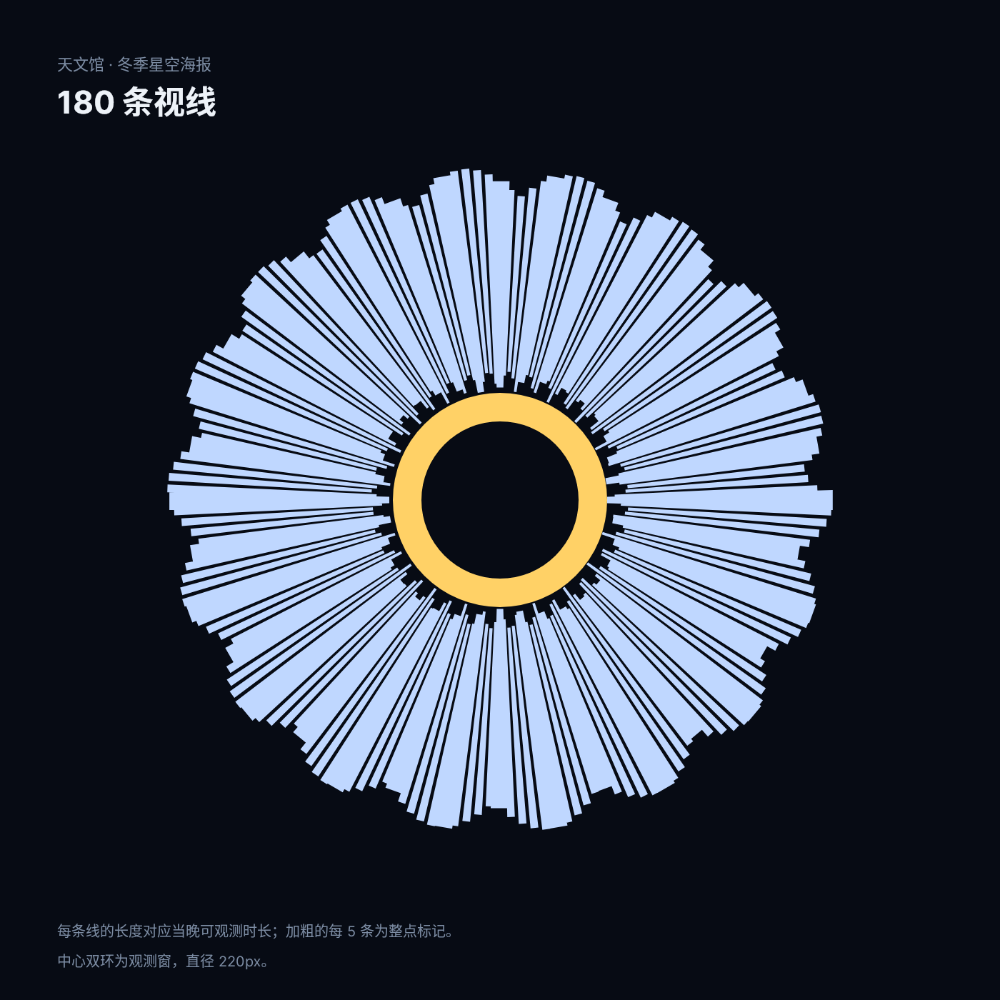
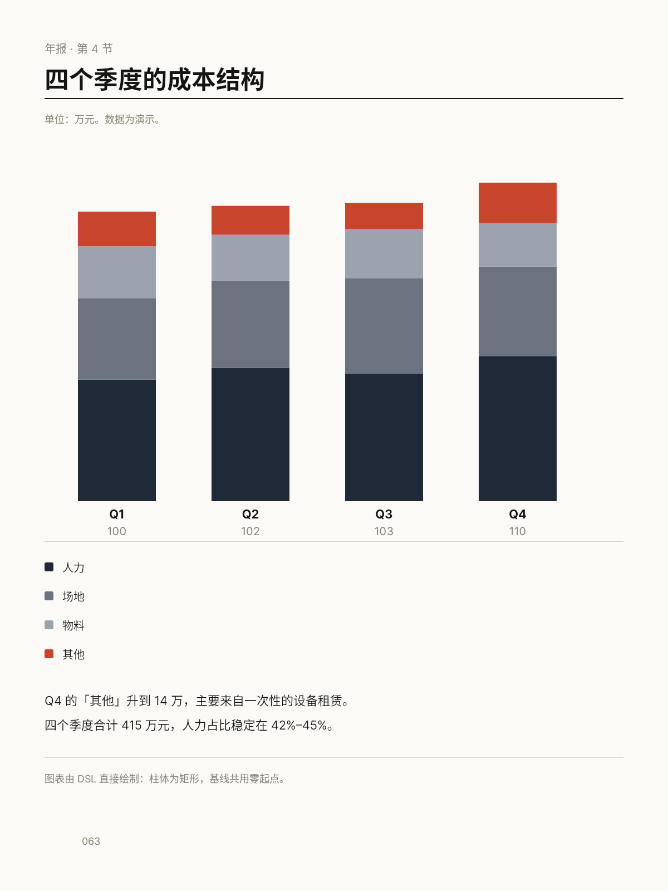

# B03 作品集 · DSL 的创意边界

十件作品，每件用一种或一组手法解决一个真实场景的问题。手法说明见 technique-notes.md。

## 01 唱片封套 · 同心环

- 手法：ClipPath 多子路径 + EVEN_ODD
- 场景：唱片发行：封面需要在流媒体小图与 12 寸印刷品上都成立
- 尺寸：1200×1200

[原 PNG](case-01/final.png) · [DSL](case-01/final.snapshot) · [case.md](case-01/case.md)

## 02 展览海报 · 旋转标题

- 手法：Transform 旋转 + 文字层级
- 场景：美术馆展览：主视觉要让标题本身成为版式
- 尺寸：1080×1440

[原 PNG](case-02/final.png) · [DSL](case-02/final.snapshot) · [case.md](case-02/case.md)

## 03 大会主视觉 · 模糊光斑

- 手法：ImageFiltered + SizedBox 包裹
- 场景：行业大会：会场大屏与手册封面共用一张主视觉
- 尺寸：1600×1000

[原 PNG](case-03/final.png) · [DSL](case-03/final.snapshot) · [case.md](case-03/case.md)

## 04 录音棚墙面 · 声波

- 手法：程序化几何（正弦叠加）
- 场景：录音棚走廊装置：把一段录音变成可施工的图形
- 尺寸：1600×900

[原 PNG](case-04/final.png) · [DSL](case-04/final.snapshot) · [case.md](case-04/case.md)

## 05 独立杂志封面 · 半调

- 手法：单路径 676 个圆的半调
- 场景：独立杂志：单色丝网印刷的封面
- 尺寸：1200×1600

[原 PNG](case-05/final.png) · [DSL](case-05/final.snapshot) · [case.md](case-05/case.md)

## 06 建筑展板 · 斜投影

- 手法：Transform 斜切矩阵
- 场景：建筑设计展：用二维图形表达三个叠合体量
- 尺寸：1400×1000

[原 PNG](case-06/final.png) · [DSL](case-06/final.snapshot) · [case.md](case-06/case.md)

## 07 品牌母版 · 镂空双环

- 手法：EVEN_ODD 挖空 + 重复单元
- 场景：品牌延展：可任意裁切的图形母版
- 尺寸：1200×1200

[原 PNG](case-07/final.png) · [DSL](case-07/final.snapshot) · [case.md](case-07/case.md)

## 08 印前研究 · 叠印

- 手法：8 位 alpha 叠色
- 场景：印前实验室：向客户解释屏幕色与印刷色的差别
- 尺寸：1080×1350

[原 PNG](case-08/final.png) · [DSL](case-08/final.snapshot) · [case.md](case-08/case.md)

## 09 天文馆海报 · 放射

- 手法：单路径 180 个四边形
- 场景：天文馆冬季星空海报
- 尺寸：1400×1400

[原 PNG](case-09/final.png) · [DSL](case-09/final.snapshot) · [case.md](case-09/case.md)

## 10 年报内页 · 堆叠柱

- 手法：真实数据 + 共用零起点
- 场景：年报第 4 节：四季度成本结构
- 尺寸：1200×1600

[原 PNG](case-10/final.png) · [DSL](case-10/final.snapshot) · [case.md](case-10/case.md)

