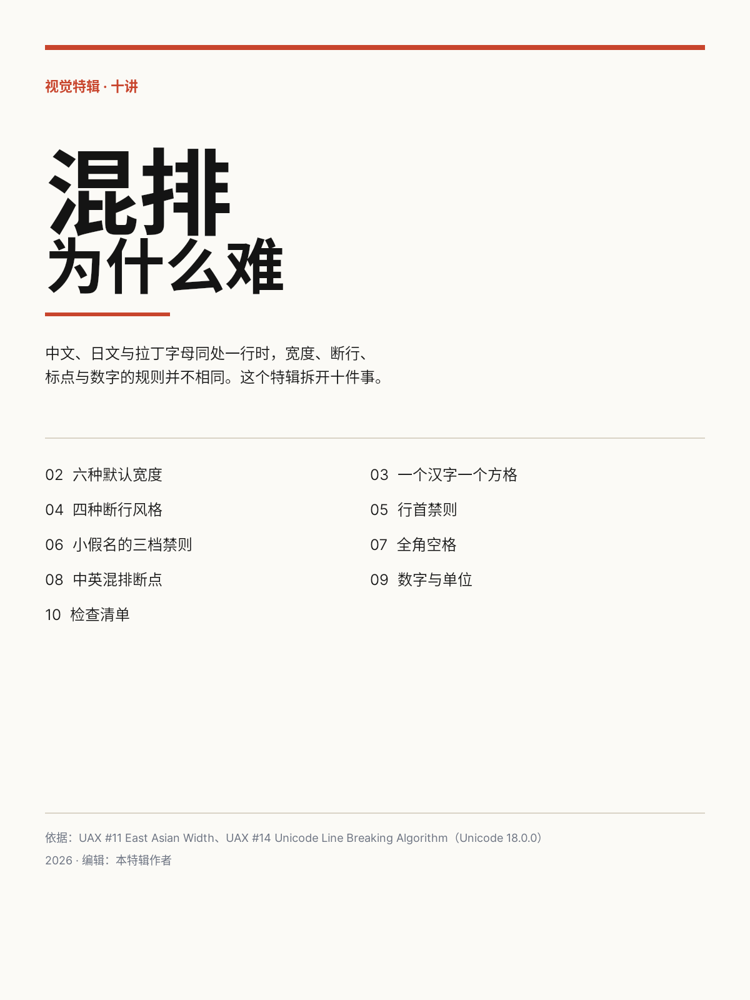
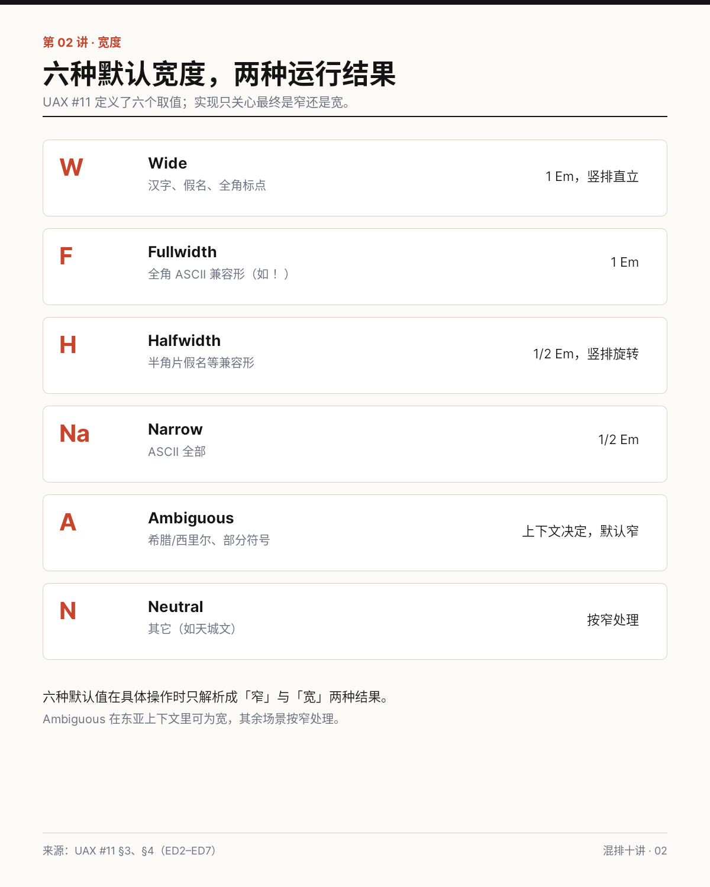
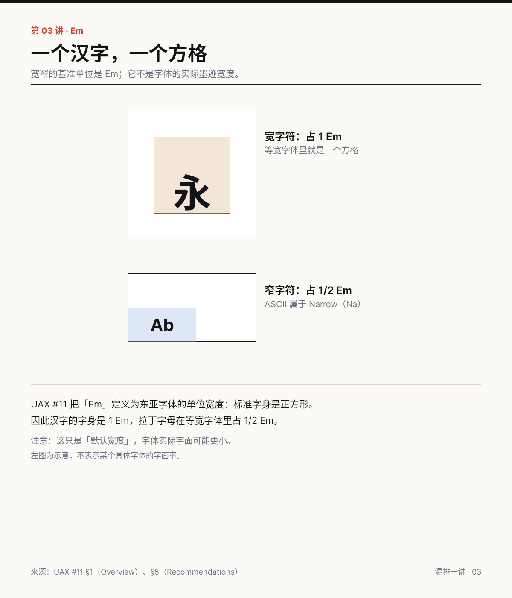
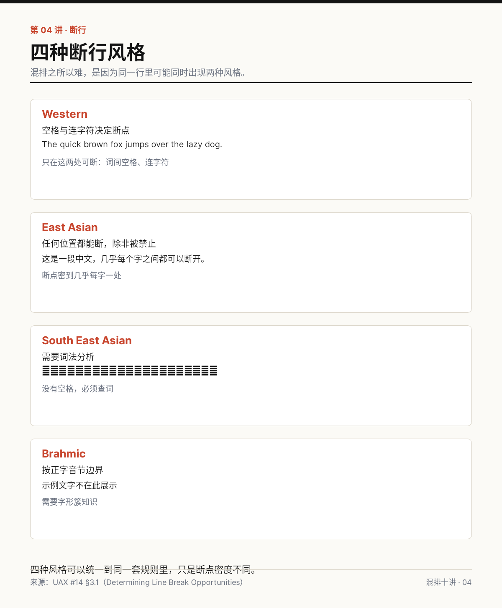
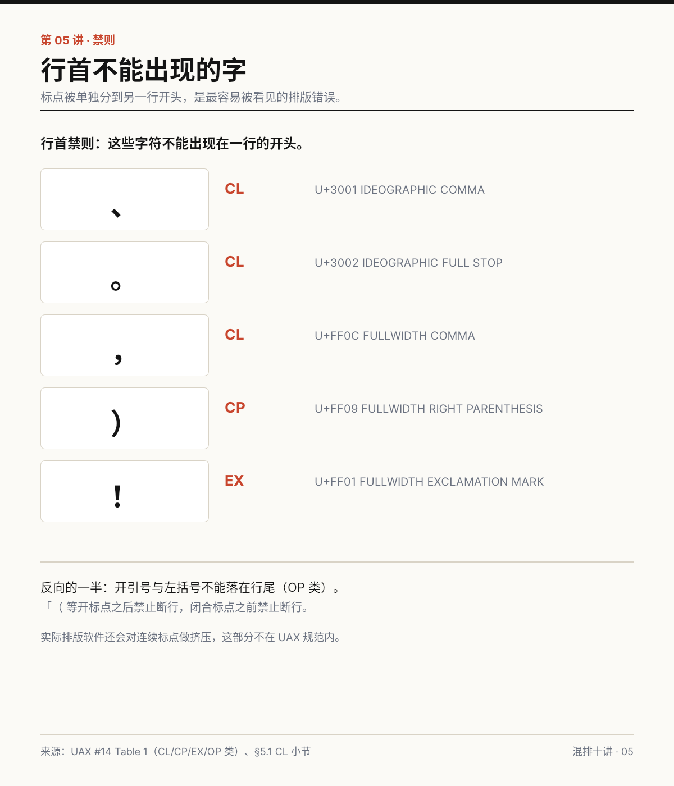
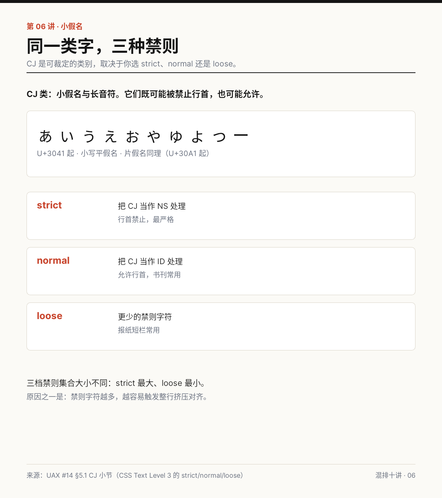
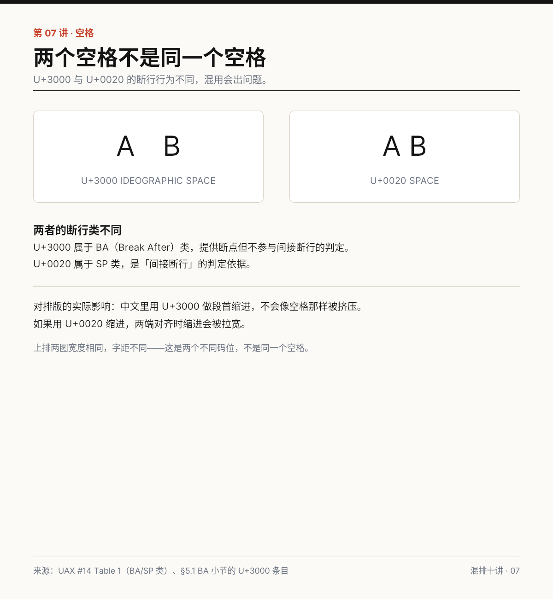
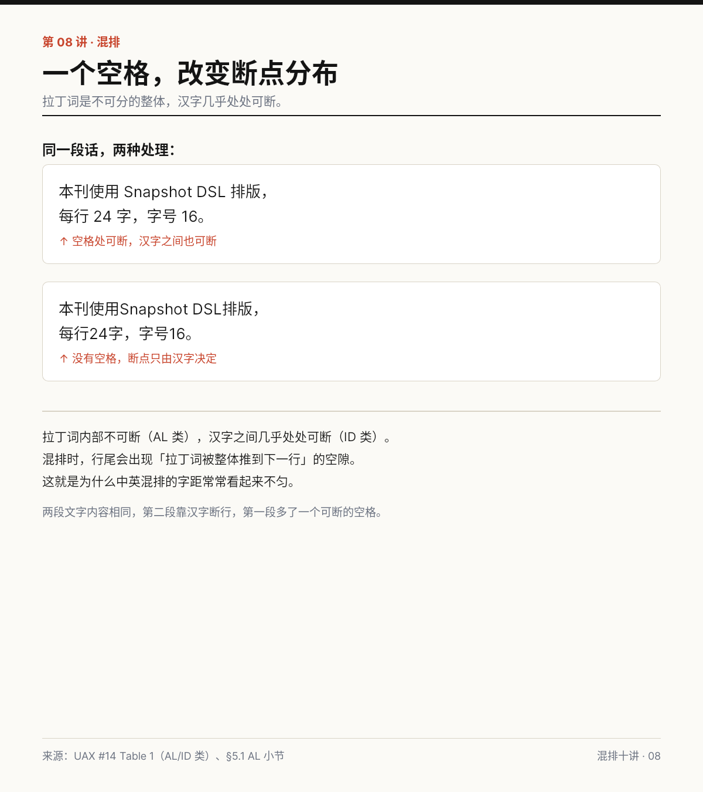
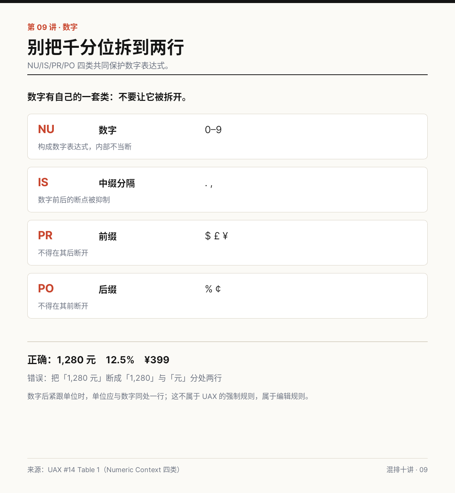
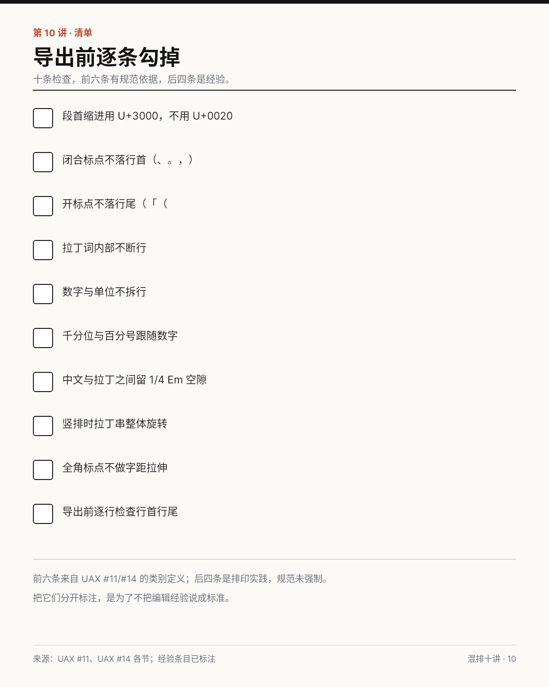

# B04 画廊

共 10 件，按讲次排列。

## 封面：混排为什么难

[原 PNG](case-01/final.png) · [DSL](case-01/final.snapshot) · [case.md](case-01/case.md)

## 六种默认宽度，两种运行结果

[原 PNG](case-02/final.png) · [DSL](case-02/final.snapshot) · [case.md](case-02/case.md)

## 一个汉字，一个方格

[原 PNG](case-03/final.png) · [DSL](case-03/final.snapshot) · [case.md](case-03/case.md)

## 四种断行风格

[原 PNG](case-04/final.png) · [DSL](case-04/final.snapshot) · [case.md](case-04/case.md)

## 行首不能出现的字

[原 PNG](case-05/final.png) · [DSL](case-05/final.snapshot) · [case.md](case-05/case.md)

## 同一类字，三种禁则

[原 PNG](case-06/final.png) · [DSL](case-06/final.snapshot) · [case.md](case-06/case.md)

## 两个空格不是同一个空格

[原 PNG](case-07/final.png) · [DSL](case-07/final.snapshot) · [case.md](case-07/case.md)

## 一个空格，改变断点分布

[原 PNG](case-08/final.png) · [DSL](case-08/final.snapshot) · [case.md](case-08/case.md)

## 别把千分位拆到两行

[原 PNG](case-09/final.png) · [DSL](case-09/final.snapshot) · [case.md](case-09/case.md)

## 导出前逐条勾掉

[原 PNG](case-10/final.png) · [DSL](case-10/final.snapshot) · [case.md](case-10/case.md)

