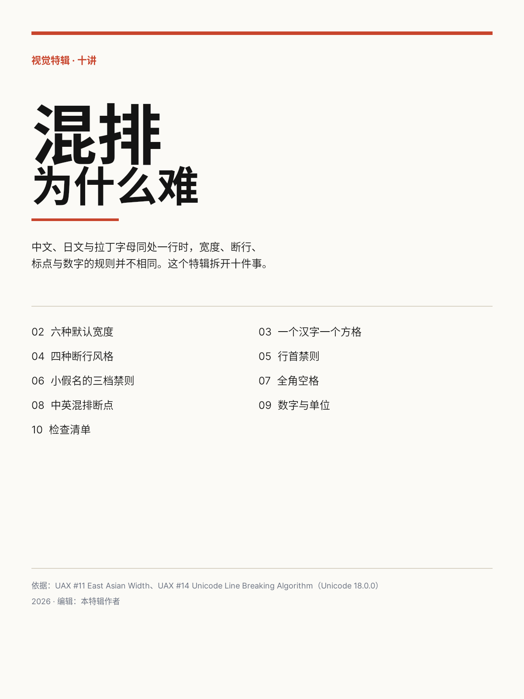
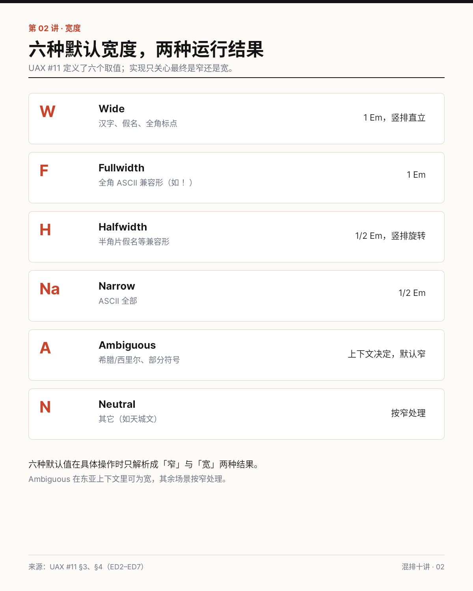
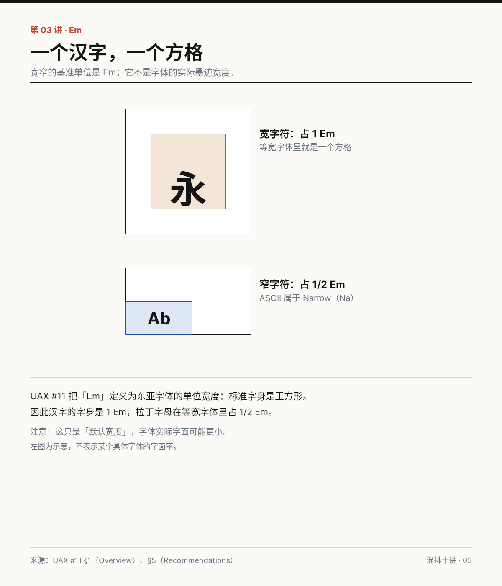
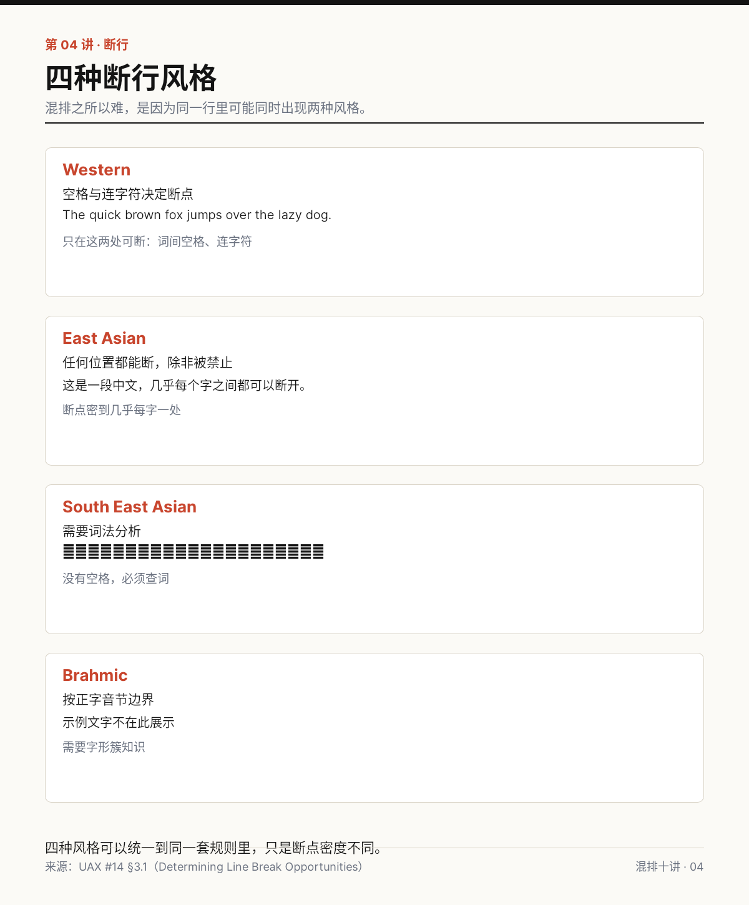
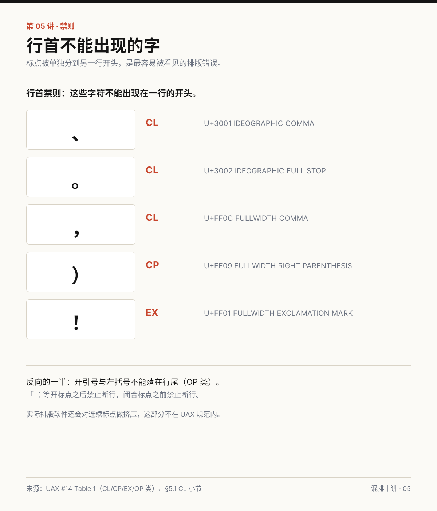
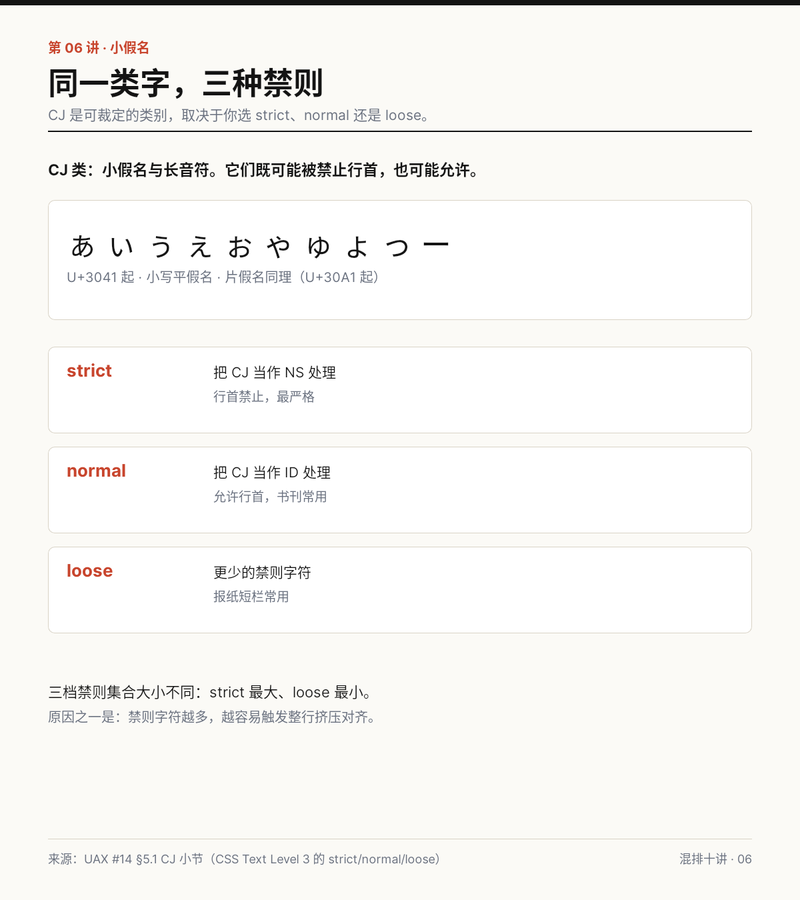
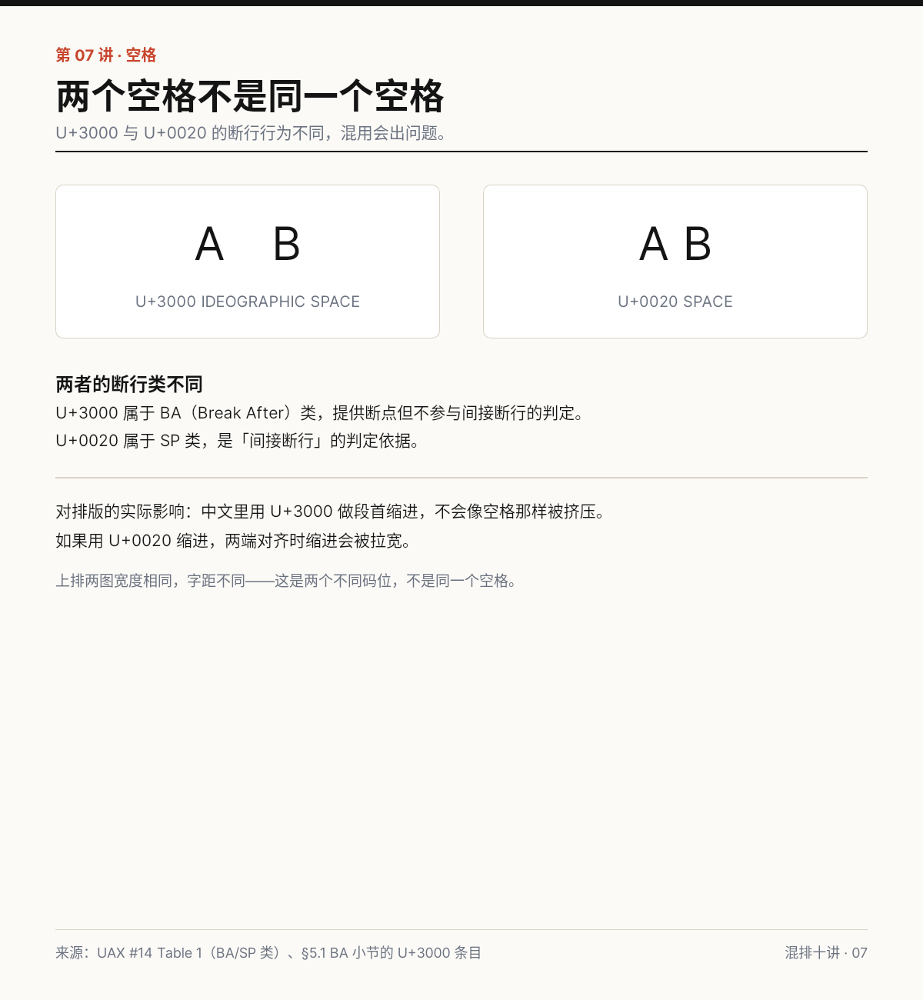
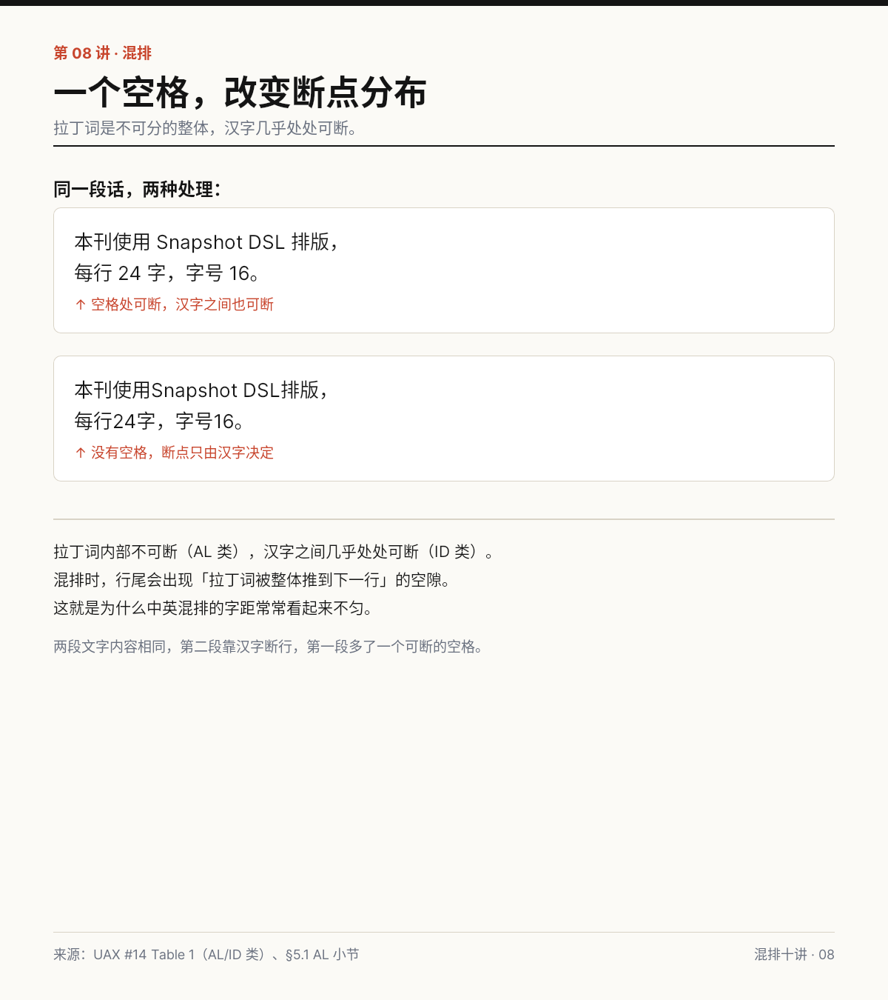
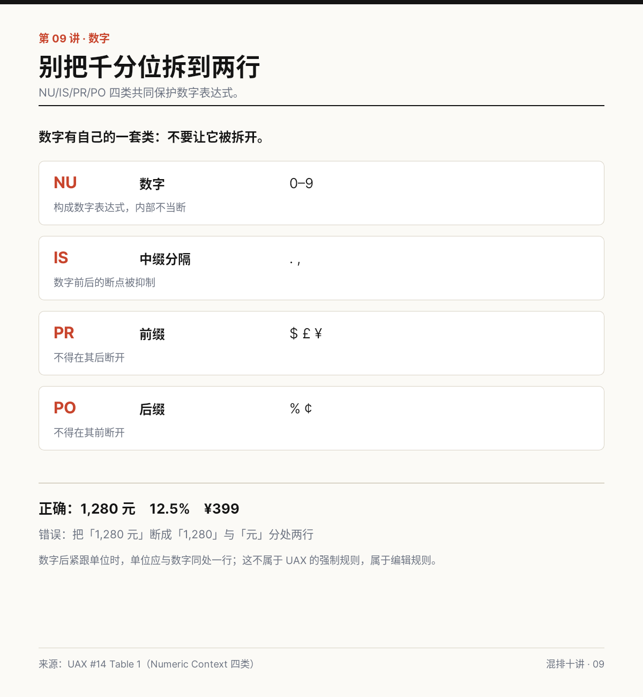
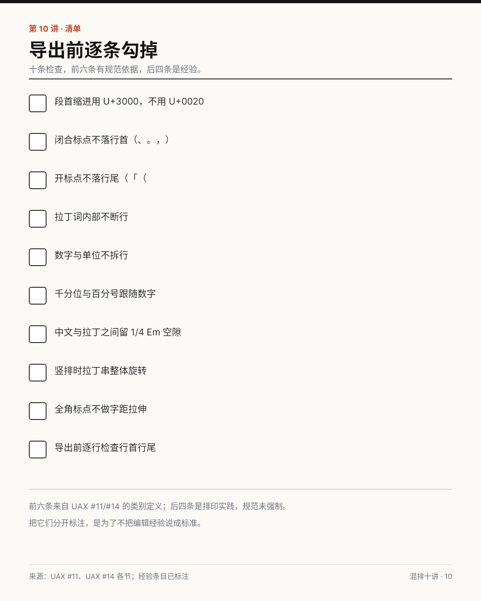

# B04 视觉特辑 · 混排为什么难

十件作品，依据 UAX #11 与 UAX #14（Unicode 18.0.0）。事实与判断的分界见 sources.json 与 editorial-note.md。

## case-01 封面：混排为什么难

- 类型：cover　尺寸：1200×1600
- 解决：用一页交代主题与十个讲次
- 设计：标题压到最大，目录用两栏编号

[原 PNG](case-01/final.png) · [DSL](case-01/final.snapshot) · [case.md](case-01/case.md)

## case-02 六种默认宽度，两种运行结果

- 类型：chart　尺寸：1200×1500
- 解决：六种默认值一次看清
- 设计：六行等高卡片，左侧大字母、右侧宽度结论

[原 PNG](case-02/final.png) · [DSL](case-02/final.snapshot) · [case.md](case-02/case.md)

## case-03 一个汉字，一个方格

- 类型：diagram　尺寸：1200×1400
- 解决：说明宽窄的基准单位
- 设计：两个方格并置，1 Em 与 1/2 Em 对比

[原 PNG](case-03/final.png) · [DSL](case-03/final.snapshot) · [case.md](case-03/case.md)

## case-04 四种断行风格

- 类型：chart　尺寸：1200×1450
- 解决：四种风格并置
- 设计：四栏等高卡片，每栏一句规则 + 一句示例

[原 PNG](case-04/final.png) · [DSL](case-04/final.snapshot) · [case.md](case-04/case.md)

## case-05 行首不能出现的字

- 类型：chart　尺寸：1200×1400
- 解决：五个不能落行首的标点
- 设计：大字字符卡 + 类别 + 码位三列

[原 PNG](case-05/final.png) · [DSL](case-05/final.snapshot) · [case.md](case-05/case.md)

## case-06 同一类字，三种禁则

- 类型：chart　尺寸：1200×1350
- 解决：CJ 类可裁定
- 设计：字符条 + 三档模式卡

[原 PNG](case-06/final.png) · [DSL](case-06/final.snapshot) · [case.md](case-06/case.md)

## case-07 两个空格不是同一个空格

- 类型：diagram　尺寸：1200×1300
- 解决：U+3000 与 U+0020 的区别
- 设计：并排两图 + 类别说明

[原 PNG](case-07/final.png) · [DSL](case-07/final.snapshot) · [case.md](case-07/case.md)

## case-08 一个空格，改变断点分布

- 类型：diagram　尺寸：1200×1350
- 解决：一个空格改变断点分布
- 设计：上下两段同样文字，一段留空格

[原 PNG](case-08/final.png) · [DSL](case-08/final.snapshot) · [case.md](case-08/case.md)

## case-09 别把千分位拆到两行

- 类型：chart　尺寸：1200×1300
- 解决：NU/IS/PR/PO 四类
- 设计：四行类别表 + 正误示例

[原 PNG](case-09/final.png) · [DSL](case-09/final.snapshot) · [case.md](case-09/case.md)

## case-10 导出前逐条勾掉

- 类型：checklist　尺寸：1200×1500
- 解决：导出前逐条核对
- 设计：十条方框清单，末尾区分规范与经验

[原 PNG](case-10/final.png) · [DSL](case-10/final.snapshot) · [case.md](case-10/case.md)

