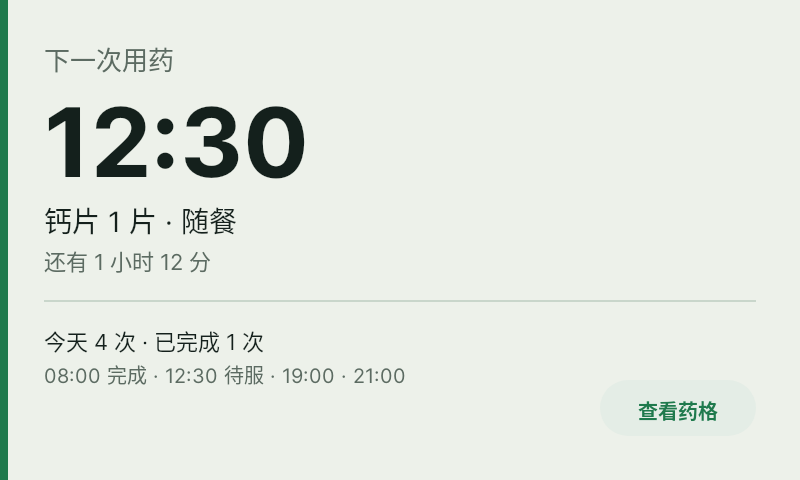
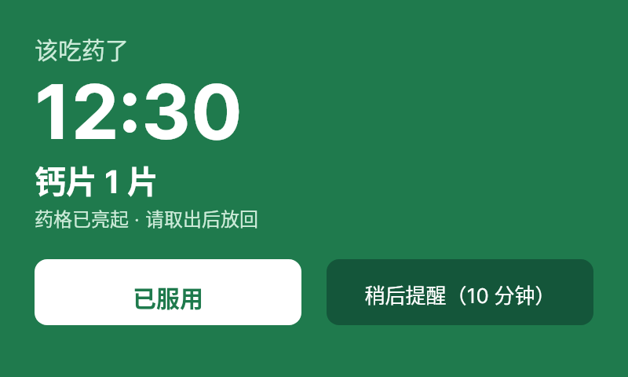
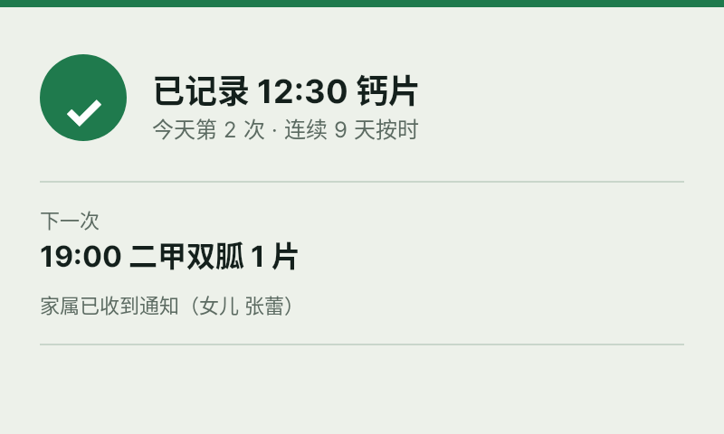
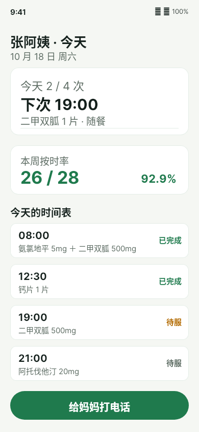
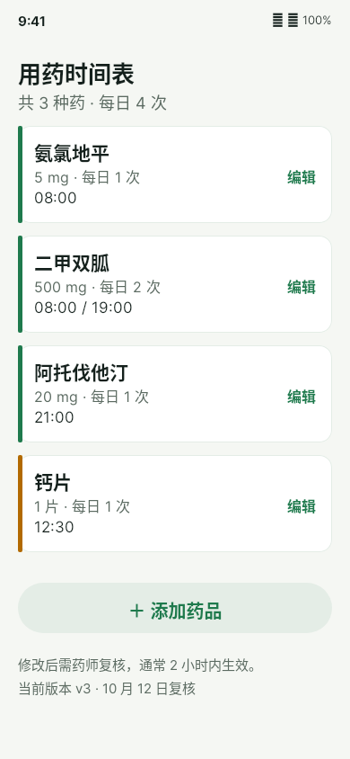
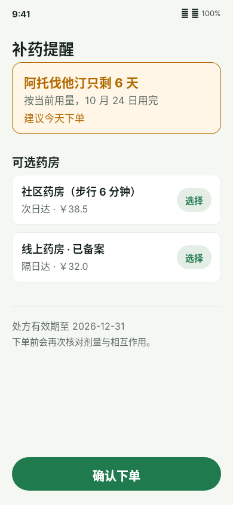
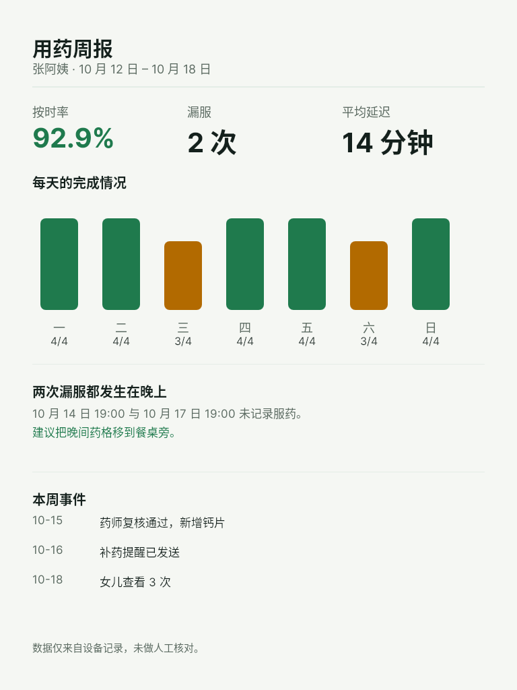
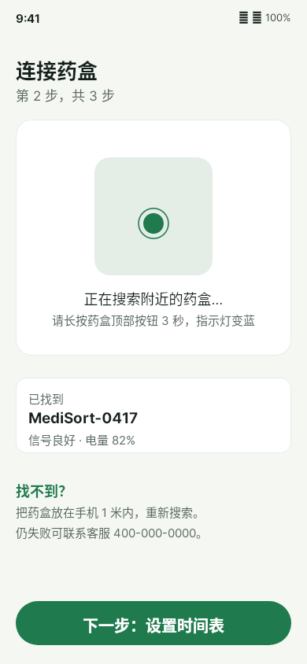
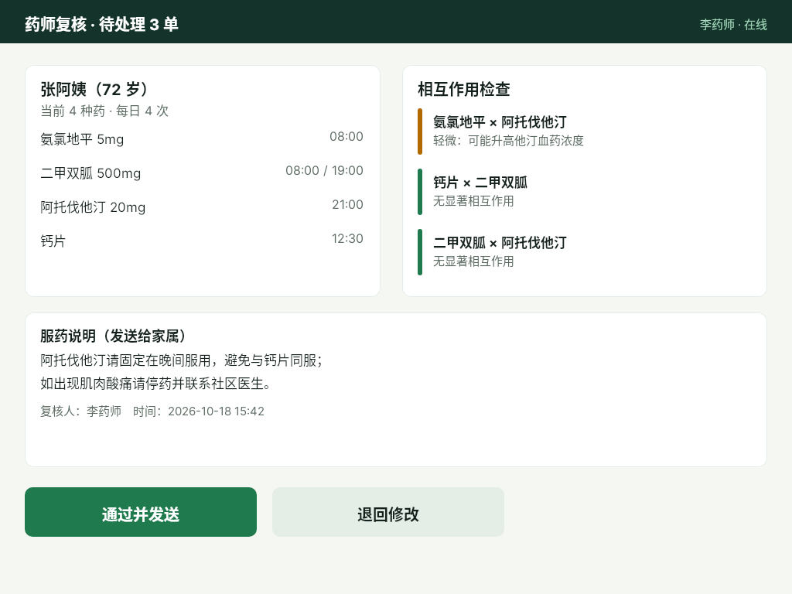
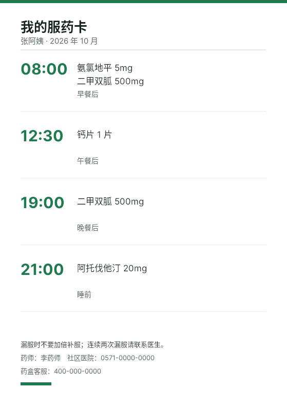

# B05 产品 · MediSort 药盒

一款给独居老人与子女的服药管理产品：实体药盒 + 家属端 + 药师端 + 纸质卡。十张画面覆盖从配对到复盘与兜底的完整过程。

完整旅程见 journey.json，产品取舍见 product-brief.md。

## case-01 药盒待机屏

- 形态：device　场景：客厅　尺寸：800×480
- 要完成：不打扰地告知下一次用药
- 设计：大字时间 + 一行药品 + 进度

[原 PNG](case-01/final.png) · [DSL](case-01/final.snapshot) · [case.md](case-01/case.md)

## case-02 到点提醒

- 形态：device　场景：客厅　尺寸：800×480
- 要完成：到点必须被看见
- 设计：整屏反色 + 只有两个选择

[原 PNG](case-02/final.png) · [DSL](case-02/final.snapshot) · [case.md](case-02/case.md)

## case-03 服药确认

- 形态：device　场景：客厅　尺寸：800×480
- 要完成：完成后立刻给反馈
- 设计：对勾 + 连续天数 + 下一次

[原 PNG](case-03/final.png) · [DSL](case-03/final.snapshot) · [case.md](case-03/case.md)

## case-04 家属端首页

- 形态：app　场景：手机　尺寸：390×844
- 要完成：子女 3 秒内知道今天怎么样
- 设计：两张卡：今天进度 + 本周按时率

[原 PNG](case-04/final.png) · [DSL](case-04/final.snapshot) · [case.md](case-04/case.md)

## case-05 时间表编辑

- 形态：app　场景：手机　尺寸：390×844
- 要完成：改剂量与时间
- 设计：四种药各一行，修改走药师复核

[原 PNG](case-05/final.png) · [DSL](case-05/final.snapshot) · [case.md](case-05/case.md)

## case-06 补药提醒

- 形态：app　场景：手机　尺寸：390×844
- 要完成：在吃完之前下单
- 设计：剩余天数 + 两个药房 + 价格

[原 PNG](case-06/final.png) · [DSL](case-06/final.snapshot) · [case.md](case-06/case.md)

## case-07 用药周报

- 形态：report　场景：平板　尺寸：768×1024
- 要完成：找出漏服规律
- 设计：七天柱状 + 结论句 + 事件流

[原 PNG](case-07/final.png) · [DSL](case-07/final.snapshot) · [case.md](case-07/case.md)

## case-08 设备配对

- 形态：app　场景：手机　尺寸：390×844
- 要完成：第一次连接不出错
- 设计：搜索态 + 已找到设备 + 失败指引

[原 PNG](case-08/final.png) · [DSL](case-08/final.snapshot) · [case.md](case-08/case.md)

## case-09 药师复核

- 形态：pro　场景：桌面　尺寸：1024×768
- 要完成：一次看清药物与风险
- 设计：左药品右相互作用，底部说明与动作

[原 PNG](case-09/final.png) · [DSL](case-09/final.snapshot) · [case.md](case-09/case.md)

## case-10 打印服药卡

- 形态：print　场景：冰箱/随身　尺寸：559×794
- 要完成：没有手机也能查
- 设计：A5 四行时间表 + 应急电话

[原 PNG](case-10/final.png) · [DSL](case-10/final.snapshot) · [case.md](case-10/case.md)

