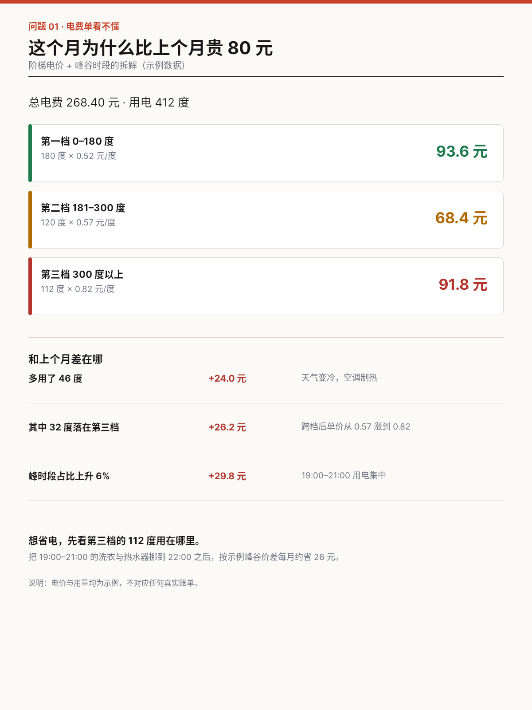
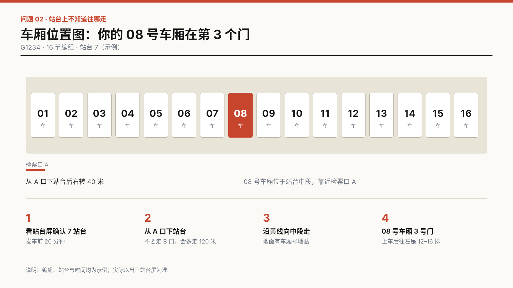
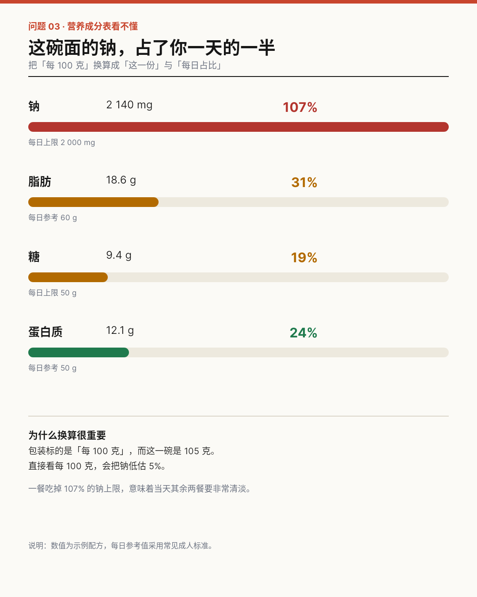
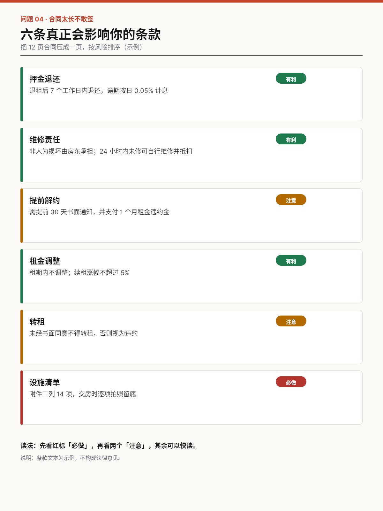
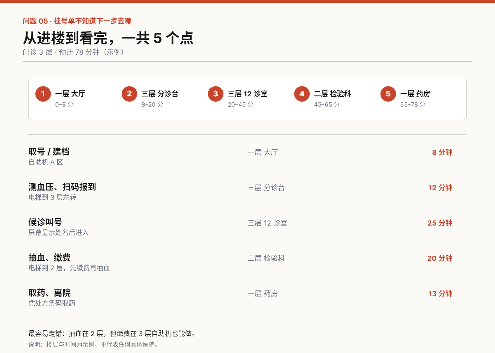
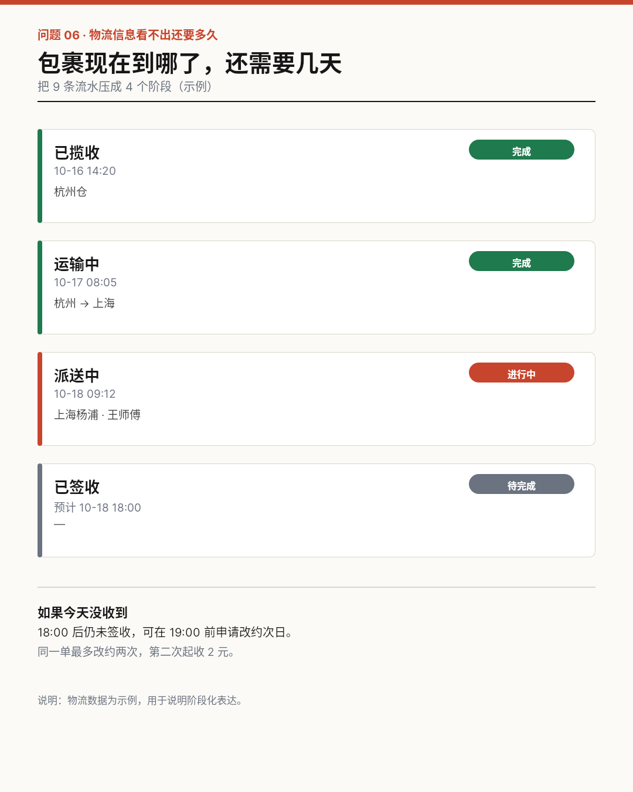
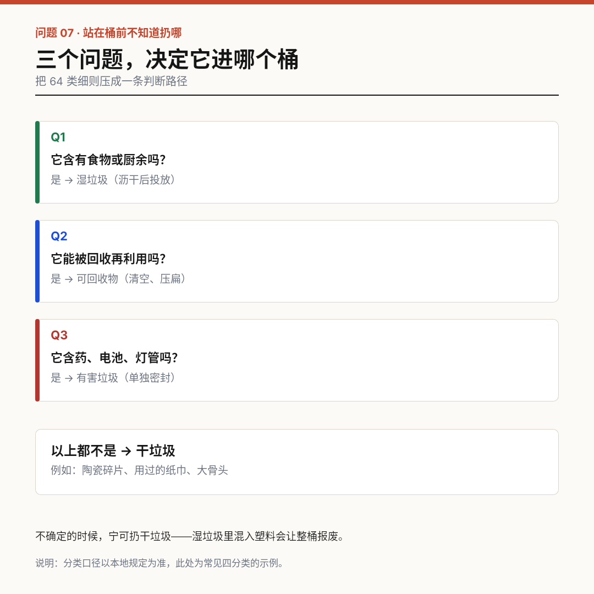
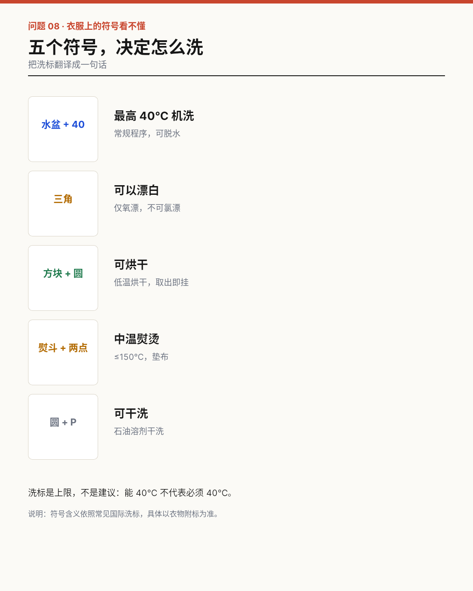
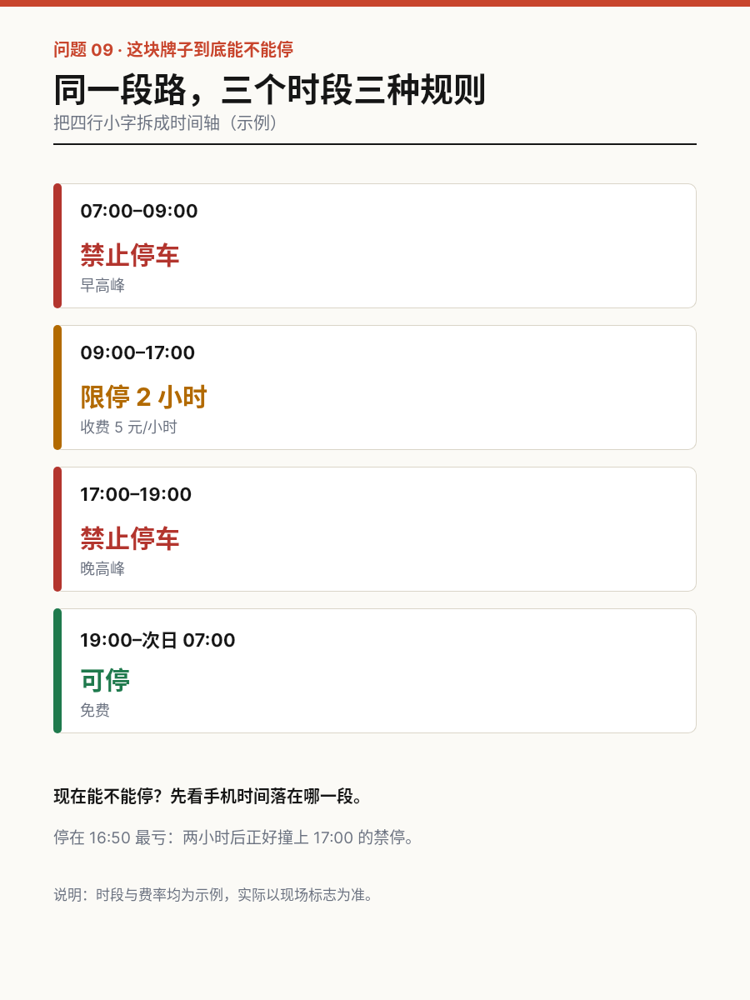
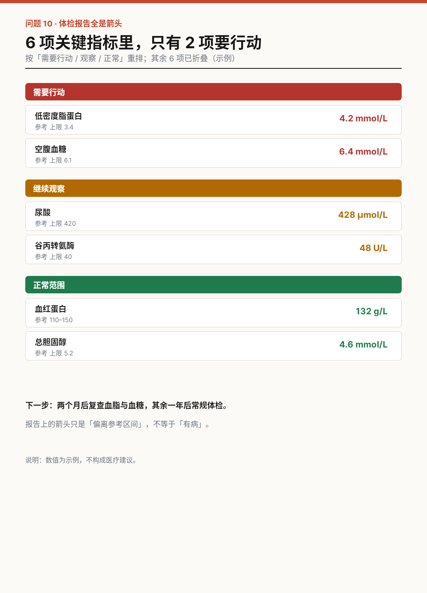

# B06 十个日常信息难题

把难懂、难比较、难决策的日常信息重新组织成能用的东西。每件的数据均为示例，未做用户测试——详见 problem-evidence.json 与 design-review.md。

## case-01 电费单：钱花在哪一档

- 原问题：电费单给出总额与档位，但不解释「为什么比上月贵」
- 重构：三档拆解 + 三条差异
- 尺寸：1200×1600

[原 PNG](case-01/final.png) · [DSL](case-01/final.snapshot) · [case.md](case-01/case.md)

## case-02 站台：我的车厢在哪

- 原问题：站台只标「几号车厢」，乘客不知道往左还是往右走
- 重构：16 格编组条 + 四步走法
- 尺寸：1600×900

[原 PNG](case-02/final.png) · [DSL](case-02/final.snapshot) · [case.md](case-02/case.md)

## case-03 营养表：一份占多少

- 原问题：营养表按「每 100 克」标注，与「这一份」不一致
- 重构：整份换算 + 每日占比条
- 尺寸：1080×1350

[原 PNG](case-03/final.png) · [DSL](case-03/final.snapshot) · [case.md](case-03/case.md)

## case-04 合同：六条关键的

- 原问题：租房合同 12 页，关键条款分散且措辞对等
- 重构：风险三色 + 一句话摘要
- 尺寸：1200×1600

[原 PNG](case-04/final.png) · [DSL](case-04/final.snapshot) · [case.md](case-04/case.md)

## case-05 就诊：下一步去哪

- 原问题：挂号单只写科室，患者不知道先去哪、要多久
- 重构：五节点 + 每段耗时
- 尺寸：1400×1000

[原 PNG](case-05/final.png) · [DSL](case-05/final.snapshot) · [case.md](case-05/case.md)

## case-06 物流：还要几天

- 原问题：物流流水九条，看不出「现在到哪、还要几天」
- 重构：四阶段 + 当前高亮
- 尺寸：1080×1350

[原 PNG](case-06/final.png) · [DSL](case-06/final.snapshot) · [case.md](case-06/case.md)

## case-07 垃圾：扔哪个桶

- 原问题：垃圾分类细则几十条，站在桶前无法即时判断
- 重构：三个是非问题
- 尺寸：1080×1080

[原 PNG](case-07/final.png) · [DSL](case-07/final.snapshot) · [case.md](case-07/case.md)

## case-08 洗标：怎么洗

- 原问题：洗标只有符号，没有文字解释
- 重构：符号配动作词
- 尺寸：1080×1350

[原 PNG](case-08/final.png) · [DSL](case-08/final.snapshot) · [case.md](case-08/case.md)

## case-09 停车牌：现在能停吗

- 原问题：路侧停车牌四行小字，时段规则相互嵌套
- 重构：四段时间轴
- 尺寸：900×1200

[原 PNG](case-09/final.png) · [DSL](case-09/final.snapshot) · [case.md](case-09/case.md)

## case-10 体检：先管哪两项

- 原问题：体检报告用箭头标注偏离，但不区分轻重缓急
- 重构：三组重排 + 复查建议
- 尺寸：1080×1500

[原 PNG](case-10/final.png) · [DSL](case-10/final.snapshot) · [case.md](case-10/case.md)

