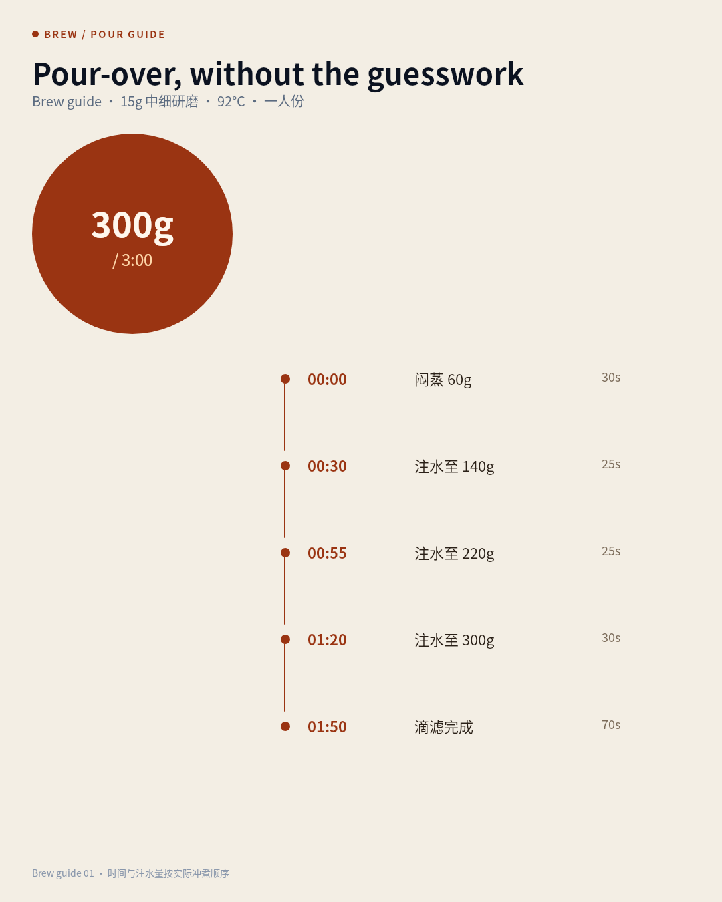
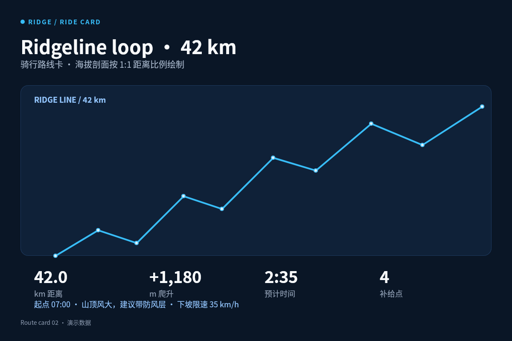
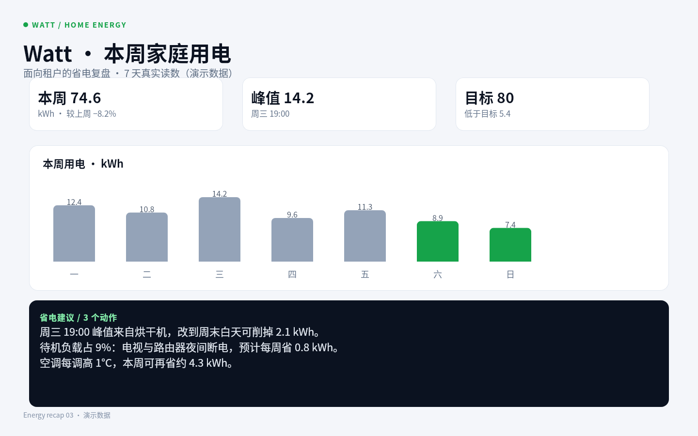
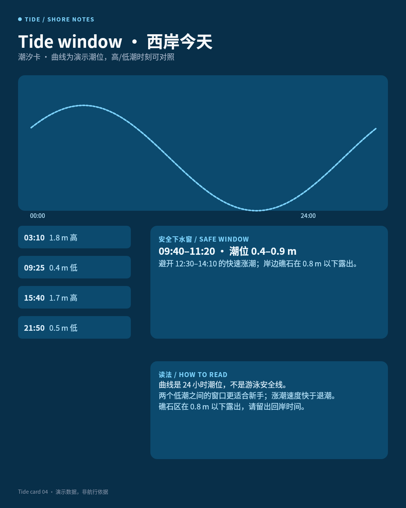
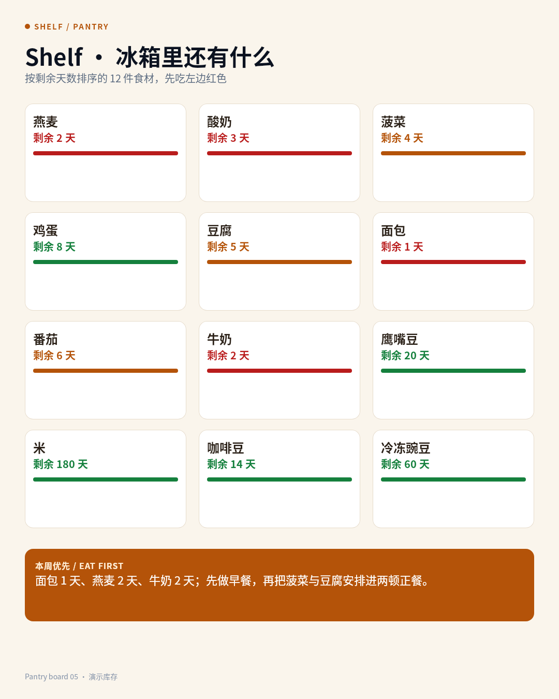
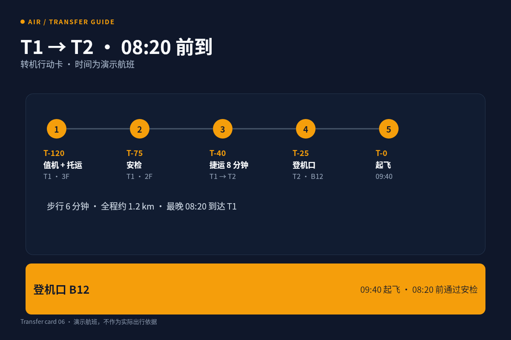
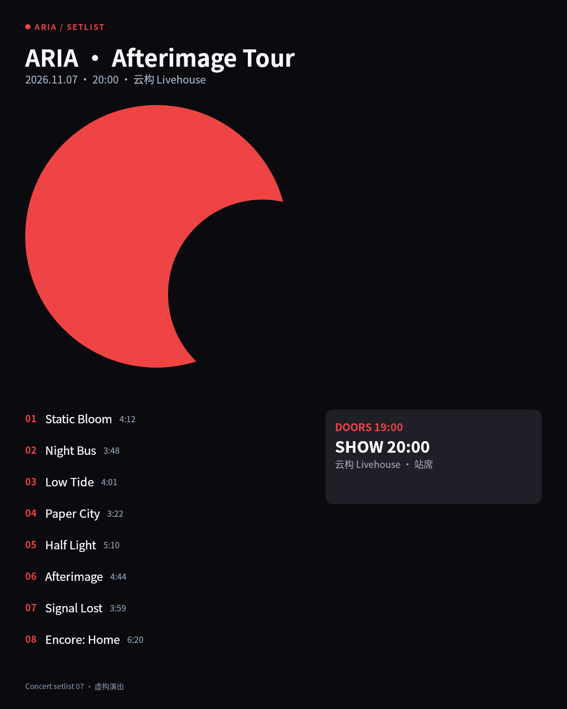
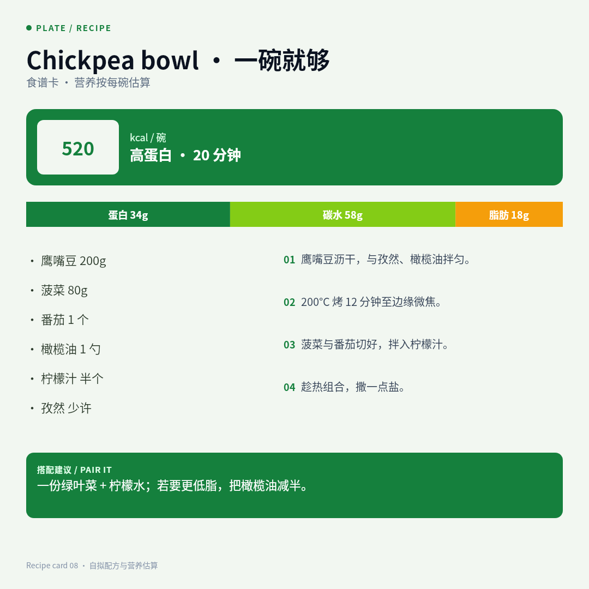
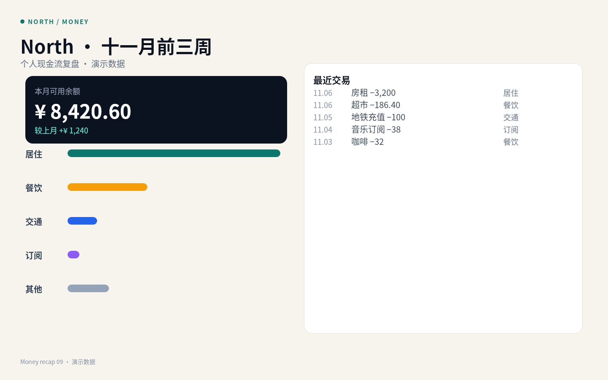
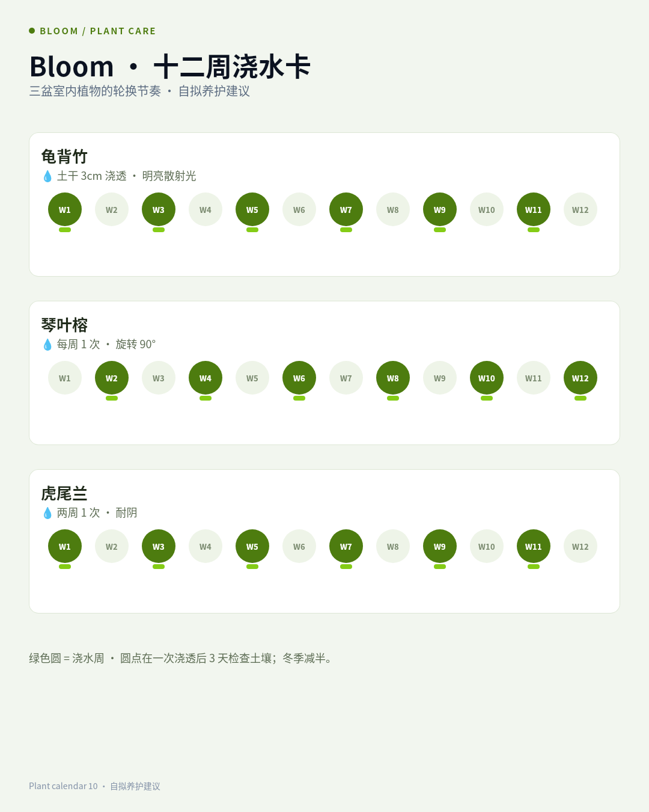

# B01 画廊

十件面向真实日常任务的视觉工具：冲煮、骑行、用电、潮汐、冰箱、转机、演出、食谱、现金流、植物养护。自拟品牌与演示数据，目标是让人在具体场景里少做一次心算、少一次误读；每件采用不同媒介尺寸与信息结构，而非同一海报换色。

## 01 · Brew · 手冲时间线

[原 PNG](case-01/final.png) · [DSL](case-01/final.snapshot)

## 02 · Ridge · 42km 骑行路线卡

[原 PNG](case-02/final.png) · [DSL](case-02/final.snapshot)

## 03 · Watt · 家庭用电周报

[原 PNG](case-03/final.png) · [DSL](case-03/final.snapshot)

## 04 · Tide · 西岸潮汐窗

[原 PNG](case-04/final.png) · [DSL](case-04/final.snapshot)

## 05 · Shelf · 冰箱剩余天数

[原 PNG](case-05/final.png) · [DSL](case-05/final.snapshot)

## 06 · Air · T1→T2 转机卡

[原 PNG](case-06/final.png) · [DSL](case-06/final.snapshot)

## 07 · ARIA · 演出曲目单

[原 PNG](case-07/final.png) · [DSL](case-07/final.snapshot)

## 08 · Plate · 鹰嘴豆碗食谱

[原 PNG](case-08/final.png) · [DSL](case-08/final.snapshot)

## 09 · North · 十一月现金流

[原 PNG](case-09/final.png) · [DSL](case-09/final.snapshot)

## 10 · Bloom · 十二周浇水卡

[原 PNG](case-10/final.png) · [DSL](case-10/final.snapshot)

