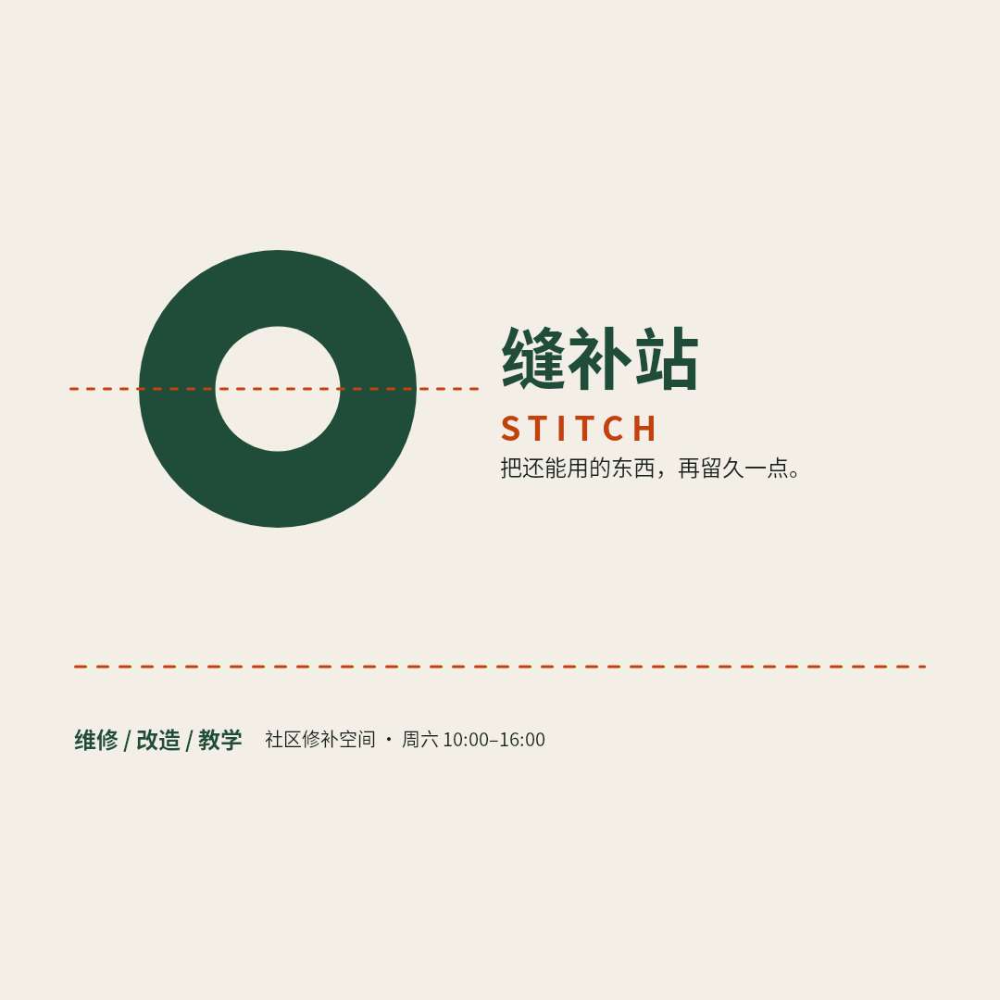
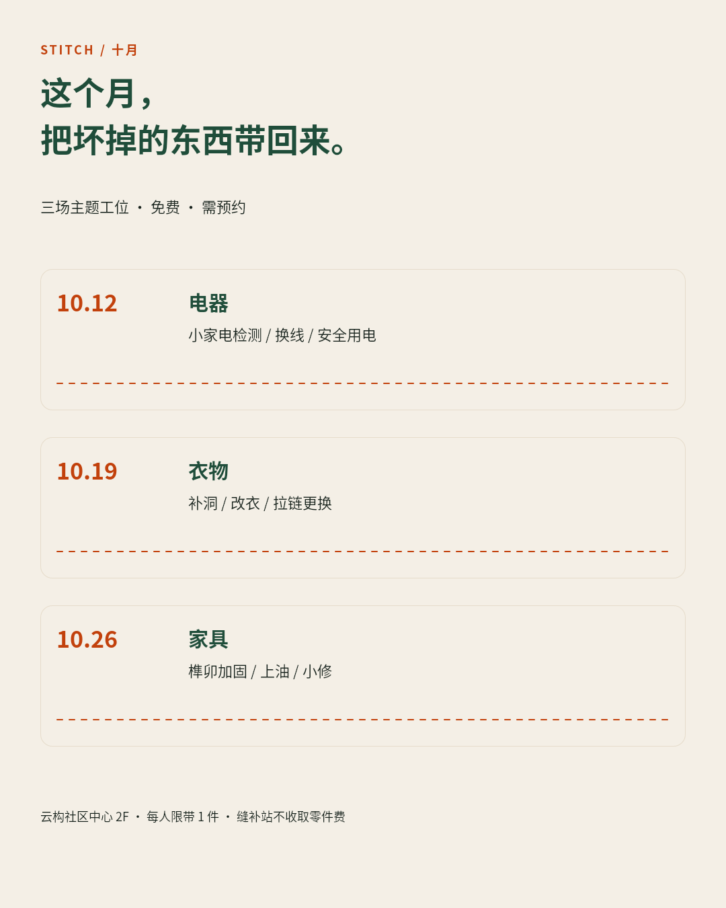
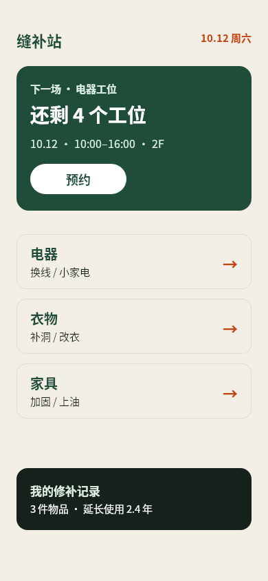
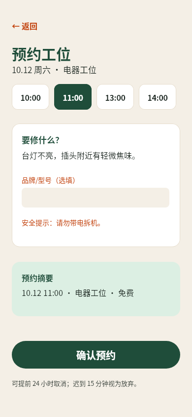
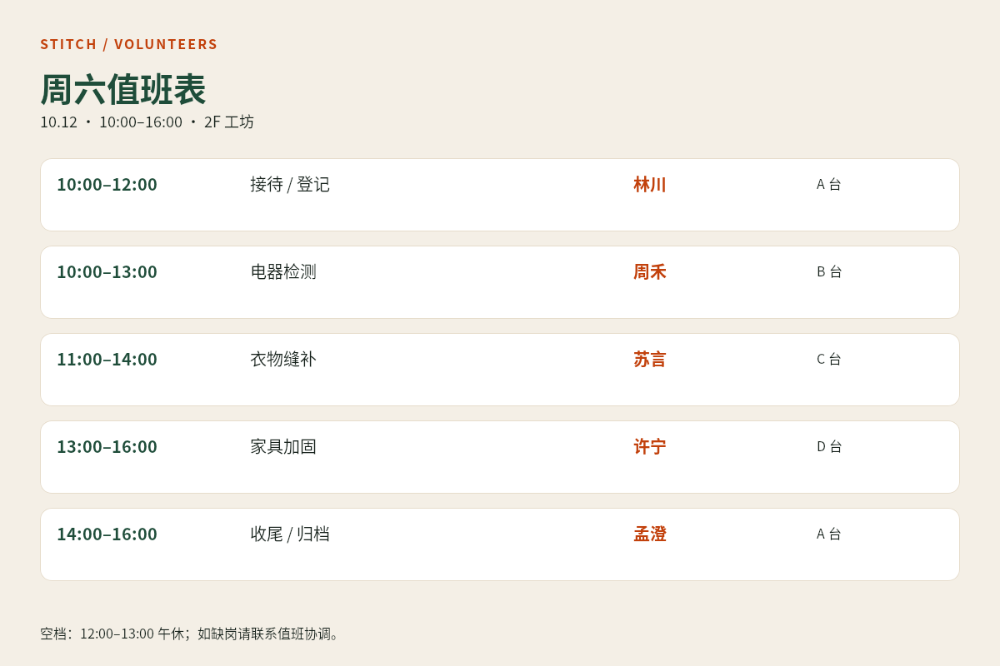
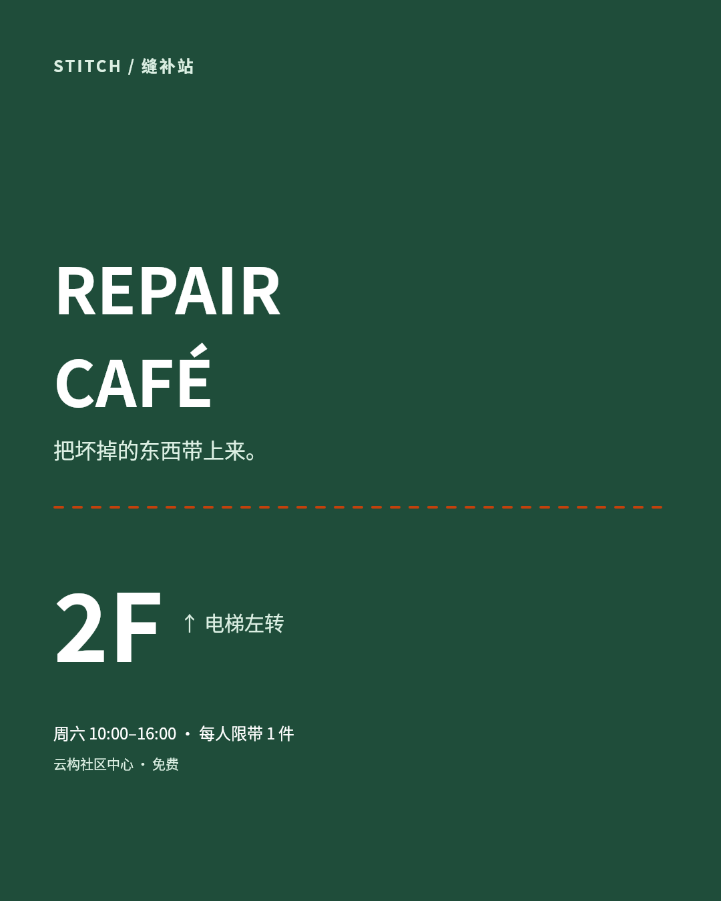
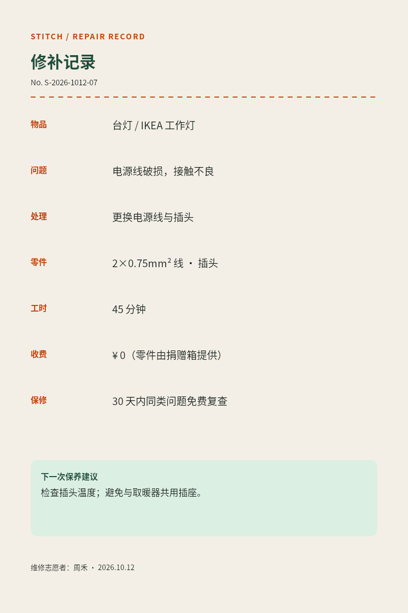
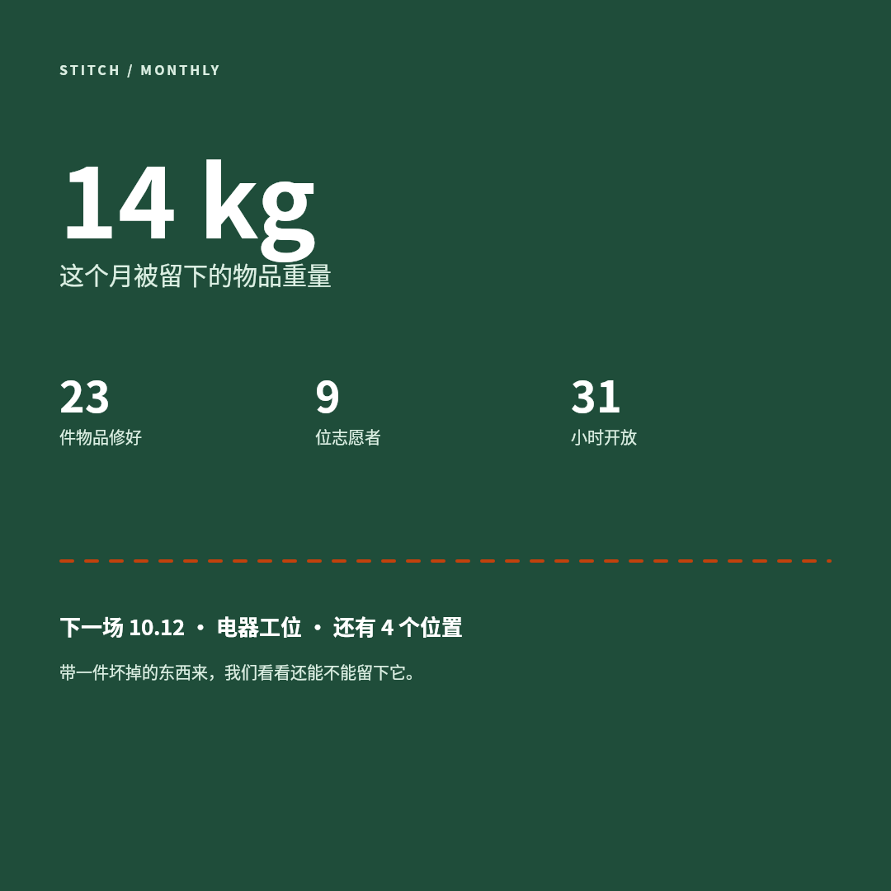
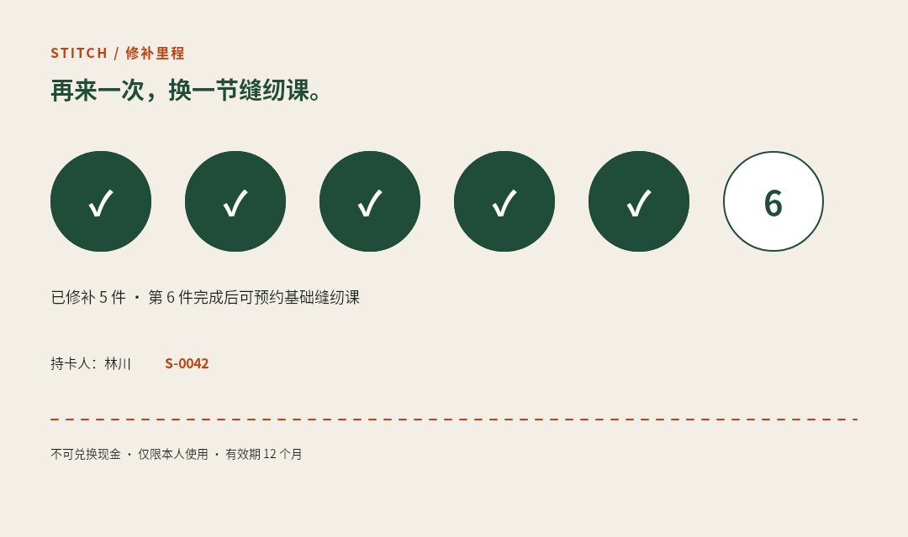
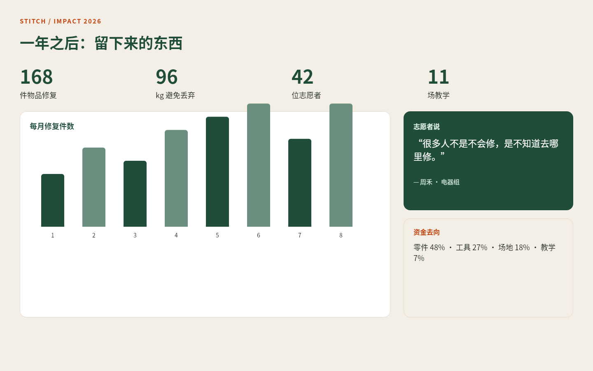

# B02 画廊

缝补站 / Stitch 是一间社区维修工坊的完整视觉生态：暖纸色、墨绿与陶土橙，虚线缝合作为跨触点符号。十件作品覆盖发现、预约、到场、记录、回访与年度影响，每件按实际使用距离与任务重新组织信息，而不是同一海报换色。

## 01 · 品牌身份卡

[原 PNG](case-01/final.png) · [DSL](case-01/final.snapshot)

## 02 · 十月场次海报

[原 PNG](case-02/final.png) · [DSL](case-02/final.snapshot)

## 03 · App 首页

[原 PNG](case-03/final.png) · [DSL](case-03/final.snapshot)

## 04 · 预约页

[原 PNG](case-04/final.png) · [DSL](case-04/final.snapshot)

## 05 · 志愿者值班板

[原 PNG](case-05/final.png) · [DSL](case-05/final.snapshot)

## 06 · 入口导视

[原 PNG](case-06/final.png) · [DSL](case-06/final.snapshot)

## 07 · 修补记录

[原 PNG](case-07/final.png) · [DSL](case-07/final.snapshot)

## 08 · 月度社交卡

[原 PNG](case-08/final.png) · [DSL](case-08/final.snapshot)

## 09 · 修补里程卡

[原 PNG](case-09/final.png) · [DSL](case-09/final.snapshot)

## 10 · 年度影响报告

[原 PNG](case-10/final.png) · [DSL](case-10/final.snapshot)

