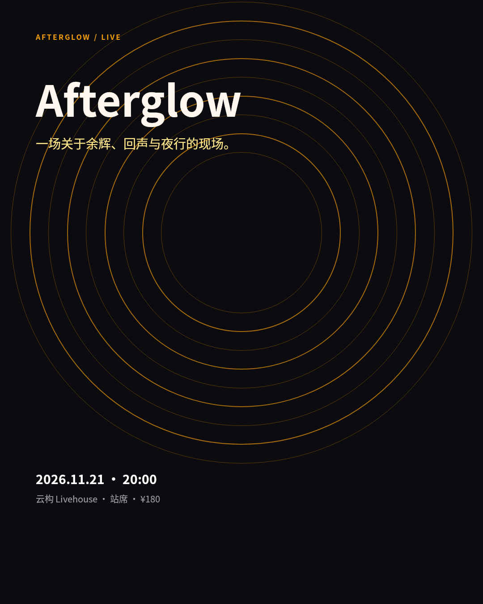
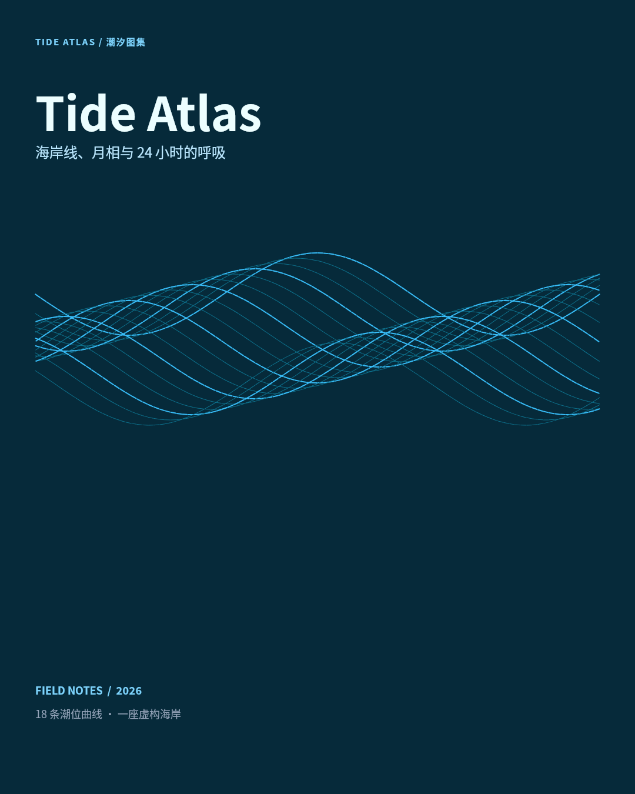
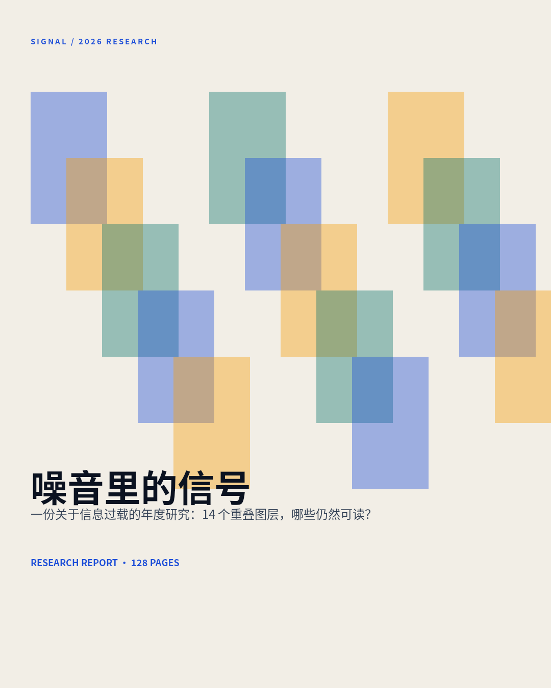
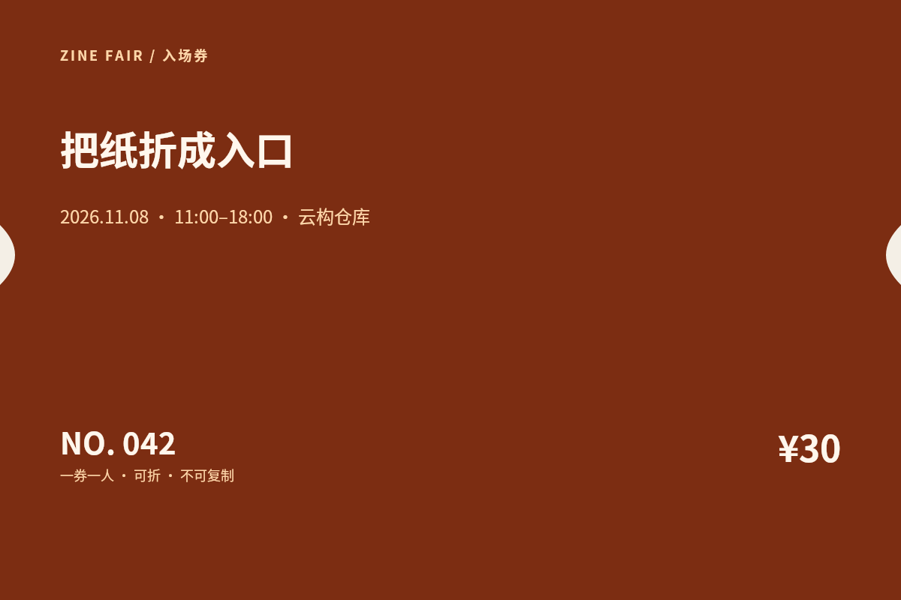
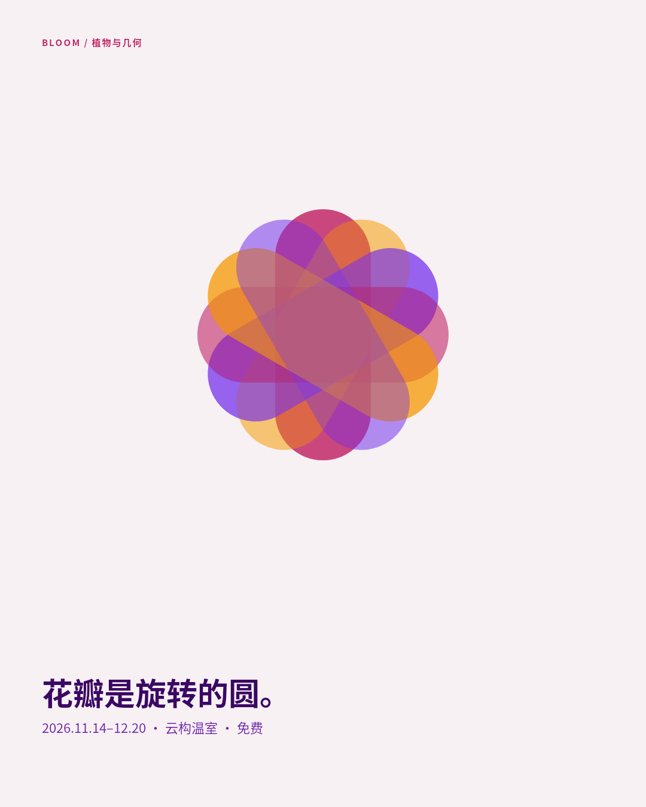
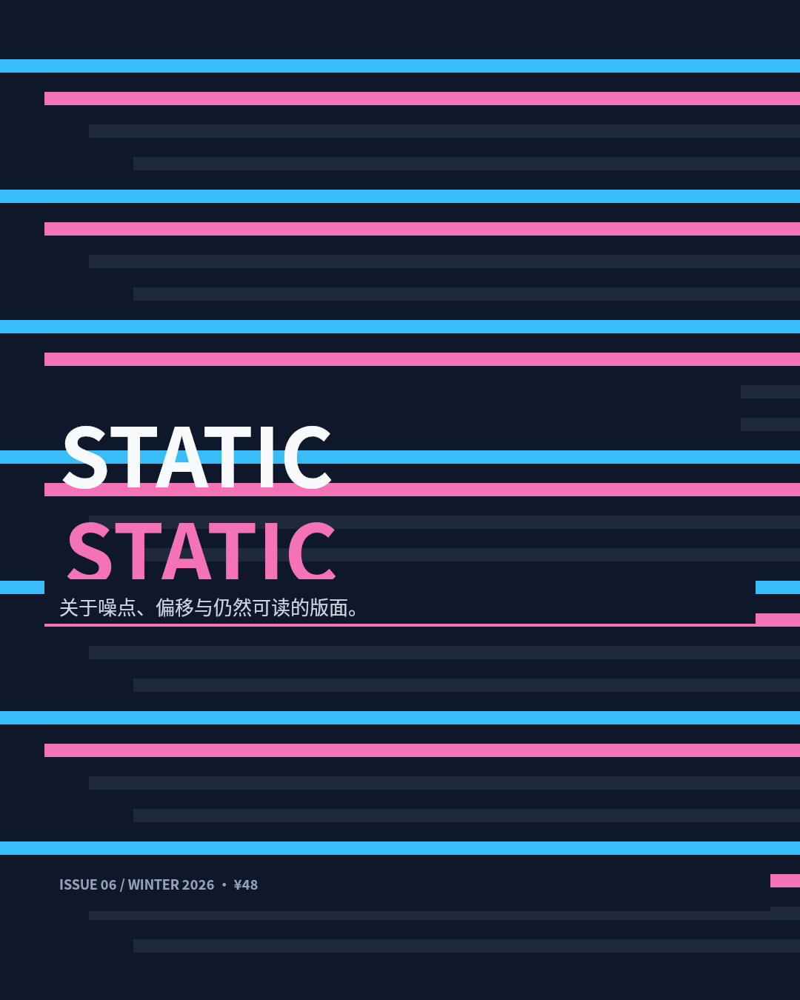
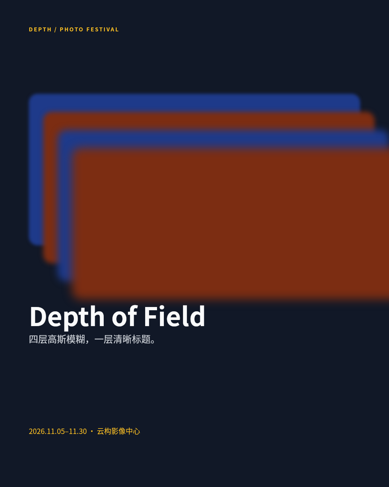
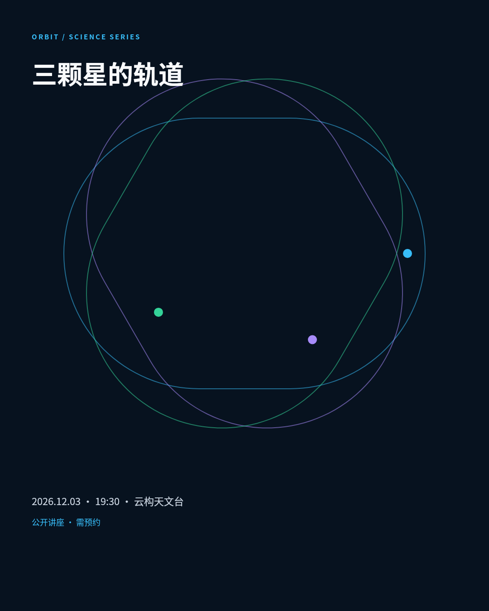
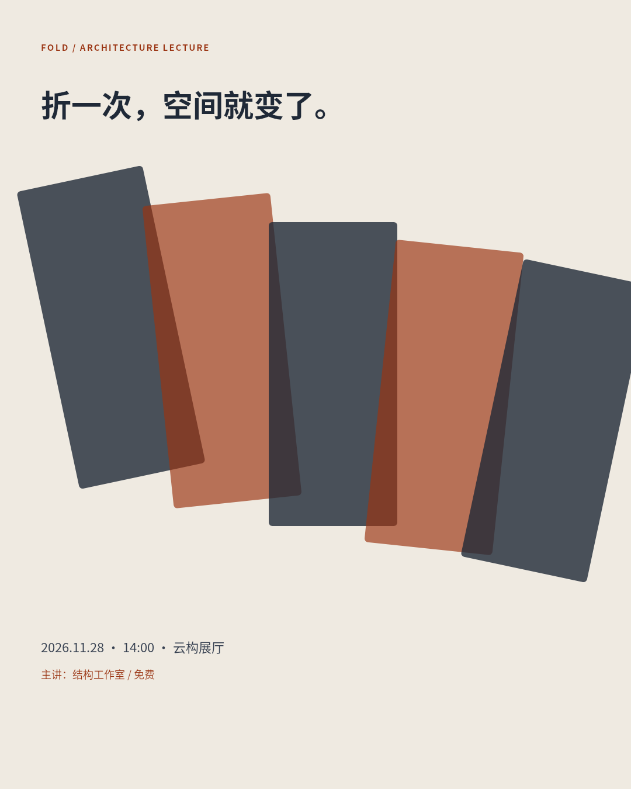
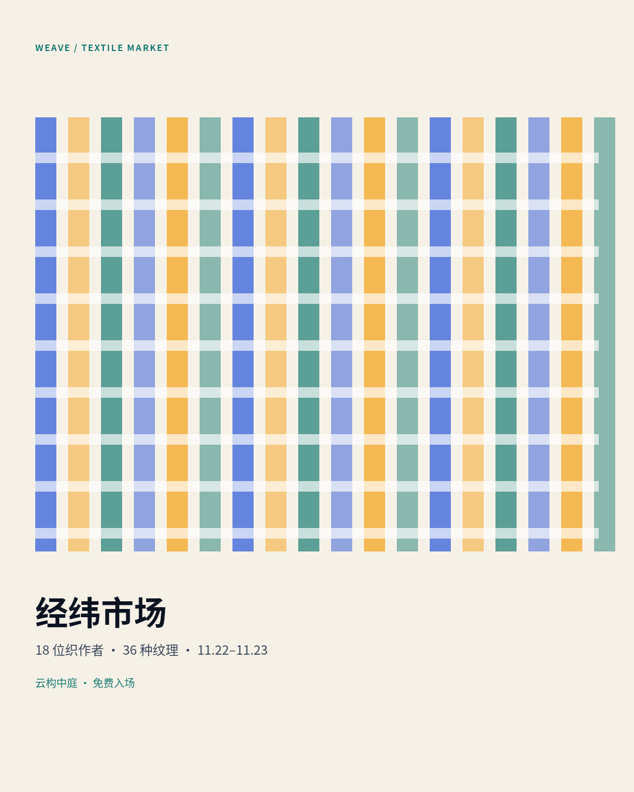

# B03 画廊

把 Snapshot 当作创意材料：十件作品分别用圆环叠层、参数化曲线、半透明矩形、ClipPath、旋转矩形、错版条纹、模糊景深、旋转椭圆、折叠面板与织物网格，服务于演出、书封、研究报告、zine 市集、展览、杂志、摄影节、科学讲座、建筑讲座与织物市集等真实场景。

## 01 · Afterglow 演出海报

[原 PNG](case-01/final.png) · [DSL](case-01/final.snapshot)

## 02 · Tide Atlas 书封

[原 PNG](case-02/final.png) · [DSL](case-02/final.snapshot)

## 03 · Signal 研究报告封面

[原 PNG](case-03/final.png) · [DSL](case-03/final.snapshot)

## 04 · Zine Fair 入场券

[原 PNG](case-04/final.png) · [DSL](case-04/final.snapshot)

## 05 · Bloom 展览海报

[原 PNG](case-05/final.png) · [DSL](case-05/final.snapshot)

## 06 · Static 杂志封面

[原 PNG](case-06/final.png) · [DSL](case-06/final.snapshot)

## 07 · Depth 摄影节海报

[原 PNG](case-07/final.png) · [DSL](case-07/final.snapshot)

## 08 · Orbit 科学讲座卡

[原 PNG](case-08/final.png) · [DSL](case-08/final.snapshot)

## 09 · Fold 建筑讲座海报

[原 PNG](case-09/final.png) · [DSL](case-09/final.snapshot)

## 10 · Weave 织物市集海报

[原 PNG](case-10/final.png) · [DSL](case-10/final.snapshot)

