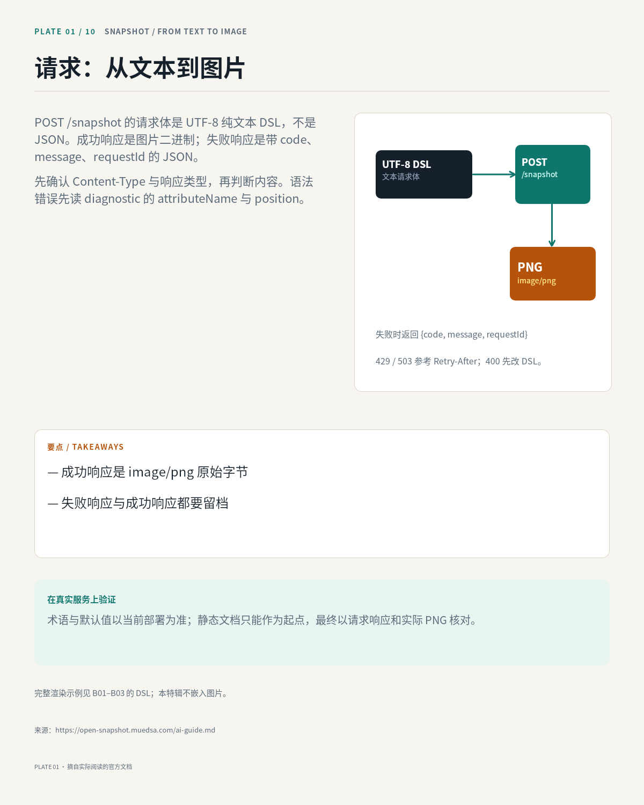
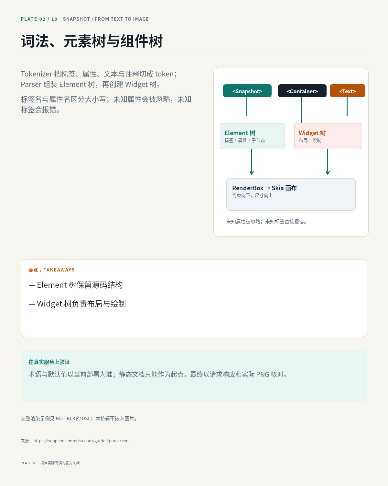
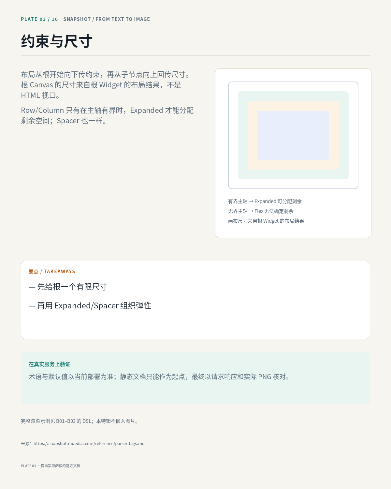
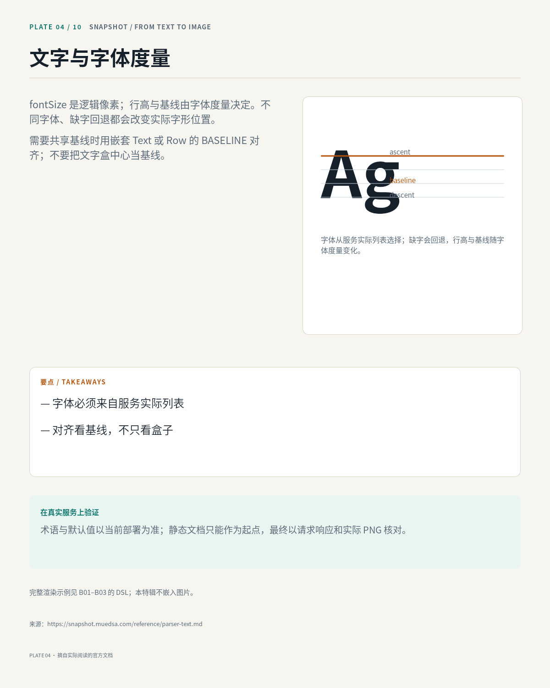
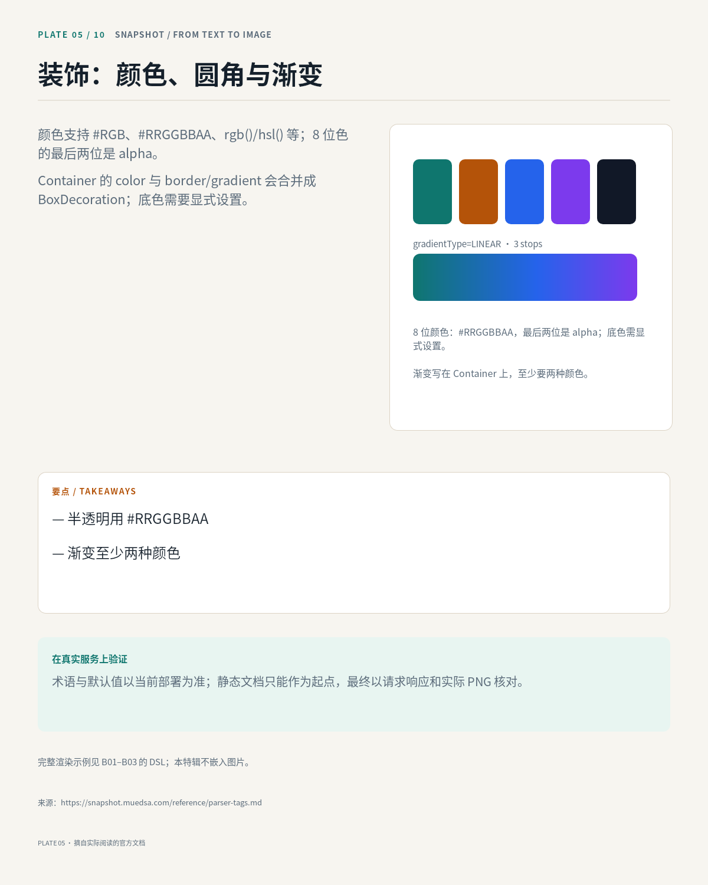
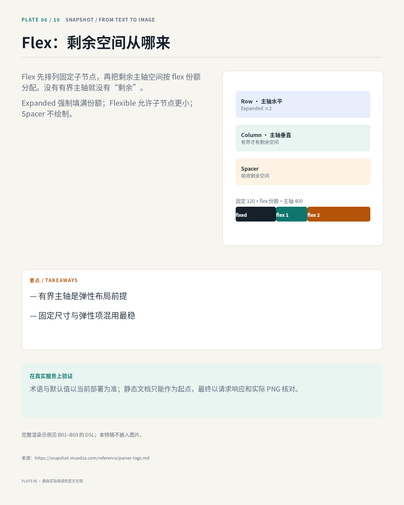
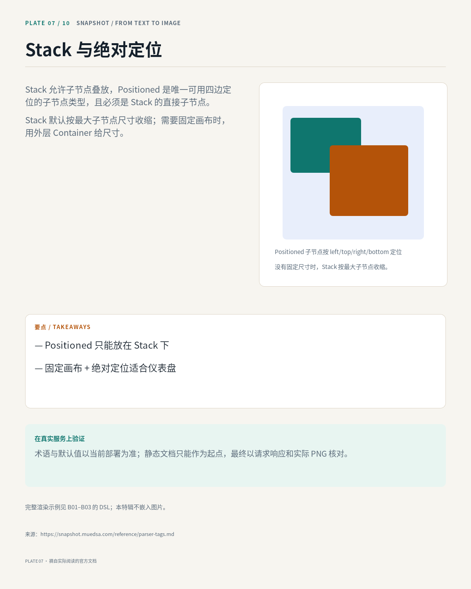
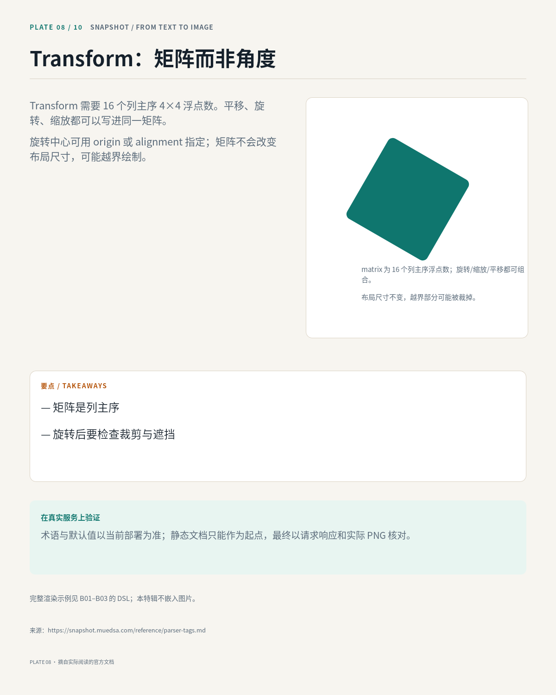
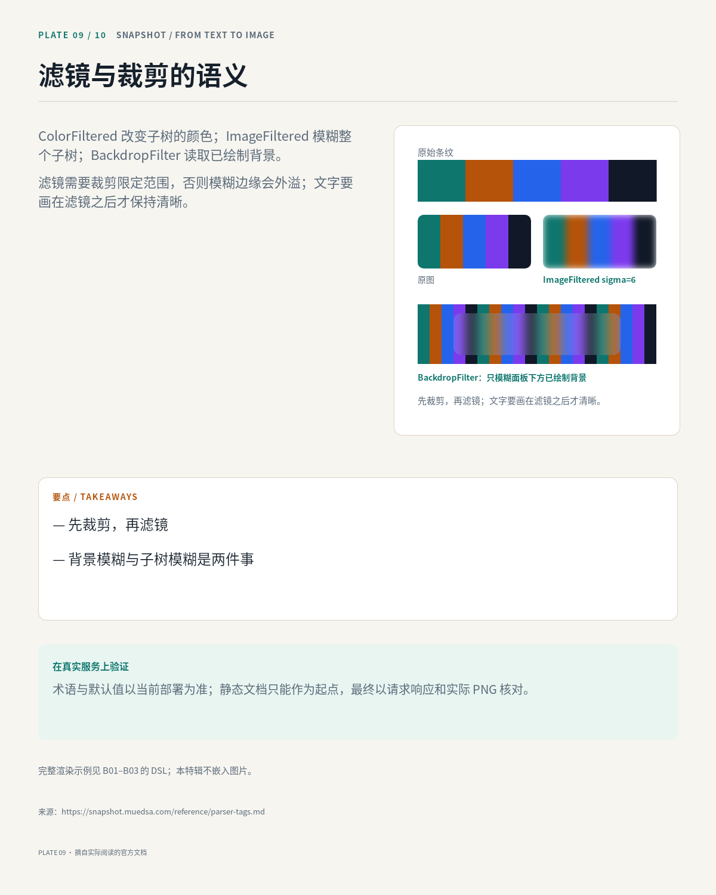
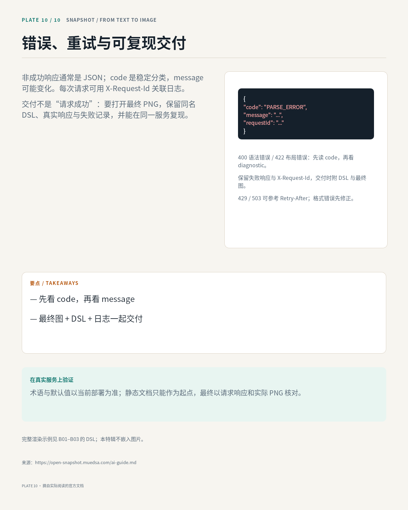

# B04 画廊

《从文本到图片》是一组十页的开发者图鉴：把 Snapshot 从请求、解析、约束、文字、装饰、Flex、Stack、Transform、滤镜到错误处理串成一条可顺序阅读的视觉叙事。每页保持同一网格与配色，用一张自制示意图承担解释，不嵌入任何外部图片。

## 01 · 请求：从文本到图片

[原 PNG](case-01/final.png) · [DSL](case-01/final.snapshot)

## 02 · 词法、元素树与组件树

[原 PNG](case-02/final.png) · [DSL](case-02/final.snapshot)

## 03 · 约束与尺寸

[原 PNG](case-03/final.png) · [DSL](case-03/final.snapshot)

## 04 · 文字与字体度量

[原 PNG](case-04/final.png) · [DSL](case-04/final.snapshot)

## 05 · 装饰：颜色、圆角与渐变

[原 PNG](case-05/final.png) · [DSL](case-05/final.snapshot)

## 06 · Flex：剩余空间从哪来

[原 PNG](case-06/final.png) · [DSL](case-06/final.snapshot)

## 07 · Stack 与绝对定位

[原 PNG](case-07/final.png) · [DSL](case-07/final.snapshot)

## 08 · Transform：矩阵而非角度

[原 PNG](case-08/final.png) · [DSL](case-08/final.snapshot)

## 09 · 滤镜与裁剪的语义

[原 PNG](case-09/final.png) · [DSL](case-09/final.snapshot)

## 10 · 错误、重试与可复现交付

[原 PNG](case-10/final.png) · [DSL](case-10/final.snapshot)

