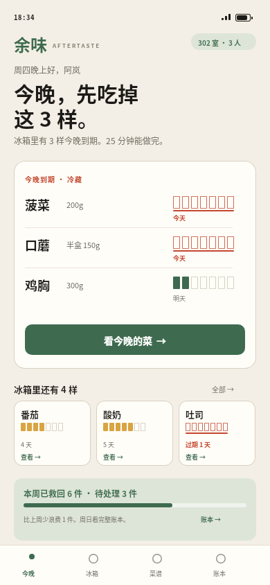
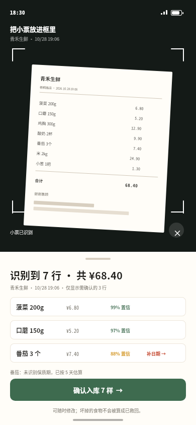
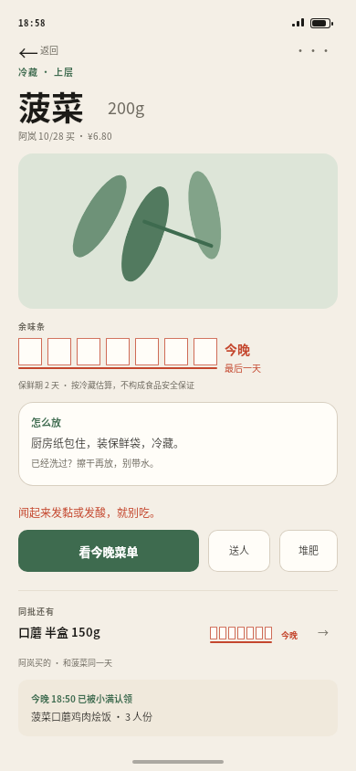
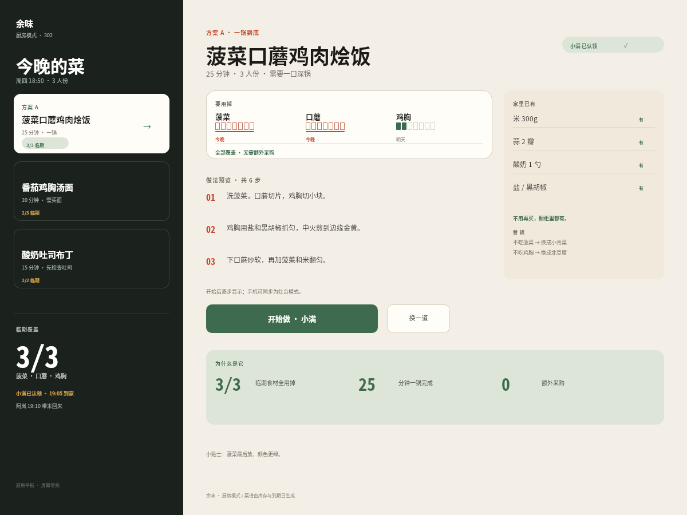
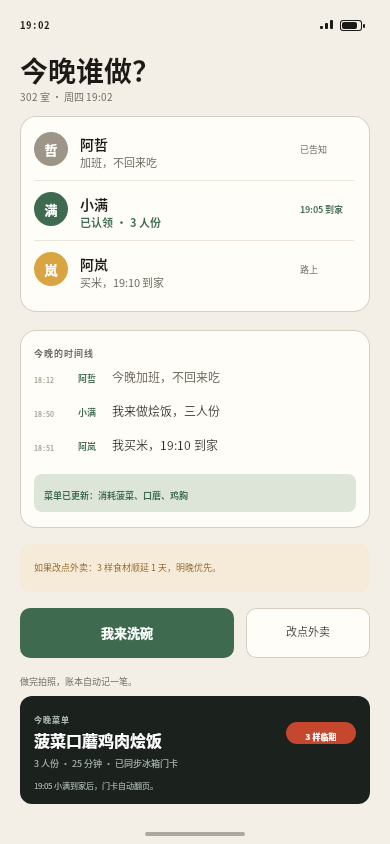
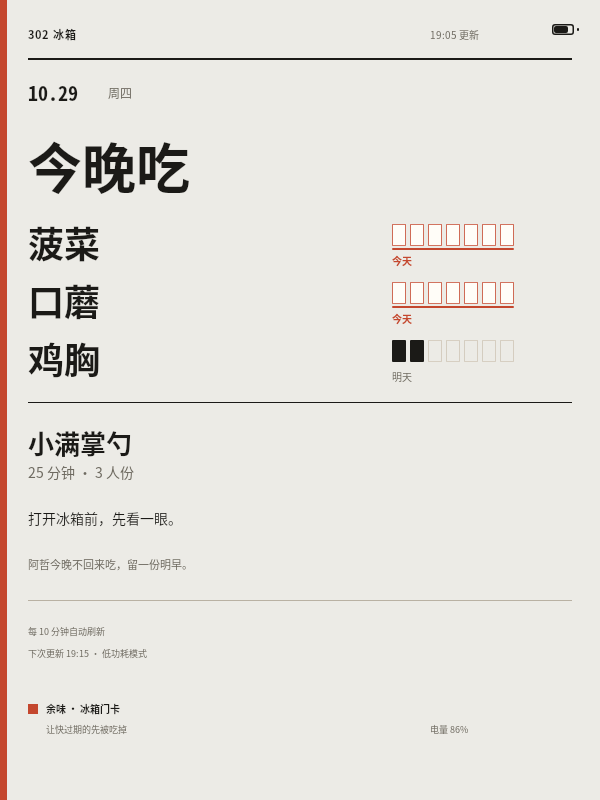
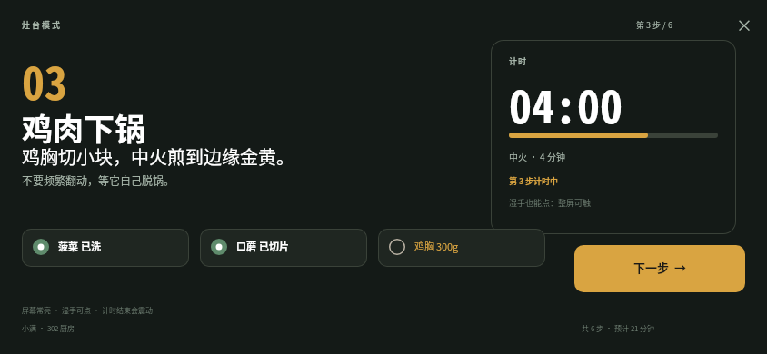
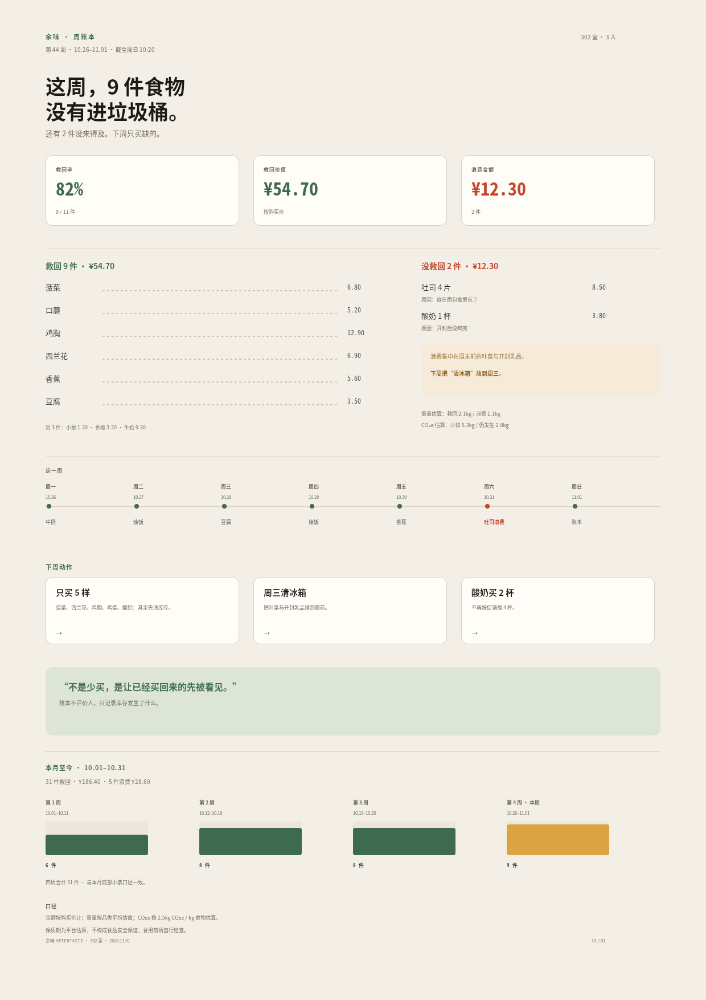
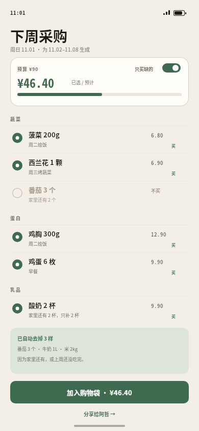
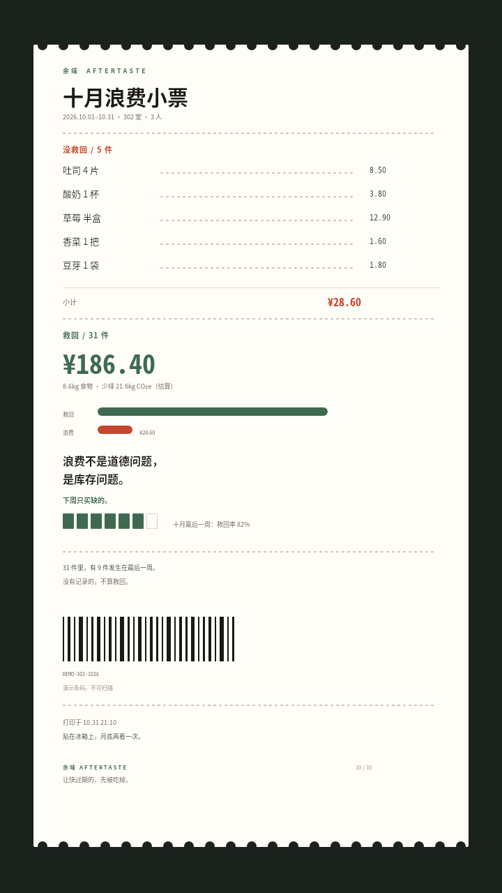

# B05 画廊 · 余味 AFTERTASTE

余味 AFTERTASTE 是一套关于“先吃掉快过期的”的共享库存产品。十张画面横跨手机、厨房平板、墨水屏、A4 与热敏小票，用同一条 7 格余味条贯穿：把保质期变成看得见的空格，把采购、认领、烹饪与复盘串成一个可信的周四晚上到周日早晨。

## 01 · 今晚三样

[原 PNG](case-01/final.png) · [DSL](case-01/final.snapshot) · [说明](case-01/case.md)

## 02 · 小票入库

[原 PNG](case-02/final.png) · [DSL](case-02/final.snapshot) · [说明](case-02/case.md)

## 03 · 一把菠菜的档案

[原 PNG](case-03/final.png) · [DSL](case-03/final.snapshot) · [说明](case-03/case.md)

## 04 · 把今晚吃掉

[原 PNG](case-04/final.png) · [DSL](case-04/final.snapshot) · [说明](case-04/case.md)

## 05 · 谁来做

[原 PNG](case-05/final.png) · [DSL](case-05/final.snapshot) · [说明](case-05/case.md)

## 06 · 冰箱门卡

[原 PNG](case-06/final.png) · [DSL](case-06/final.snapshot) · [说明](case-06/case.md)

## 07 · 灶台模式

[原 PNG](case-07/final.png) · [DSL](case-07/final.snapshot) · [说明](case-07/case.md)

## 08 · 本周账本

[原 PNG](case-08/final.png) · [DSL](case-08/final.snapshot) · [说明](case-08/case.md)

## 09 · 只买缺的

[原 PNG](case-09/final.png) · [DSL](case-09/final.snapshot) · [说明](case-09/case.md)

## 10 · 十月浪费小票

[原 PNG](case-10/final.png) · [DSL](case-10/final.snapshot) · [说明](case-10/case.md)
