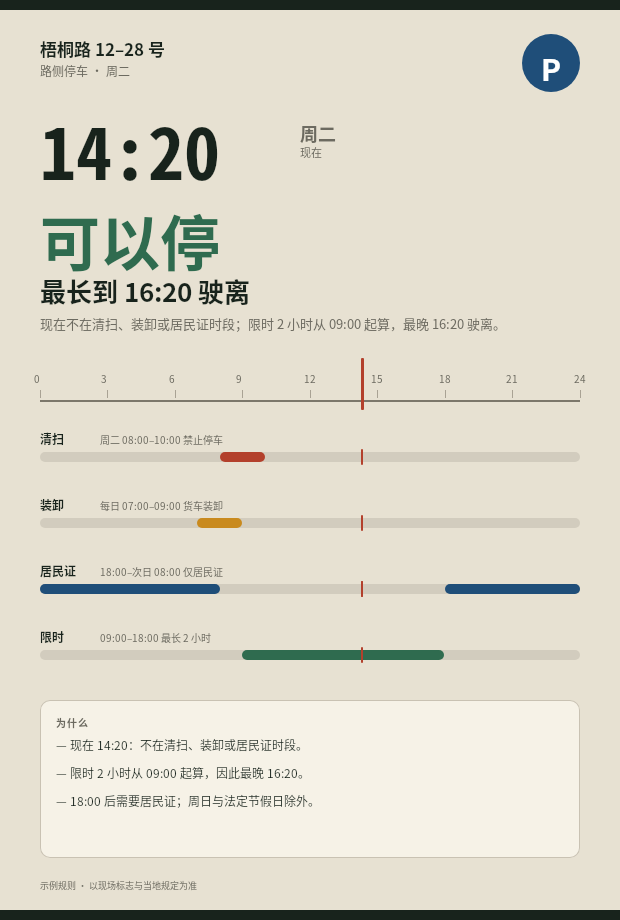
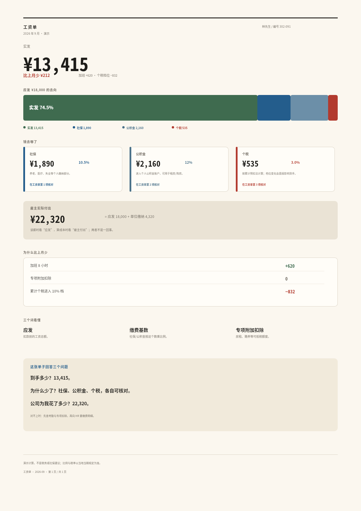
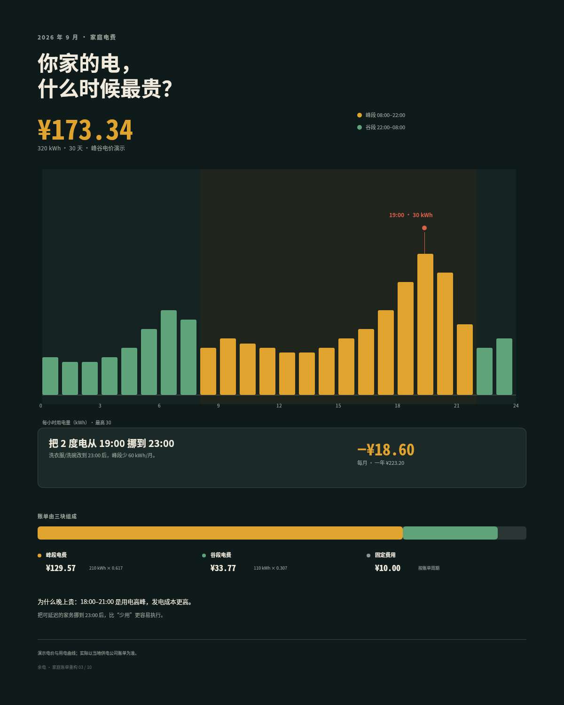
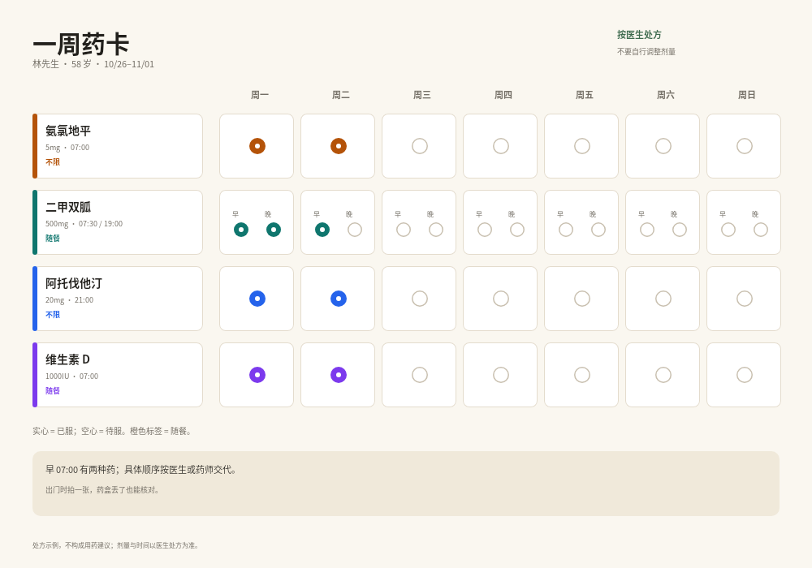
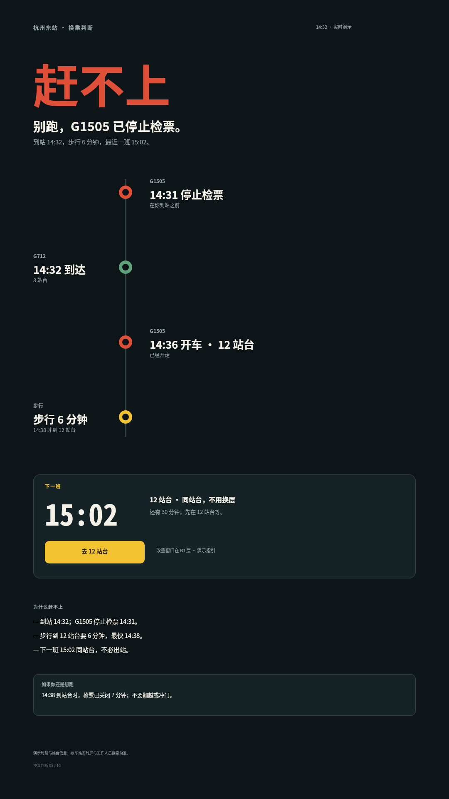
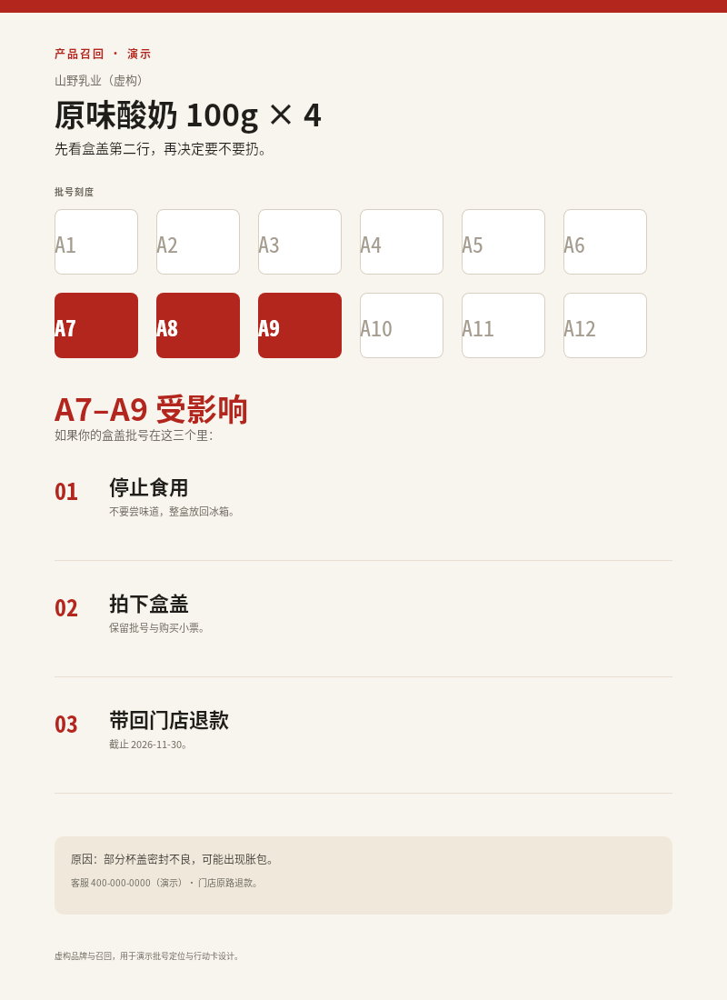
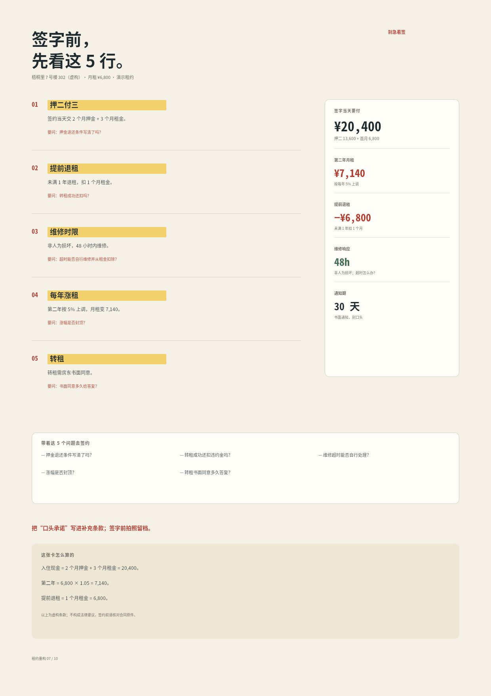
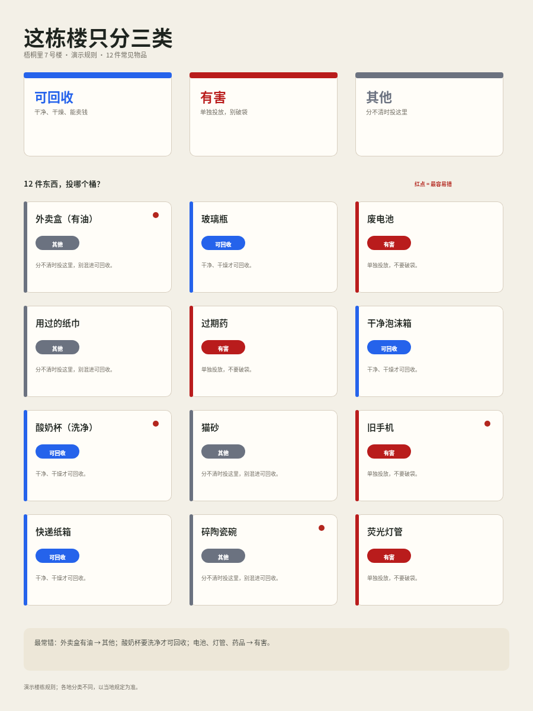
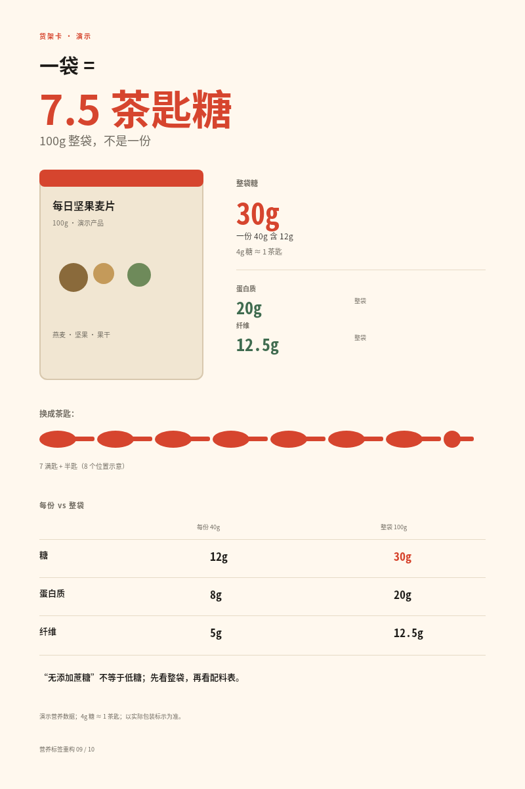
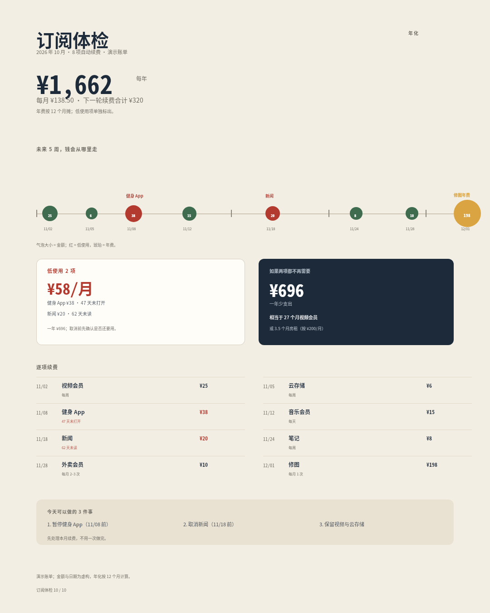

# B06 画廊 · 日常信息重构

十件日常信息重构：停车牌、工资单、电费、药卡、换乘屏、召回卡、租约、垃圾房、营养标签与订阅账单。每件只回答一个被原有形式挡住的问题，用该媒介最擅长的组织方式——同一条时间标尺、一条闭合的分段条、一张 7 天网格、一条可行性时间轴、一组批号格、一张现金面板、一个物品网格、一排茶匙、一条续费跑道——把“看清”变成“能做”。

## 01 · 路侧停车：现在能停吗？

[原 PNG](case-01/final.png) · [DSL](case-01/final.snapshot) · [说明](case-01/case.md)

## 02 · 工资单：钱去哪了

[原 PNG](case-02/final.png) · [DSL](case-02/final.snapshot) · [说明](case-02/case.md)

## 03 · 电费：什么时候最贵？

[原 PNG](case-03/final.png) · [DSL](case-03/final.snapshot) · [说明](case-03/case.md)

## 04 · 一周药卡

[原 PNG](case-04/final.png) · [DSL](case-04/final.snapshot) · [说明](case-04/case.md)

## 05 · 换乘：跑不跑得赢？

[原 PNG](case-05/final.png) · [DSL](case-05/final.snapshot) · [说明](case-05/case.md)

## 06 · 召回：我的盒子中招了吗？

[原 PNG](case-06/final.png) · [DSL](case-06/final.snapshot) · [说明](case-06/case.md)

## 07 · 租约：签字前先看 5 行

[原 PNG](case-07/final.png) · [DSL](case-07/final.snapshot) · [说明](case-07/case.md)

## 08 · 垃圾房：这件东西投哪个桶？

[原 PNG](case-08/final.png) · [DSL](case-08/final.snapshot) · [说明](case-08/case.md)

## 09 · 营养：一袋有多少糖？

[原 PNG](case-09/final.png) · [DSL](case-09/final.snapshot) · [说明](case-09/case.md)

## 10 · 订阅体检

[原 PNG](case-10/final.png) · [DSL](case-10/final.snapshot) · [说明](case-10/case.md)
