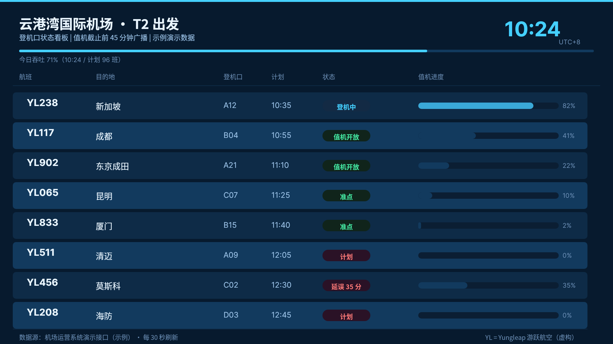
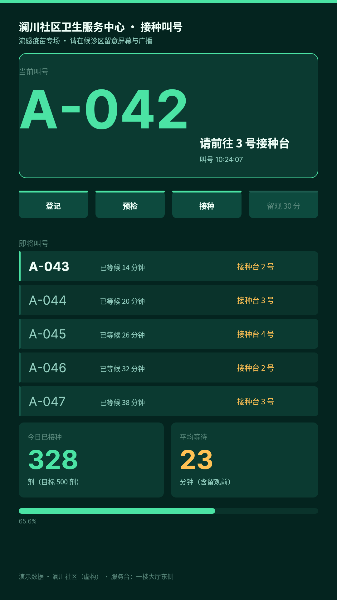
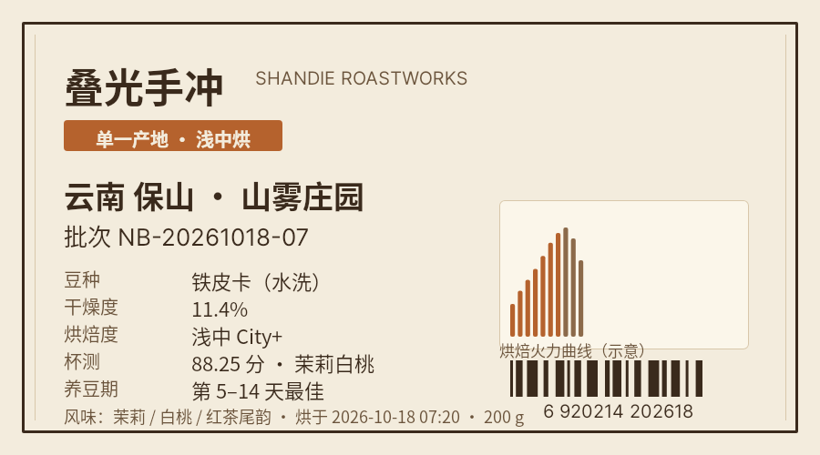
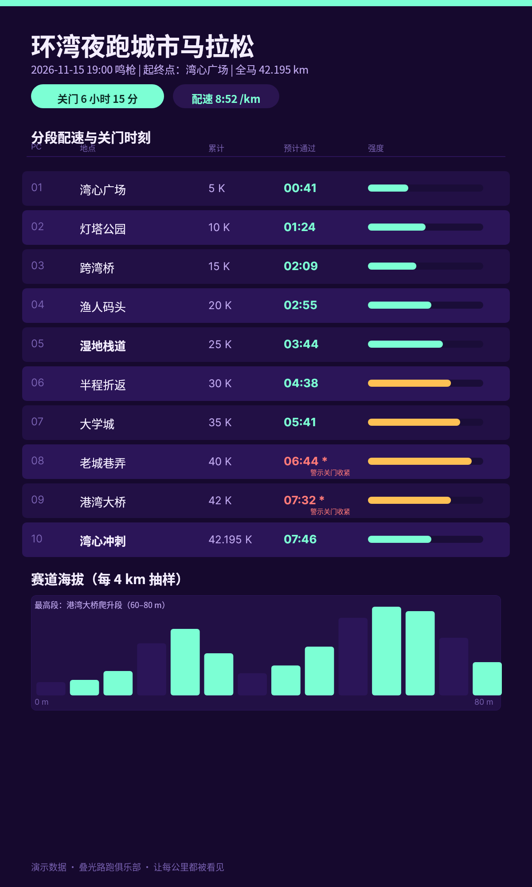
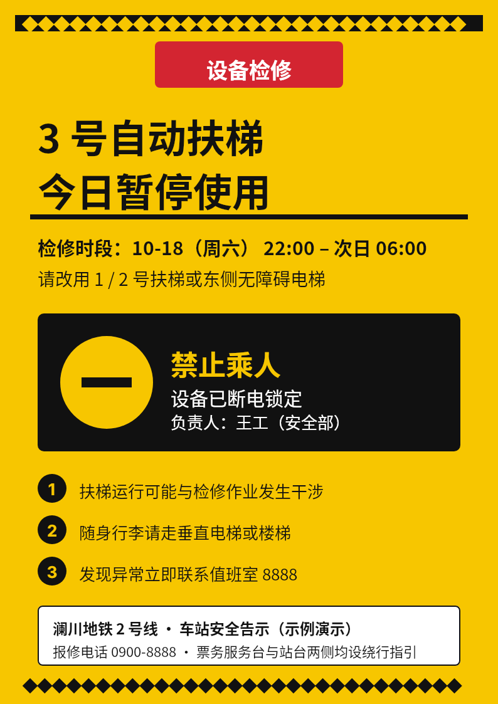
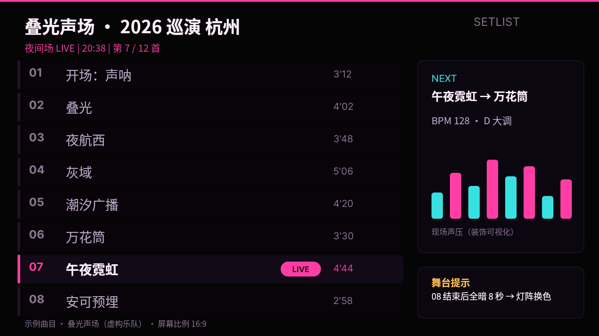
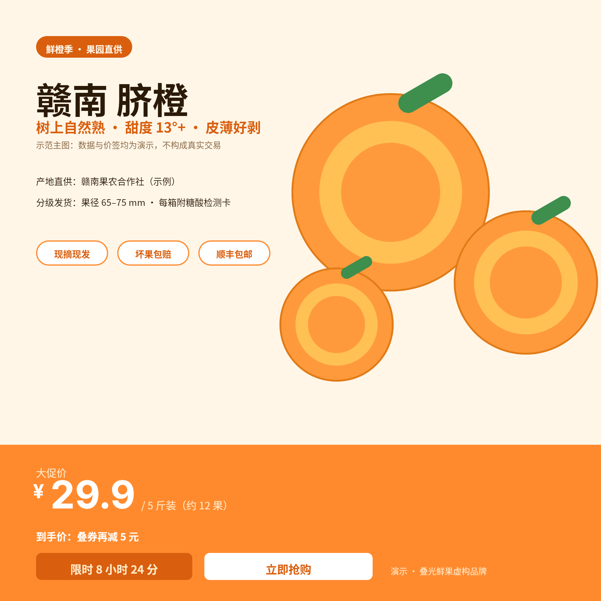
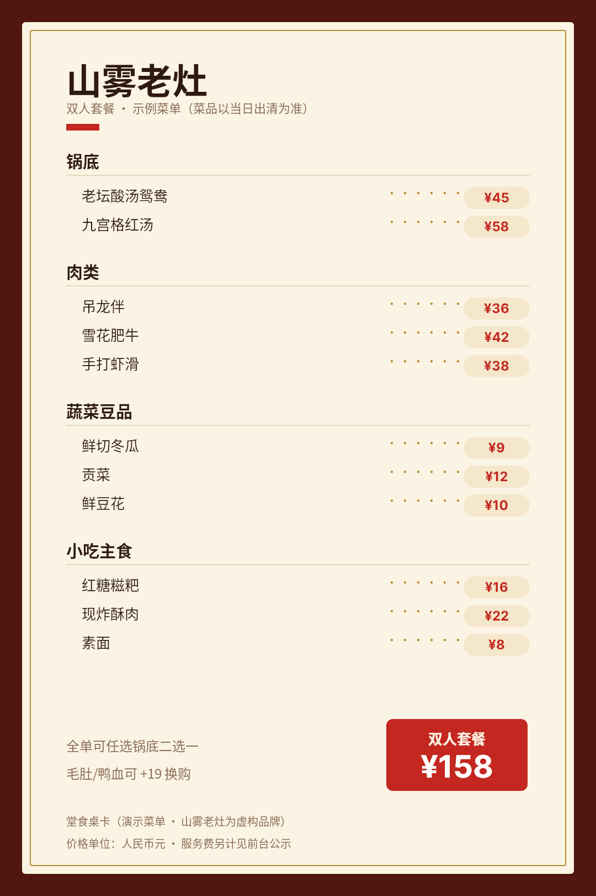
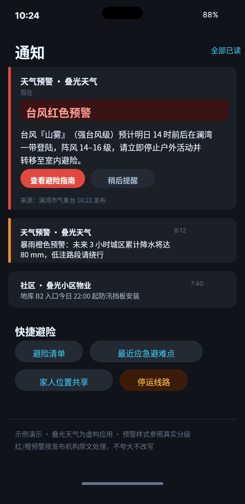
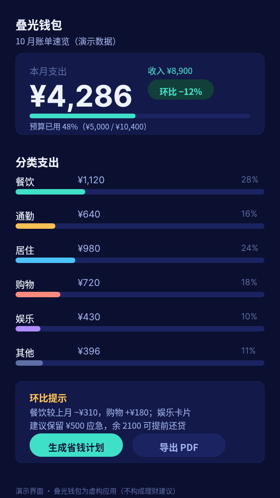

# B01 · 画廊（十件最终图）

run_id `20261016T164020-m1`；每件条目含预览、PNG 与对应完整 DSL 链接（相对本文件）。

## 1. 云港湾 T2 登机口状态看板（运营拼接屏 · 1920×1080）

- PNG：[case-01/final.png](case-01/final.png)  ·  DSL：[case-01/final.snapshot](case-01/final.snapshot)  ·  说明：[case-01/case.md](case-01/case.md)

## 2. 社区接种叫号屏（候诊竖屏电视 · 1080×1920）

- PNG：[case-02/final.png](case-02/final.png)  ·  DSL：[case-02/final.snapshot](case-02/final.snapshot)  ·  说明：[case-02/case.md](case-02/case.md)

## 3. 咖啡烘焙批次卡（印刷贴纸 · 900×500）

- PNG：[case-03/final.png](case-03/final.png)  ·  DSL：[case-03/final.snapshot](case-03/final.snapshot)  ·  说明：[case-03/case.md](case-03/case.md)

## 4. 马拉松分段配速海报（手机/公众号长图 · 1200×2000）

- PNG：[case-04/final.png](case-04/final.png)  ·  DSL：[case-04/final.snapshot](case-04/final.snapshot)  ·  说明：[case-04/case.md](case-04/case.md)

## 5. 扶梯检修警示牌（A4 打印塑封 · 794×1123）

- PNG：[case-05/final.png](case-05/final.png)  ·  DSL：[case-05/final.snapshot](case-05/final.snapshot)  ·  说明：[case-05/case.md](case-05/case.md)

## 6. 演出 LED 侧屏曲目单（舞台侧屏 · 1366×768）

- PNG：[case-06/final.png](case-06/final.png)  ·  DSL：[case-06/final.snapshot](case-06/final.snapshot)  ·  说明：[case-06/case.md](case-06/case.md)

## 7. 生鲜电商脐橙主图（电商方图 · 2000×2000）

- PNG：[case-07/final.png](case-07/final.png)  ·  DSL：[case-07/final.snapshot](case-07/final.snapshot)  ·  说明：[case-07/case.md](case-07/case.md)

## 8. 火锅双人菜单桌卡（桌面桌卡 · 1080×1620）

- PNG：[case-08/final.png](case-08/final.png)  ·  DSL：[case-08/final.snapshot](case-08/final.snapshot)  ·  说明：[case-08/case.md](case-08/case.md)

## 9. 台风/暴雨预警推送卡组（手机通知中心 · 720×1480）

- PNG：[case-09/final.png](case-09/final.png)  ·  DSL：[case-09/final.snapshot](case-09/final.snapshot)  ·  说明：[case-09/case.md](case-09/case.md)

## 10. 手机银行月度账单速览（手机页 · 720×1280）

- PNG：[case-10/final.png](case-10/final.png)  ·  DSL：[case-10/final.snapshot](case-10/final.snapshot)  ·  说明：[case-10/case.md](case-10/case.md)
