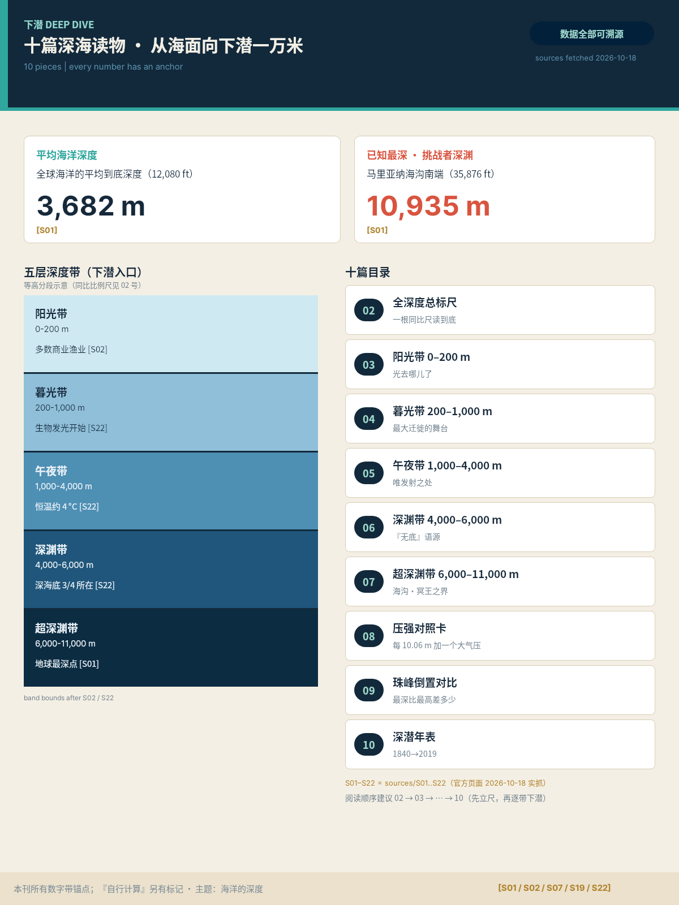
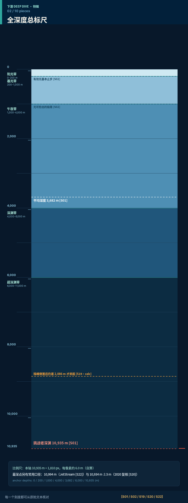
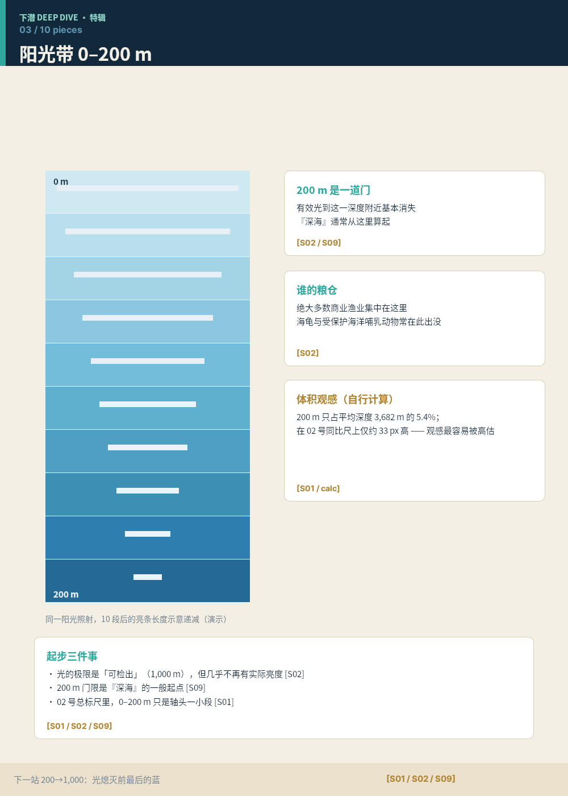
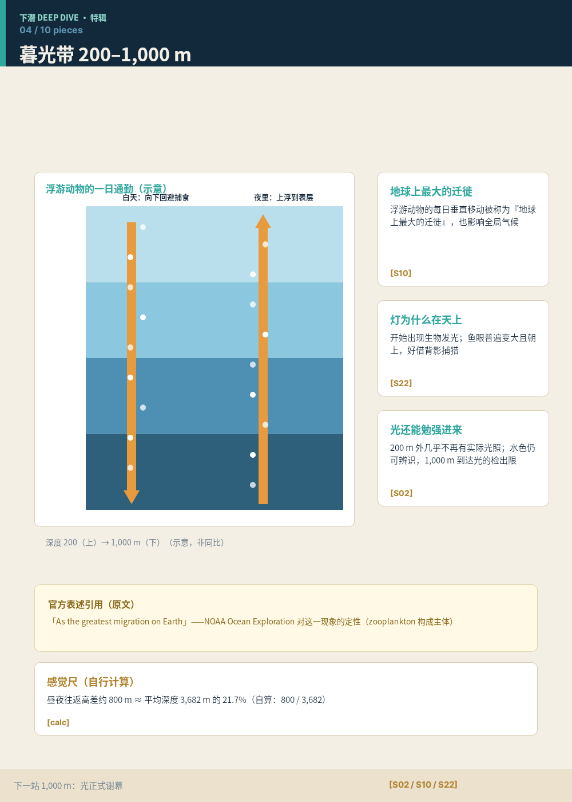
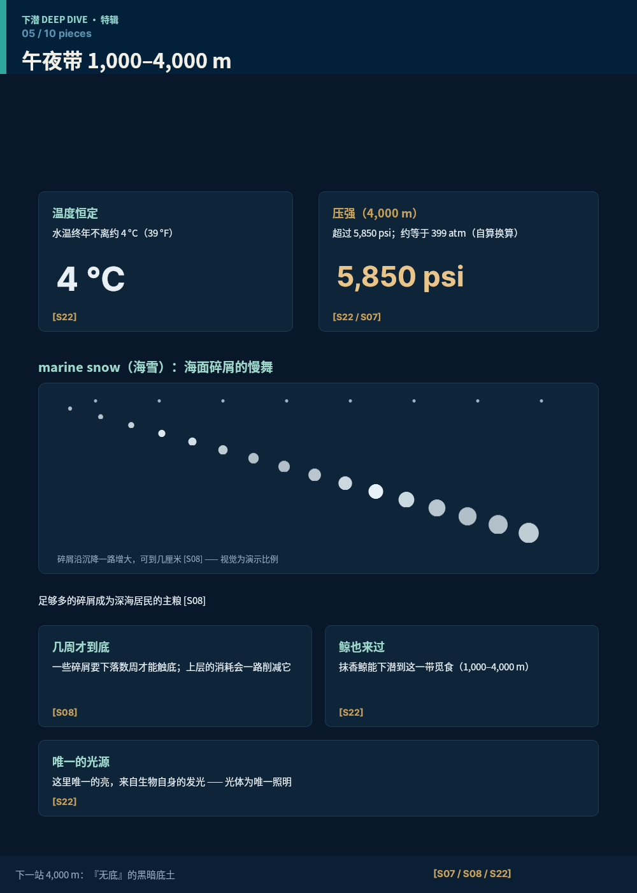
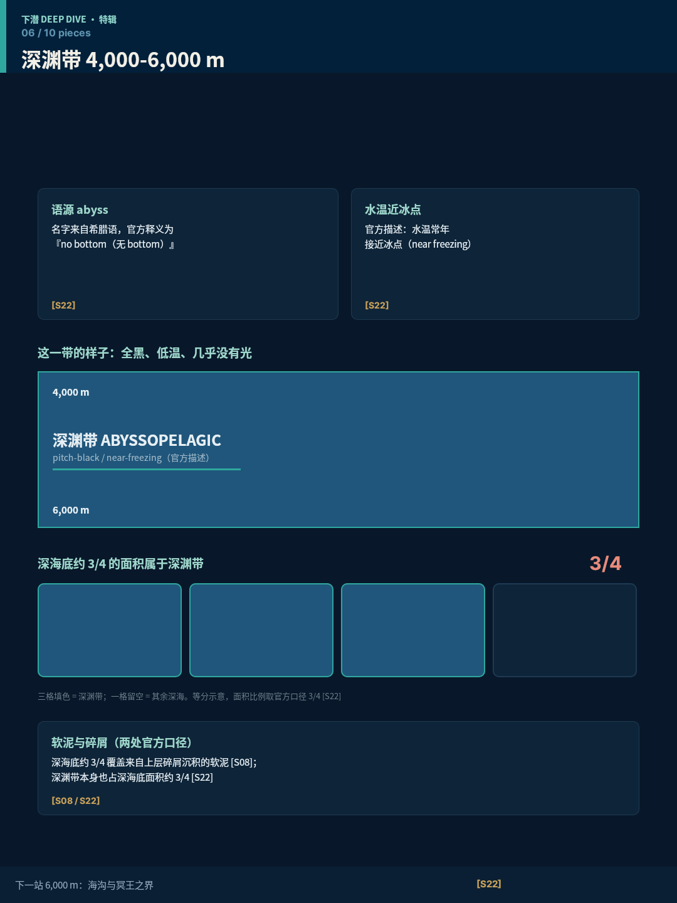
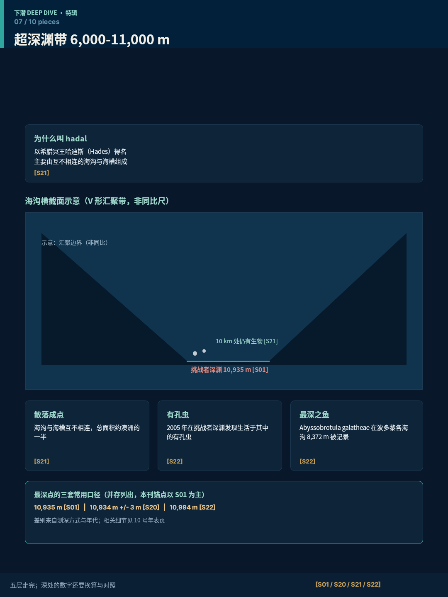
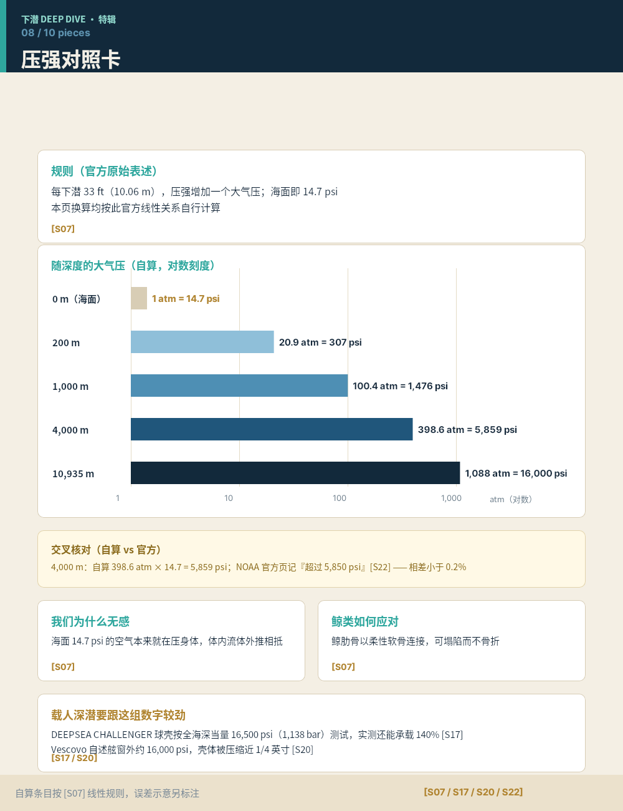
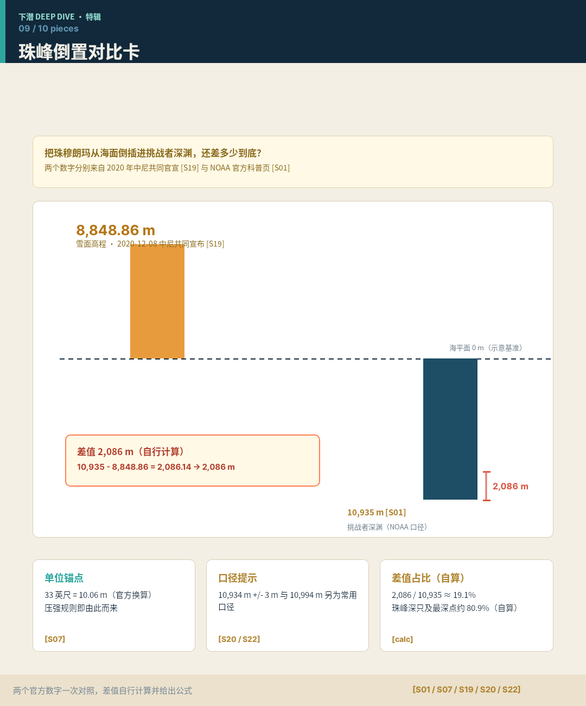
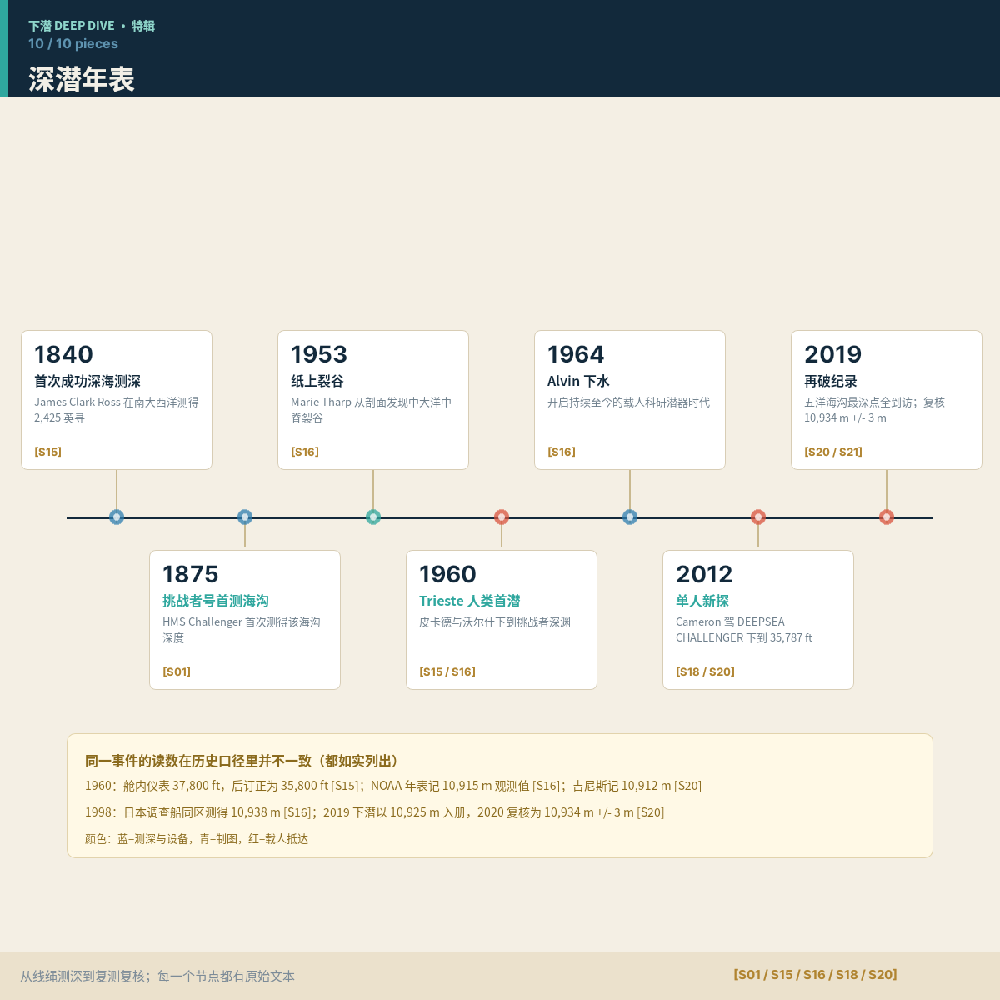

# B04 ·《下潜 DEEP DIVE》画廊

十件深海深度特辑。Markdown 预览 + 原 PNG/DSL/case.md 链接均相对本文件（B04 输出根）。
锚点符号 [S#] 对应 sources.json（normalized 于 sources/SXX-*.txt 实抓原文）。

## case-01 · 特辑封面 · 下潜 DEEP DIVE（1200×1600）

原 PNG：[case-01/final.png](case-01/final.png) · 完整 DSL：[case-01/final.snapshot](case-01/final.snapshot) · 记录：[case-01/case.md](case-01/case.md)

锚点：cl-avg，cl-max，cl-z-su，cl-z-tw，cl-z-mi，cl-z-ab，cl-z-ha，cl-fishery，cl-bio，cl-4c，cl-aby3q，cl-had-name，demo-spine

## case-02 · 全深度总标尺（900×2400）

原 PNG：[case-02/final.png](case-02/final.png) · 完整 DSL：[case-02/final.snapshot](case-02/final.snapshot) · 记录：[case-02/case.md](case-02/case.md)

锚点：cl-avg，cl-max，cl-max-alt，cl-z-su，cl-z-tw，cl-z-mi，cl-z-ab，cl-z-ha，cl-light1000，calc-everdiff，cl-everest

## case-03 · 阳光带 0–200 m（1000×1400）

原 PNG：[case-03/final.png](case-03/final.png) · 完整 DSL：[case-03/final.snapshot](case-03/final.snapshot) · 记录：[case-03/case.md](case-03/case.md)

锚点：cl-z-su，cl-deep0，cl-fishery，cl-light1000，cl-avg，calc-ratio-200，demo-strip

## case-04 · 暮光带 200–1,000 m（1000×1400）

原 PNG：[case-04/final.png](case-04/final.png) · 完整 DSL：[case-04/final.snapshot](case-04/final.snapshot) · 记录：[case-04/case.md](case-04/case.md)

锚点：cl-z-tw，cl-bio-mig，cl-bio，cl-light1000，calc-ratio-800，demo-mig

## case-05 · 午夜带 1,000–4,000 m（1000×1400）

原 PNG：[case-05/final.png](case-05/final.png) · 完整 DSL：[case-05/final.snapshot](case-05/final.snapshot) · 记录：[case-05/case.md](case-05/case.md)

锚点：cl-z-mi，cl-4c，cl-w4k，calc-atm，cl-4c-whale，cl-bio，demo-snow

## case-06 · 深渊带 4,000–6,000 m（1080×1440）

原 PNG：[case-06/final.png](case-06/final.png) · 完整 DSL：[case-06/final.snapshot](case-06/final.snapshot) · 记录：[case-06/case.md](case-06/case.md)

锚点：cl-z-ab，cl-aby3q，demo-grid34

## case-07 · 超深渊带 6,000–11,000 m（1080×1440）

原 PNG：[case-07/final.png](case-07/final.png) · 完整 DSL：[case-07/final.snapshot](case-07/final.snapshot) · 记录：[case-07/case.md](case-07/case.md)

锚点：cl-z-ha，cl-had-name，cl-had-area，cl-life10，cl-foram，cl-fish，cl-max，cl-max-alt，demo-trench

## case-08 · 压强对照卡（1000×1300）

原 PNG：[case-08/final.png](case-08/final.png) · 完整 DSL：[case-08/final.snapshot](case-08/final.snapshot) · 记录：[case-08/case.md](case-08/case.md)

锚点：cl-psi0，cl-10m，calc-atm，cl-w4k，cl-sphere，cl-16k，cl-max

## case-09 · 珠峰倒置对比卡（1080×1300）

原 PNG：[case-09/final.png](case-09/final.png) · 完整 DSL：[case-09/final.snapshot](case-09/final.snapshot) · 记录：[case-09/case.md](case-09/case.md)

锚点：cl-max，cl-max-alt，cl-everest，calc-everdiff，calc-ratio-2086，cl-10m，demo-k

## case-10 · 深潜年表（1200×1200）

原 PNG：[case-10/final.png](case-10/final.png) · 完整 DSL：[case-10/final.snapshot](case-10/final.snapshot) · 记录：[case-10/case.md](case-10/case.md)

锚点：cl-1840，cl-1875，cl-1953，cl-1960，cl-1960-alt，cl-1960-gwr，cl-1964，cl-2012，cl-2019-5d，cl-2019，cl-1998，cl-max-alt，demo-timeline

（本画廊为 B04 单题画廊。全套总画廊见 ../_suite/gallery.md，由全套收尾阶段生成。）