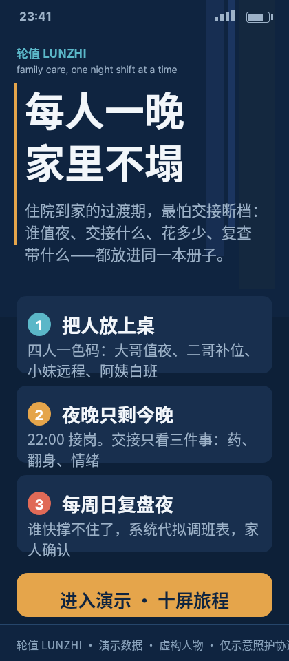
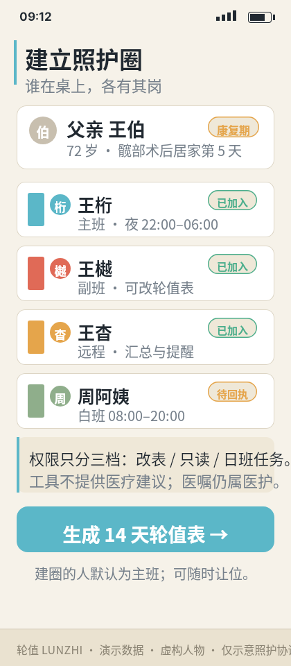
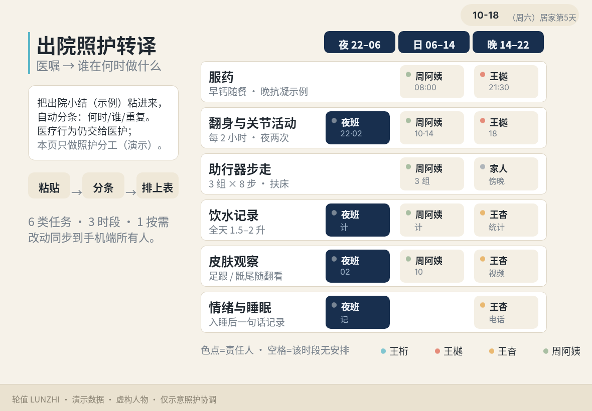
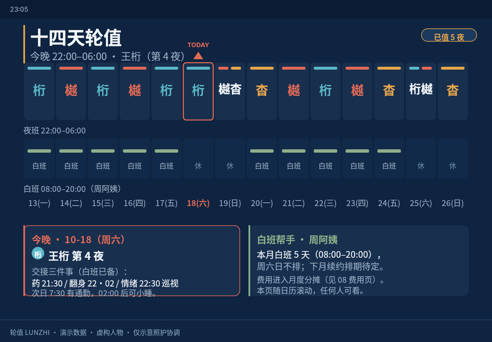
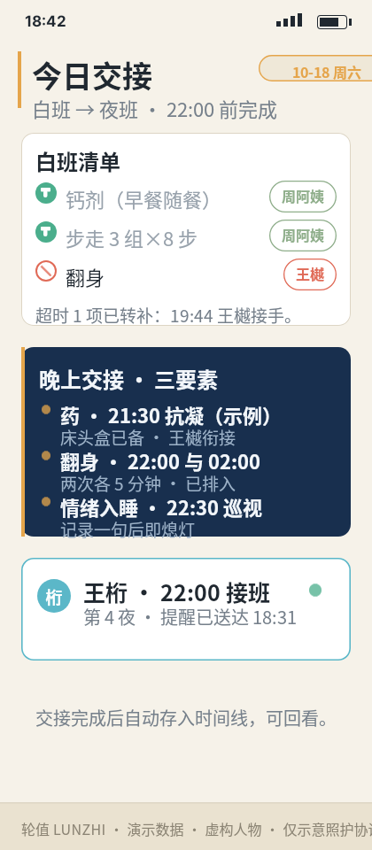
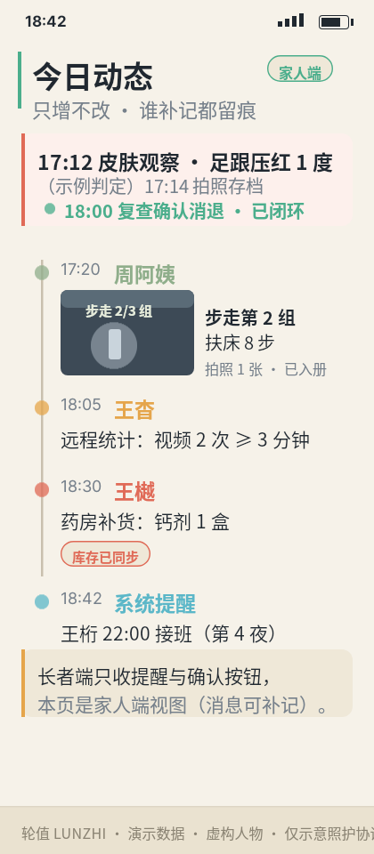
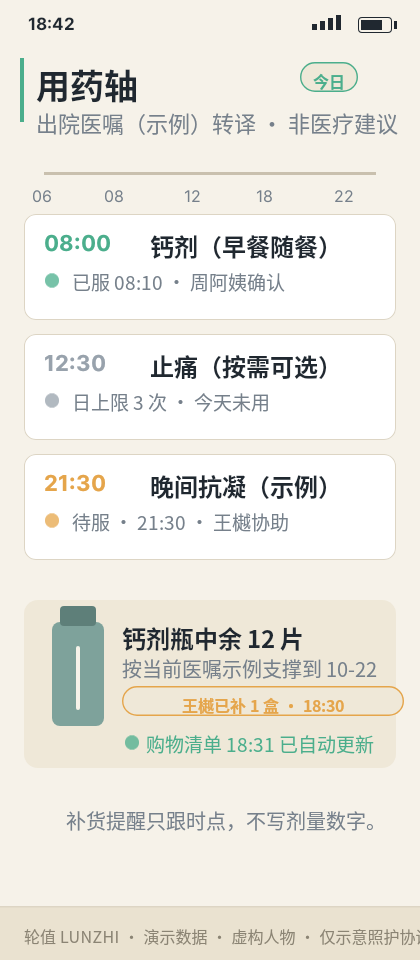
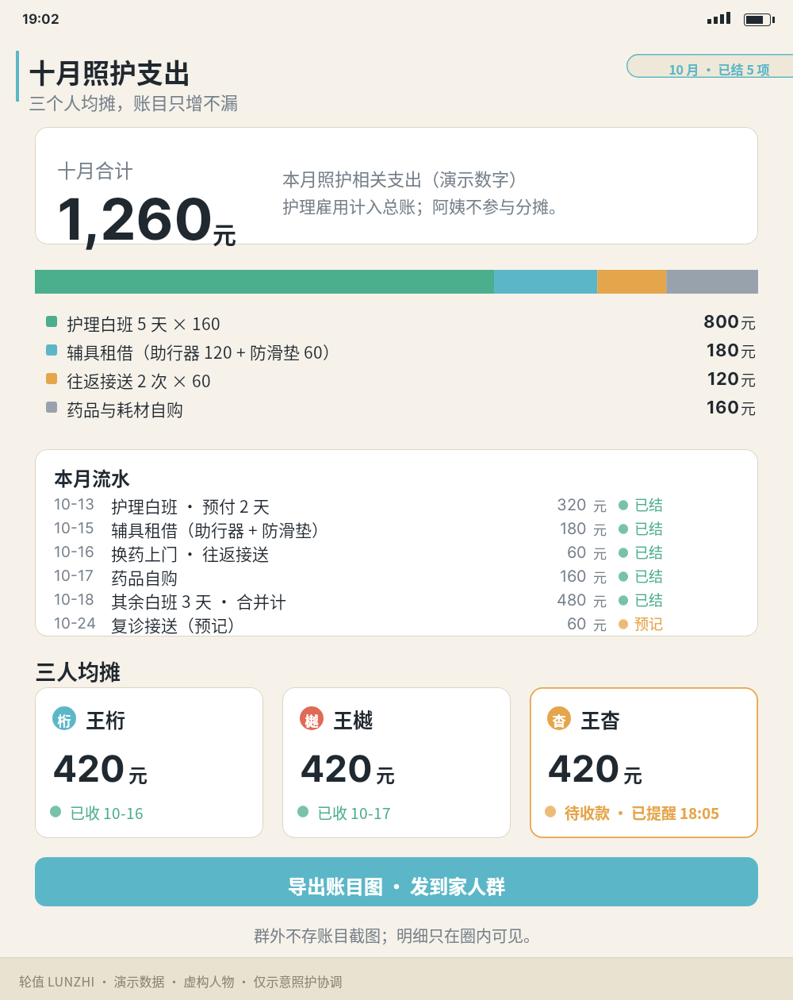
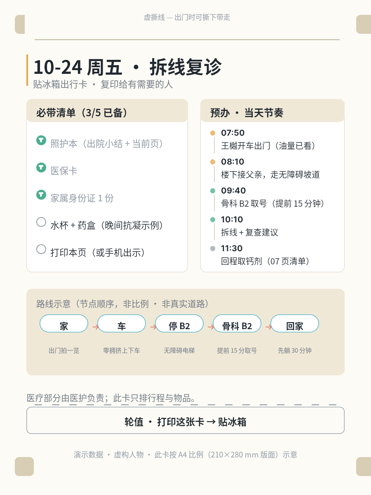
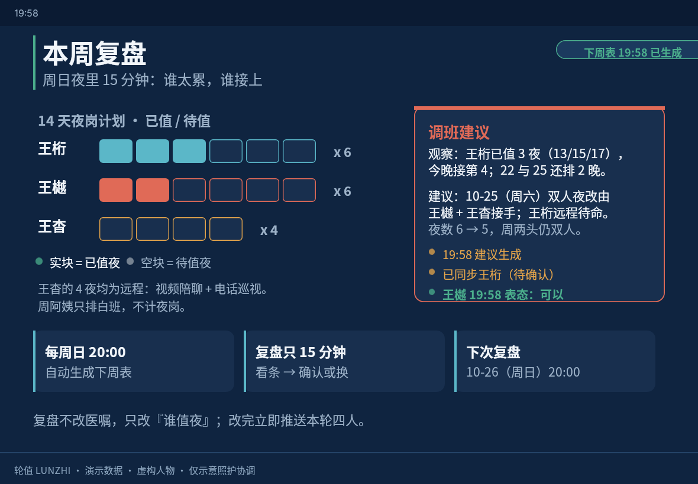

# B05 作品集 · 《轮值》十屏（虚构演示）

策展逻辑：十屏=一条照护旅程。引入(c01) → 建圈(c02) → 转译(c03) → 日常循环
(c04 轮值表 / c05 交接 / c06 动态 / c07 用药) → 月度账(c08) → 事件出行(c09) →
周复盘(c10) 回到轮值表，闭环。视觉记忆点：深夜蓝/米白纸感昼夜交替 + 左侧状态灯柱
+ 四人成员色码（桁青/樾珊瑚/杳琥珀/阿姨灰绿）。

**虚构声明**：人物、日期、金额、用药全部为演示；未做真实用户验证；不提供医疗建议。

| # | 用例 | 成品预览 | 要点 |
|---|---|---|---|
| 1 | [着陆概念「每人一晚，家里不塌」(420×960 夜)](case-01/final.png) · [DSL](case-01/final.snapshot) · [md](case-01/case.md) |  | 深夜着陆；三个上手段：把人放上桌 / 夜晚只剩今晚 / 每周日复盘夜 |
| 2 | [建立照护圈：角色与权限](case-02/final.png) · [DSL](case-02/final.snapshot) · [md](case-02/case.md) |  | 五人色码与权限差分；周阿姨待回执 |
| 3 | [出院照护转译表](case-03/final.png) · [DSL](case-03/final.snapshot) · [md](case-03/case.md) |  | 医嘱（示例）→ 6 类任务 × 3 时段；夜列深底 |
| 4 | [十四天轮值表(平板夜)](case-04/final.png) · [DSL](case-04/final.snapshot) · [md](case-04/case.md) |  | 14 夜网格定标；今晚=王桁第 4 夜；已值 5 夜 |
| 5 | [今日交接卡](case-05/final.png) · [DSL](case-05/final.snapshot) · [md](case-05/case.md) |  | 白班清单 ✔✔✘ + 夜班交接三要素 + 接班提醒 |
| 6 | [照护动态时间线](case-06/final.png) · [DSL](case-06/final.snapshot) · [md](case-06/case.md) |  | 异常闭环（足跟压红）/照片卡/补货/提醒 |
| 7 | [用药轴与库存](case-07/final.png) · [DSL](case-07/final.snapshot) · [md](case-07/case.md) |  | 08:00 已服 / 12:30 按需 / 21:30 待服 + 12 片 → 10-22 |
| 8 | [十月费用与三人均摊](case-08/final.png) · [DSL](case-08/final.snapshot) · [md](case-08/case.md) |  | 1,260 = 800+180+120+160；各 420；2 结 1 待 |
| 9 | [复诊出行卡(A4)](case-09/final.png) · [DSL](case-09/final.snapshot) · [md](case-09/case.md) |  | A4 撕角出行卡：必带 3/5 + 节奏 + 路线示意 |
| 10 | [周报与调班复盘](case-10/final.png) · [DSL](case-10/final.snapshot) · [md](case-10/case.md) |  | 夜岗对比条（桁3+3/樾2+4/杳0+4）+ 调班建议确认流 |

逐件说明见各 case.md；旅程与一致性锚点见 journey.json 与 product-brief.md。
