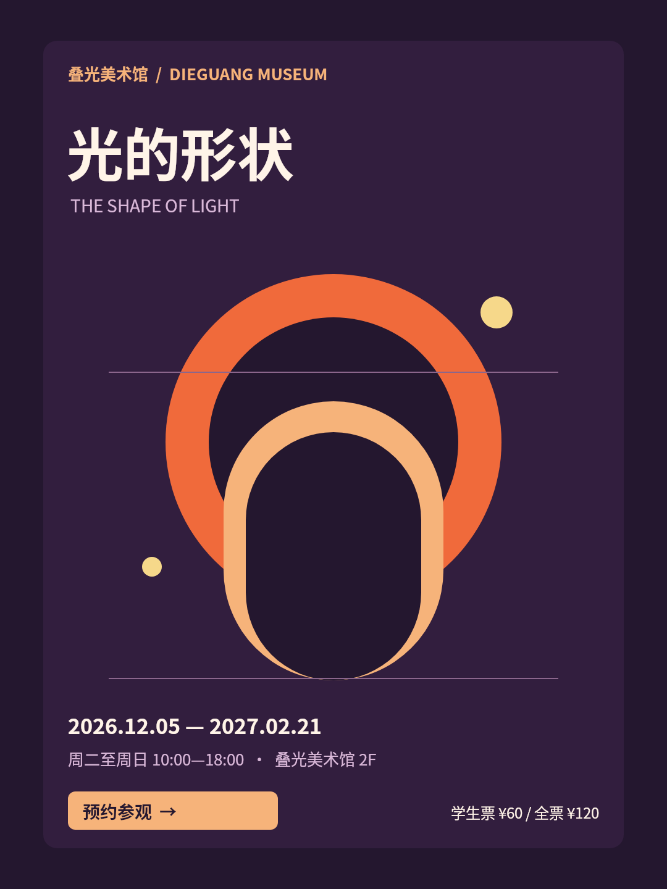
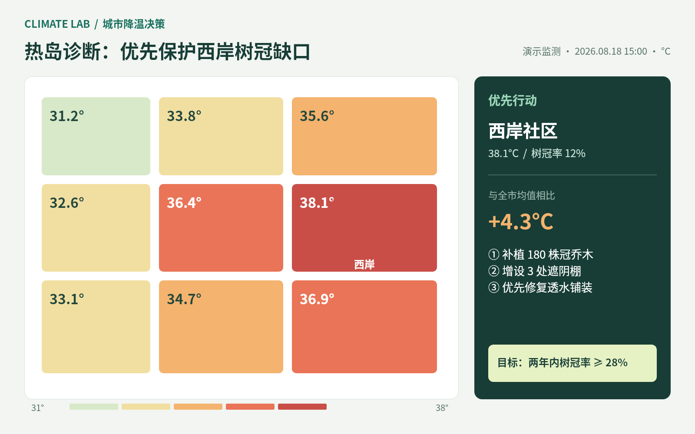
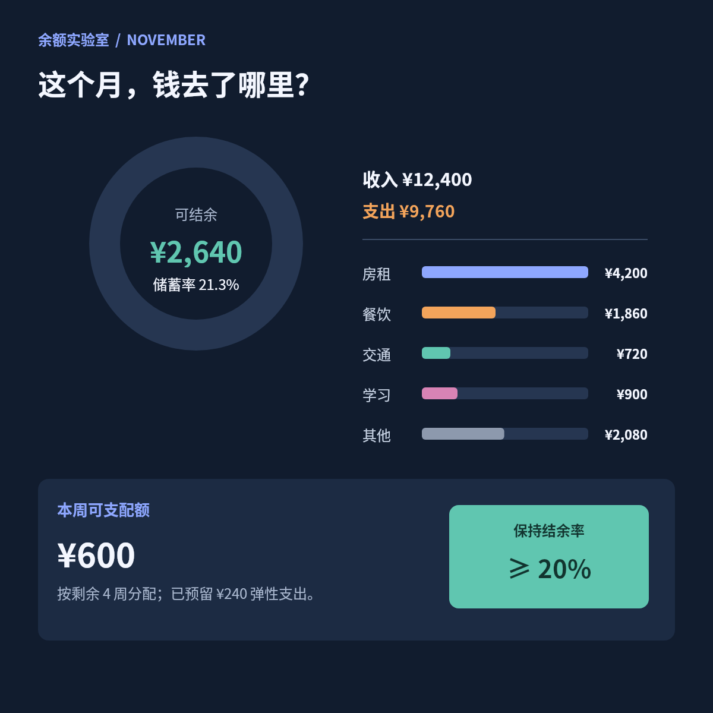
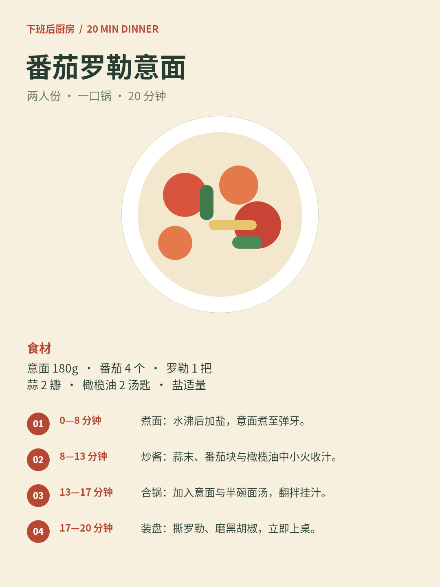
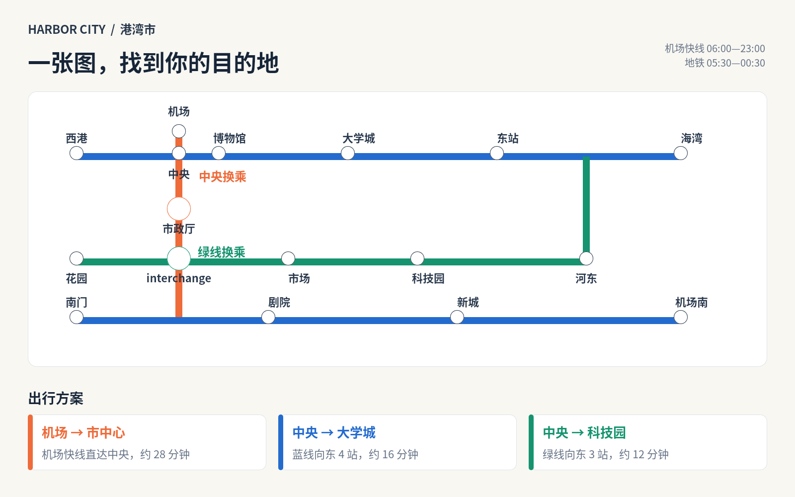
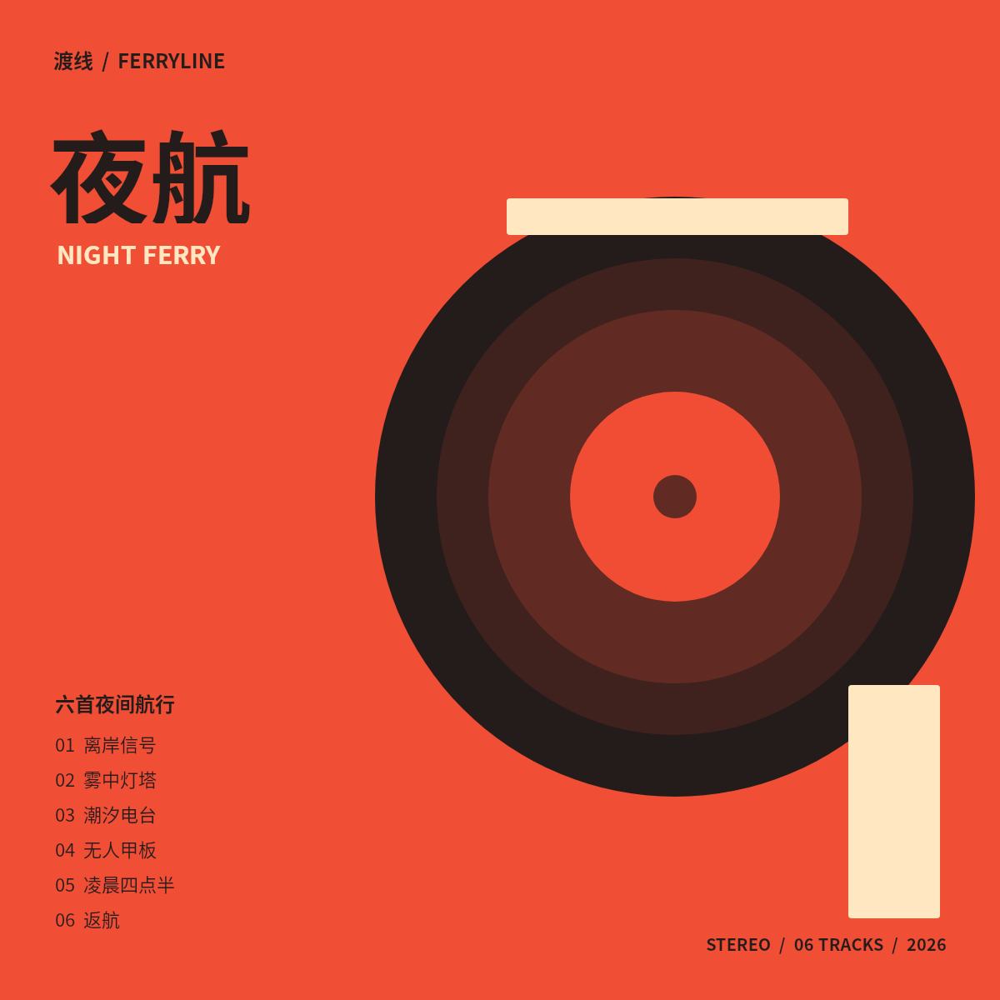
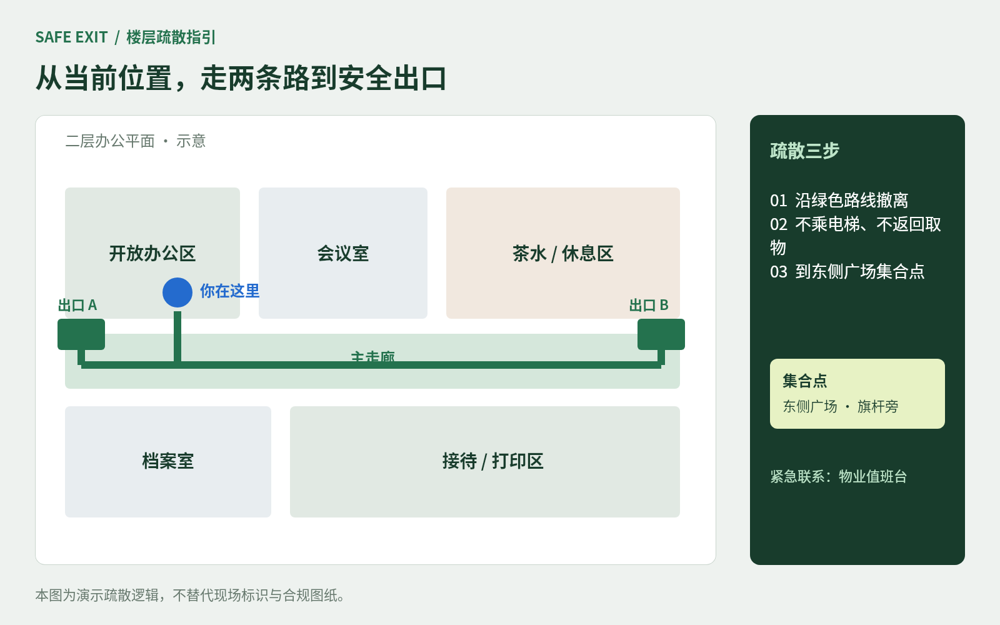
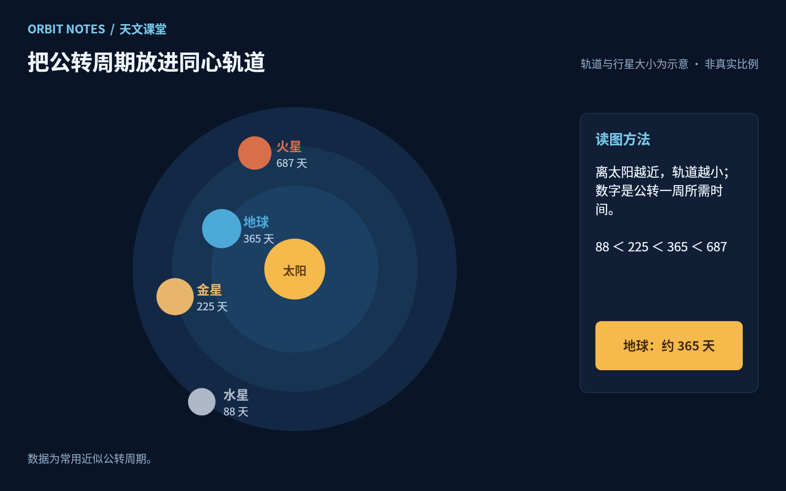
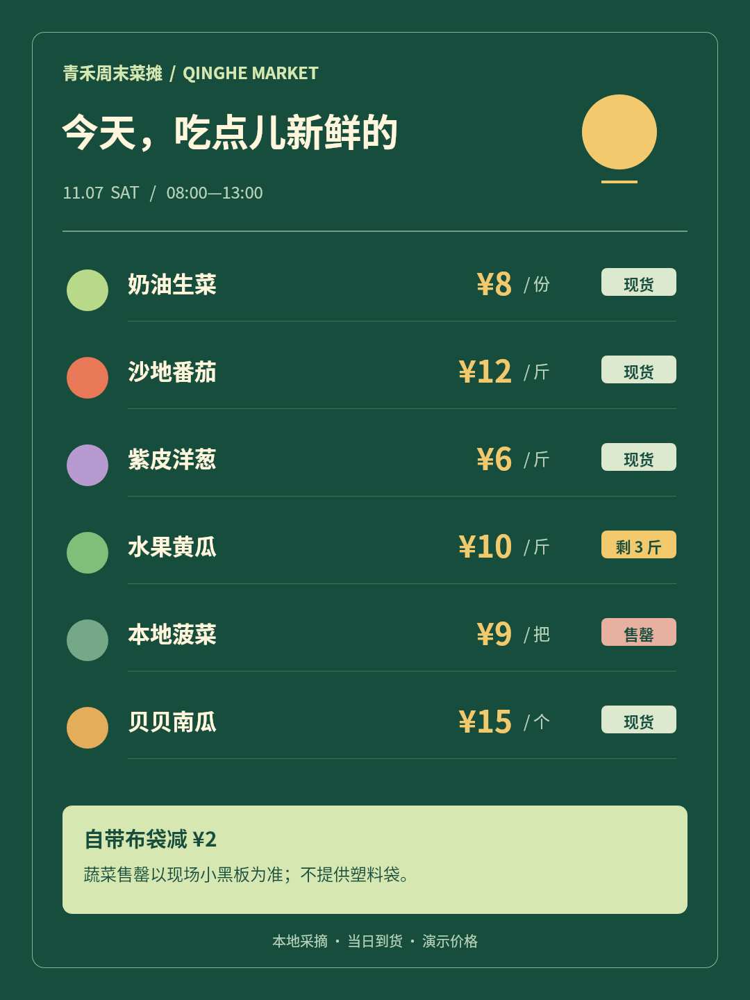
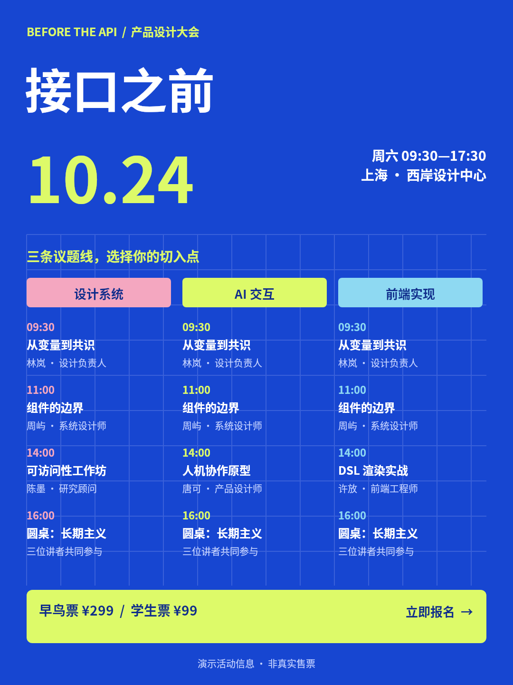

# B01 最终作品画廊

## case-01 · 光的形状｜美术馆展览海报

- 原始PNG：[case-01/final.png](case-01/final.png)
- 完整DSL：[case-01/final.snapshot](case-01/final.snapshot)
- 场景与自检：[case-01/case.md](case-01/case.md)

## case-02 · 城市热岛｜社区降温决策看板

- 原始PNG：[case-02/final.png](case-02/final.png)
- 完整DSL：[case-02/final.snapshot](case-02/final.snapshot)
- 场景与自检：[case-02/case.md](case-02/case.md)

## case-03 · 月度余额｜个人预算控制台

- 原始PNG：[case-03/final.png](case-03/final.png)
- 完整DSL：[case-03/final.snapshot](case-03/final.snapshot)
- 场景与自检：[case-03/case.md](case-03/case.md)

## case-04 · 番茄罗勒｜20分钟晚餐教学单

- 原始PNG：[case-04/final.png](case-04/final.png)
- 完整DSL：[case-04/final.snapshot](case-04/final.snapshot)
- 场景与自检：[case-04/case.md](case-04/case.md)

## case-05 · 港湾线｜城市通勤导览图

- 原始PNG：[case-05/final.png](case-05/final.png)
- 完整DSL：[case-05/final.snapshot](case-05/final.snapshot)
- 场景与自检：[case-05/case.md](case-05/case.md)

## case-06 · 夜航｜独立电子专辑封面

- 原始PNG：[case-06/final.png](case-06/final.png)
- 完整DSL：[case-06/final.snapshot](case-06/final.snapshot)
- 场景与自检：[case-06/case.md](case-06/case.md)

## case-07 · 安全出口｜办公室疏散指引

- 原始PNG：[case-07/final.png](case-07/final.png)
- 完整DSL：[case-07/final.snapshot](case-07/final.snapshot)
- 场景与自检：[case-07/case.md](case-07/case.md)

## case-08 · 内太阳系｜科普尺度图

- 原始PNG：[case-08/final.png](case-08/final.png)
- 完整DSL：[case-08/final.snapshot](case-08/final.snapshot)
- 场景与自检：[case-08/case.md](case-08/case.md)

## case-09 · 周末菜摊｜社区市集价格牌

- 原始PNG：[case-09/final.png](case-09/final.png)
- 完整DSL：[case-09/final.snapshot](case-09/final.snapshot)
- 场景与自检：[case-09/case.md](case-09/case.md)

## case-10 · 接口之前｜产品设计大会议程

- 原始PNG：[case-10/final.png](case-10/final.png)
- 完整DSL：[case-10/final.snapshot](case-10/final.snapshot)
- 场景与自检：[case-10/case.md](case-10/case.md)
