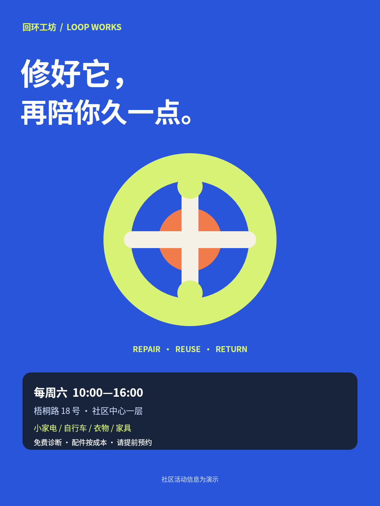
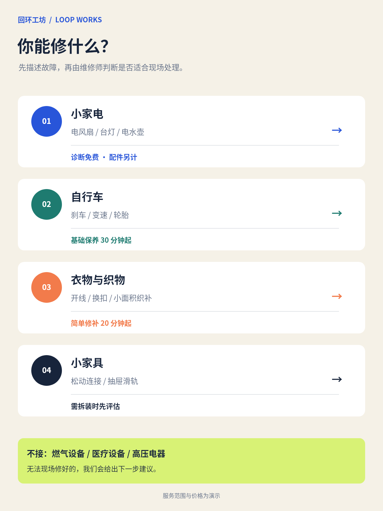
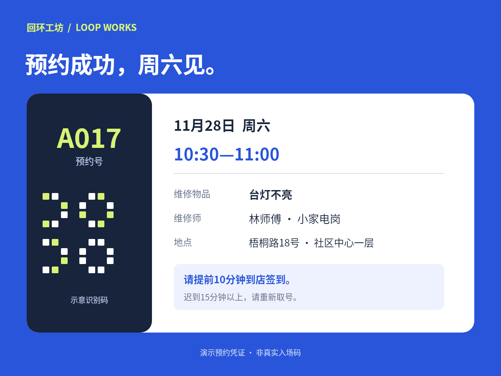
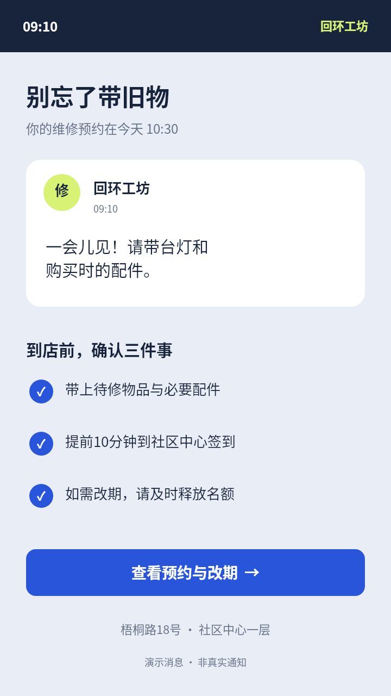
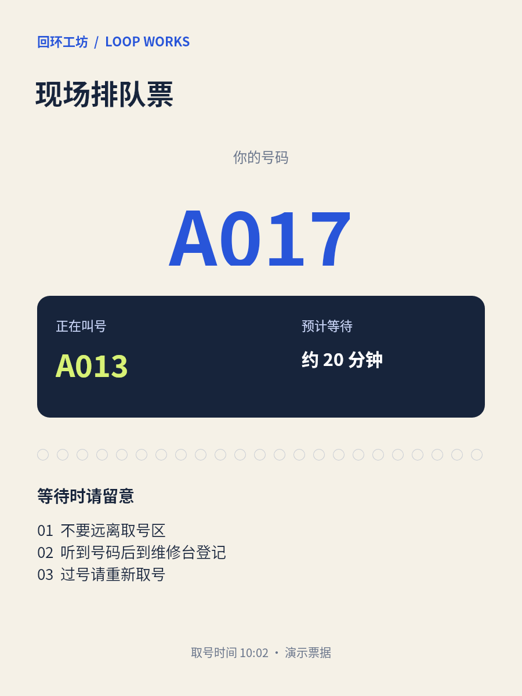
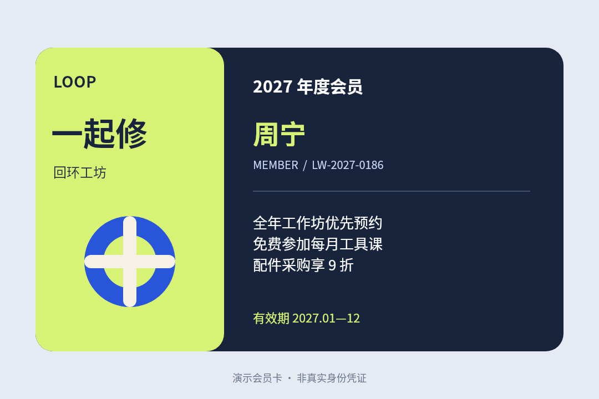
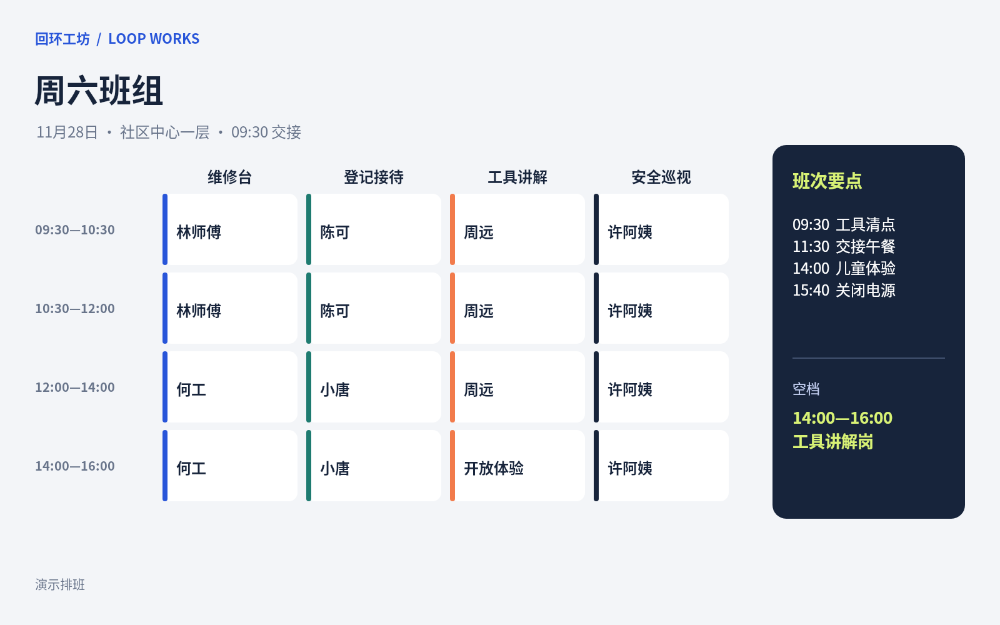
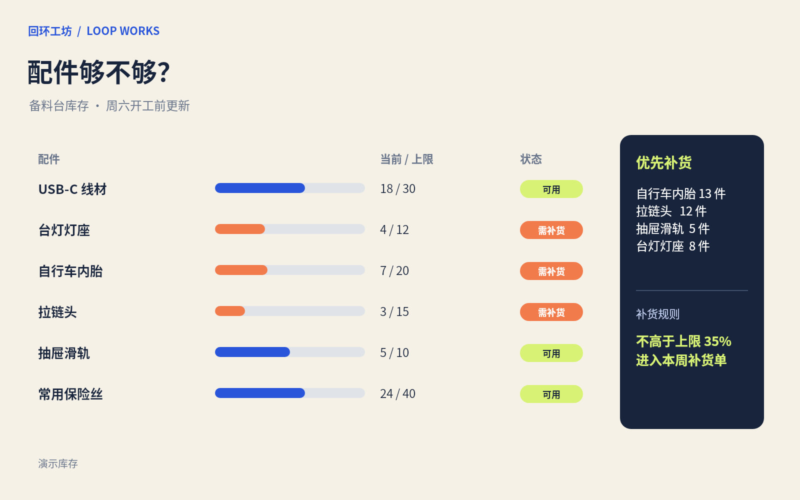
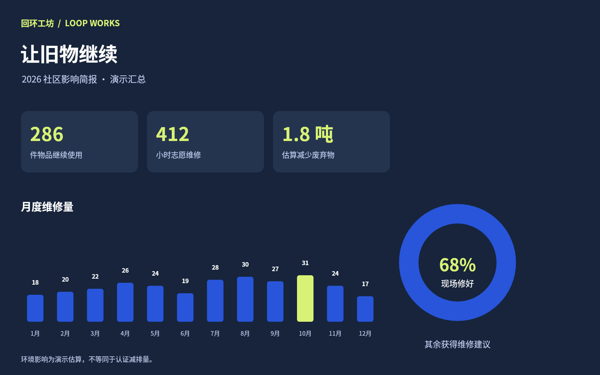
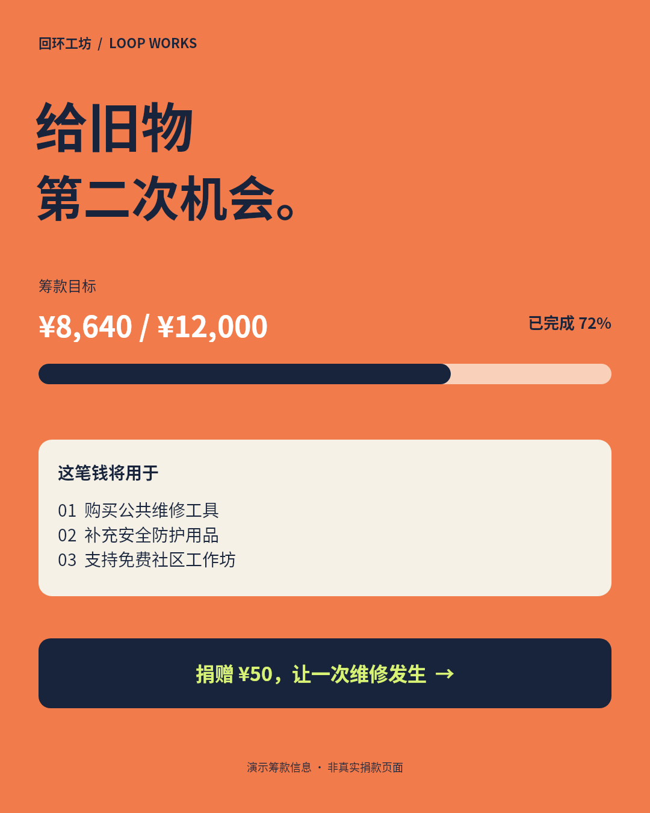

# B02 最终作品画廊

## case-01 · 修好它，再陪你久一点｜招募海报

- 原始PNG：[case-01/final.png](case-01/final.png)
- 完整DSL：[case-01/final.snapshot](case-01/final.snapshot)
- 场景与自检：[case-01/case.md](case-01/case.md)

## case-02 · 能修什么｜服务菜单

- 原始PNG：[case-02/final.png](case-02/final.png)
- 完整DSL：[case-02/final.snapshot](case-02/final.snapshot)
- 场景与自检：[case-02/case.md](case-02/case.md)

## case-03 · 预约成功｜到店凭证

- 原始PNG：[case-03/final.png](case-03/final.png)
- 完整DSL：[case-03/final.snapshot](case-03/final.snapshot)
- 场景与自检：[case-03/case.md](case-03/case.md)

## case-04 · 别忘了带旧物｜行前提醒

- 原始PNG：[case-04/final.png](case-04/final.png)
- 完整DSL：[case-04/final.snapshot](case-04/final.snapshot)
- 场景与自检：[case-04/case.md](case-04/case.md)

## case-05 · A017｜现场排队票

- 原始PNG：[case-05/final.png](case-05/final.png)
- 完整DSL：[case-05/final.snapshot](case-05/final.snapshot)
- 场景与自检：[case-05/case.md](case-05/case.md)

## case-06 · 一起修｜年度会员卡

- 原始PNG：[case-06/final.png](case-06/final.png)
- 完整DSL：[case-06/final.snapshot](case-06/final.snapshot)
- 场景与自检：[case-06/case.md](case-06/case.md)

## case-07 · 周六班组｜志愿者排班

- 原始PNG：[case-07/final.png](case-07/final.png)
- 完整DSL：[case-07/final.snapshot](case-07/final.snapshot)
- 场景与自检：[case-07/case.md](case-07/case.md)

## case-08 · 配件够不够｜库存看板

- 原始PNG：[case-08/final.png](case-08/final.png)
- 完整DSL：[case-08/final.snapshot](case-08/final.snapshot)
- 场景与自检：[case-08/case.md](case-08/case.md)

## case-09 · 让旧物继续｜年度影响报告

- 原始PNG：[case-09/final.png](case-09/final.png)
- 完整DSL：[case-09/final.snapshot](case-09/final.snapshot)
- 场景与自检：[case-09/case.md](case-09/case.md)

## case-10 · 给旧物第二次机会｜筹款海报

- 原始PNG：[case-10/final.png](case-10/final.png)
- 完整DSL：[case-10/final.snapshot](case-10/final.snapshot)
- 场景与自检：[case-10/case.md](case-10/case.md)
