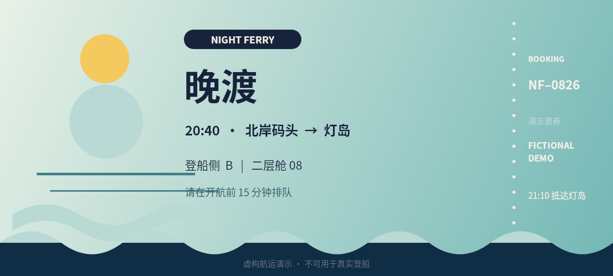
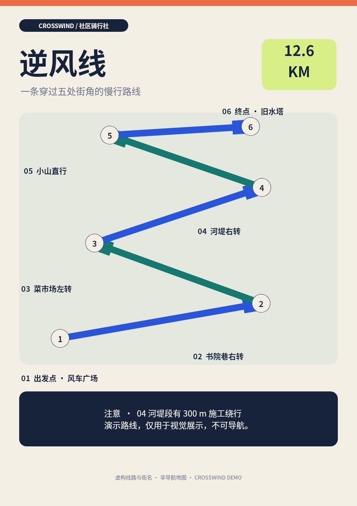
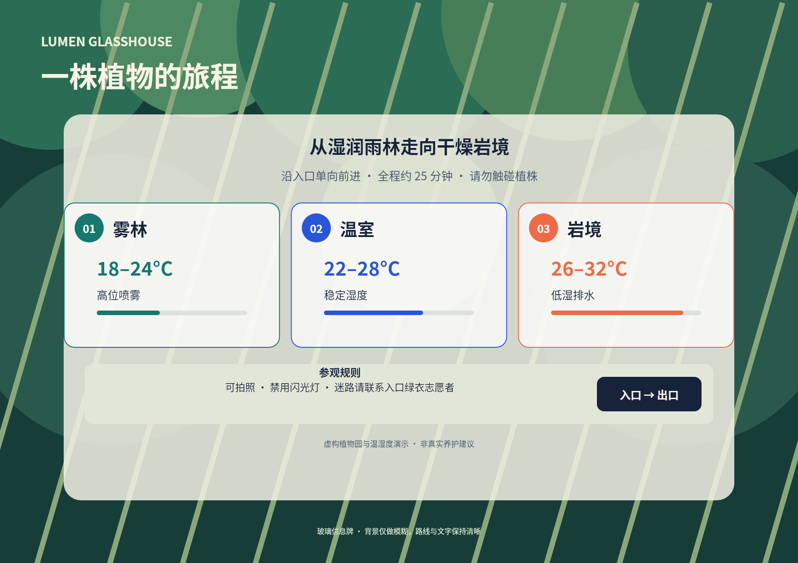
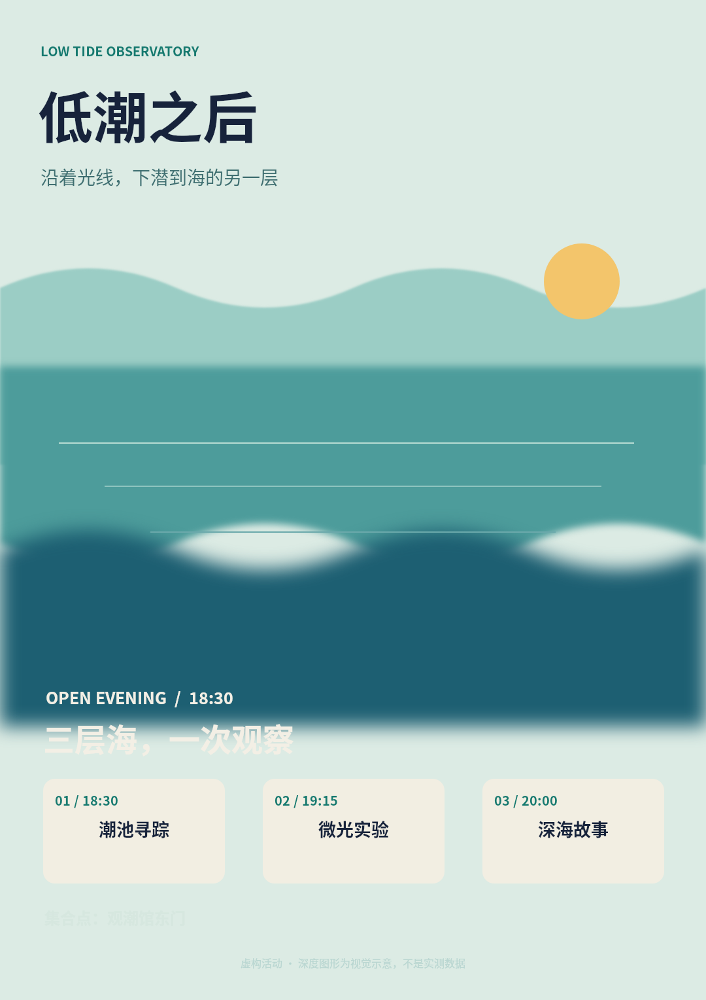
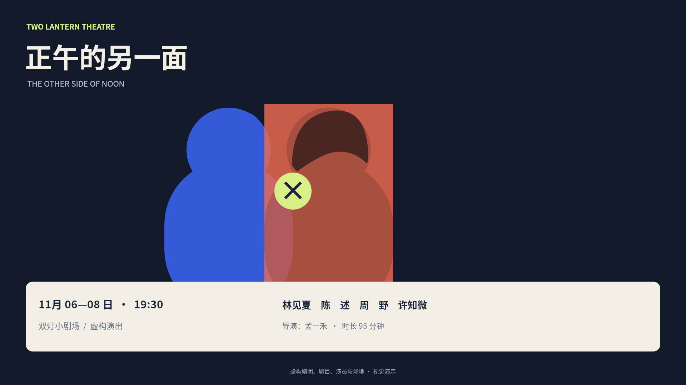
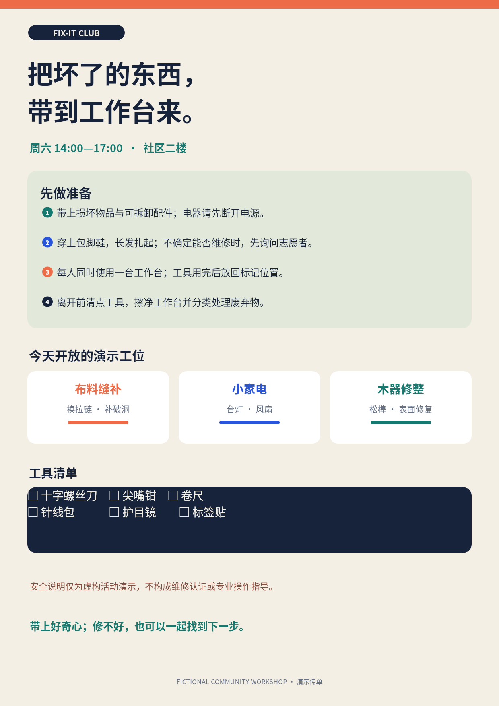
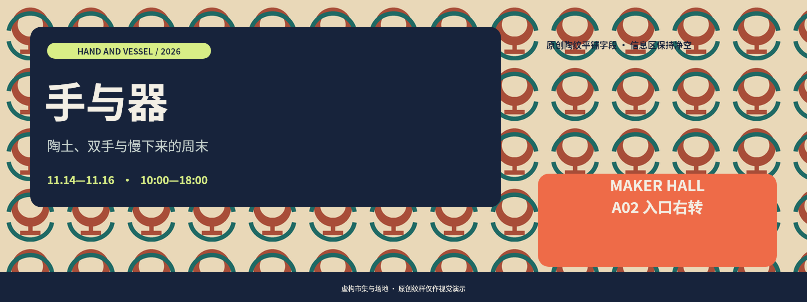
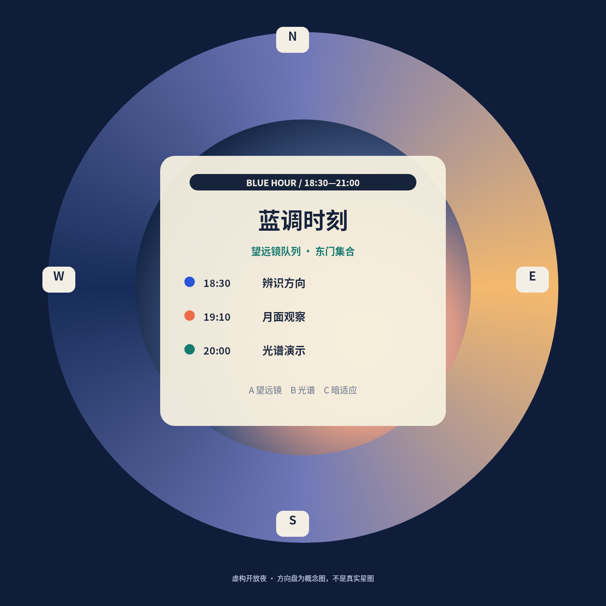
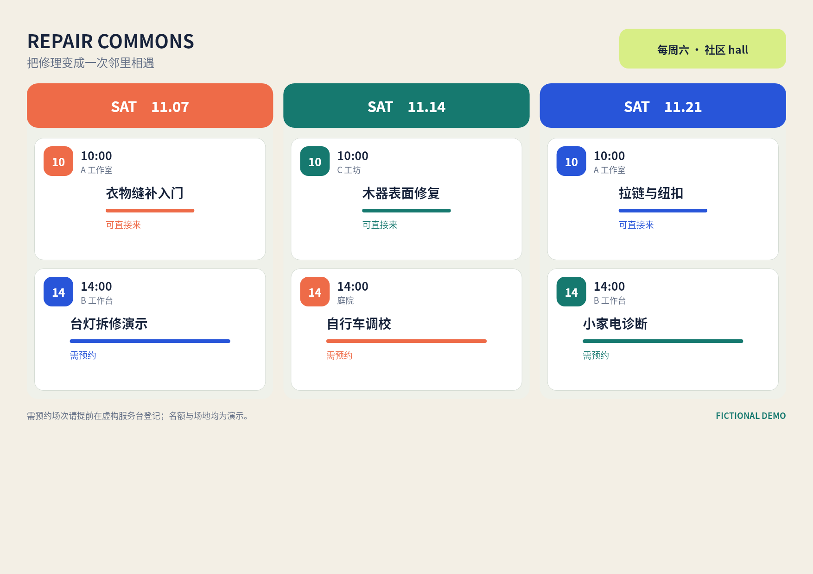
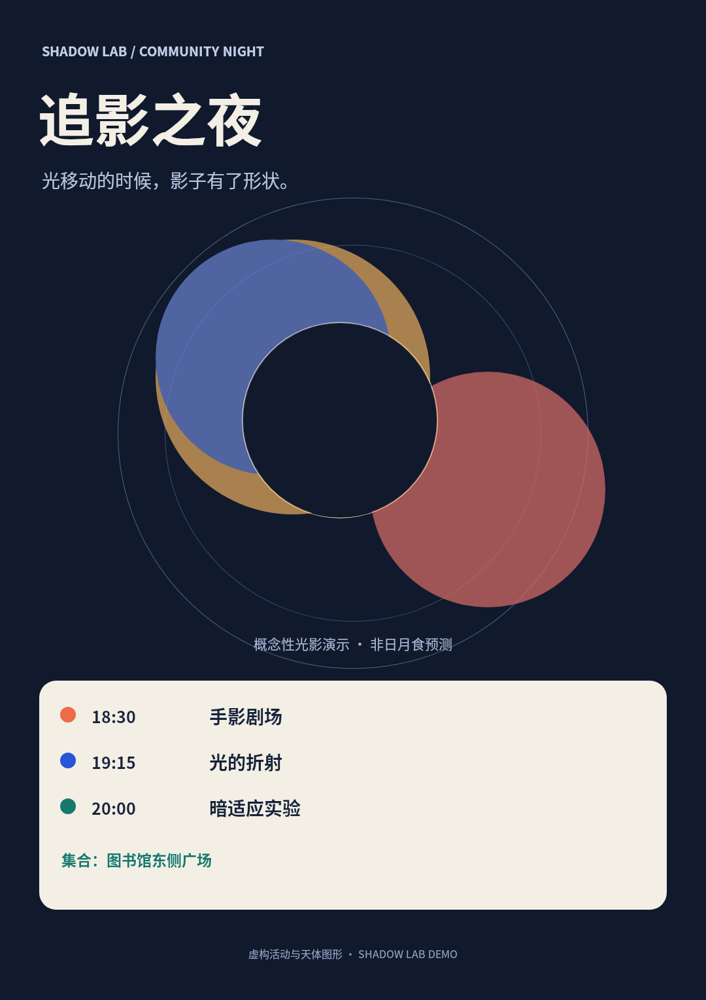

# B03 最终作品画廊

## case-01 · Night Ferry cut-out ticket

- 原始PNG：[case-01/final.png](case-01/final.png)
- 完整DSL：[case-01/final.snapshot](case-01/final.snapshot)
- 场景与自检：[case-01/case.md](case-01/case.md)

## case-02 · Crosswind cycling route poster

- 原始PNG：[case-02/final.png](case-02/final.png)
- 完整DSL：[case-02/final.snapshot](case-02/final.snapshot)
- 场景与自检：[case-02/case.md](case-02/case.md)

## case-03 · Glasshouse visitor information panel

- 原始PNG：[case-03/final.png](case-03/final.png)
- 完整DSL：[case-03/final.snapshot](case-03/final.snapshot)
- 场景与自检：[case-03/case.md](case-03/case.md)

## case-04 · Low Tide Observatory depth poster

- 原始PNG：[case-04/final.png](case-04/final.png)
- 完整DSL：[case-04/final.snapshot](case-04/final.snapshot)
- 场景与自检：[case-04/case.md](case-04/case.md)

## case-05 · Two Lantern Theatre cast billboard

- 原始PNG：[case-05/final.png](case-05/final.png)
- 完整DSL：[case-05/final.snapshot](case-05/final.snapshot)
- 场景与自检：[case-05/case.md](case-05/case.md)

## case-06 · Fix-It Club inline workshop leaflet

- 原始PNG：[case-06/final.png](case-06/final.png)
- 完整DSL：[case-06/final.snapshot](case-06/final.snapshot)
- 场景与自检：[case-06/case.md](case-06/case.md)

## case-07 · Hand & Vessel fair pattern wrap

- 原始PNG：[case-07/final.png](case-07/final.png)
- 完整DSL：[case-07/final.snapshot](case-07/final.snapshot)
- 场景与自检：[case-07/case.md](case-07/case.md)

## case-08 · Blue Hour sky-orientation dial

- 原始PNG：[case-08/final.png](case-08/final.png)
- 完整DSL：[case-08/final.snapshot](case-08/final.snapshot)
- 场景与自检：[case-08/case.md](case-08/case.md)

## case-09 · Repair Commons modular timetable board

- 原始PNG：[case-09/final.png](case-09/final.png)
- 完整DSL：[case-09/final.snapshot](case-09/final.snapshot)
- 场景与自检：[case-09/case.md](case-09/case.md)

## case-10 · Shadow Lab eclipse-night poster

- 原始PNG：[case-10/final.png](case-10/final.png)
- 完整DSL：[case-10/final.snapshot](case-10/final.snapshot)
- 场景与自检：[case-10/case.md](case-10/case.md)
