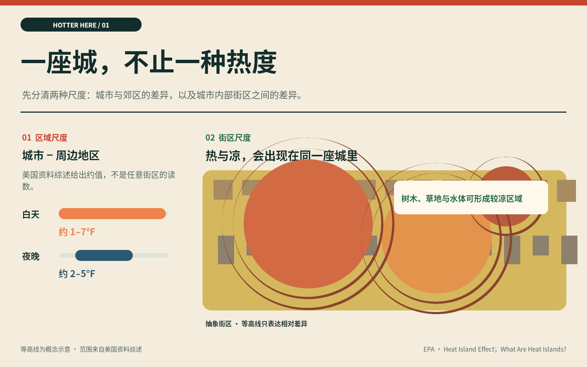
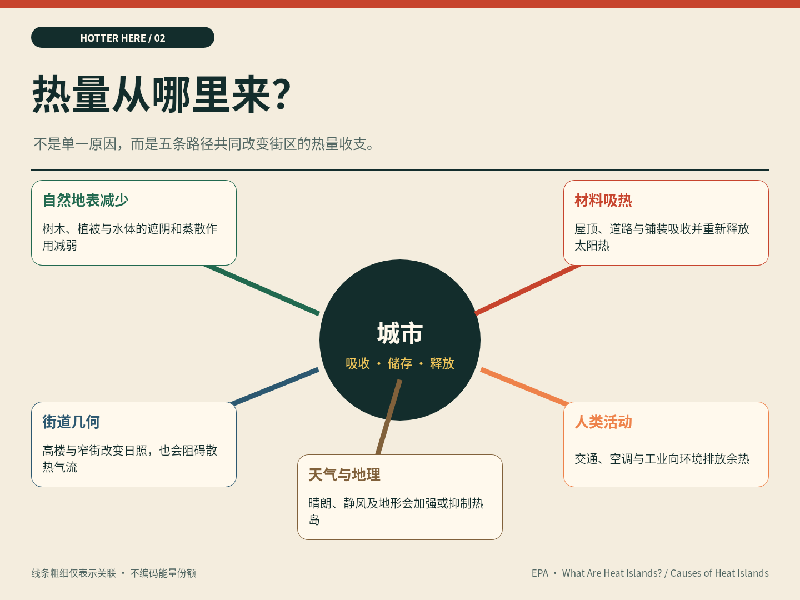
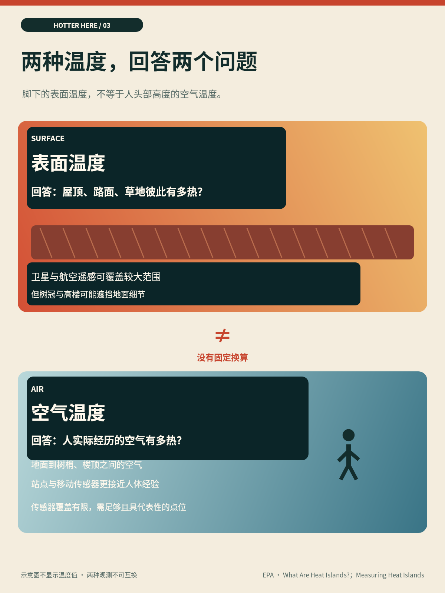
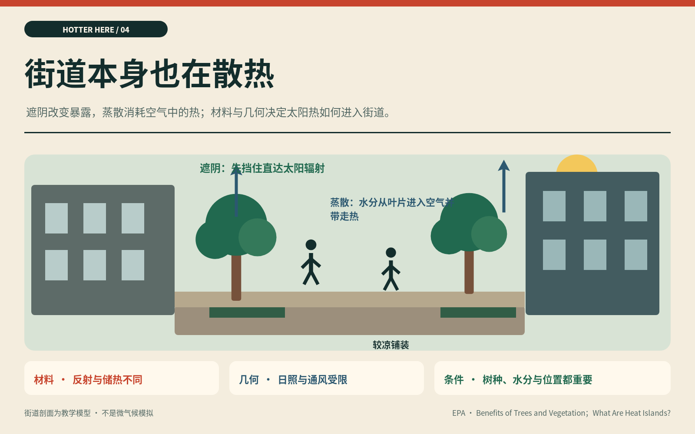
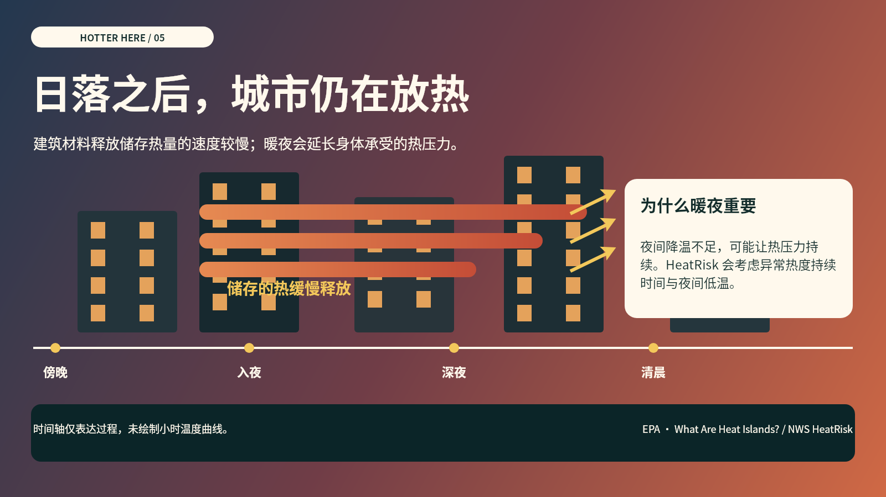
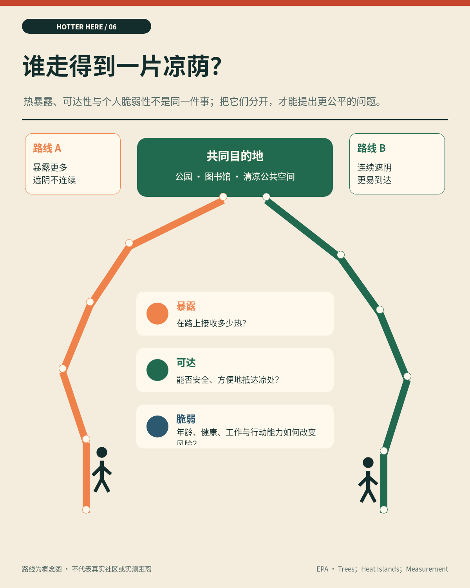
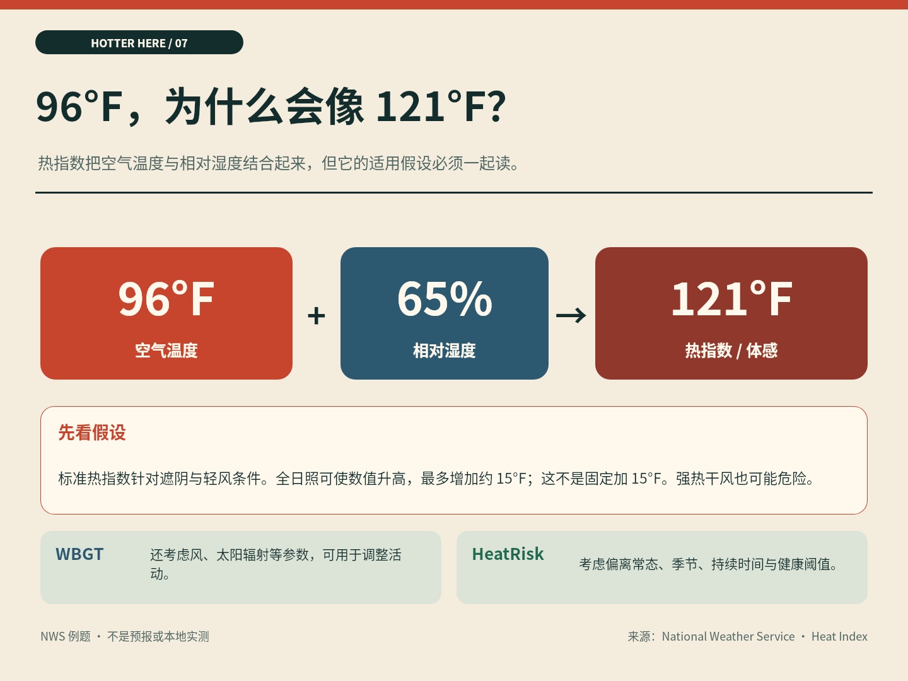
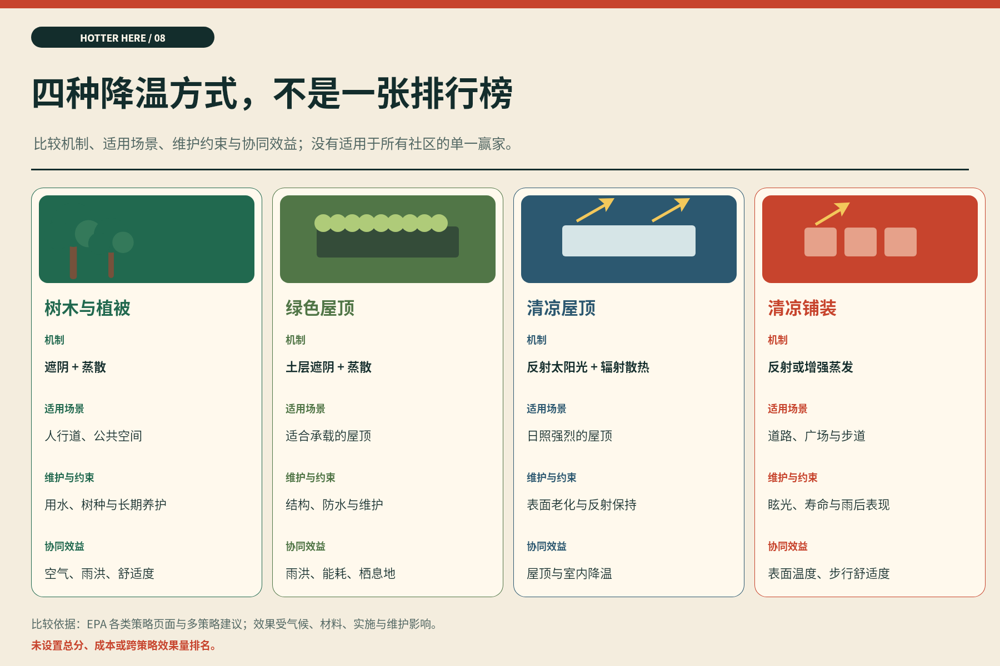
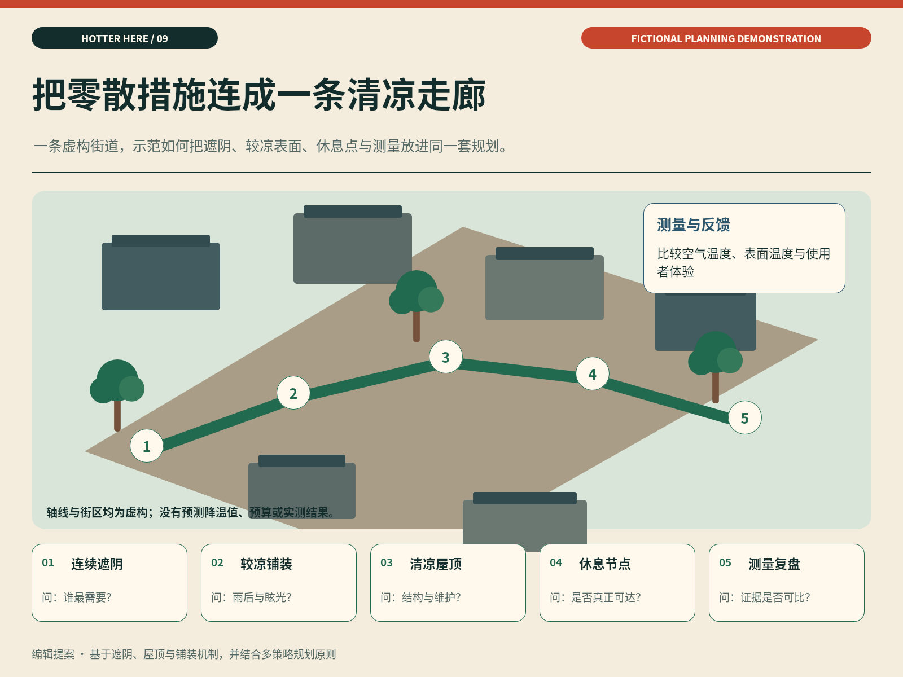
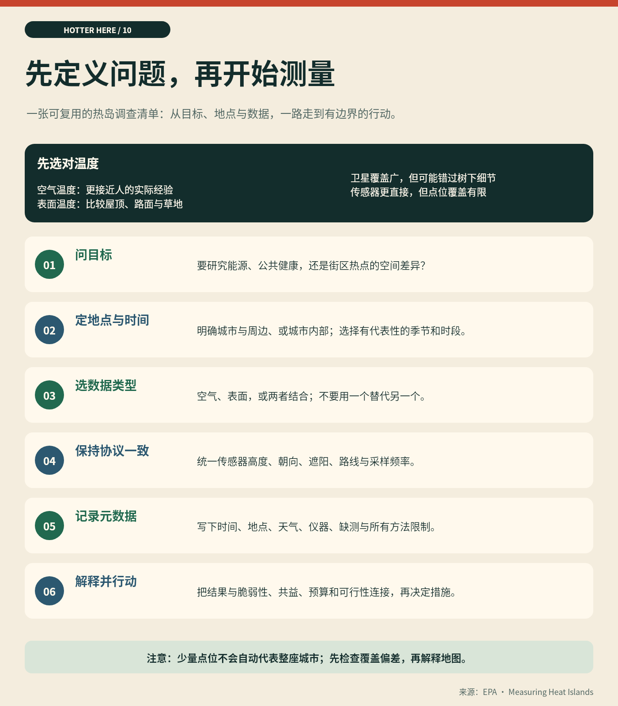

# B04 最终作品画廊

## B04-case-01 · One City, Many Climates

- 原始PNG：[B04-case-01/final.png](B04-case-01/final.png)
- 完整DSL：[B04-case-01/final.snapshot](B04-case-01/final.snapshot)
- 场景与自检：[B04-case-01/case.md](B04-case-01/case.md)

## B04-case-02 · The Day's Heat Budget

- 原始PNG：[B04-case-02/final.png](B04-case-02/final.png)
- 完整DSL：[B04-case-02/final.snapshot](B04-case-02/final.snapshot)
- 场景与自检：[B04-case-02/case.md](B04-case-02/case.md)

## B04-case-03 · Two Temperatures, Two Questions

- 原始PNG：[B04-case-03/final.png](B04-case-03/final.png)
- 完整DSL：[B04-case-03/final.snapshot](B04-case-03/final.snapshot)
- 场景与自检：[B04-case-03/case.md](B04-case-03/case.md)

## B04-case-04 · The Street Decides

- 原始PNG：[B04-case-04/final.png](B04-case-04/final.png)
- 完整DSL：[B04-case-04/final.snapshot](B04-case-04/final.snapshot)
- 场景与自检：[B04-case-04/case.md](B04-case-04/case.md)

## B04-case-05 · After Sunset, the City Exhales

- 原始PNG：[B04-case-05/final.png](B04-case-05/final.png)
- 完整DSL：[B04-case-05/final.snapshot](B04-case-05/final.snapshot)
- 场景与自检：[B04-case-05/case.md](B04-case-05/case.md)

## B04-case-06 · Who Gets the Shade?

- 原始PNG：[B04-case-06/final.png](B04-case-06/final.png)
- 完整DSL：[B04-case-06/final.snapshot](B04-case-06/final.snapshot)
- 场景与自检：[B04-case-06/case.md](B04-case-06/case.md)

## B04-case-07 · What 96°F Feels Like

- 原始PNG：[B04-case-07/final.png](B04-case-07/final.png)
- 完整DSL：[B04-case-07/final.snapshot](B04-case-07/final.snapshot)
- 场景与自检：[B04-case-07/case.md](B04-case-07/case.md)

## B04-case-08 · Four Ways to Cool a Block

- 原始PNG：[B04-case-08/final.png](B04-case-08/final.png)
- 完整DSL：[B04-case-08/final.snapshot](B04-case-08/final.snapshot)
- 场景与自检：[B04-case-08/case.md](B04-case-08/case.md)

## B04-case-09 · Draw a Cool Corridor

- 原始PNG：[B04-case-09/final.png](B04-case-09/final.png)
- 完整DSL：[B04-case-09/final.snapshot](B04-case-09/final.snapshot)
- 场景与自检：[B04-case-09/case.md](B04-case-09/case.md)

## B04-case-10 · Measure Before You Map

- 原始PNG：[B04-case-10/final.png](B04-case-10/final.png)
- 完整DSL：[B04-case-10/final.snapshot](B04-case-10/final.snapshot)
- 场景与自检：[B04-case-10/case.md](B04-case-10/case.md)
