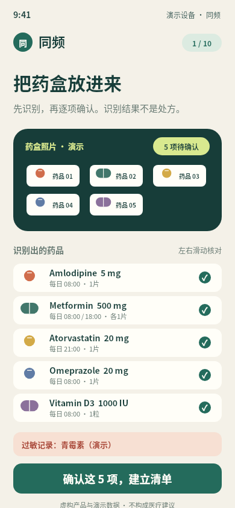
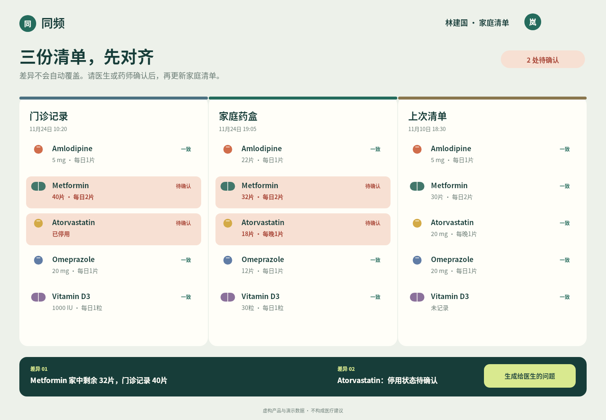
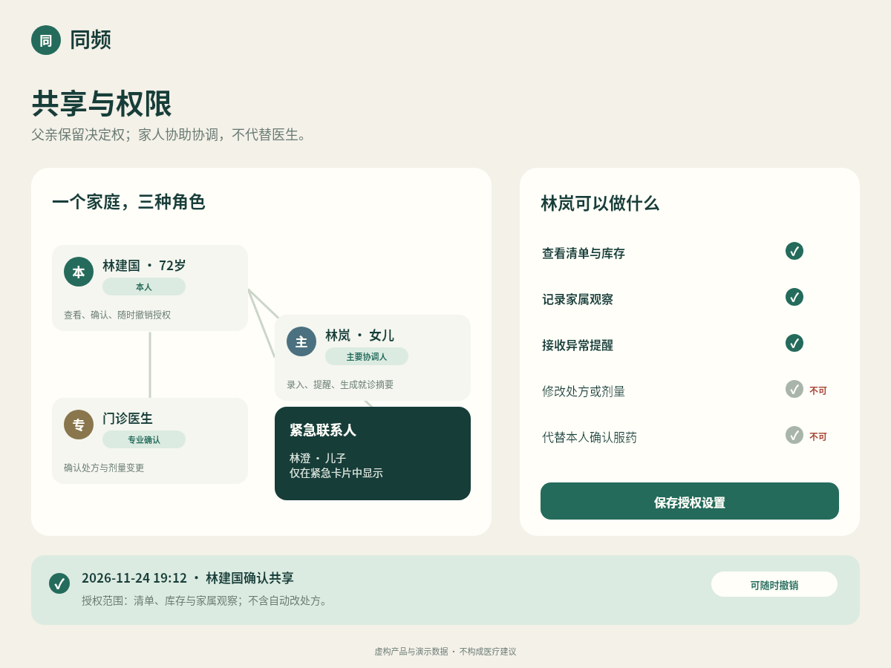
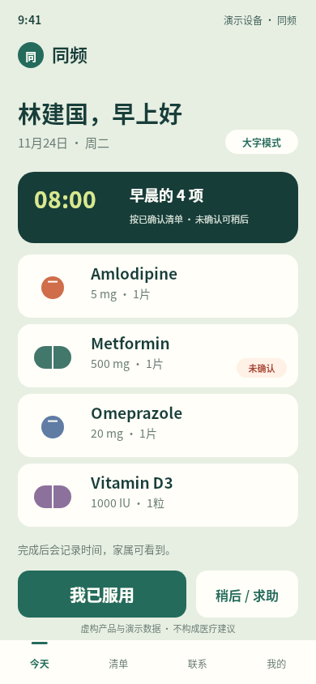
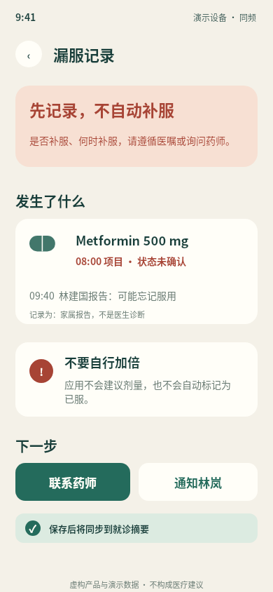
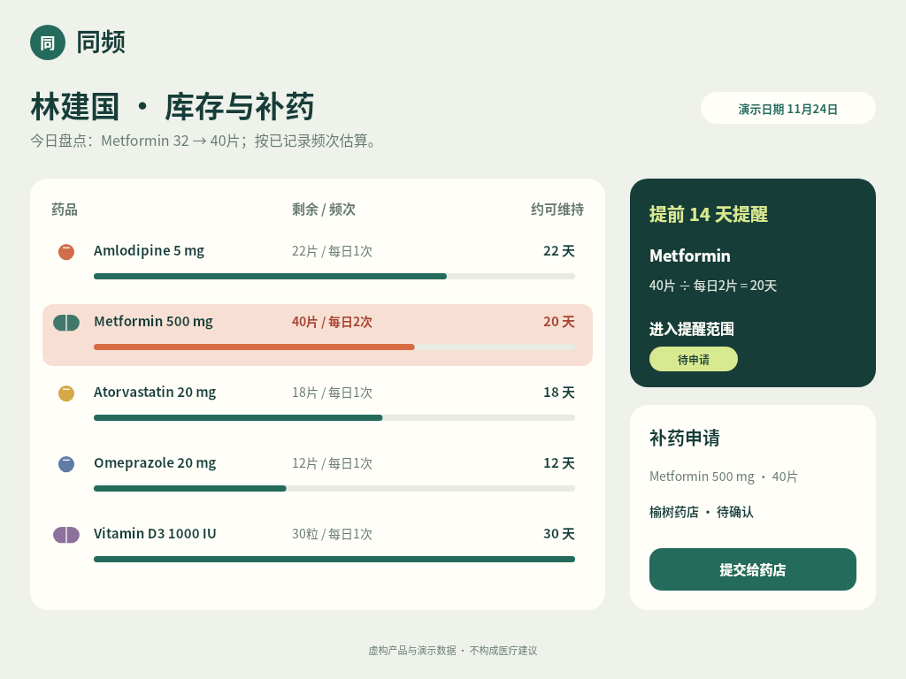
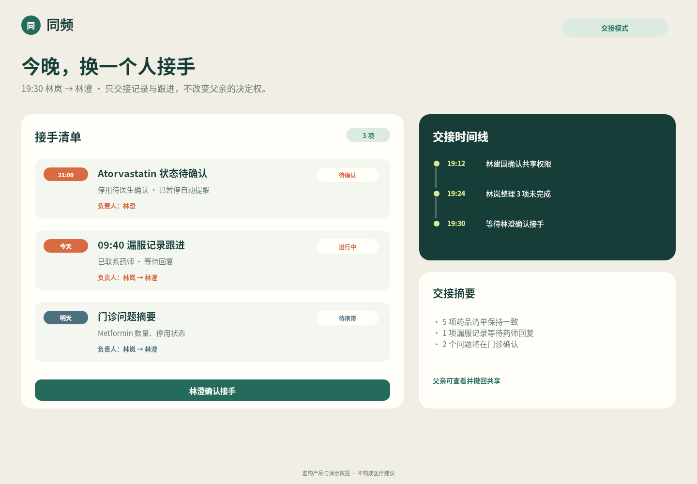
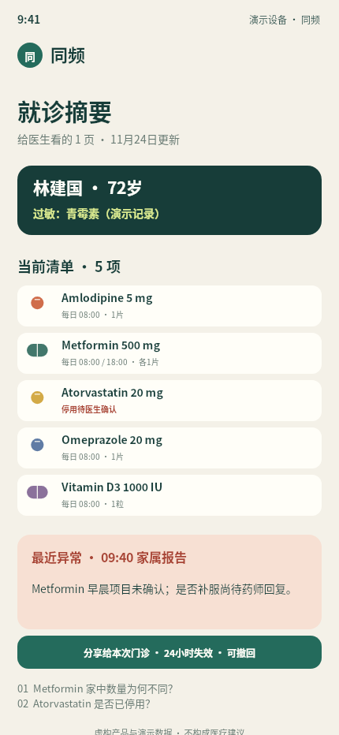
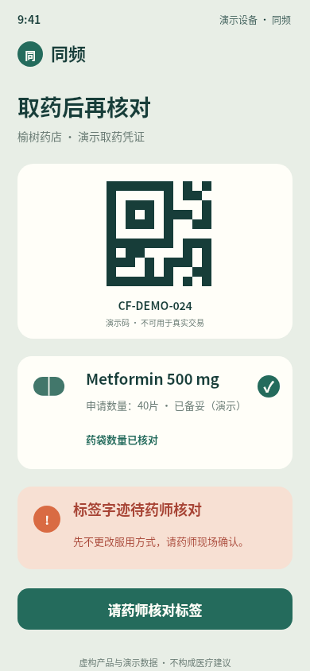
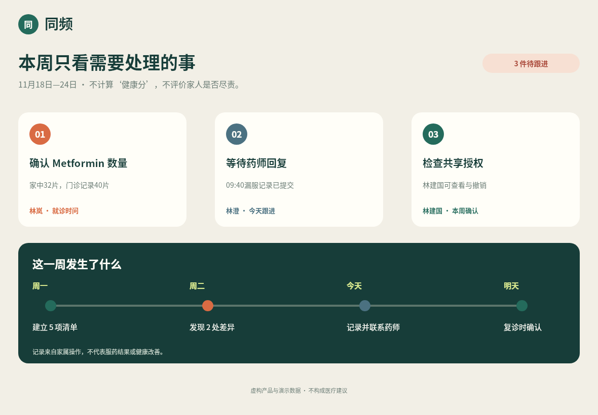

# B05 最终作品画廊

## B05-case-01 · 把药盒放进来

- 原始PNG：[B05-case-01/final.png](B05-case-01/final.png)
- 完整DSL：[B05-case-01/final.snapshot](B05-case-01/final.snapshot)
- 场景与自检：[B05-case-01/case.md](B05-case-01/case.md)

## B05-case-02 · 三份清单，先对齐

- 原始PNG：[B05-case-02/final.png](B05-case-02/final.png)
- 完整DSL：[B05-case-02/final.snapshot](B05-case-02/final.snapshot)
- 场景与自检：[B05-case-02/case.md](B05-case-02/case.md)

## B05-case-03 · 谁可以看见，谁来决定

- 原始PNG：[B05-case-03/final.png](B05-case-03/final.png)
- 完整DSL：[B05-case-03/final.snapshot](B05-case-03/final.snapshot)
- 场景与自检：[B05-case-03/case.md](B05-case-03/case.md)

## B05-case-04 · 现在，只做这一件

- 原始PNG：[B05-case-04/final.png](B05-case-04/final.png)
- 完整DSL：[B05-case-04/final.snapshot](B05-case-04/final.snapshot)
- 场景与自检：[B05-case-04/case.md](B05-case-04/case.md)

## B05-case-05 · 漏服了，先别加倍

- 原始PNG：[B05-case-05/final.png](B05-case-05/final.png)
- 完整DSL：[B05-case-05/final.snapshot](B05-case-05/final.snapshot)
- 场景与自检：[B05-case-05/case.md](B05-case-05/case.md)

## B05-case-06 · 在见底之前安排补药

- 原始PNG：[B05-case-06/final.png](B05-case-06/final.png)
- 完整DSL：[B05-case-06/final.snapshot](B05-case-06/final.snapshot)
- 场景与自检：[B05-case-06/case.md](B05-case-06/case.md)

## B05-case-07 · 今晚，换一个人接手

- 原始PNG：[B05-case-07/final.png](B05-case-07/final.png)
- 完整DSL：[B05-case-07/final.snapshot](B05-case-07/final.snapshot)
- 场景与自检：[B05-case-07/case.md](B05-case-07/case.md)

## B05-case-08 · 把问题带到诊室

- 原始PNG：[B05-case-08/final.png](B05-case-08/final.png)
- 完整DSL：[B05-case-08/final.snapshot](B05-case-08/final.snapshot)
- 场景与自检：[B05-case-08/case.md](B05-case-08/case.md)

## B05-case-09 · 取药后，再核对一次

- 原始PNG：[B05-case-09/final.png](B05-case-09/final.png)
- 完整DSL：[B05-case-09/final.snapshot](B05-case-09/final.snapshot)
- 场景与自检：[B05-case-09/case.md](B05-case-09/case.md)

## B05-case-10 · 只看需要处理的三件事

- 原始PNG：[B05-case-10/final.png](B05-case-10/final.png)
- 完整DSL：[B05-case-10/final.snapshot](B05-case-10/final.snapshot)
- 场景与自检：[B05-case-10/case.md](B05-case-10/case.md)
