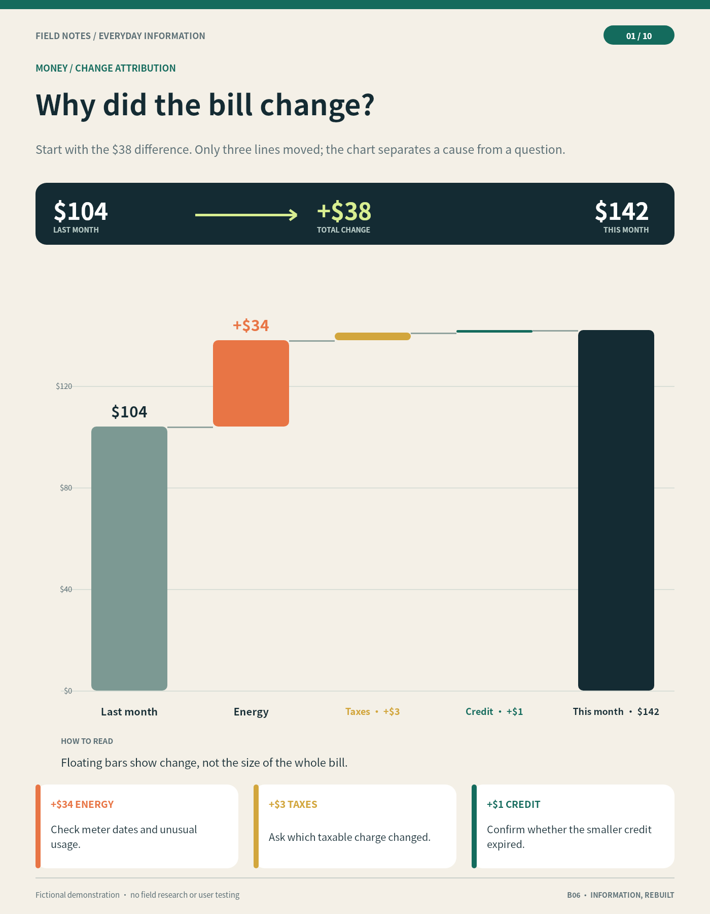
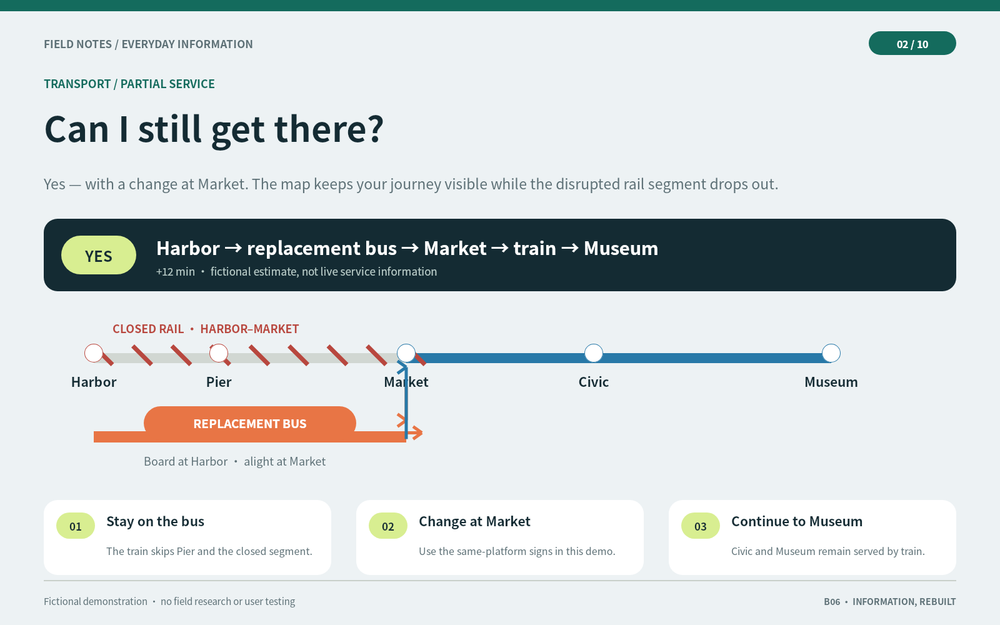
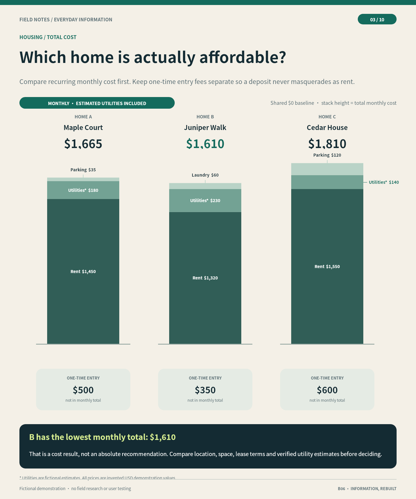
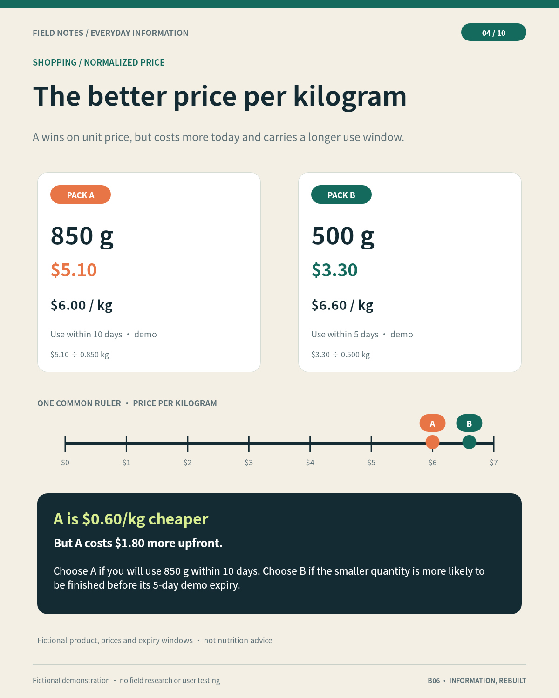
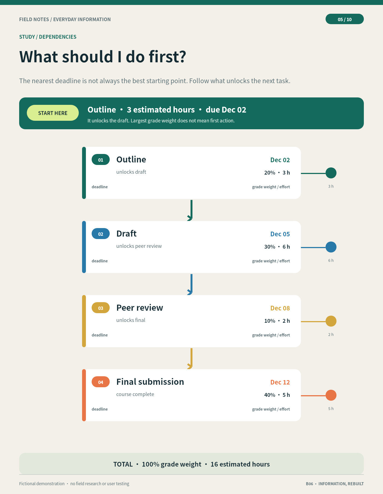
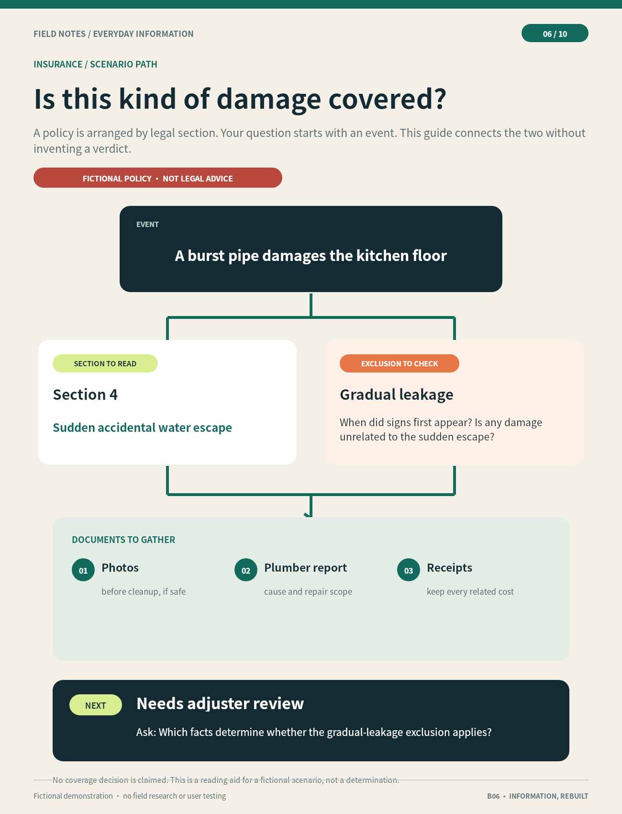
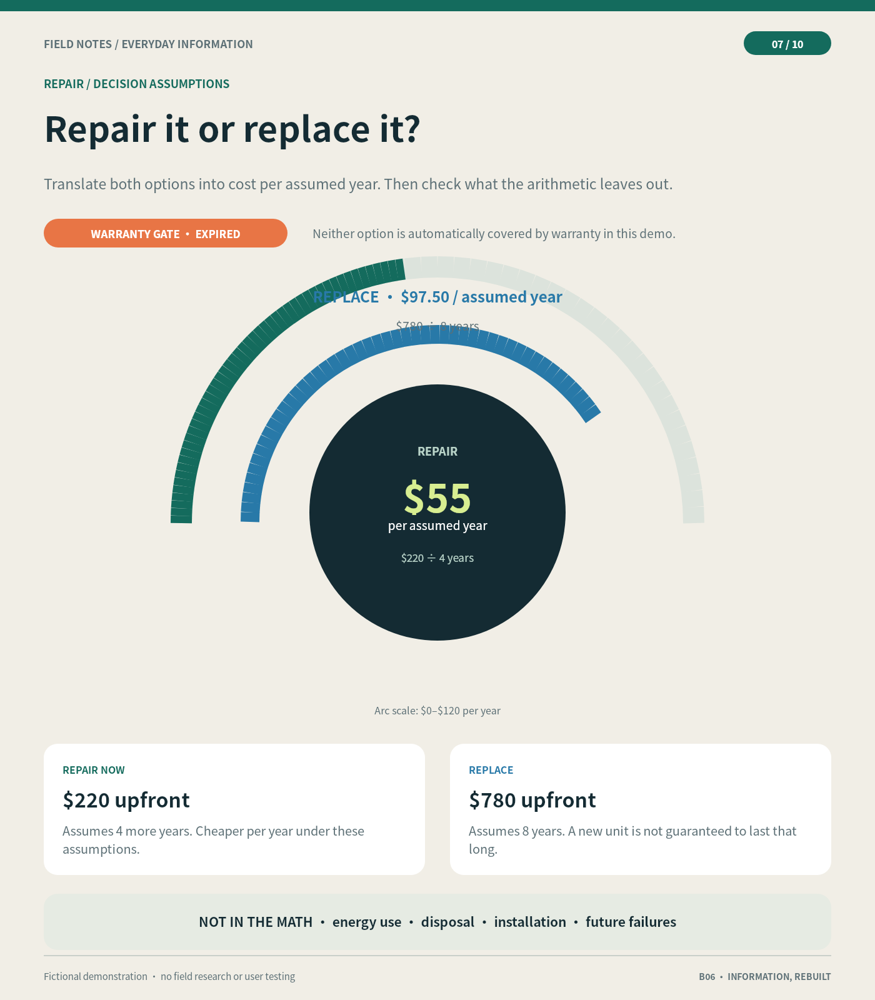
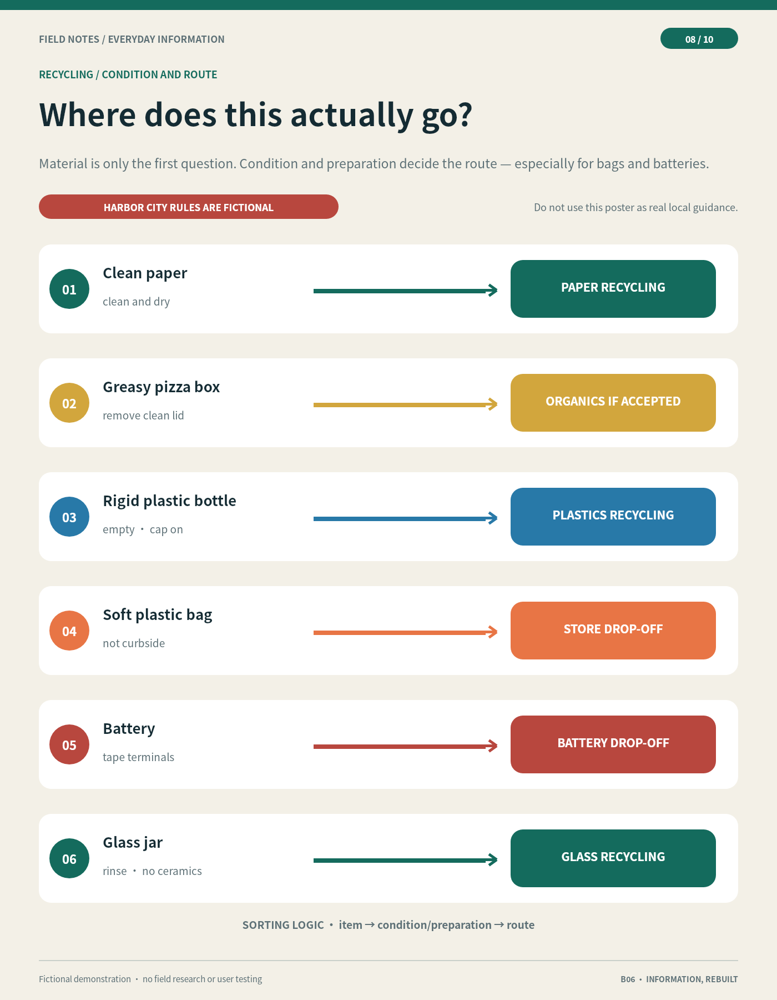
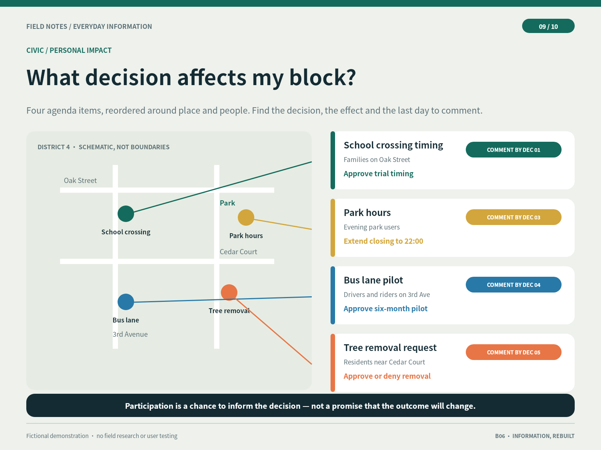
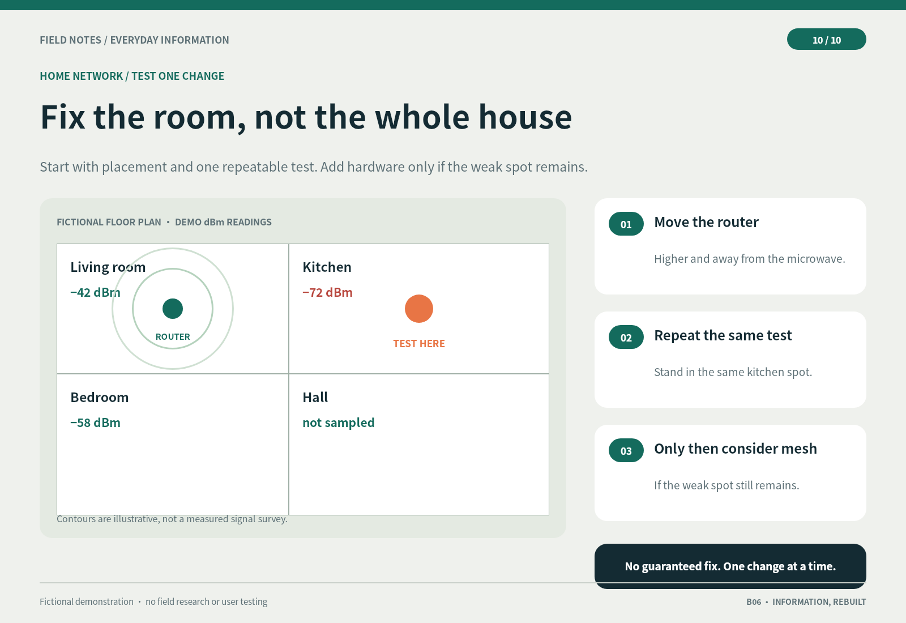

# B06 最终作品画廊

## B06-case-01 · Why Did This Month's Bill Change?

- 原始PNG：[B06-case-01/final.png](B06-case-01/final.png)
- 完整DSL：[B06-case-01/final.snapshot](B06-case-01/final.snapshot)
- 场景与自检：[B06-case-01/case.md](B06-case-01/case.md)

## B06-case-02 · Can I Still Get There?

- 原始PNG：[B06-case-02/final.png](B06-case-02/final.png)
- 完整DSL：[B06-case-02/final.snapshot](B06-case-02/final.snapshot)
- 场景与自检：[B06-case-02/case.md](B06-case-02/case.md)

## B06-case-03 · Which Home Is Actually Affordable?

- 原始PNG：[B06-case-03/final.png](B06-case-03/final.png)
- 完整DSL：[B06-case-03/final.snapshot](B06-case-03/final.snapshot)
- 场景与自检：[B06-case-03/case.md](B06-case-03/case.md)

## B06-case-04 · The Better Price per Kilogram

- 原始PNG：[B06-case-04/final.png](B06-case-04/final.png)
- 完整DSL：[B06-case-04/final.snapshot](B06-case-04/final.snapshot)
- 场景与自检：[B06-case-04/case.md](B06-case-04/case.md)

## B06-case-05 · What Should I Do First?

- 原始PNG：[B06-case-05/final.png](B06-case-05/final.png)
- 完整DSL：[B06-case-05/final.snapshot](B06-case-05/final.snapshot)
- 场景与自检：[B06-case-05/case.md](B06-case-05/case.md)

## B06-case-06 · Is This Kind of Damage Covered?

- 原始PNG：[B06-case-06/final.png](B06-case-06/final.png)
- 完整DSL：[B06-case-06/final.snapshot](B06-case-06/final.snapshot)
- 场景与自检：[B06-case-06/case.md](B06-case-06/case.md)

## B06-case-07 · Repair It or Replace It?

- 原始PNG：[B06-case-07/final.png](B06-case-07/final.png)
- 完整DSL：[B06-case-07/final.snapshot](B06-case-07/final.snapshot)
- 场景与自检：[B06-case-07/case.md](B06-case-07/case.md)

## B06-case-08 · Where Does This Actually Go?

- 原始PNG：[B06-case-08/final.png](B06-case-08/final.png)
- 完整DSL：[B06-case-08/final.snapshot](B06-case-08/final.snapshot)
- 场景与自检：[B06-case-08/case.md](B06-case-08/case.md)

## B06-case-09 · What Decision Affects My Block?

- 原始PNG：[B06-case-09/final.png](B06-case-09/final.png)
- 完整DSL：[B06-case-09/final.snapshot](B06-case-09/final.snapshot)
- 场景与自检：[B06-case-09/case.md](B06-case-09/case.md)

## B06-case-10 · Fix the Room, Not the Whole House

- 原始PNG：[B06-case-10/final.png](B06-case-10/final.png)
- 完整DSL：[B06-case-10/final.snapshot](B06-case-10/final.snapshot)
- 场景与自检：[B06-case-10/case.md](B06-case-10/case.md)
