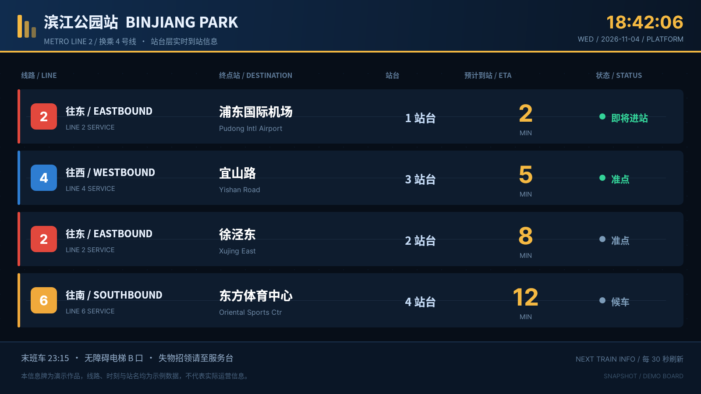
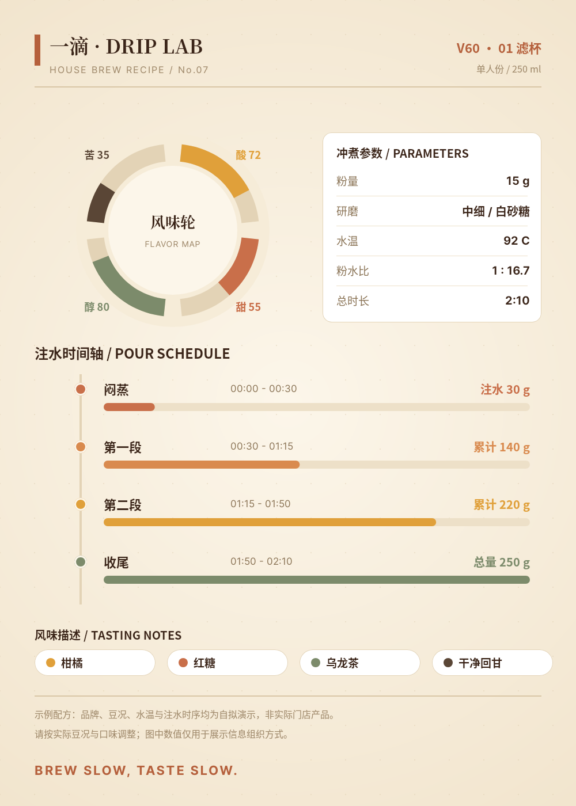
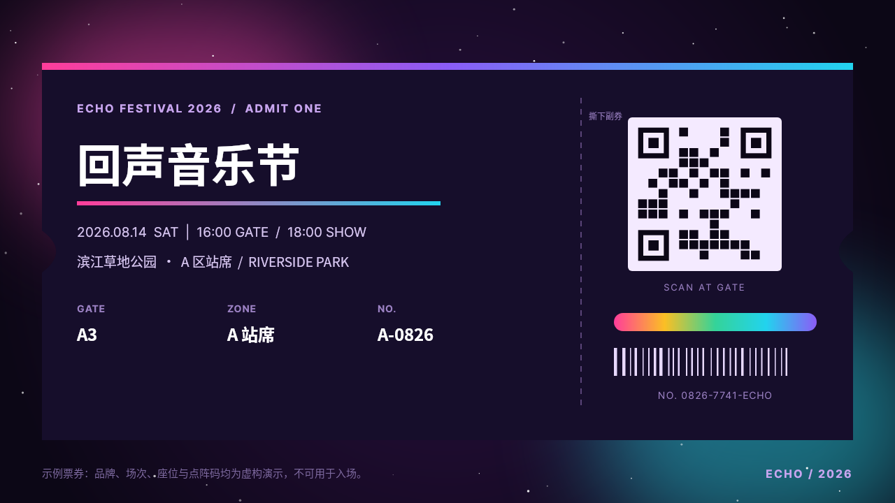
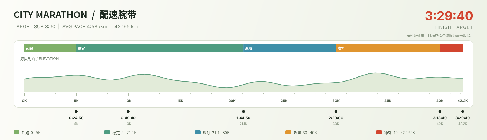
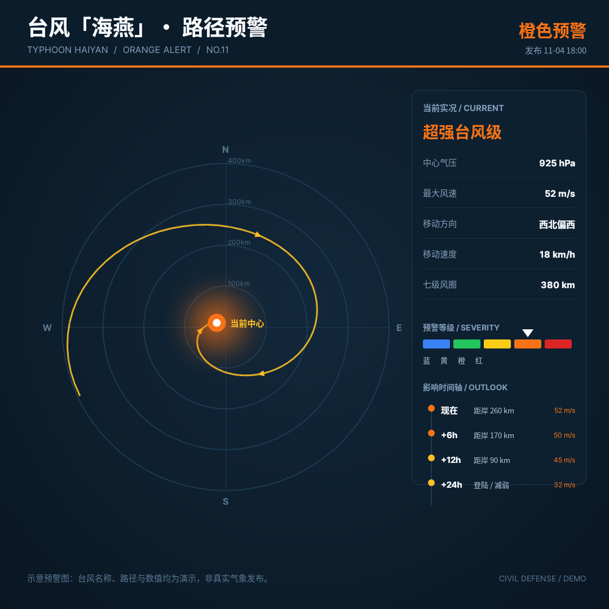
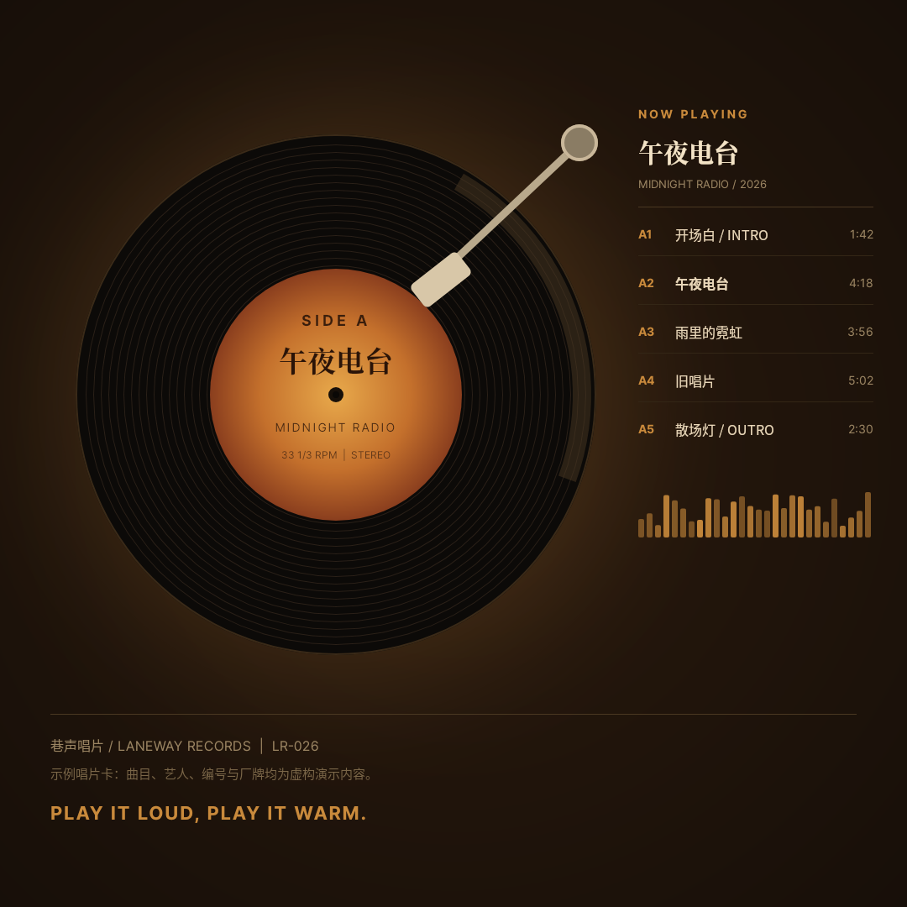
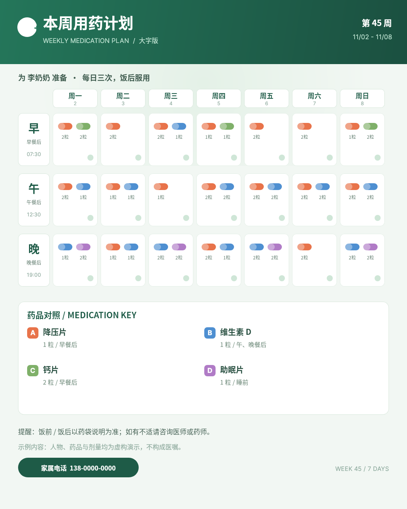
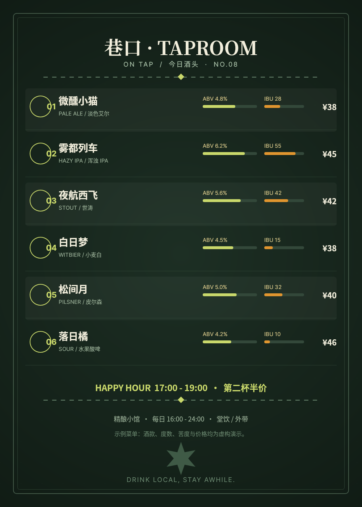
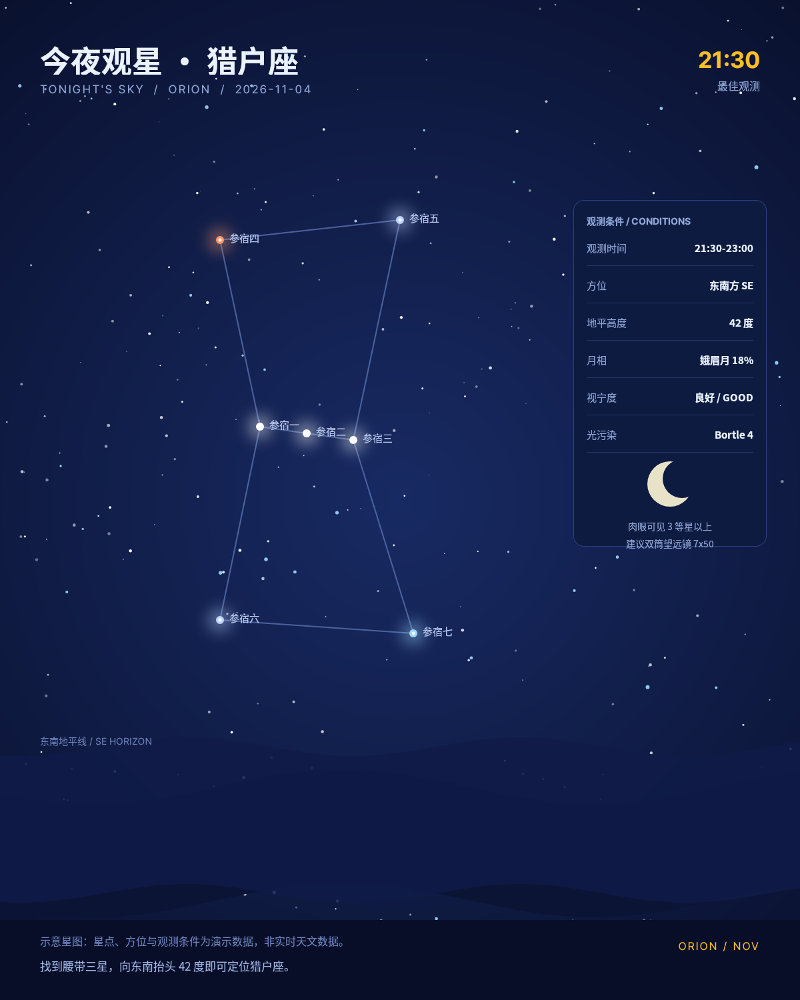
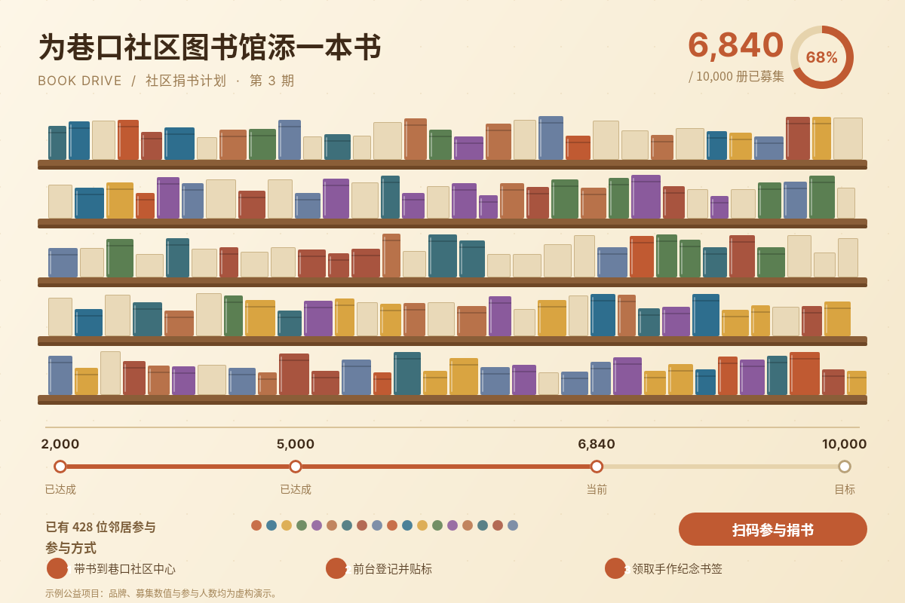

# B01 画廊 · 十张最终作品

以下每张均为 open-snapshot 服务真实响应 PNG；链接相对本题输出根，可离线浏览。

## case-01 · 滨江公园站 · 实时到站信息牌

- 原图 PNG：[case-01/final.png](case-01/final.png)
- 完整 DSL：[case-01/final.snapshot](case-01/final.snapshot)
- 用例说明：[case-01/case.md](case-01/case.md)
- 尺寸：1600×900  ·  地铁站台悬挂 LED 屏、约 3–8 米远距离站立观看

## case-02 · 一滴 DRIP LAB · 手冲配方卡

- 原图 PNG：[case-02/final.png](case-02/final.png)
- 完整 DSL：[case-02/final.snapshot](case-02/final.snapshot)
- 用例说明：[case-02/case.md](case-02/case.md)
- 尺寸：1000×1400  ·  竖版卡片贴在咖啡角或 iPad 上近距离阅读

## case-03 · ECHO 回声音乐节 · 霓虹电子票

- 原图 PNG：[case-03/final.png](case-03/final.png)
- 完整 DSL：[case-03/final.snapshot](case-03/final.snapshot)
- 用例说明：[case-03/case.md](case-03/case.md)
- 尺寸：1280×720  ·  手机屏幕出示或打印的横向电子票、近距离核验

## case-04 · 城市马拉松 · 配速腕带

- 原图 PNG：[case-04/final.png](case-04/final.png)
- 完整 DSL：[case-04/final.snapshot](case-04/final.snapshot)
- 用例说明：[case-04/case.md](case-04/case.md)
- 尺寸：1800×520  ·  超宽长条打印后缠在手腕、跑动中低头扫视

## case-05 · 台风「海燕」· 路径预警图

- 原图 PNG：[case-05/final.png](case-05/final.png)
- 完整 DSL：[case-05/final.snapshot](case-05/final.snapshot)
- 用例说明：[case-05/case.md](case-05/case.md)
- 尺寸：1080×1080  ·  社区公告屏/手机推送的方形预警图、中距离阅读

## case-06 · 巷声唱片 · 黑胶 Now Playing 卡

- 原图 PNG：[case-06/final.png](case-06/final.png)
- 完整 DSL：[case-06/final.snapshot](case-06/final.snapshot)
- 用例说明：[case-06/case.md](case-06/case.md)
- 尺寸：1080×1080  ·  唱片架旁的方形展示卡/社媒方图、近距离观看

## case-07 · 李奶奶的每周药盒 · 用药提醒

- 原图 PNG：[case-07/final.png](case-07/final.png)
- 完整 DSL：[case-07/final.snapshot](case-07/final.snapshot)
- 用例说明：[case-07/case.md](case-07/case.md)
- 尺寸：1080×1350  ·  贴在冰箱或药盒上的大字竖版卡片、近距离阅读

## case-08 · 巷口 TAPROOM · 今日酒头黑板

- 原图 PNG：[case-08/final.png](case-08/final.png)
- 完整 DSL：[case-08/final.snapshot](case-08/final.snapshot)
- 用例说明：[case-08/case.md](case-08/case.md)
- 尺寸：1000×1400  ·  吧台上方竖版黑板、约 1–2 米站立阅读

## case-09 · 今夜观星 · 猎户座导览卡

- 原图 PNG：[case-09/final.png](case-09/final.png)
- 完整 DSL：[case-09/final.snapshot](case-09/final.snapshot)
- 用例说明：[case-09/case.md](case-09/case.md)
- 尺寸：1200×1500  ·  户外手机竖屏或打印导览卡、低光环境近距离阅读

## case-10 · 社区捐书计划 · 渐满的书架

- 原图 PNG：[case-10/final.png](case-10/final.png)
- 完整 DSL：[case-10/final.snapshot](case-10/final.snapshot)
- 用例说明：[case-10/case.md](case-10/case.md)
- 尺寸：1200×800  ·  社区中心墙面横版海报/公众号头图、中距离阅读

