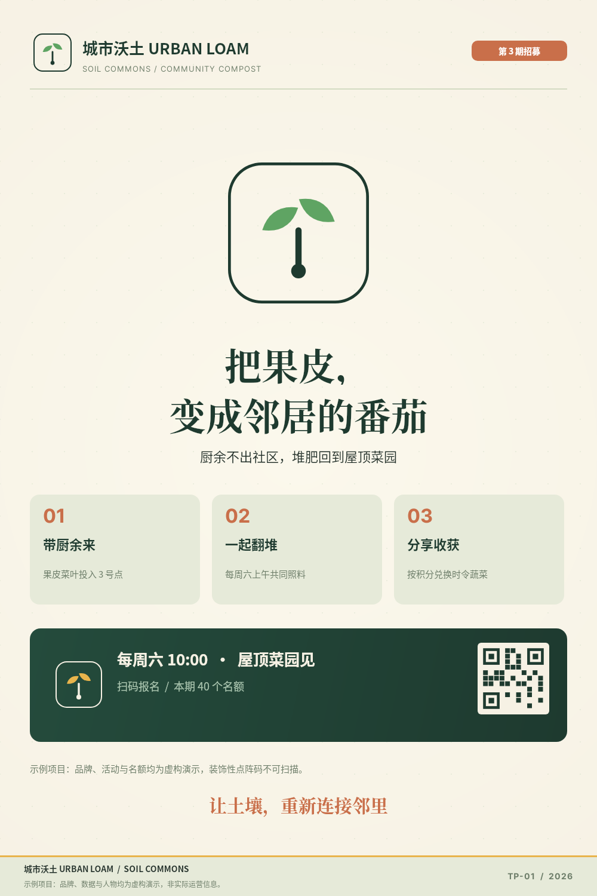
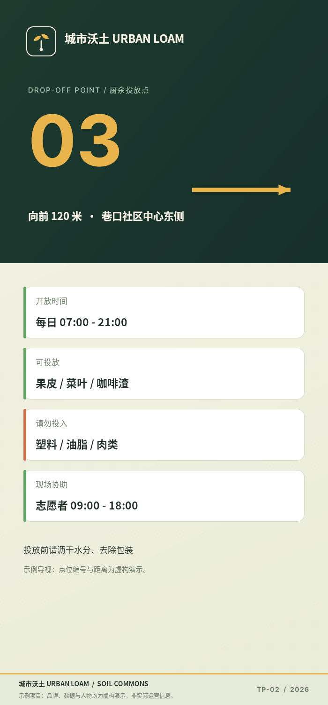
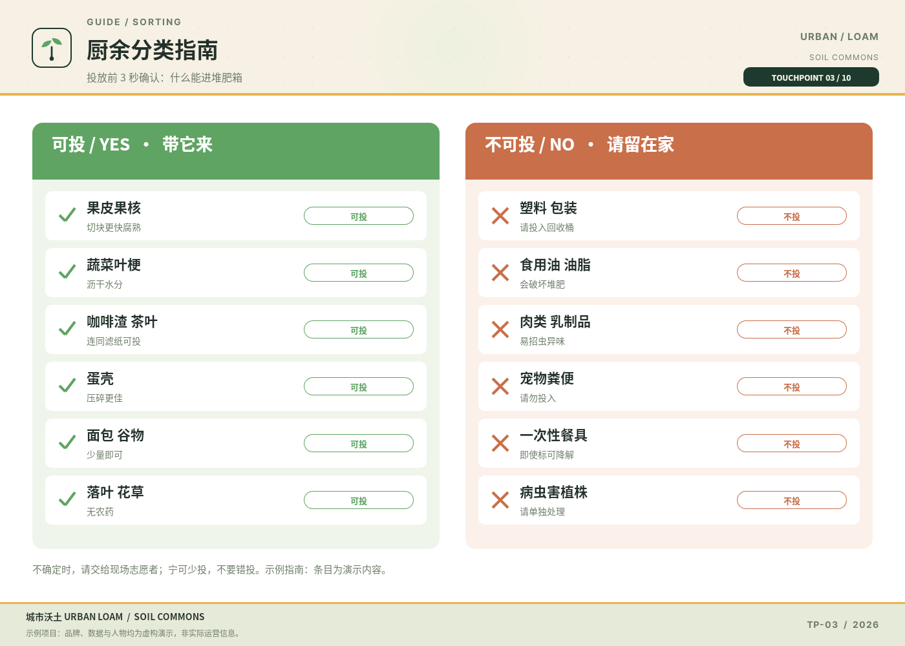
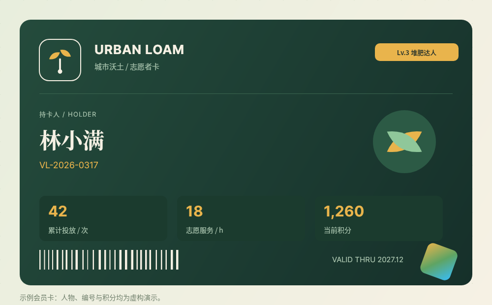
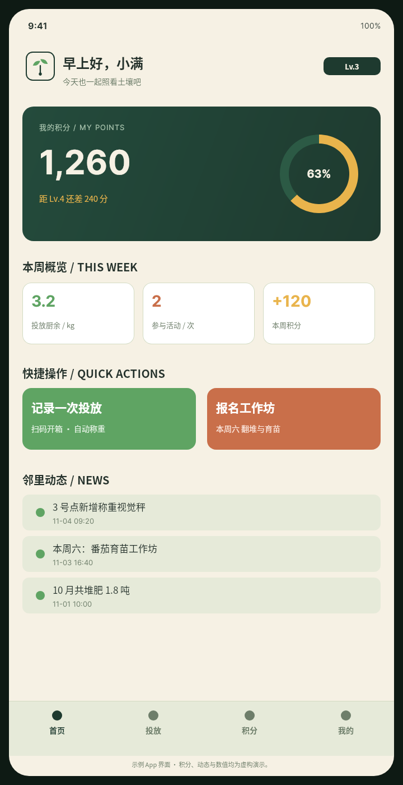
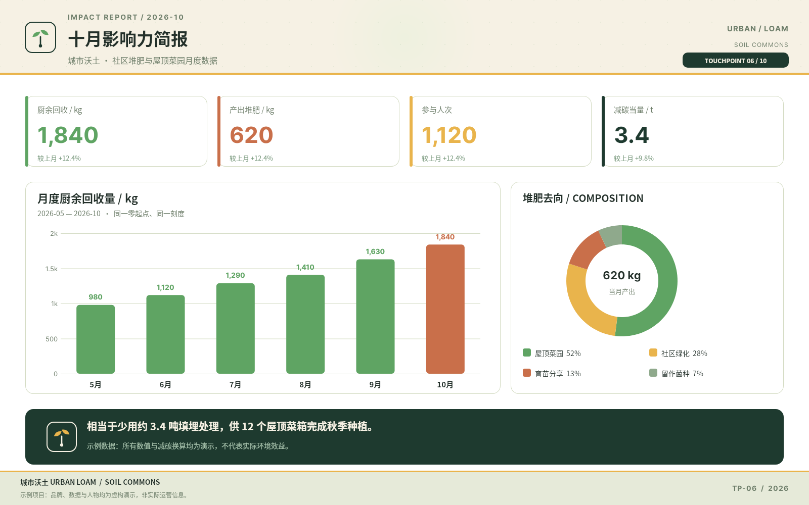
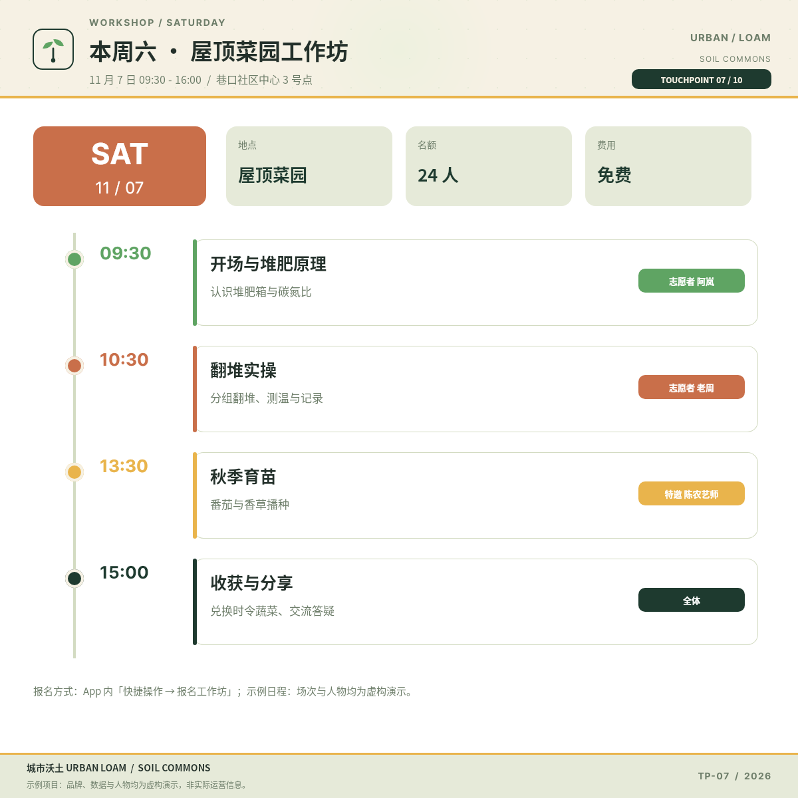
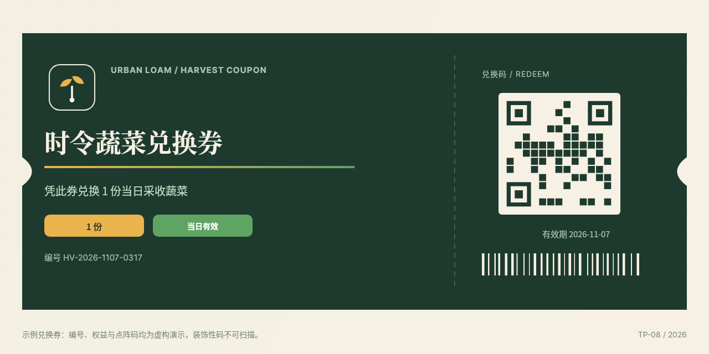
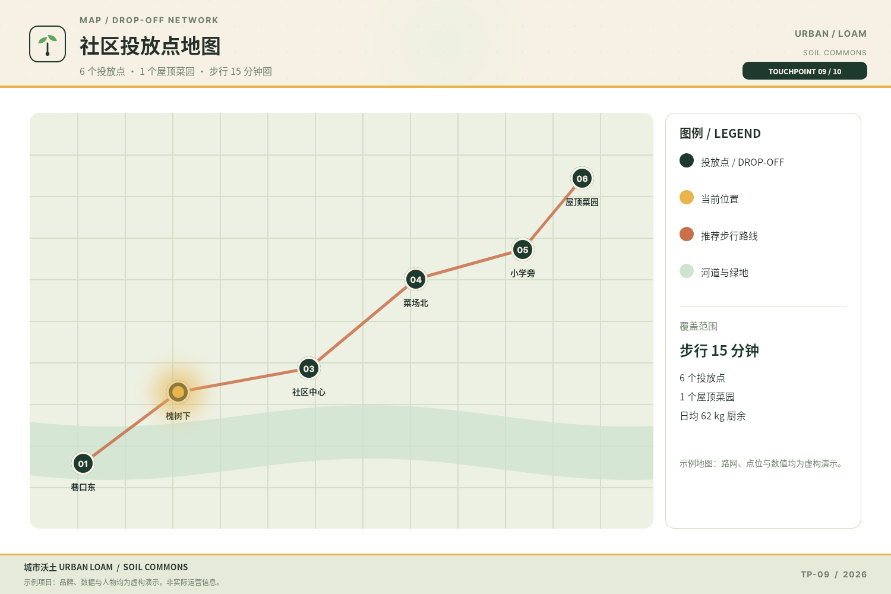
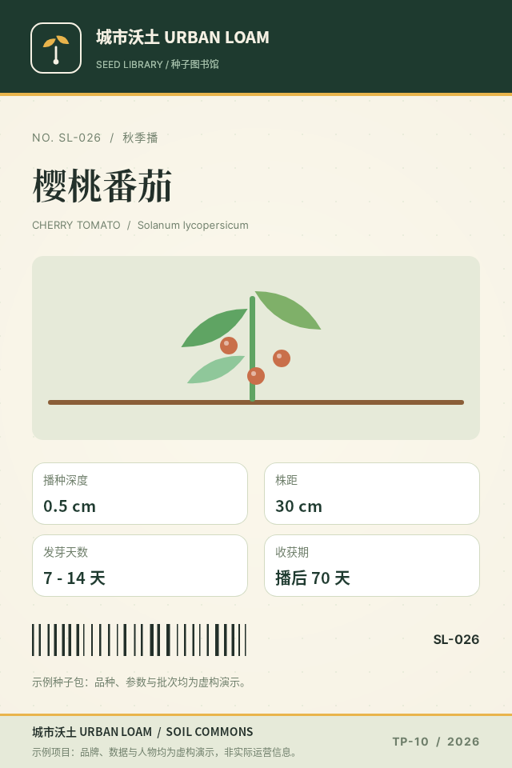

# B02 画廊 · 城市沃土十个触点

以下每张均为 open-snapshot 服务真实响应 PNG；链接相对本题输出根，可离线浏览。

## case-01 · 第 3 期志愿者招募主视觉海报

- 原图 PNG：[case-01/final.png](case-01/final.png)
- 完整 DSL：[case-01/final.snapshot](case-01/final.snapshot)
- 用例说明：[case-01/case.md](case-01/case.md)
- 尺寸：1000×1500  ·  竖版海报，1–3 米站立观看或手机竖屏

## case-02 · 3 号投放点导视立牌

- 原图 PNG：[case-02/final.png](case-02/final.png)
- 完整 DSL：[case-02/final.snapshot](case-02/final.snapshot)
- 用例说明：[case-02/case.md](case-02/case.md)
- 尺寸：700×1500  ·  狭窄长条形立牌，2–5 米行走中扫视

## case-03 · 厨余分类指南卡

- 原图 PNG：[case-03/final.png](case-03/final.png)
- 完整 DSL：[case-03/final.snapshot](case-03/final.snapshot)
- 用例说明：[case-03/case.md](case-03/case.md)
- 尺寸：1400×1000  ·  横版双栏，约 0.5–1 米近距离阅读

## case-04 · 志愿者会员卡

- 原图 PNG：[case-04/final.png](case-04/final.png)
- 完整 DSL：[case-04/final.snapshot](case-04/final.snapshot)
- 用例说明：[case-04/case.md](case-04/case.md)
- 尺寸：1000×620  ·  小尺寸横卡，手持近距离

## case-05 · App 首页界面

- 原图 PNG：[case-05/final.png](case-05/final.png)
- 完整 DSL：[case-05/final.snapshot](case-05/final.snapshot)
- 用例说明：[case-05/case.md](case-05/case.md)
- 尺寸：720×1400  ·  手机竖屏，30–40 厘米手持

## case-06 · 十月影响力数据简报

- 原图 PNG：[case-06/final.png](case-06/final.png)
- 完整 DSL：[case-06/final.snapshot](case-06/final.snapshot)
- 用例说明：[case-06/case.md](case-06/case.md)
- 尺寸：1600×1000  ·  横版大屏或打印 A3，1–2 米阅读

## case-07 · 周六工作坊日程表

- 原图 PNG：[case-07/final.png](case-07/final.png)
- 完整 DSL：[case-07/final.snapshot](case-07/final.snapshot)
- 用例说明：[case-07/case.md](case-07/case.md)
- 尺寸：1200×1200  ·  方形板，1–2 米或手机方图

## case-08 · 收获兑换券

- 原图 PNG：[case-08/final.png](case-08/final.png)
- 完整 DSL：[case-08/final.snapshot](case-08/final.snapshot)
- 用例说明：[case-08/case.md](case-08/case.md)
- 尺寸：1280×640  ·  横向券面，手持或手机出示

## case-09 · 社区投放点地图

- 原图 PNG：[case-09/final.png](case-09/final.png)
- 完整 DSL：[case-09/final.snapshot](case-09/final.snapshot)
- 用例说明：[case-09/case.md](case-09/case.md)
- 尺寸：1500×1000  ·  横版地图，0.5–2 米阅读

## case-10 · 种子包标签

- 原图 PNG：[case-10/final.png](case-10/final.png)
- 完整 DSL：[case-10/final.snapshot](case-10/final.snapshot)
- 用例说明：[case-10/case.md](case-10/case.md)
- 尺寸：640×960  ·  小尺寸竖版包装，手持极近距离

