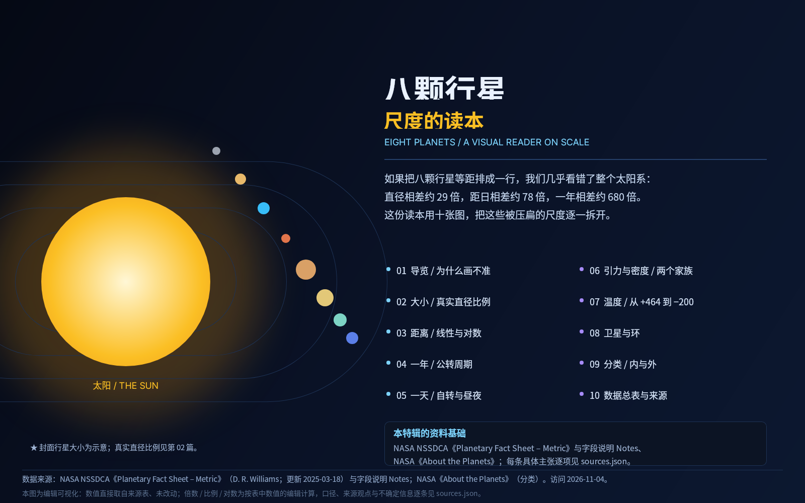
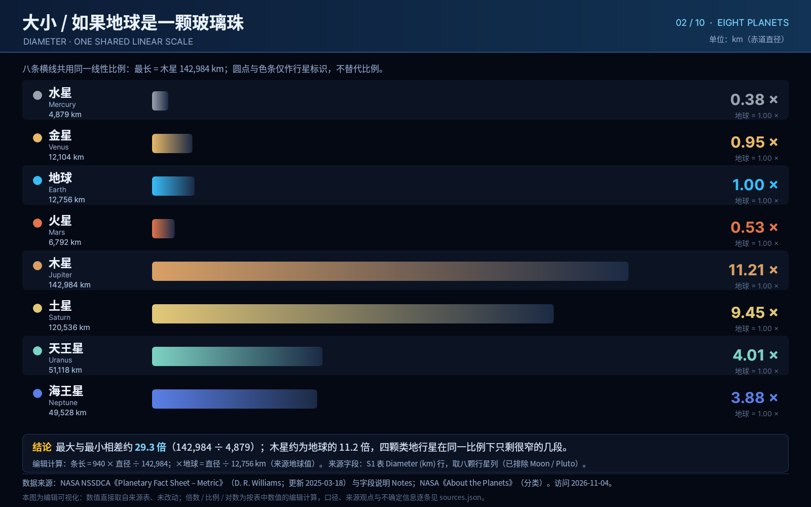
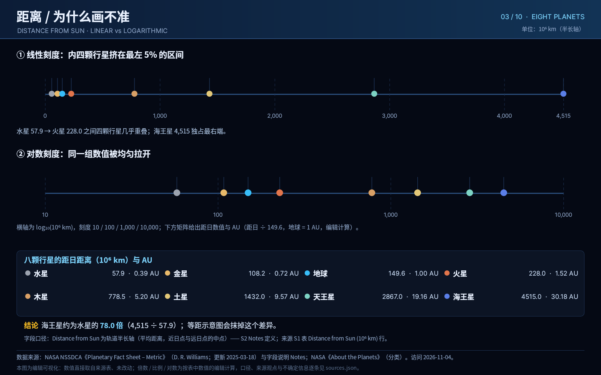
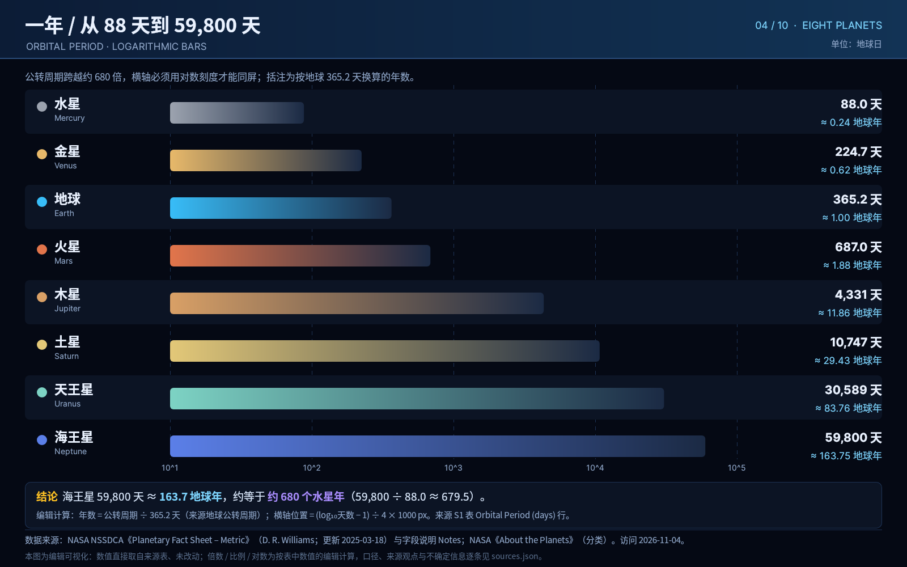
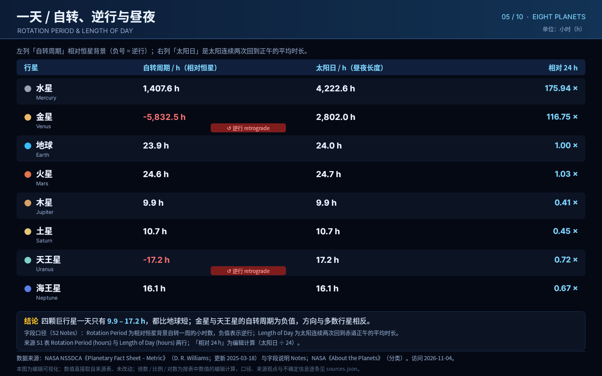
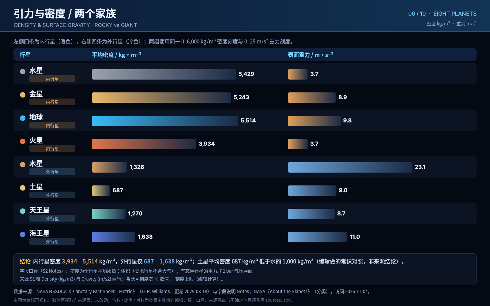
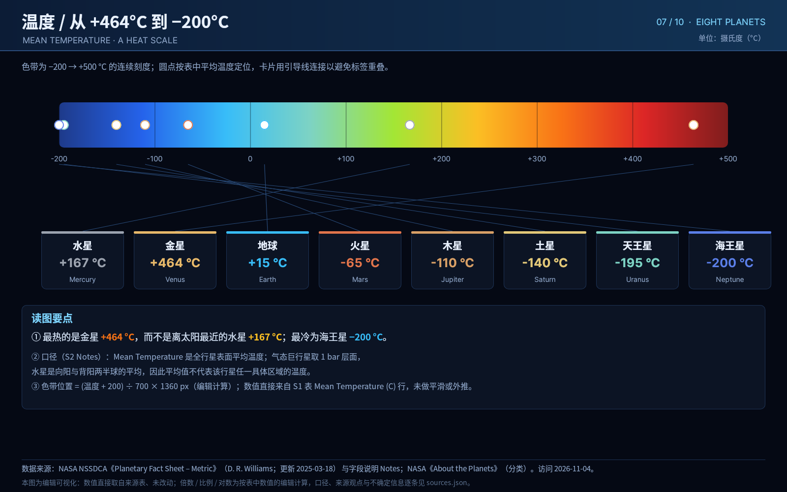
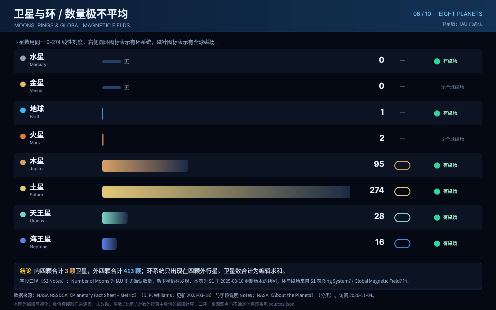
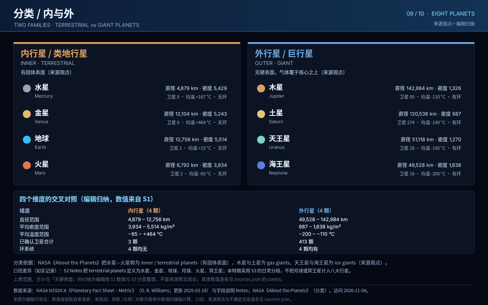
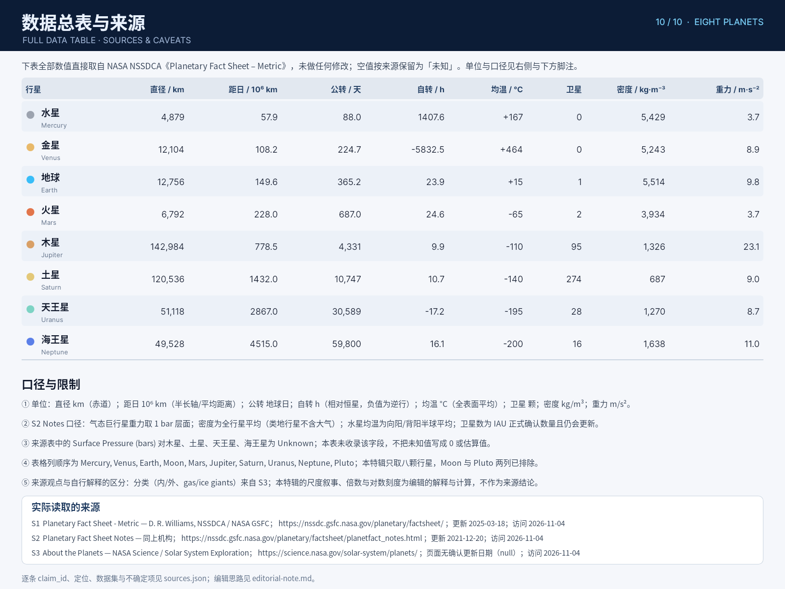

# B04 · 作品画廊（10 件 · 视觉特辑）

图片与 DSL 链接均相对本题输出根，可离线浏览。按阅读顺序排列。

## case-01 · 八颗行星 · 尺度的读本（封面/导览）

- 原 PNG：[case-01/final.png](case-01/final.png)
- 同名 DSL：[case-01/final.snapshot](case-01/final.snapshot)
- 用例说明：[case-01/case.md](case-01/case.md)
- 关联 claim：C01

## case-02 · 大小 · 真实直径比例

- 原 PNG：[case-02/final.png](case-02/final.png)
- 同名 DSL：[case-02/final.snapshot](case-02/final.snapshot)
- 用例说明：[case-02/case.md](case-02/case.md)
- 关联 claim：C02, C03

## case-03 · 距离 · 线性与对数

- 原 PNG：[case-03/final.png](case-03/final.png)
- 同名 DSL：[case-03/final.snapshot](case-03/final.snapshot)
- 用例说明：[case-03/case.md](case-03/case.md)
- 关联 claim：C04, C05, C06, C07

## case-04 · 一年 · 公转周期

- 原 PNG：[case-04/final.png](case-04/final.png)
- 同名 DSL：[case-04/final.snapshot](case-04/final.snapshot)
- 用例说明：[case-04/case.md](case-04/case.md)
- 关联 claim：C08, C09

## case-05 · 一天 · 自转、逆行与昼夜

- 原 PNG：[case-05/final.png](case-05/final.png)
- 同名 DSL：[case-05/final.snapshot](case-05/final.snapshot)
- 用例说明：[case-05/case.md](case-05/case.md)
- 关联 claim：C10, C11, C12

## case-06 · 引力与密度 · 两个家族

- 原 PNG：[case-06/final.png](case-06/final.png)
- 同名 DSL：[case-06/final.snapshot](case-06/final.snapshot)
- 用例说明：[case-06/case.md](case-06/case.md)
- 关联 claim：C13, C14, C15, C27

## case-07 · 温度 · 从 +464°C 到 −200°C

- 原 PNG：[case-07/final.png](case-07/final.png)
- 同名 DSL：[case-07/final.snapshot](case-07/final.snapshot)
- 用例说明：[case-07/case.md](case-07/case.md)
- 关联 claim：C16, C17

## case-08 · 卫星与环 · 数量极不平均

- 原 PNG：[case-08/final.png](case-08/final.png)
- 同名 DSL：[case-08/final.snapshot](case-08/final.snapshot)
- 用例说明：[case-08/case.md](case-08/case.md)
- 关联 claim：C18, C19, C20, C21, C28

## case-09 · 分类 · 内与外

- 原 PNG：[case-09/final.png](case-09/final.png)
- 同名 DSL：[case-09/final.snapshot](case-09/final.snapshot)
- 用例说明：[case-09/case.md](case-09/case.md)
- 关联 claim：C22, C23, C24

## case-10 · 数据总表与来源

- 原 PNG：[case-10/final.png](case-10/final.png)
- 同名 DSL：[case-10/final.snapshot](case-10/final.snapshot)
- 用例说明：[case-10/case.md](case-10/case.md)
- 关联 claim：C25, C26

