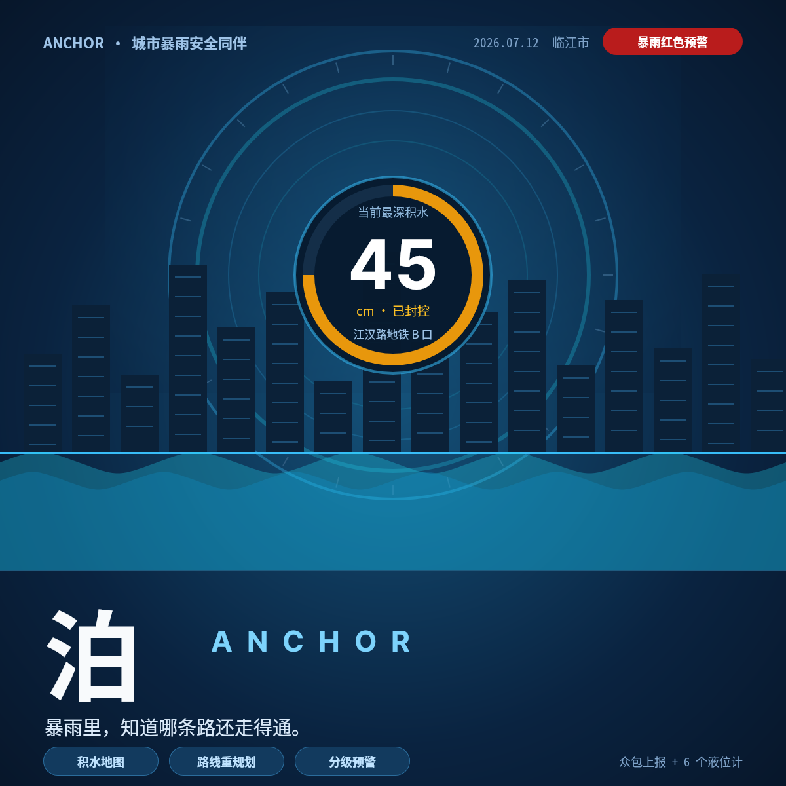
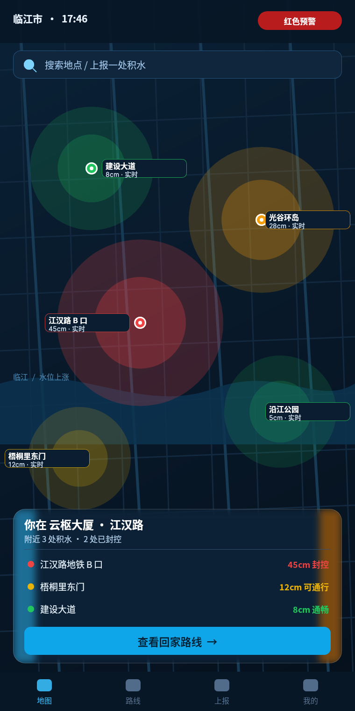
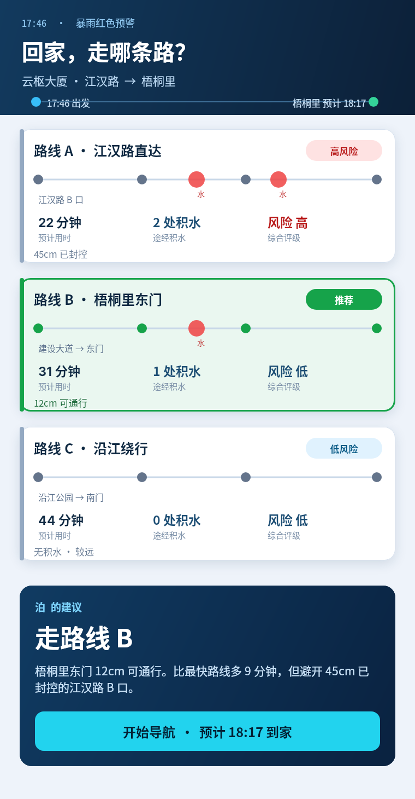
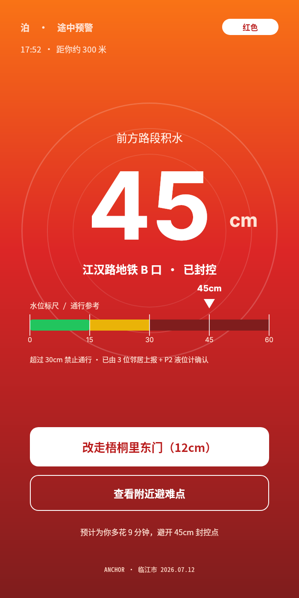
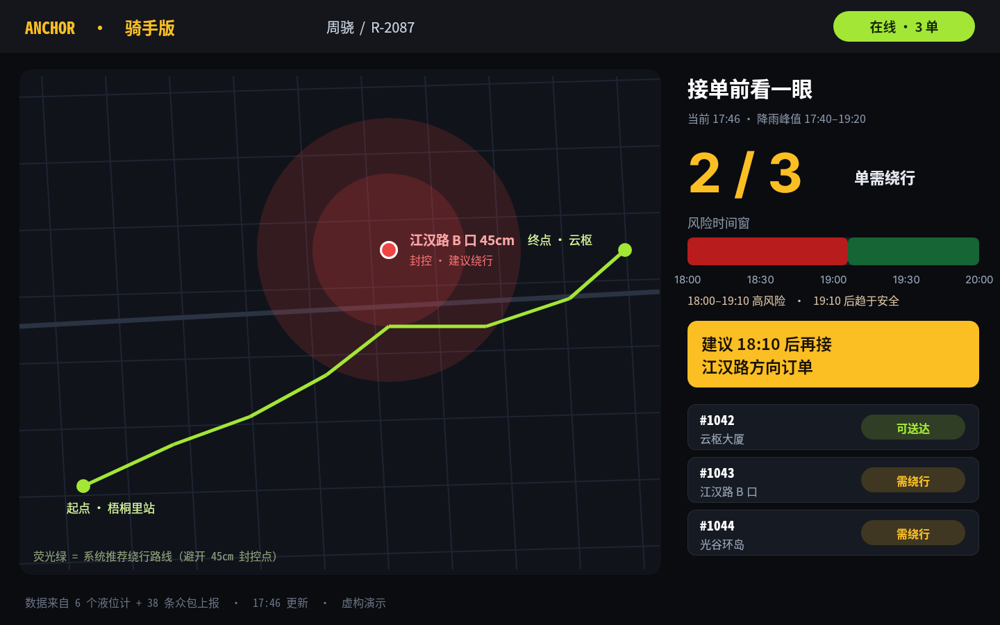
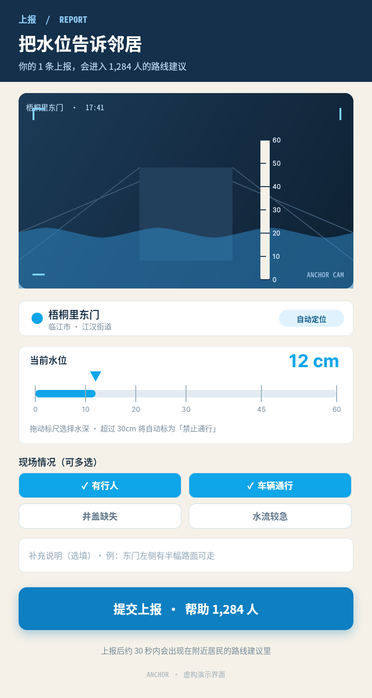
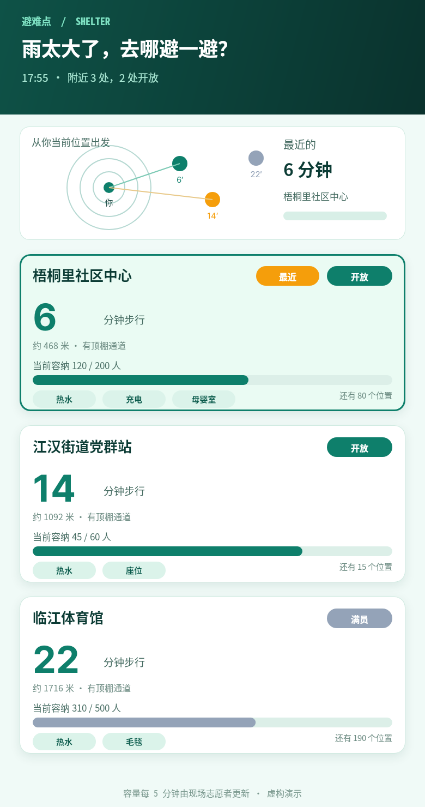
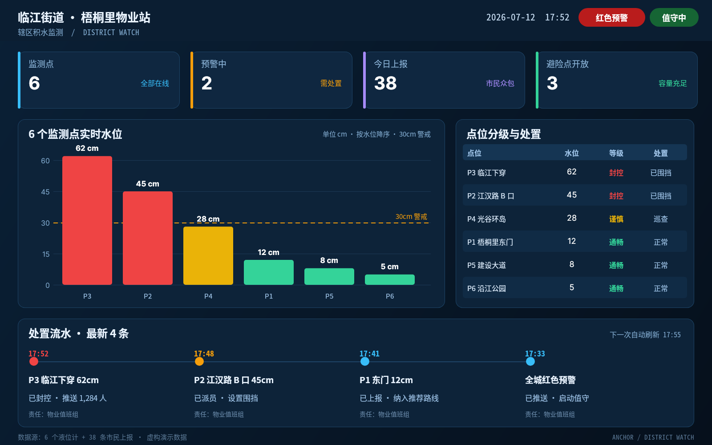
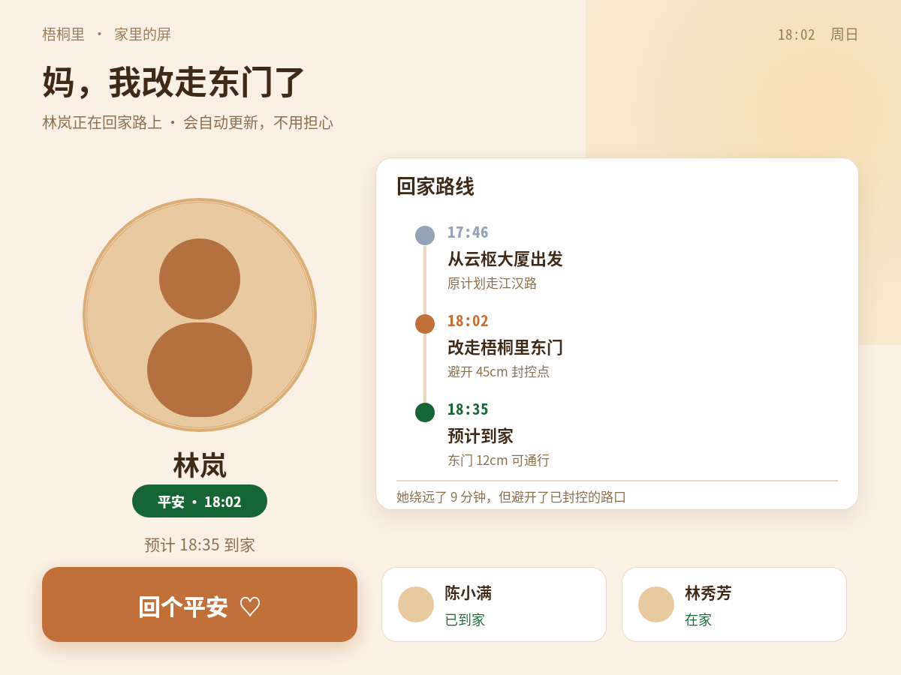
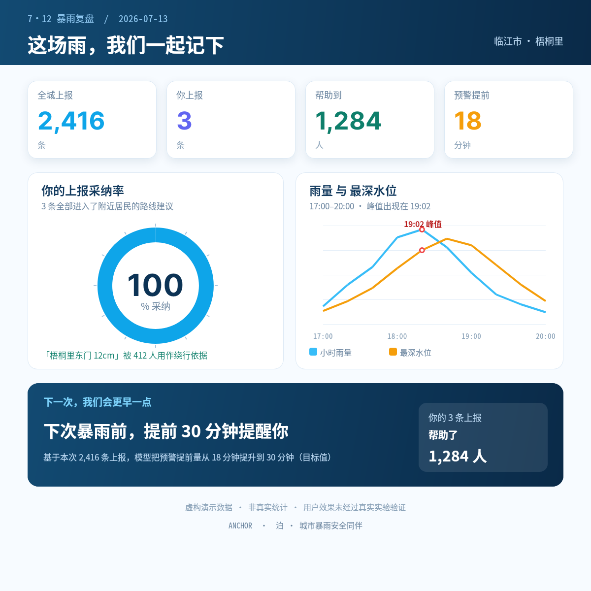

# B05 作品画廊 · 泊 / ANCHOR（10 件独立作品）

全部 PNG 均为 open-snapshot 服务真实响应；链接相对本题输出根，可离线浏览。

## 01 · 水位之上 · 品牌概念主视觉

品牌认知：让人第一次理解产品的存在与价值  ｜  尺寸 1200×1200  ｜  以同心水位环 + 城市天际线 + 贯穿的水位线建立原创视觉隐喻；中央仪表盘给出可信数据锚点

[原 PNG](case-01/final.png) · [对应 DSL](case-01/final.snapshot) · [用例说明](case-01/case.md)

## 02 · 此刻的城市 · 实时积水地图首页

态势感知：打开 App 后第一屏，理解「现在城市怎么样」  ｜  尺寸 760×1520  ｜  全屏深色地图 + 彩色风险热力晕 + 毛玻璃底部浮层，营造「实时态势」沉浸感

[原 PNG](case-02/final.png) · [对应 DSL](case-02/final.snapshot) · [用例说明](case-02/case.md)

## 03 · 三条路，怎么走 · 出门决策卡

决策：把「哪条路走得通」从猜测变成一次可比较的选择  ｜  尺寸 760×1460  ｜  浅色卡片对比清单，用等宽三列指标并列比较，推荐项用绿色描边与角标突出，底部深色结论条收束决策

[原 PNG](case-03/final.png) · [对应 DSL](case-03/final.snapshot) · [用例说明](case-03/case.md)

## 04 · 前方 300 米 · 45 厘米 · 途中预警

状态突变：途中收到封控预警，必须立刻改道  ｜  尺寸 700×1400  ｜  整屏橙红渐变 + 一个 220px 的巨大数字 + 一条水位标尺，把信息压缩到单一焦点与单一动作

[原 PNG](case-04/final.png) · [对应 DSL](case-04/final.snapshot) · [用例说明](case-04/case.md)

## 05 · 接单前的风险叠加 · 骑手横屏视图

职业场景：同一产品为不同角色提供不同媒介与信息优先级  ｜  尺寸 1440×900  ｜  黑底 + 琥珀黄与荧光绿高对比；左地图右分栏，风险时间窗用红/绿横向色带表达

[原 PNG](case-05/final.png) · [对应 DSL](case-05/final.snapshot) · [用例说明](case-05/case.md)

## 06 · 把水位告诉邻居 · 众包上报表单

数据输入：让普通市民成为传感器网络的一部分  ｜  尺寸 800×1500  ｜  米白纸质 + 深蓝取景框，把「拍照 + 标尺」做成一张像表格一样好填的卡片；蓝色大标尺是核心控件

[原 PNG](case-06/final.png) · [对应 DSL](case-06/final.snapshot) · [用例说明](case-06/case.md)

## 07 · 哪里能进去避一避 · 避险点列表

应急结果：从「知道有危险」到「知道去哪里」  ｜  尺寸 780×1480  ｜  浅青绿底色 + 方位缩略环 + 容量进度条；把「开放/满员」和「还有多少位置」做成一眼可判的视觉信号

[原 PNG](case-07/final.png) · [对应 DSL](case-07/final.snapshot) · [用例说明](case-07/case.md)

## 08 · 梧桐里辖区监测 · 物业值班大屏

运营侧：把零散上报汇总成可行动的辖区态势  ｜  尺寸 1600×1000  ｜  深海军蓝密集信息驾驶舱：KPI 行 + 排序柱图 + 分级表 + 处置时间线，30cm 警戒虚线贯穿主图

[原 PNG](case-08/final.png) · [对应 DSL](case-08/final.snapshot) · [用例说明](case-08/case.md)

## 09 · 妈，我改走东门了 · 家庭平安屏

家庭侧：把一个人的安全状态变成全家可共享的安心  ｜  尺寸 1200×900  ｜  暖米色 + 橙棕的柔和情感化界面；大圆形肖像 + 竖时间轴 + 一个大号「回个平安」按钮，字号与点击区都为长者放大

[原 PNG](case-09/final.png) · [对应 DSL](case-09/final.snapshot) · [用例说明](case-09/case.md)

## 10 · 这场雨，我们一起记下 · 雨后复盘

结果与反馈：让贡献可见，形成下一次继续上报的动机  ｜  尺寸 1200×1200  ｜  清爽白底数据海报收尾：4 个大数字 + 采纳率环形 + 雨量/水位双曲线 + 深色结论条，把「结果」讲清楚

[原 PNG](case-10/final.png) · [对应 DSL](case-10/final.snapshot) · [用例说明](case-10/case.md)

