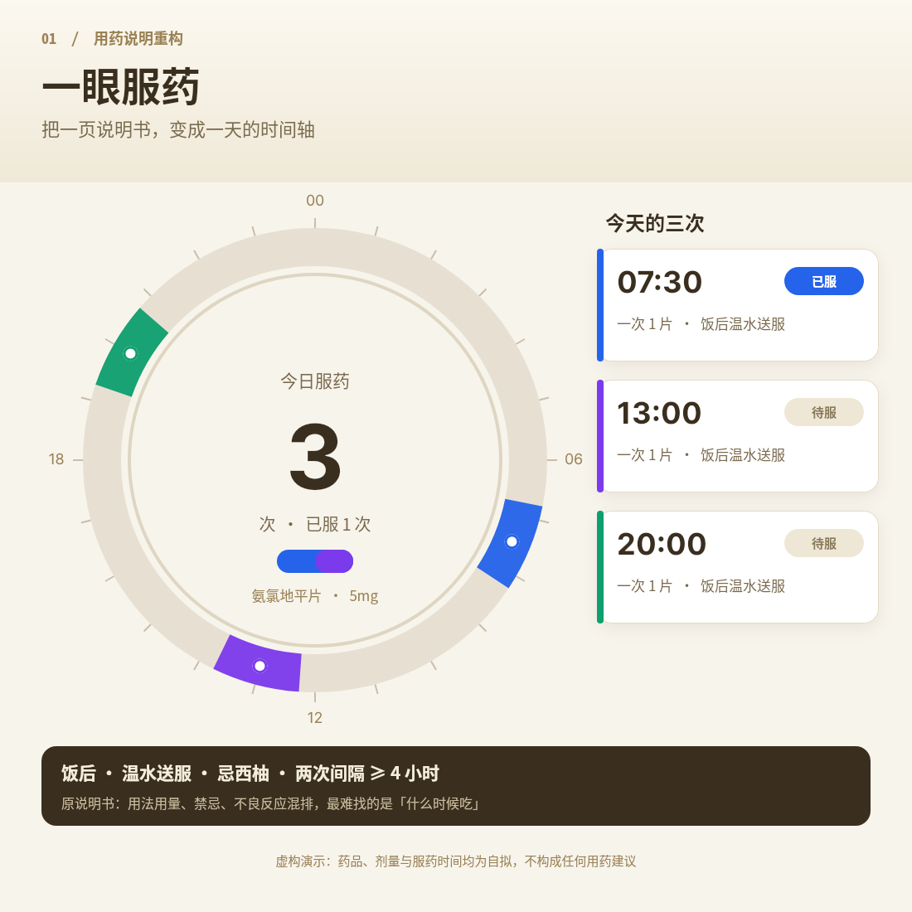
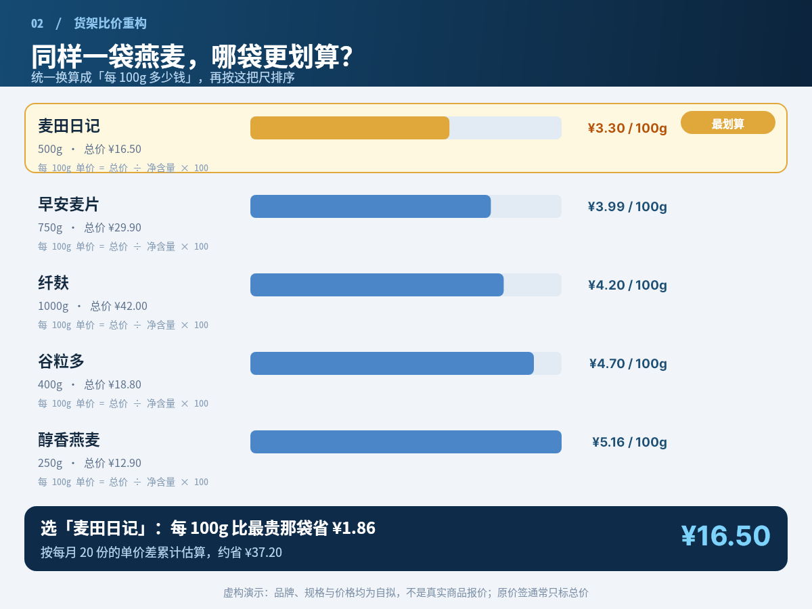
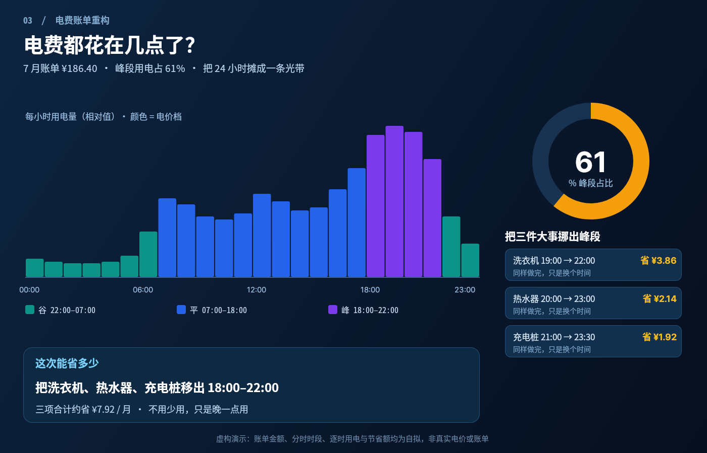
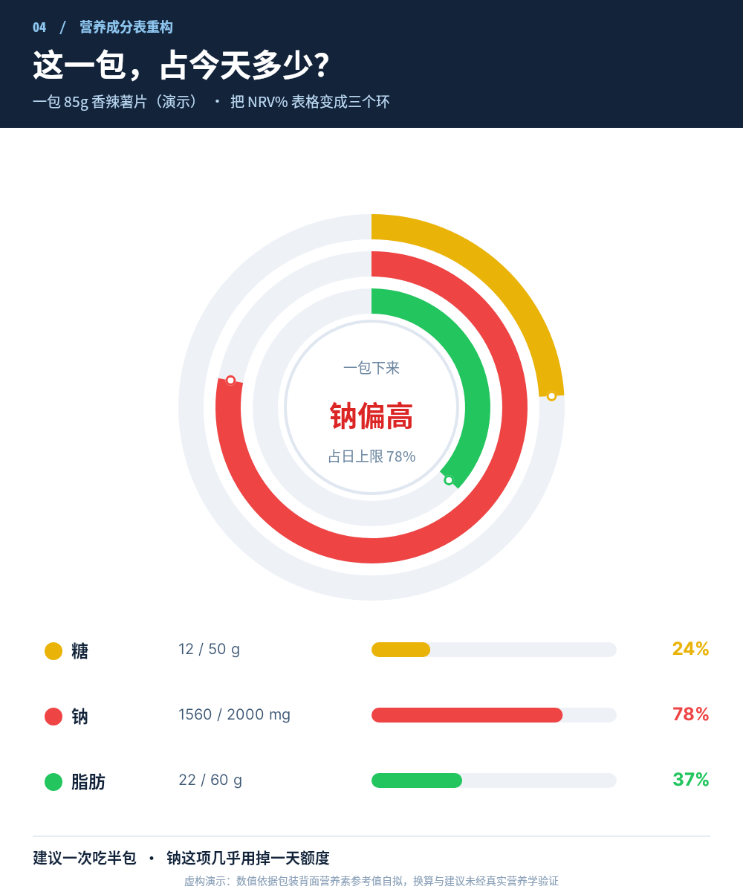
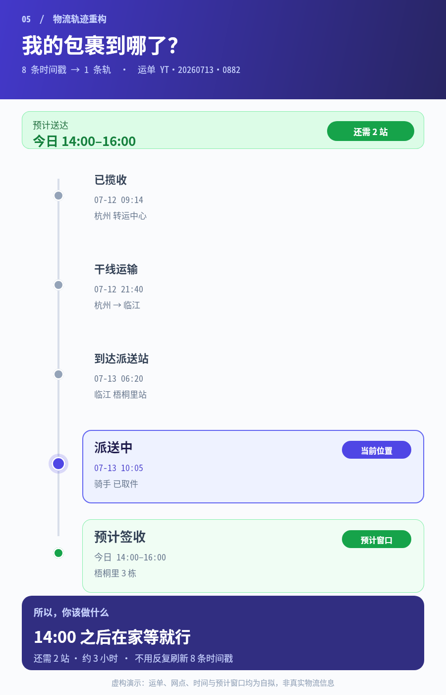
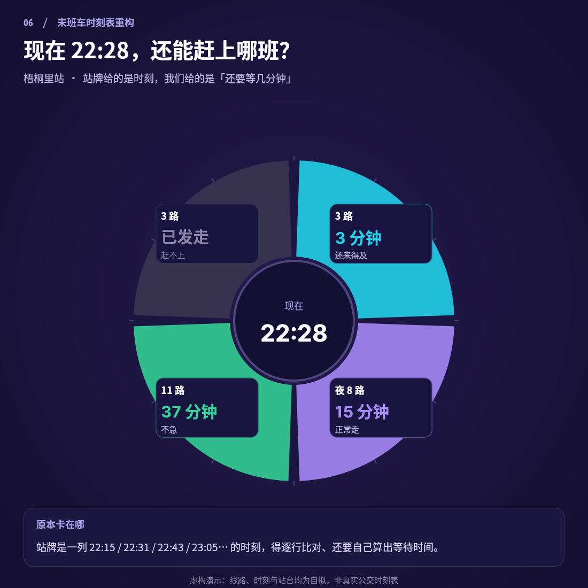
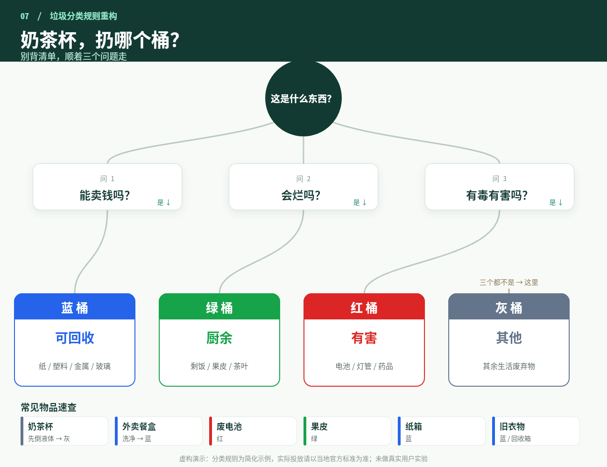
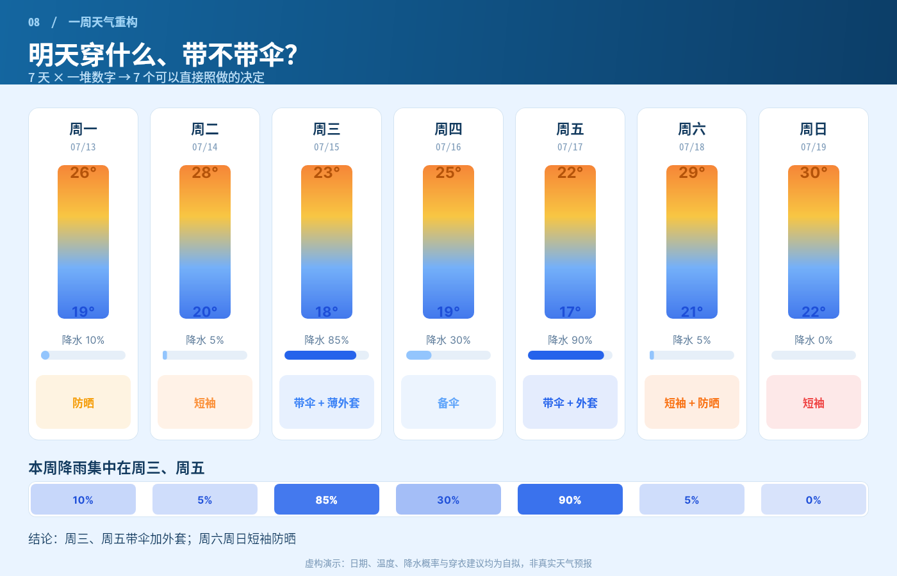
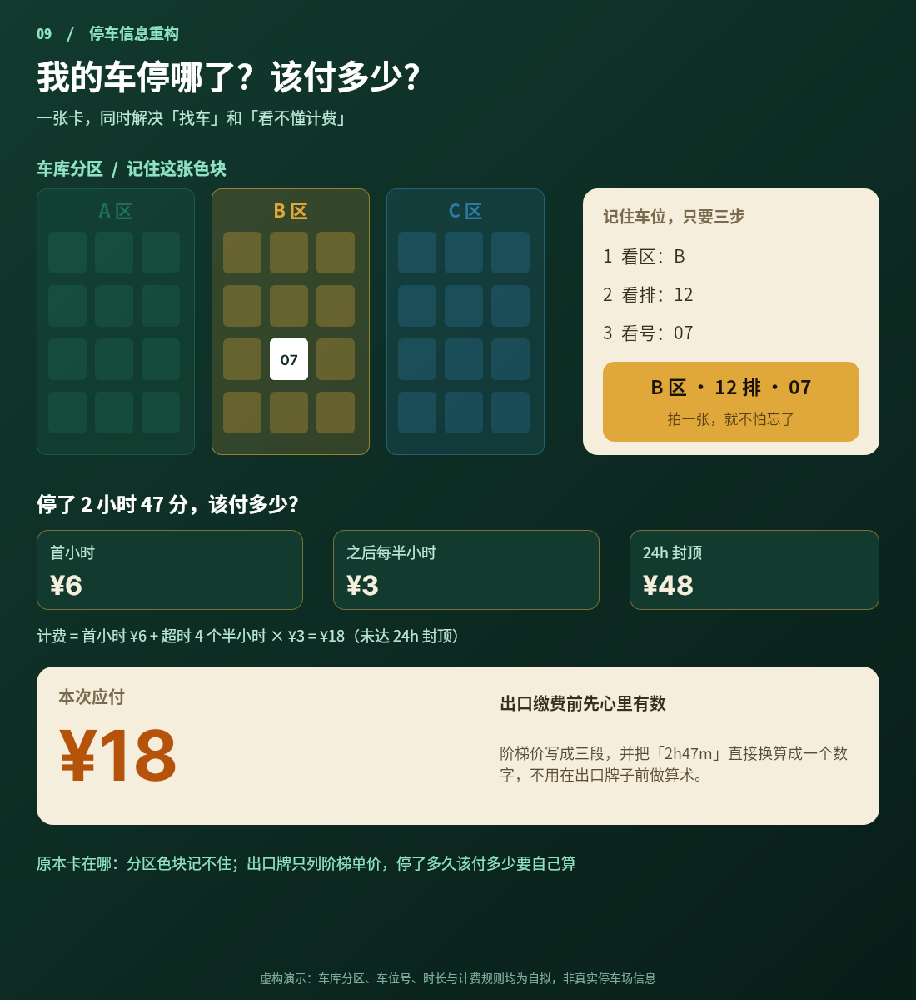
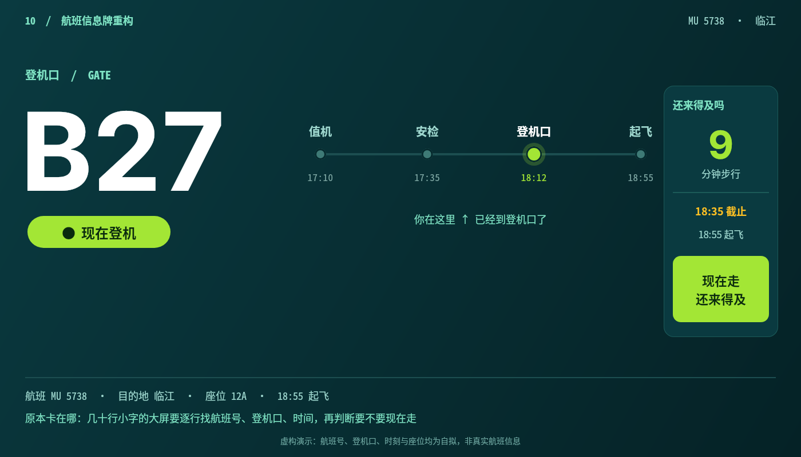

# B06 作品画廊 · 10 件独立信息设计

全部 PNG 均为 open-snapshot 服务真实响应；链接相对本题输出根，可离线浏览。

## 01 · 一眼服药 · 24 小时服药环

原本卡在哪：药品说明书把用法用量、禁忌、不良反应混排成密密麻麻的小字，用户真正要找的「什么时候吃、吃几次」反而最不显眼

重构：把 24 小时压成一个环形时钟，三个服药窗口用彩色弧段标在环上，中心给出「3 次 / 已服 1 次」的结论；右侧三张卡给出具体剂量  ｜  尺寸 1100×1100

[原 PNG](case-01/final.png) · [对应 DSL](case-01/final.snapshot) · [用例说明](case-01/case.md)

## 02 · 同价尺 · 每 100g 统一标尺

原本卡在哪：货架价签只标总价，不同净含量之间无法直接比较，购物者要么心算要么凭感觉

重构：把 5 种包装换算到同一把「每 100g」标尺，按单价排序成横向条形，最划算项用金色高亮并在底部给出可执行的省钱结论  ｜  尺寸 1200×900

[原 PNG](case-02/final.png) · [对应 DSL](case-02/final.snapshot) · [用例说明](case-02/case.md)

## 03 · 峰谷光带 · 24 小时用电账单

原本卡在哪：传统账单只给总金额与峰/谷/平三段电量，看不出具体哪个小时贵，也不告诉用户能怎么改

重构：把 24 小时摊成一条色带：颜色编码电价档、柱高编码用电量；右侧环形给出峰段占比，底部直接给出三条可执行建议  ｜  尺寸 1400×900

[原 PNG](case-03/final.png) · [对应 DSL](case-03/final.snapshot) · [用例说明](case-03/case.md)

## 04 · 三环限额 · 一包零食占多少

原本卡在哪：营养成分表用 NRV% 小字表格呈现，用户要自己在脑子里把「每 100g」换算成「这一包」，很难形成整体判断

重构：三个同心环分别表达三种营养素占日上限的比例，中心直接给出「钠偏高」的判断，下方三行保留可核查的精确数值  ｜  尺寸 1000×1200

[原 PNG](case-04/final.png) · [对应 DSL](case-04/final.snapshot) · [用例说明](case-04/case.md)

## 05 · 一条轨 · 把 8 条时间戳压成一条线

原本卡在哪：物流页把每一次扫描都列成一行时间戳，用户要在 8 行里自己找「现在在哪」和「什么时候能到」

重构：把 8 条原始时间戳归并成 4 阶段 + 1 个 ETA 窗口的垂直单轨，当前节点与预计窗口用底色高亮，底部直接给出「14:00 后在家」的行动结论  ｜  尺寸 900×1400

[原 PNG](case-05/final.png) · [对应 DSL](case-05/final.snapshot) · [用例说明](case-05/case.md)

## 06 · 末班钟 · 还能赶上哪班

原本卡在哪：公交站牌按时间顺序列出末班时刻，乘客要自己把每一班和「现在」相减，才能判断赶不赶得上、要等多久

重构：把「现在」放在圆心，把还能赶上的班次做成放射状扇形扇区，倒计时直接写在扇区里；赶不上的班次灰掉，形成一眼可判的极坐标时钟  ｜  尺寸 1100×1100

[原 PNG](case-06/final.png) · [对应 DSL](case-06/final.snapshot) · [用例说明](case-06/case.md)

## 07 · 四色树 · 垃圾分类决策树

原本卡在哪：垃圾分类规则通常是按物品罗列的长清单，遇到清单外的东西（奶茶杯、外卖盒）就要逐条查，且难以记住判断顺序

重构：把线性规则清单重构成树状分支：根节点 → 三个是非问题 → 四色终点桶，用贝塞尔曲线连接；底部补一行常见物品速查色块  ｜  尺寸 1300×1000

[原 PNG](case-07/final.png) · [对应 DSL](case-07/final.snapshot) · [用例说明](case-07/case.md)

## 08 · 穿衣带 · 一周天气决策列

原本卡在哪：天气预报按天堆叠最高/最低温、降水概率、风力等数字，用户真正要的决定（穿什么、带不带伞）要自己从数字里推

重构：7 列等宽卡片，每列用一条冷→暖渐变色带表达温度区间、一条降水条表达概率，底部把数字收敛成一句可执行决策；下方再用一条周降雨色带给出整体结论  ｜  尺寸 1400×900

[原 PNG](case-08/final.png) · [对应 DSL](case-08/final.snapshot) · [用例说明](case-08/case.md)

## 09 · 停车格 · 找车与计费一张卡

原本卡在哪：地下车库分区/排/号难记；出口计费牌只列首小时与超时单价，用户要把停车时长换算成金额

重构：上半用三色分区网格 + 高亮车位做空间记忆卡，下半把阶梯计费拆成三段色卡并直接换算成「¥18」大数字  ｜  尺寸 1100×1200

[原 PNG](case-09/final.png) · [对应 DSL](case-09/final.snapshot) · [用例说明](case-09/case.md)

## 10 · 登机条 · 一眼看清 B27

原本卡在哪：机场航班大屏把几十个航班堆成小字表格，旅客要逐行定位自己的航班号，再自行推断登机口、时间与是否该动身

重构：把整块信息牌压缩成单个航班：左侧 190px 的超大登机口数字，中间一条水平时间轴标出「你在这里」，右侧给出步行分钟与「现在走还来得及」的绿灯结论  ｜  尺寸 1400×800

[原 PNG](case-10/final.png) · [对应 DSL](case-10/final.snapshot) · [用例说明](case-10/case.md)

