# B01 画廊（11 件最终作品，逐图）

## case-01 · 汛眼 · 城市内涝值班图板（1600×1100）
受众：市防汛办值班员（值班室大屏旁的桌面打印图板）；目标：10 分钟内决定封路顺序与泵车派往

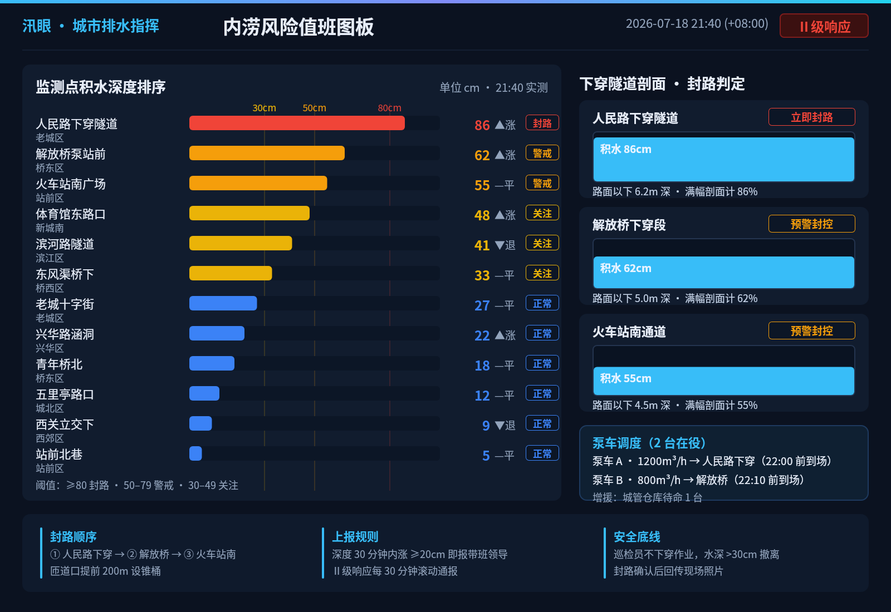

[原 PNG](case-01/final.png) · [对应 DSL](case-01/final.snapshot) · [case.md](case-01/case.md)

## case-02 · 屿咖啡 · 周备货看板（1080×1440）
受众：独立咖啡店店长（后场平板/手机，打烊后查看）；目标：按上周杯量与天气预报决定豆/奶/杯三品类订量

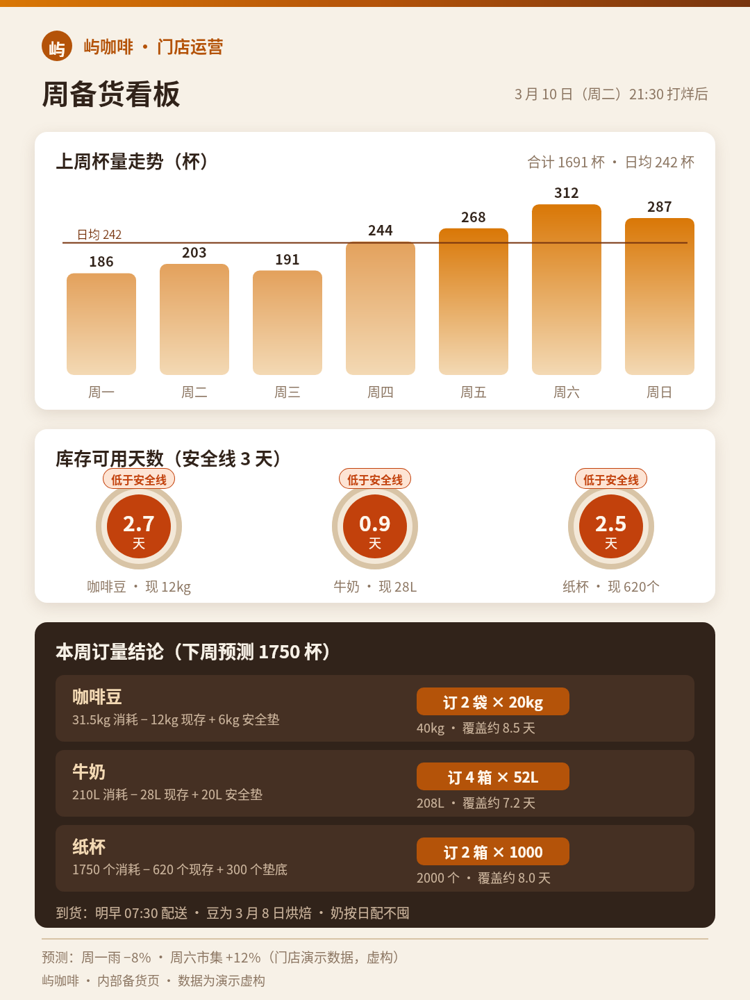

[原 PNG](case-02/final.png) · [对应 DSL](case-02/final.snapshot) · [case.md](case-02/case.md)

## case-03 · Ridgeline · 赛段剖面与补给策略（1800×760）
受众：职业自行车队体育主管（车队大巴电视屏，赛前简报）；目标：确定 3 个补给点里程与最后 20km 配速方案

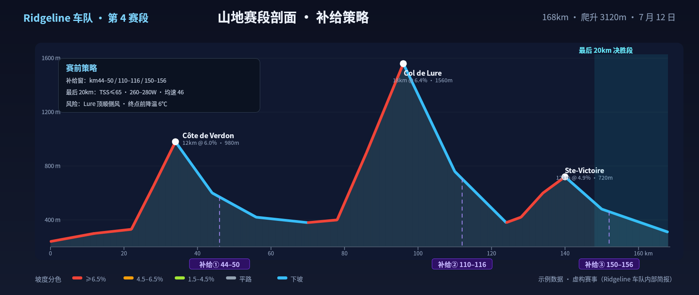

[原 PNG](case-03/final.png) · [对应 DSL](case-03/final.snapshot) · [case.md](case-03/case.md)

## case-04 · Sonnenspeicher · 家庭能源日调度卡（1200×1600）
受众：装光伏+储能的家庭用户（厨房贴/手机）；目标：决定洗衣机/洗碗机/电动车三件事各自的最佳用电时段

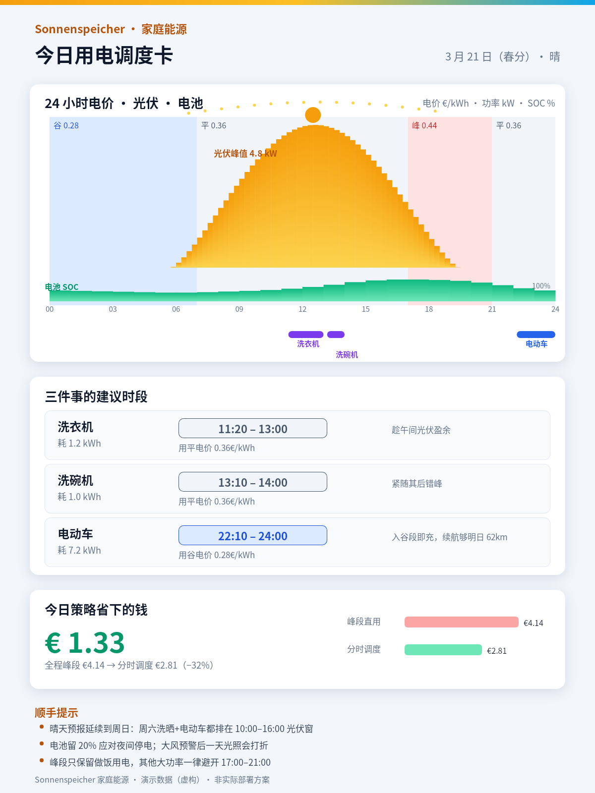

[原 PNG](case-04/final.png) · [对应 DSL](case-04/final.snapshot) · [case.md](case-04/case.md)

## case-05 · 琥珀剧院 · 今晚登台牌（900×1600）
受众：舞台监督与演员（后台侧幕张贴，1.5m 处站立阅读）；目标：三幕换景 cue 与道具/演员上场位置时间一目了然

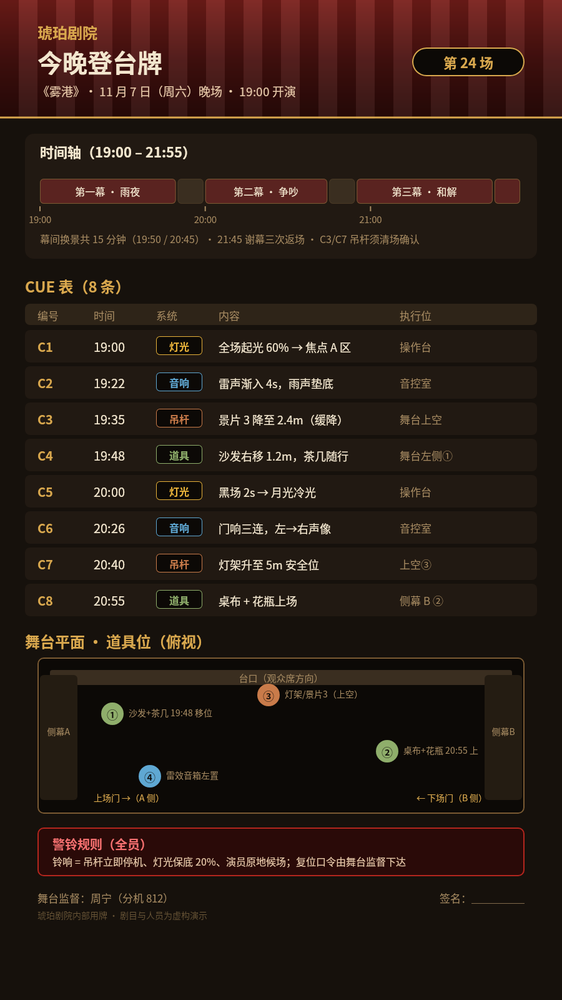

[原 PNG](case-05/final.png) · [对应 DSL](case-05/final.snapshot) · [case.md](case-05/case.md)

## case-06 · 启航计划 · 首次贡献者导航（1400×1000）
受众：想给开源项目提第一个 PR 的新手开发者（笔记本屏）；目标：30 分钟内从选 issue 到开 PR 的每一步与命令

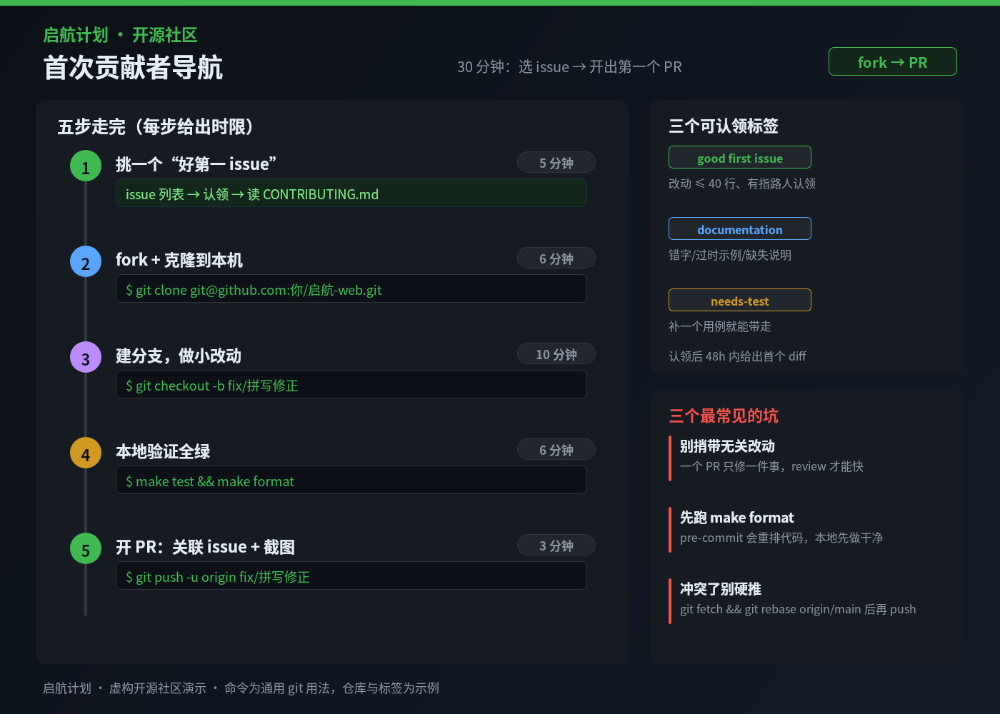

[原 PNG](case-06/final.png) · [对应 DSL](case-06/final.snapshot) · [case.md](case-06/case.md)

## case-07 · 安诺药房 · 处方核对单（1240×1754）
受众：社区药房药师（柜台 A4 打印，逐行勾核）；目标：核对 5 位患者 7 张处方并拦下 1 处高危相互作用 + 1 处剂量异常

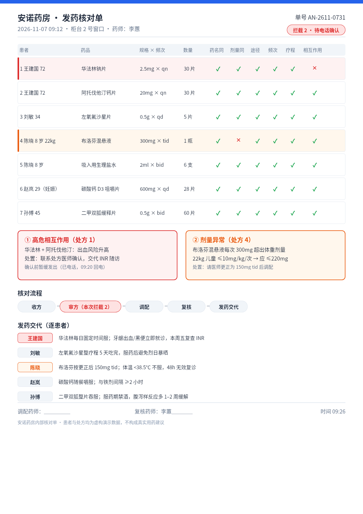

[原 PNG](case-07/final.png) · [对应 DSL](case-07/final.snapshot) · [case.md](case-07/case.md)

## case-08 · 峰线向导 · 明日窗口判定（1080×1920）
受众：周末徒步领队（出发前夜手机查看）；目标：判断明日是否出发、走哪条线、几点折返

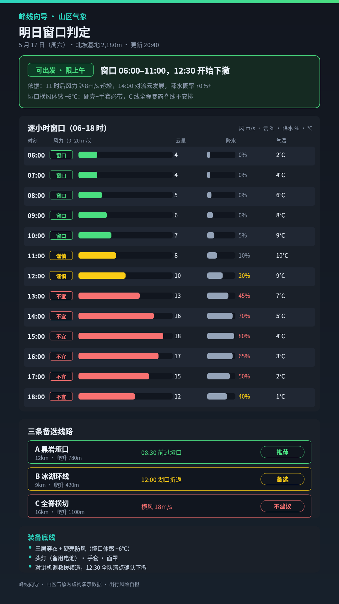

[原 PNG](case-08/final.png) · [对应 DSL](case-08/final.snapshot) · [case.md](case-08/case.md)

## case-09 · 赶海历 · 东岙湾潮汐窗口（1500×1000）
受众：周末赶海爱好者（出发前手机 + 渔市张贴）；目标：按当日潮位曲线决定去哪片滩涂、采什么、几点必须撤

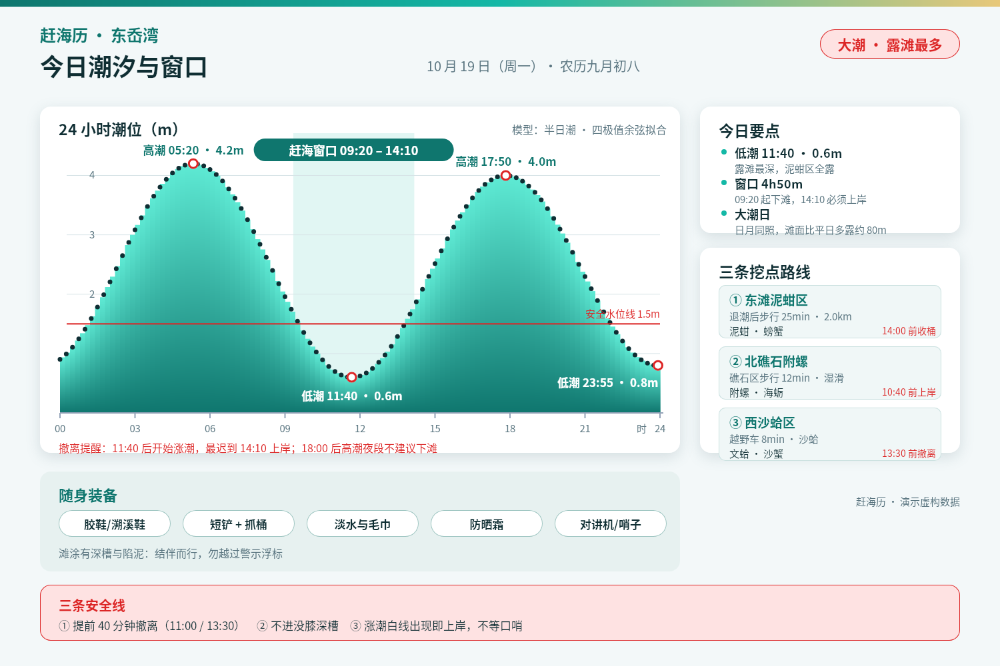

[原 PNG](case-09/final.png) · [对应 DSL](case-09/final.snapshot) · [case.md](case-09/case.md)

## case-10 · 金杯拉花赛 · 评审记分屏（1600×900）
受众：比赛评委、观众与直播（舞台侧屏，远距可读）；目标：看到四位选手两轮得分构成与排名变化

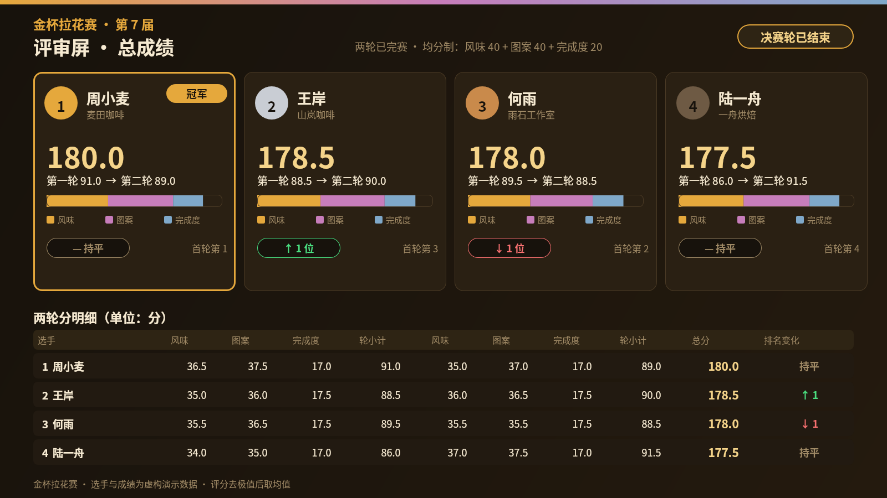

[原 PNG](case-10/final.png) · [对应 DSL](case-10/final.snapshot) · [case.md](case-10/case.md)

## case-11 · 夜巡观星 · 今晚观测条件卡（1200×1200）
受众：城市天文爱好者（傍晚出发前手机扫一眼，亦可发小组帖）；目标：选出今晚最佳观星时段，并对比市内/近郊两观测点

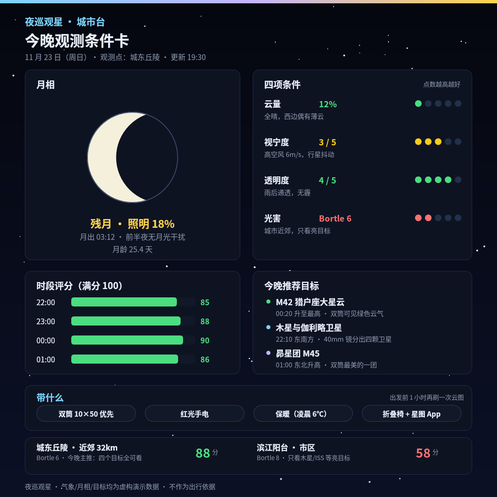

[原 PNG](case-11/final.png) · [对应 DSL](case-11/final.snapshot) · [case.md](case-11/case.md)
