# B04 画廊 · 太阳系数据特辑（11/11）

链接相对本题输出根（`outputs/run-20261011-01/B04/`），可离线浏览。
每件含 Markdown 预览、原 PNG 与同名主体 `.snapshot` 配对。

## 01 · 行星有多大：直径比例尺（1600×1000 · 定版 v3）

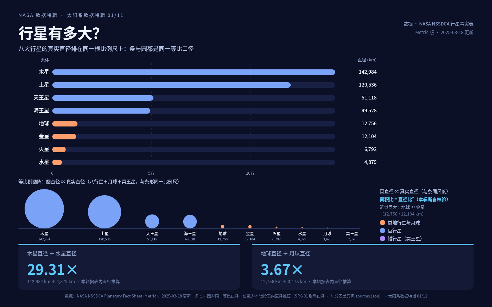

原图：[case-01/final.png](case-01/final.png) · DSL：[case-01/final.snapshot](case-01/final.snapshot)

## 02 · 太阳系有多空：对数距离标尺（1800×900 · 定版 v2）

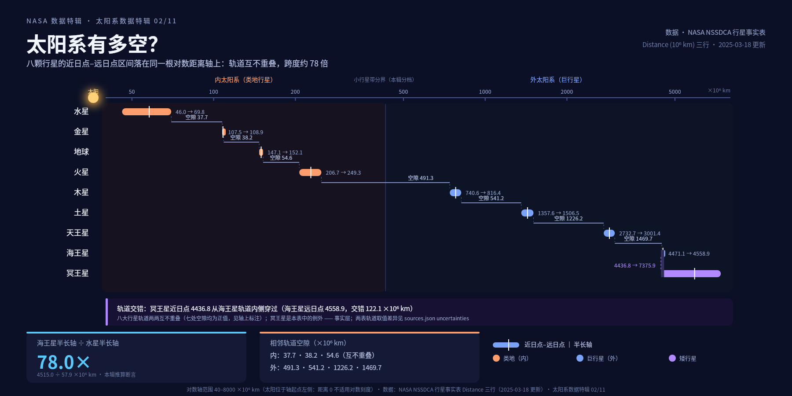

原图：[case-02/final.png](case-02/final.png) · DSL：[case-02/final.snapshot](case-02/final.snapshot)

## 03 · 开普勒定律的数据版：双对数散点（1600×1200 · 定版 v2）

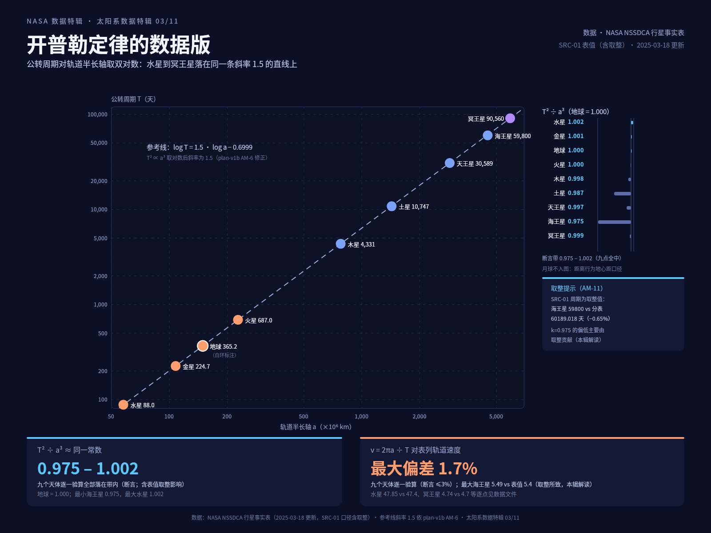

原图：[case-03/final.png](case-03/final.png) · DSL：[case-03/final.snapshot](case-03/final.snapshot)

## 04 · 一天有多长：太阳日与自转（1400×1000 · 定版 v2）

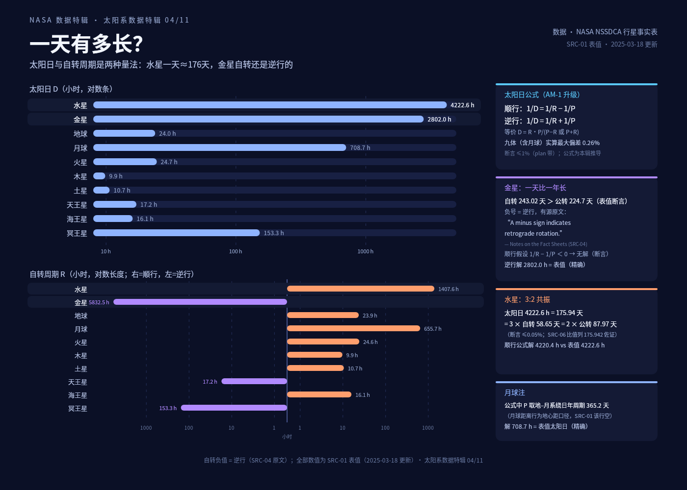

原图：[case-04/final.png](case-04/final.png) · DSL：[case-04/final.snapshot](case-04/final.snapshot)

## 05 · 能跳多高：重力与逃逸速度（1400×1000 · 定版 v3）

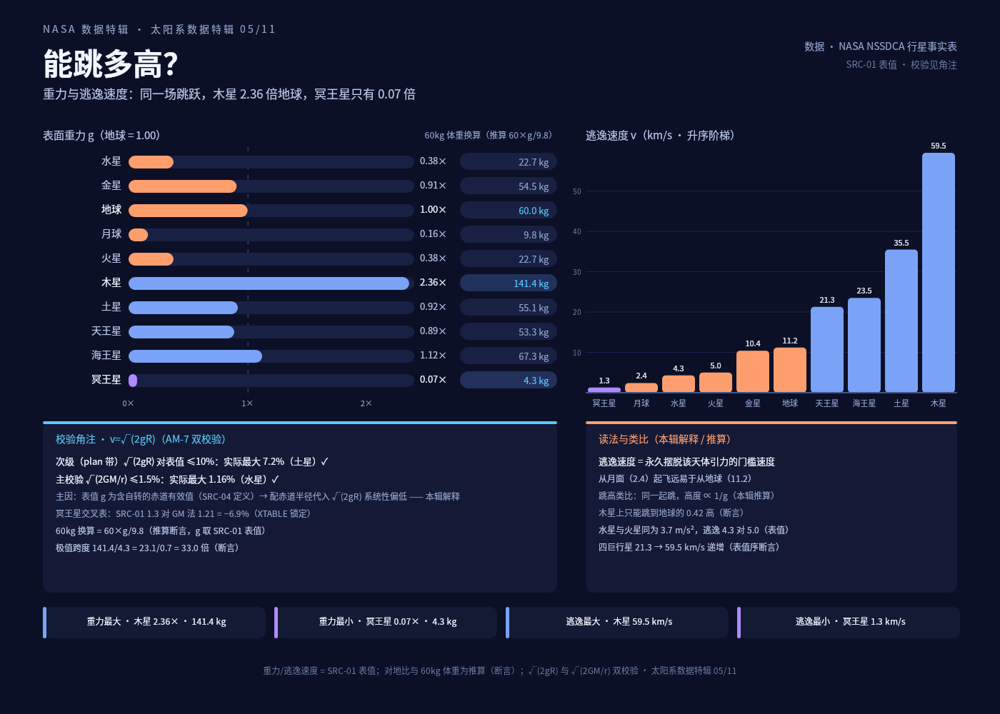

原图：[case-05/final.png](case-05/final.png) · DSL：[case-05/final.snapshot](case-05/final.snapshot)

## 06 · 哪里最热：温度阶梯（1200×1400 · 定版 v3）

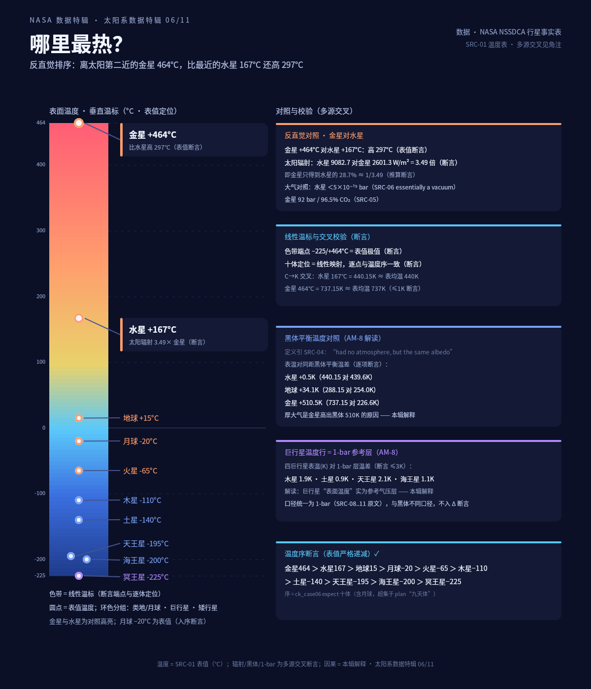

原图：[case-06/final.png](case-06/final.png) · DSL：[case-06/final.snapshot](case-06/final.snapshot)

## 07 · 卫星家族：谁的孩子多（1400×1000 · 定版 v2）

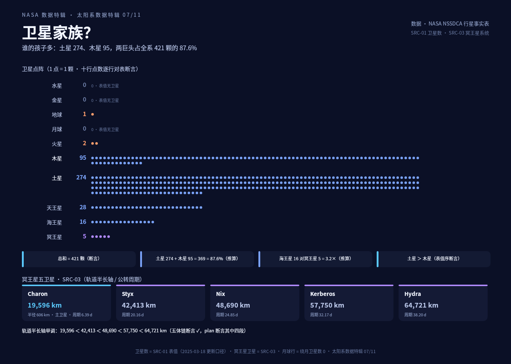

原图：[case-07/final.png](case-07/final.png) · DSL：[case-07/final.snapshot](case-07/final.snapshot)

## 08 · 地月系统：1/4 与 1/81（1400×1000 · 定版 v3）

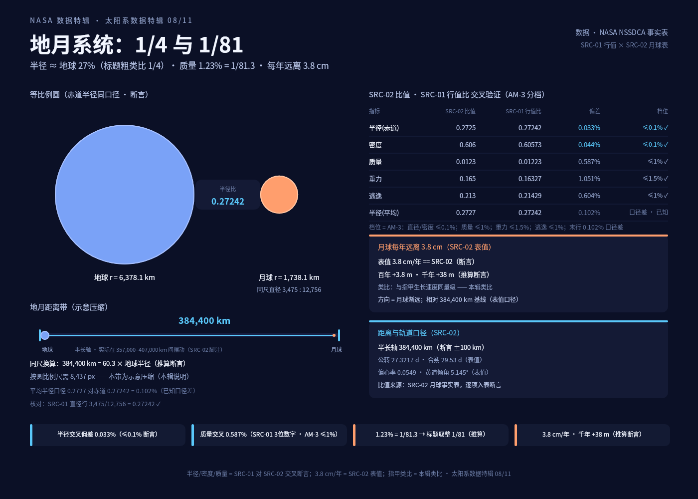

原图：[case-08/final.png](case-08/final.png) · DSL：[case-08/final.snapshot](case-08/final.snapshot)

## 09 · 冥王星档案卡（1200×1600 · 定版 v1）

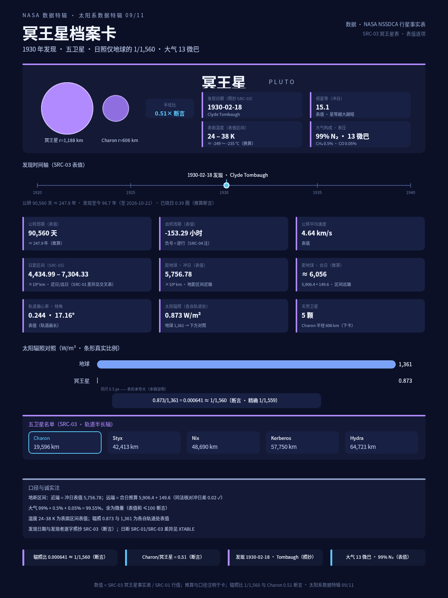

原图：[case-09/final.png](case-09/final.png) · DSL：[case-09/final.snapshot](case-09/final.snapshot)

## 10 · 环、磁场与密度分野（1600×1000 · 定版 v5）

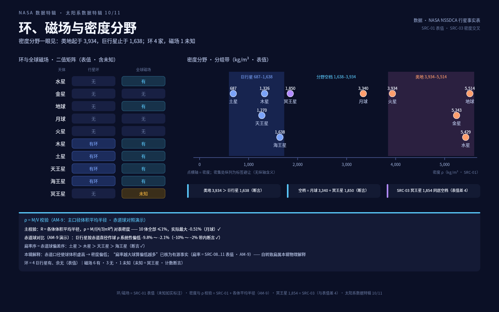

原图：[case-10/final.png](case-10/final.png) · DSL：[case-10/final.snapshot](case-10/final.snapshot)

## 11 · 全家福：特辑导读图（1600×1000 · 定版 v2）

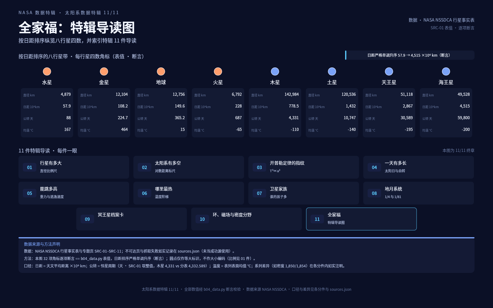

原图：[case-11/final.png](case-11/final.png) · DSL：[case-11/final.snapshot](case-11/final.snapshot)
