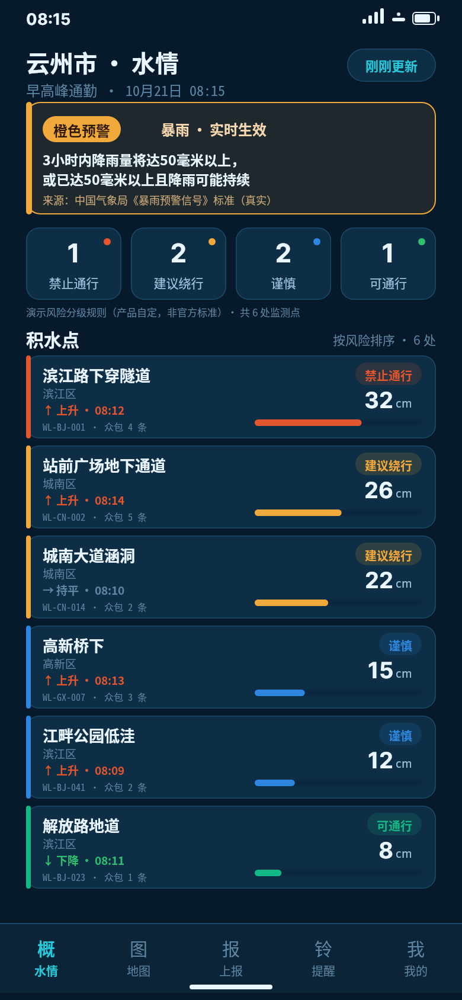
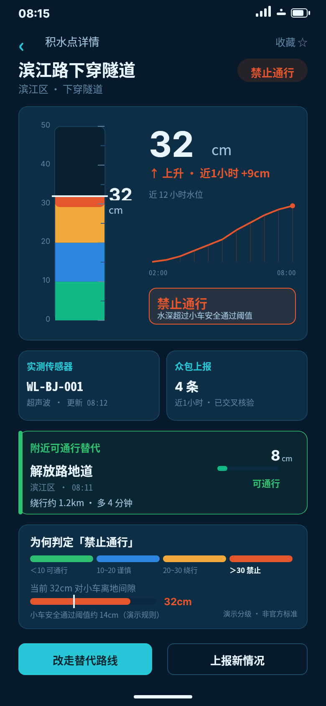
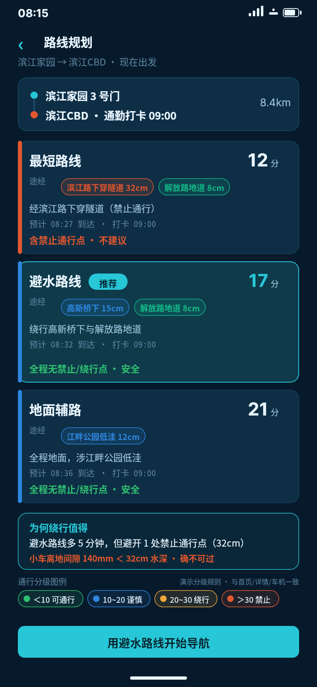
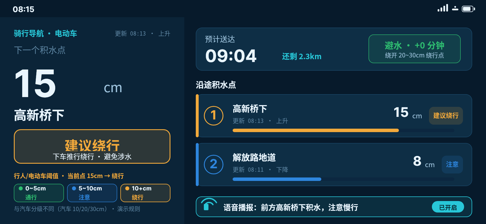
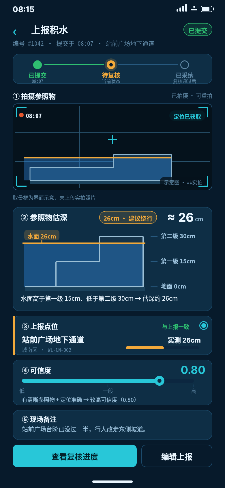
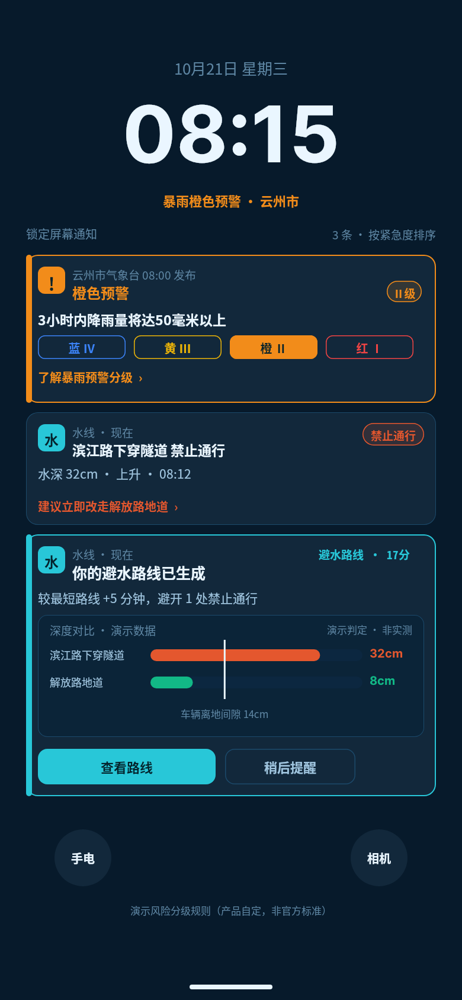
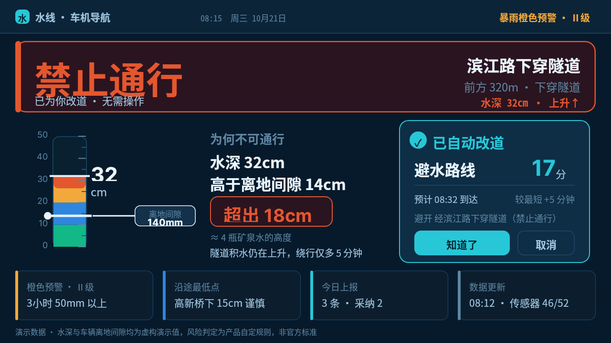
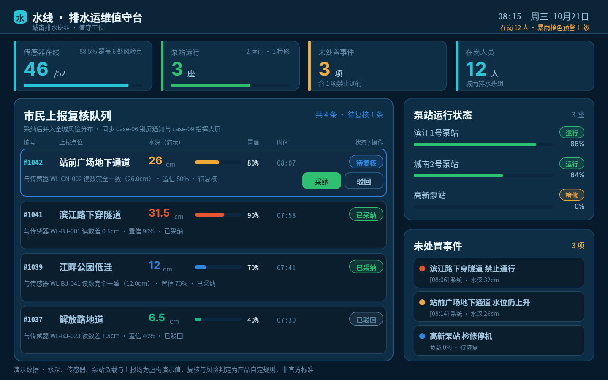
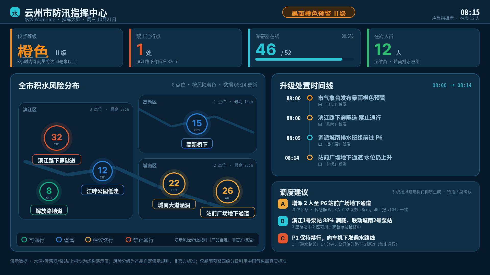
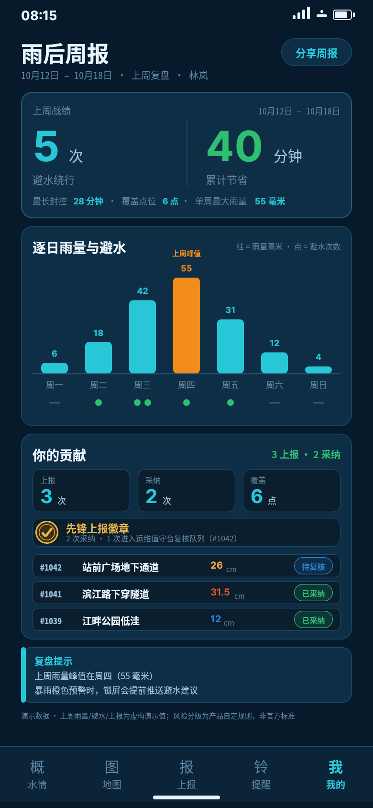

# 水线 Waterline · 最终作品画廊

共 **10** 张最终作品，全部为 open-snapshot 服务原始响应字节，每张配同名完整 `.snapshot` DSL。按旅程顺序排列。

| # | 画面 | 角色 · 设备 | 尺寸 | 版本 |
|---|---|---|---|---|
| 1 | [case-01 首页 · 城市水情总览](case-01/case.md) | 市民通勤 · 手机竖屏 | 780×1688 | v4 |
| 2 | [case-02 水点详情 · 滨江路下穿隧道](case-02/case.md) | 市民通勤 · 手机竖屏 | 780×1688 | v4 |
| 3 | [case-03 避水路线规划](case-03/case.md) | 市民通勤 · 手机竖屏 | 780×1688 | v4 |
| 4 | [case-04 骑行横屏导航](case-04/case.md) | 外卖骑手 · 手机横屏 | 1688×780 | v4 |
| 5 | [case-05 上报积水](case-05/case.md) | 市民/骑手 · 手机竖屏 | 780×1688 | v2 |
| 6 | [case-06 预警与通知中心（锁屏）](case-06/case.md) | 全体用户 · 手机竖屏（锁屏） | 780×1688 | v4 |
| 7 | [case-07 车机 · 驾驶避水提醒](case-07/case.md) | 私家车主 · 车机 1280×720 | 1280×720 | v4 |
| 8 | [case-08 排水运维值守台](case-08/case.md) | 排水运维 · 桌面 1440×900 | 1440×900 | v4 |
| 9 | [case-09 市级防汛指挥大屏](case-09/case.md) | 防汛指挥 · 大屏 1920×1080 | 1920×1080 | v3 |
| 10 | [case-10 雨后个人周报](case-10/case.md) | 市民通勤（个人） · 手机竖屏 | 780×1688 | v2 |

---

## 1. case-01 · 首页 · 城市水情总览

**市民通勤 ｜ 手机竖屏 ｜ 780 × 1688 ｜ 接受版本 v4**

**它回答的问题**：全城现在哪些点位有风险、各自多深、什么判定

**数据来源**：b05_data 6 点位 + CMA 橙色预警（SRC-01）

[原 PNG](case-01/final.png) ｜ [对应 DSL](case-01/final.snapshot) ｜ [画面说明](case-01/case.md)

---

## 2. case-02 · 水点详情 · 滨江路下穿隧道

**市民通勤 ｜ 手机竖屏 ｜ 780 × 1688 ｜ 接受版本 v4**

**它回答的问题**：32cm 判定禁止通行，双来源校验，趋势上升

**数据来源**：传感器 WL-BJ-001 + 众包 4 条；P4 8cm 可通行作为替代参照

[原 PNG](case-02/final.png) ｜ [对应 DSL](case-02/final.snapshot) ｜ [画面说明](case-02/case.md)

---

## 3. case-03 · 避水路线规划

**市民通勤 ｜ 手机竖屏 ｜ 780 × 1688 ｜ 接受版本 v4**

**它回答的问题**：避水路线 17 分钟推荐；最短 12 分钟但途经禁行 P1

**数据来源**：ROUTES 三条 + CAR_CLEAR_MM=140 离地间隙判定

[原 PNG](case-03/final.png) ｜ [对应 DSL](case-03/final.snapshot) ｜ [画面说明](case-03/case.md)

---

## 4. case-04 · 骑行横屏导航

**外卖骑手 ｜ 手机横屏 ｜ 1688 × 780 ｜ 接受版本 v4**

**它回答的问题**：骑手用更严的 5/10cm 阈值：P4 8cm 注意 / P3 15cm 绕行

**数据来源**：ped_risk_of 分级；横屏大字少信息强对比

[原 PNG](case-04/final.png) ｜ [对应 DSL](case-04/final.snapshot) ｜ [画面说明](case-04/case.md)

---

## 5. case-05 · 上报积水

**市民/骑手 ｜ 手机竖屏 ｜ 780 × 1688 ｜ 接受版本 v2**

**它回答的问题**：参照台阶第二级估约 26cm，可信度 0.8，提交后待复核

**数据来源**：REPORT #1042 P6 站前广场地下通道

[原 PNG](case-05/final.png) ｜ [对应 DSL](case-05/final.snapshot) ｜ [画面说明](case-05/case.md)

---

## 6. case-06 · 预警与通知中心（锁屏）

**全体用户 ｜ 手机竖屏（锁屏） ｜ 780 × 1688 ｜ 接受版本 v4**

**它回答的问题**：预警 > 禁止通行 > 路线 三级推送，各带可解释动作

**数据来源**：CMA 橙色预警文案 + P1 禁行 + 避水路线

[原 PNG](case-06/final.png) ｜ [对应 DSL](case-06/final.snapshot) ｜ [画面说明](case-06/case.md)

---

## 7. case-07 · 车机 · 驾驶避水提醒

**私家车主 ｜ 车机 1280×720 ｜ 1280 × 720 ｜ 接受版本 v4**

**它回答的问题**：P1 32cm 高于净空 14cm → 不可过；改走避水路线

**数据来源**：CAR_CLEAR_MM=140 vs P1 32cm，DepthRuler 叠画离地间隙线

[原 PNG](case-07/final.png) ｜ [对应 DSL](case-07/final.snapshot) ｜ [画面说明](case-07/case.md)

---

## 8. case-08 · 排水运维值守台

**排水运维 ｜ 桌面 1440×900 ｜ 1440 × 900 ｜ 接受版本 v4**

**它回答的问题**：#1042 与传感器 26.0cm 一致可采纳；3 座泵站 2 运行 1 检修

**数据来源**：MOD_QUEUE + OPS（泵站/事件/在岗）

[原 PNG](case-08/final.png) ｜ [对应 DSL](case-08/final.snapshot) ｜ [画面说明](case-08/case.md)

---

## 9. case-09 · 市级防汛指挥大屏

**防汛指挥 ｜ 大屏 1920×1080 ｜ 1920 × 1080 ｜ 接受版本 v3**

**它回答的问题**：6 点按风险着色分布、08:00→08:14 事件时序、三条调度建议

**数据来源**：全系数据汇总 + ESCALATION 时序

[原 PNG](case-09/final.png) ｜ [对应 DSL](case-09/final.snapshot) ｜ [画面说明](case-09/case.md)

---

## 10. case-10 · 雨后个人周报

**市民通勤（个人） ｜ 手机竖屏 ｜ 780 × 1688 ｜ 接受版本 v2**

**它回答的问题**：上周 5 次避水绕行、省 40 分钟、上报 3 采纳 2、覆盖 6 点

**数据来源**：WEEK 周数据（10月12日–10月18日，上周）

[原 PNG](case-10/final.png) ｜ [对应 DSL](case-10/final.snapshot) ｜ [画面说明](case-10/case.md)
