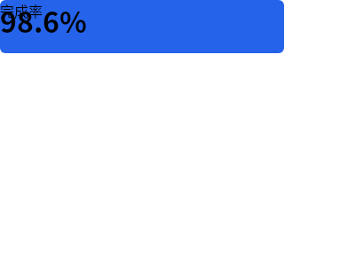
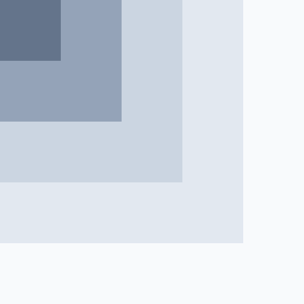

# B03 画廊 — DSL创意边界 (10件)

## case-01 — 同心圆层级

- PNG: [case-01/final.png](case-01/final.png)
- DSL: [case-01/final.snapshot](case-01/final.snapshot)

## case-02 — 色块网格矩阵

- PNG: [case-02/final.png](case-02/final.png)
- DSL: [case-02/final.snapshot](case-02/final.snapshot)

## case-03 — 排版实验卡片

- PNG: [case-03/final.png](case-03/final.png)
- DSL: [case-03/final.snapshot](case-03/final.snapshot)

## case-04 — 线条几何抽象

- PNG: [case-04/final.png](case-04/final.png)
- DSL: [case-04/final.snapshot](case-04/final.snapshot)

## case-05 — 色彩渐变块

- PNG: [case-05/final.png](case-05/final.png)
- DSL: [case-05/final.snapshot](case-05/final.snapshot)

## case-06 — 极简数据卡片

- PNG: [case-06/final.png](case-06/final.png)
- DSL: [case-06/final.snapshot](case-06/final.snapshot)

## case-07 — 对称构图研究

- PNG: [case-07/final.png](case-07/final.png)
- DSL: [case-07/final.snapshot](case-07/final.snapshot)

## case-08 — 不规则网格

- PNG: [case-08/final.png](case-08/final.png)
- DSL: [case-08/final.snapshot](case-08/final.snapshot)

## case-09 — 单色调层级

- PNG: [case-09/final.png](case-09/final.png)
- DSL: [case-09/final.snapshot](case-09/final.snapshot)

## case-10 — 动态旋转方块

- PNG: [case-10/final.png](case-10/final.png)
- DSL: [case-10/final.snapshot](case-10/final.snapshot)
