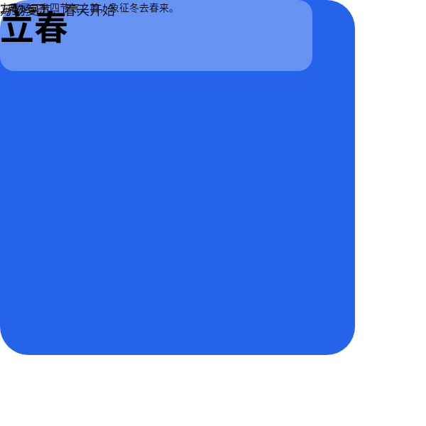
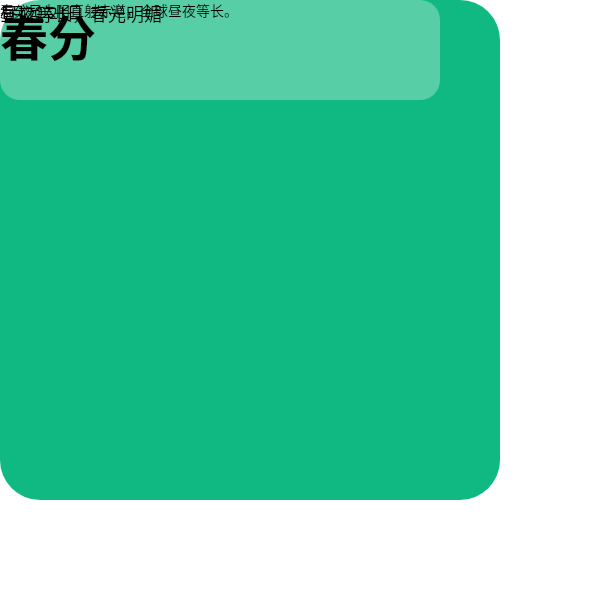
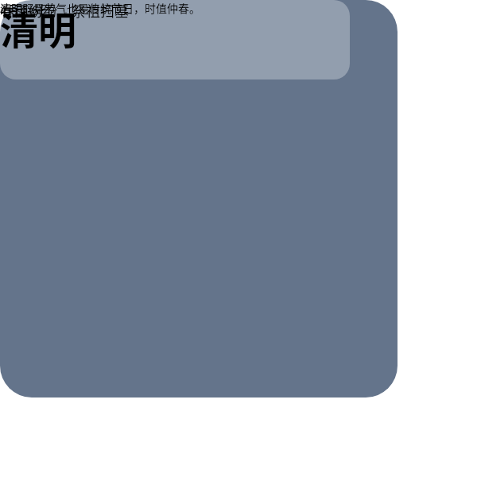
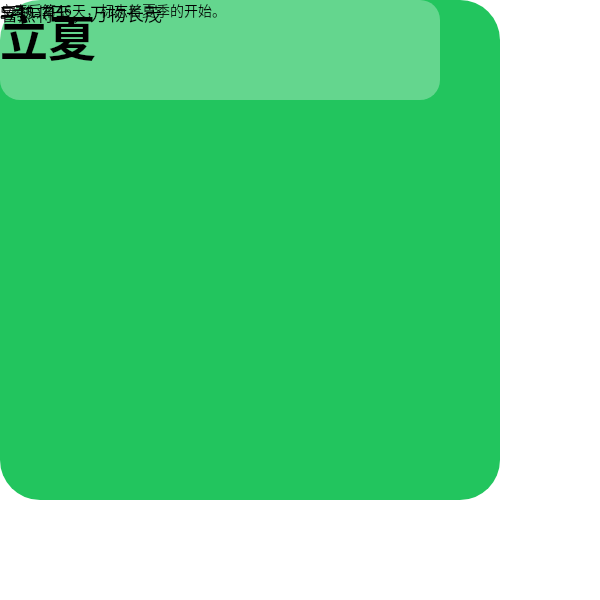
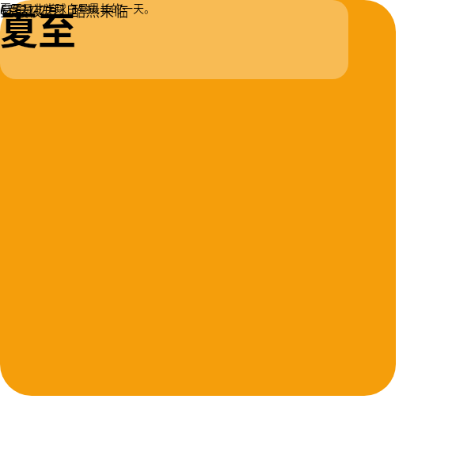
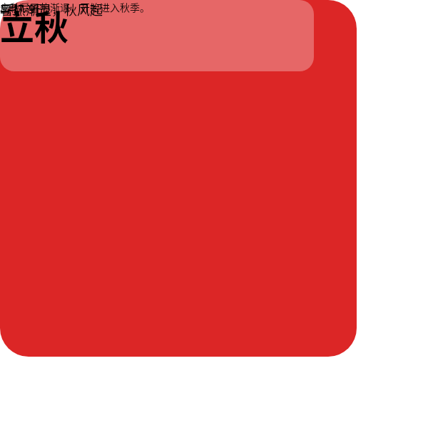
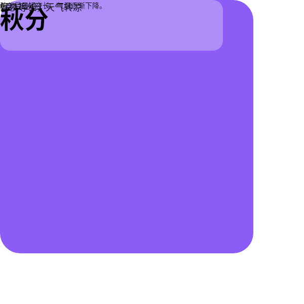
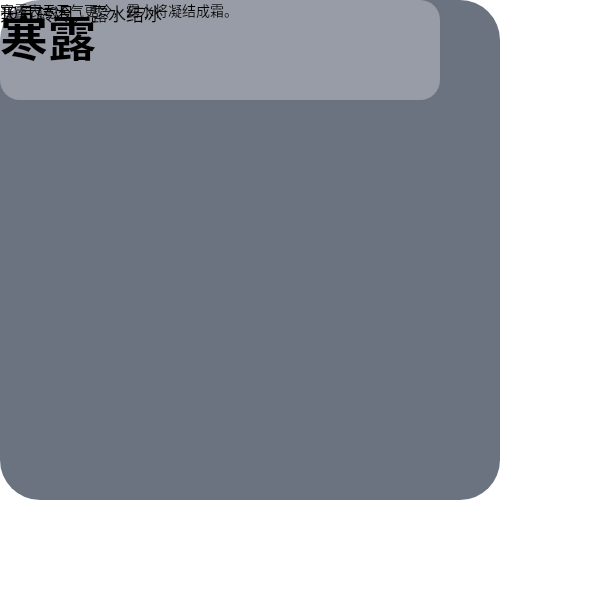
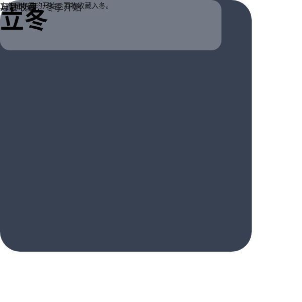
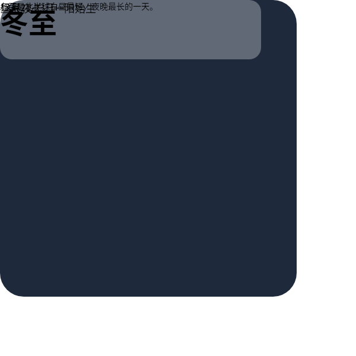

# B04 画廊 — 二十四节气特辑 (10件)

## case-01 — 立春节气

- PNG: [case-01/final.png](case-01/final.png)
- DSL: [case-01/final.snapshot](case-01/final.snapshot)

## case-02 — 春分节气

- PNG: [case-02/final.png](case-02/final.png)
- DSL: [case-02/final.snapshot](case-02/final.snapshot)

## case-03 — 清明节气

- PNG: [case-03/final.png](case-03/final.png)
- DSL: [case-03/final.snapshot](case-03/final.snapshot)

## case-04 — 立夏节气

- PNG: [case-04/final.png](case-04/final.png)
- DSL: [case-04/final.snapshot](case-04/final.snapshot)

## case-05 — 夏至节气

- PNG: [case-05/final.png](case-05/final.png)
- DSL: [case-05/final.snapshot](case-05/final.snapshot)

## case-06 — 立秋节气

- PNG: [case-06/final.png](case-06/final.png)
- DSL: [case-06/final.snapshot](case-06/final.snapshot)

## case-07 — 秋分节气

- PNG: [case-07/final.png](case-07/final.png)
- DSL: [case-07/final.snapshot](case-07/final.snapshot)

## case-08 — 寒露节气

- PNG: [case-08/final.png](case-08/final.png)
- DSL: [case-08/final.snapshot](case-08/final.snapshot)

## case-09 — 立冬节气

- PNG: [case-09/final.png](case-09/final.png)
- DSL: [case-09/final.snapshot](case-09/final.snapshot)

## case-10 — 冬至节气

- PNG: [case-10/final.png](case-10/final.png)
- DSL: [case-10/final.snapshot](case-10/final.snapshot)
