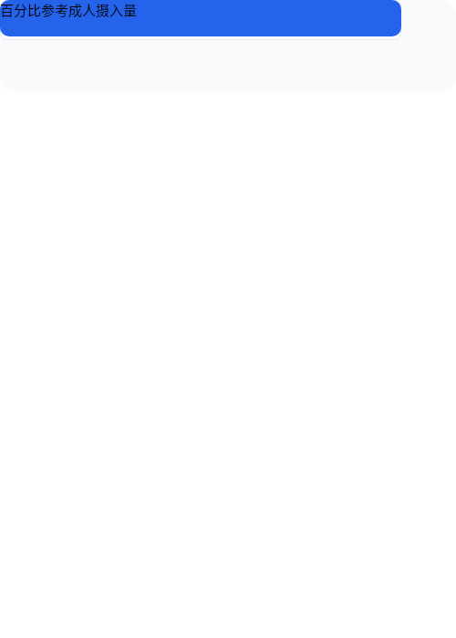
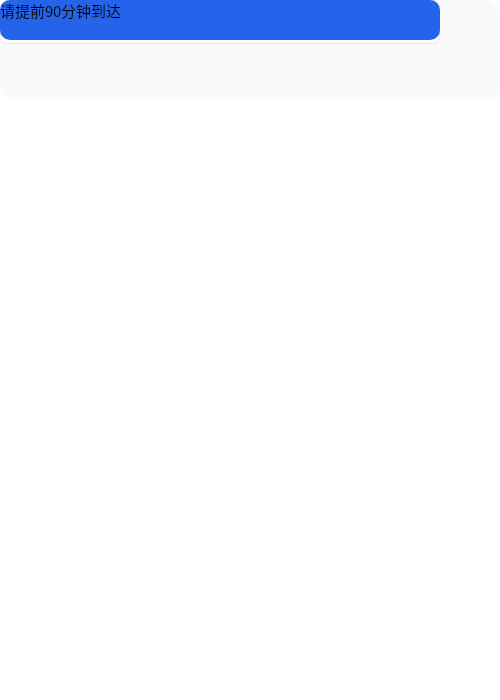
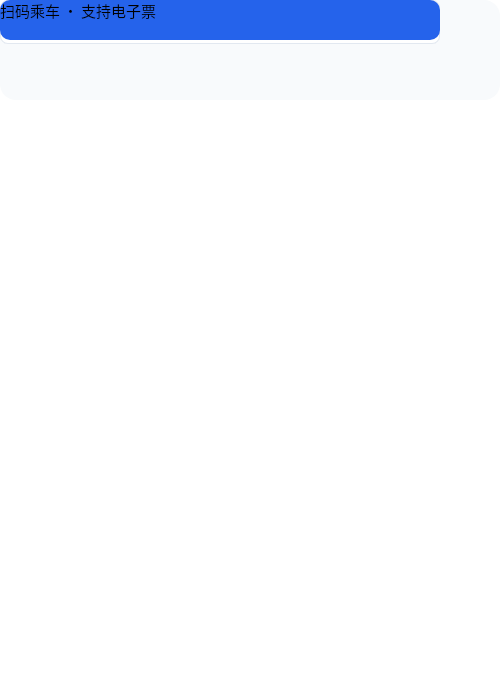

# B06 画廊 — 日常信息难题重构 (10件)

## case-01 — 营养成分表

- PNG: [case-01/final.png](case-01/final.png)
- DSL: [case-01/final.snapshot](case-01/final.snapshot)

## case-02 — 药品说明书

- PNG: [case-02/final.png](case-02/final.png)
- DSL: [case-02/final.snapshot](case-02/final.snapshot)

## case-03 — 航班信息

- PNG: [case-03/final.png](case-03/final.png)
- DSL: [case-03/final.snapshot](case-03/final.snapshot)

## case-04 — 天气预报

- PNG: [case-04/final.png](case-04/final.png)
- DSL: [case-04/final.snapshot](case-04/final.snapshot)

## case-05 — 股票行情

- PNG: [case-05/final.png](case-05/final.png)
- DSL: [case-05/final.snapshot](case-05/final.snapshot)

## case-06 — 公交线路

- PNG: [case-06/final.png](case-06/final.png)
- DSL: [case-06/final.snapshot](case-06/final.snapshot)

## case-07 — 餐厅菜单

- PNG: [case-07/final.png](case-07/final.png)
- DSL: [case-07/final.snapshot](case-07/final.snapshot)

## case-08 — 产品对比

- PNG: [case-08/final.png](case-08/final.png)
- DSL: [case-08/final.snapshot](case-08/final.snapshot)

## case-09 — 保险条款

- PNG: [case-09/final.png](case-09/final.png)
- DSL: [case-09/final.snapshot](case-09/final.snapshot)

## case-10 — 电费账单

- PNG: [case-10/final.png](case-10/final.png)
- DSL: [case-10/final.snapshot](case-10/final.snapshot)
