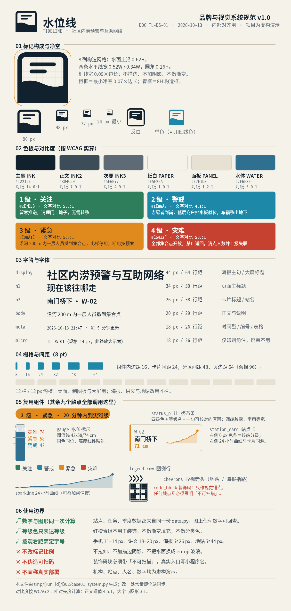
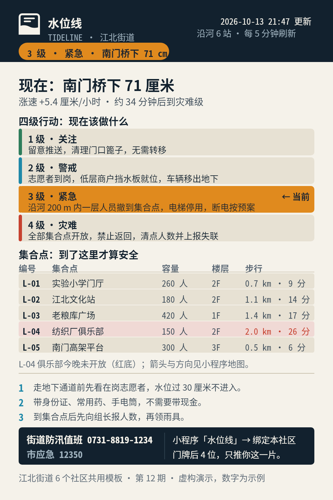
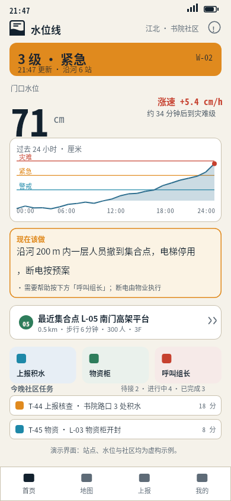
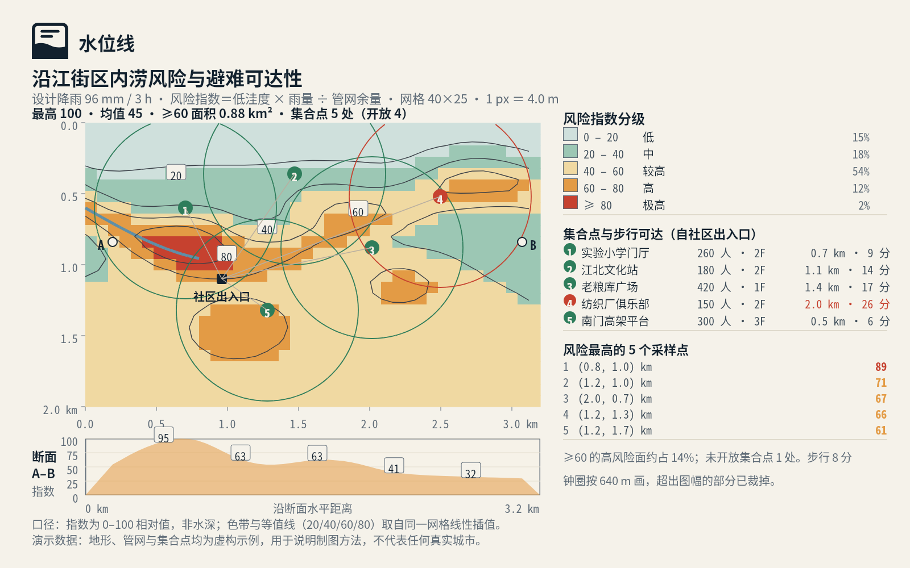
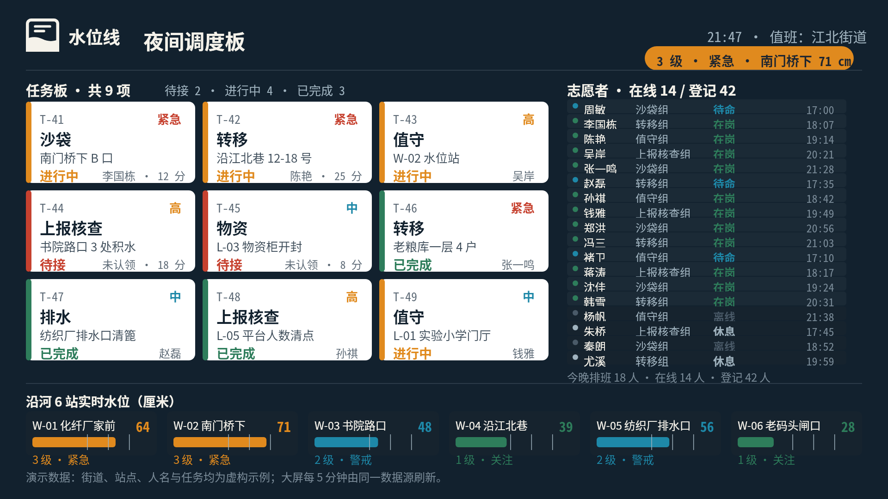
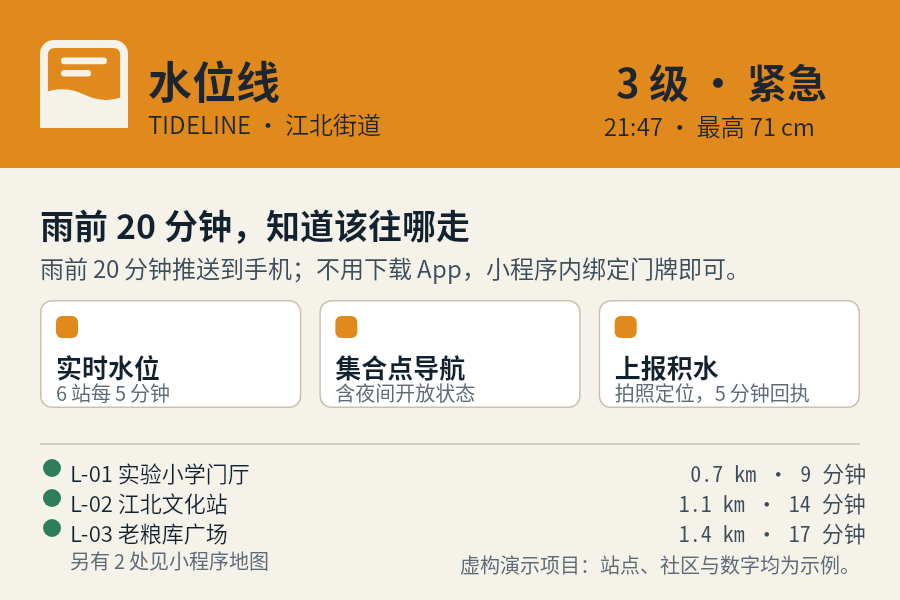
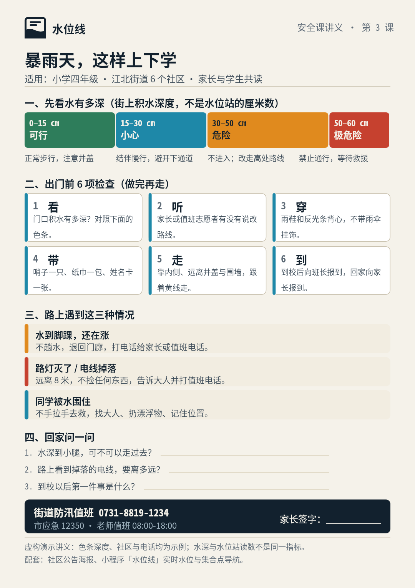
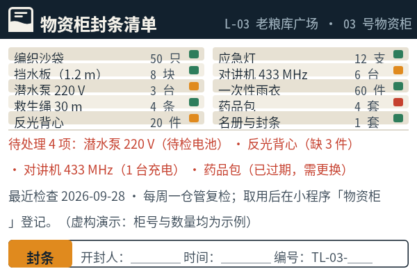
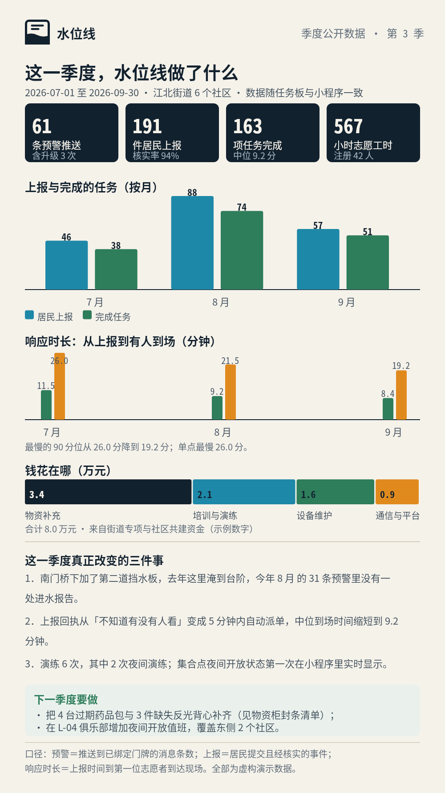
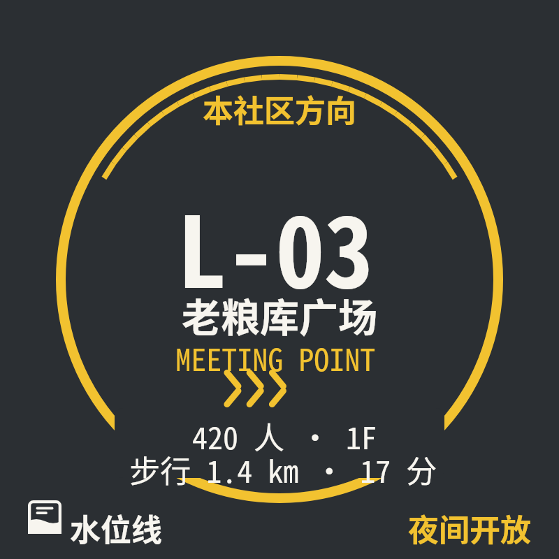

# B02 画廊 · 水位线视觉生态（run 2026-10-12T10-04Z-r001）

十件作品同属一个虚构社区项目，但媒介、尺寸与观看距离各不相同。
预览图即最终交付图；每张下方给出原 PNG 与生成它的完整 `.snapshot`。
链接相对本题输出根 `outputs/2026-10-12T10-04Z-r001/B02/`。

| # | 触点 | 作品 | 尺寸 | 字号地板 | 渲染 | 版本 |
|---|---|---|---|---|---|---|
| 01 | 品牌规范页（内部对齐用，A4/屏幕） | [水位线 品牌与视觉系统规范](#case-01) | 1200×1680 | 20 px | 4 次 | 4 版 |
| 02 | 社区公告栏汛期海报 | [汛期四级行动 · 社区公告](#case-02) | 900×1350 | 26 px | 5 次 | 5 版 |
| 03 | 手机 App 实时预警页 | [潮水位 · 实时预警页](#case-03) | 390×844 | 11 px | 4 次 | 4 版 |
| 04 | 街道内涝风险制图板 | [沿江街区内涝风险与避难可达性](#case-04) | 1600×1000 | 20 px | 6 次 | 6 版 |
| 05 | 街道值班室调度大屏 | [夜间调度板 · 任务与志愿者状态](#case-05) | 1920×1080 | 24 px | 1 次 | 1 版 |
| 06 | 微信服务卡片／推文头图 | [入汛提醒 · 服务入口卡](#case-06) | 900×600 | 20 px | 1 次 | 1 版 |
| 07 | 学校安全教育讲义 | [暴雨天上下学 · 安全课讲义](#case-07) | 1080×1528 | 20 px | 1 次 | 1 版 |
| 08 | 物资柜清单标签（100×67 mm 印刷） | [社区物资柜 · 封条清单](#case-08) | 600×400 | 18 px | 2 次 | 2 版 |
| 09 | 季度透明报告长图（社区公开） | [2026 第三季度公开数据报告](#case-09) | 1000×2000 | 20 px | 2 次 | 2 版 |
| 10 | 地面集合点导视贴 | [集合点 L-03 地贴](#case-10) | 800×800 | 44 px | 4 次 | 4 版 |

---

## case-01 · 水位线 品牌与视觉系统规范

*品牌规范页（内部对齐用，A4/屏幕） · 1200×1680 px · 最小字号 20 px*

- 受众：志愿者宣传组与新加入的设计/开发
- 完成的事：不改系统的前提下做出其余 9 个触点
- 观看环境：会议室投屏与打印对照
- 原图：[case-01/final.png](case-01/final.png)
- 完整 DSL：[case-01/final.snapshot](case-01/final.snapshot)
- 用例说明：[case-01/case.md](case-01/case.md)
- 计算结果：[case-01/computed-data.json](case-01/computed-data.json)
- 生成程序：`tmp/2026-10-12T10-04Z-r001/B02/case01_system.py`（共享构件 `tmp/2026-10-12T10-04Z-r001/B02/tide.py`、数据 `tmp/2026-10-12T10-04Z-r001/B02/data.py`）
- 审计：文本 121 / 形 217 · 重叠 0 · 出界 0 · 渲染 4 次

---

## case-02 · 汛期四级行动 · 社区公告

*社区公告栏汛期海报 · 900×1350 px · 最小字号 26 px*

- 受众：路过公告栏的居民（含老人）
- 完成的事：3 秒内知道当前等级、集合点、电话
- 观看环境：室外公告栏，1–2 m 阅读，无手机
- 原图：[case-02/final.png](case-02/final.png)
- 完整 DSL：[case-02/final.snapshot](case-02/final.snapshot)
- 用例说明：[case-02/case.md](case-02/case.md)
- 计算结果：[case-02/computed-data.json](case-02/computed-data.json)
- 生成程序：`tmp/2026-10-12T10-04Z-r001/B02/case02_poster.py`（共享构件 `tmp/2026-10-12T10-04Z-r001/B02/tide.py`、数据 `tmp/2026-10-12T10-04Z-r001/B02/data.py`）
- 审计：文本 60 / 形 23 · 重叠 0 · 出界 0 · 渲染 5 次

---

## case-03 · 潮水位 · 实时预警页

*手机 App 实时预警页 · 390×844 px · 最小字号 11 px*

- 受众：已安装小程序的居民，夜里在家看手机
- 完成的事：知道自家门口现在多深、会不会涨、现在该做什么
- 观看环境：手机竖屏，暗光，30 cm
- 原图：[case-03/final.png](case-03/final.png)
- 完整 DSL：[case-03/final.snapshot](case-03/final.snapshot)
- 用例说明：[case-03/case.md](case-03/case.md)
- 计算结果：[case-03/computed-data.json](case-03/computed-data.json)
- 生成程序：`tmp/2026-10-12T10-04Z-r001/B02/case03_app.py`（共享构件 `tmp/2026-10-12T10-04Z-r001/B02/tide.py`、数据 `tmp/2026-10-12T10-04Z-r001/B02/data.py`）
- 审计：文本 42 / 形 66 · 重叠 0 · 出界 0 · 渲染 4 次

---

## case-04 · 沿江街区内涝风险与避难可达性

*街道内涝风险制图板 · 1600×1000 px · 最小字号 20 px*

- 受众：街道与公共卫生人员做设施选址
- 完成的事：找出风险最连片的街区与覆盖盲区
- 观看环境：会议室大屏与 A3 打印
- 原图：[case-04/final.png](case-04/final.png)
- 完整 DSL：[case-04/final.snapshot](case-04/final.snapshot)
- 用例说明：[case-04/case.md](case-04/case.md)
- 计算结果：[case-04/computed-data.json](case-04/computed-data.json)
- 生成程序：`tmp/2026-10-12T10-04Z-r001/B02/case04_map.py`（共享构件 `tmp/2026-10-12T10-04Z-r001/B02/tide.py`、数据 `tmp/2026-10-12T10-04Z-r001/B02/data.py`）
- 审计：文本 102 / 形 879 · 重叠 0 · 出界 0 · 渲染 6 次

---

## case-05 · 夜间调度板 · 任务与志愿者状态

*街道值班室调度大屏 · 1920×1080 px · 最小字号 24 px*

- 受众：值班员与现场组长
- 完成的事：在 10 m 外看清谁在做什么、哪里还没人接
- 观看环境：值班室 65 寸屏，10 m 常驻显示
- 原图：[case-05/final.png](case-05/final.png)
- 完整 DSL：[case-05/final.snapshot](case-05/final.snapshot)
- 用例说明：[case-05/case.md](case-05/case.md)
- 计算结果：[case-05/computed-data.json](case-05/computed-data.json)
- 生成程序：`tmp/2026-10-12T10-04Z-r001/B02/case05_wall.py`（共享构件 `tmp/2026-10-12T10-04Z-r001/B02/tide.py`、数据 `tmp/2026-10-12T10-04Z-r001/B02/data.py`）
- 审计：文本 154 / 形 92 · 重叠 0 · 出界 0 · 渲染 1 次

---

## case-06 · 入汛提醒 · 服务入口卡

*微信服务卡片／推文头图 · 900×600 px · 最小字号 20 px*

- 受众：公众号读者（转发到群里）
- 完成的事：一眼看到当前等级并进入三个入口
- 观看环境：手机聊天列表缩略图 + 点开大图
- 原图：[case-06/final.png](case-06/final.png)
- 完整 DSL：[case-06/final.snapshot](case-06/final.snapshot)
- 用例说明：[case-06/case.md](case-06/case.md)
- 计算结果：[case-06/computed-data.json](case-06/computed-data.json)
- 生成程序：`tmp/2026-10-12T10-04Z-r001/B02/case06_card.py`（共享构件 `tmp/2026-10-12T10-04Z-r001/B02/tide.py`、数据 `tmp/2026-10-12T10-04Z-r001/B02/data.py`）
- 审计：文本 20 / 形 16 · 重叠 0 · 出界 0 · 渲染 1 次

---

## case-07 · 暴雨天上下学 · 安全课讲义

*学校安全教育讲义 · 1080×1528 px · 最小字号 20 px*

- 受众：小学四年级学生与班主任
- 完成的事：课后能独立完成出门前 6 项检查
- 观看环境：A4 打印，30 cm，纸质
- 原图：[case-07/final.png](case-07/final.png)
- 完整 DSL：[case-07/final.snapshot](case-07/final.snapshot)
- 用例说明：[case-07/case.md](case-07/case.md)
- 计算结果：[case-07/computed-data.json](case-07/computed-data.json)
- 生成程序：`tmp/2026-10-12T10-04Z-r001/B02/case07_school.py`（共享构件 `tmp/2026-10-12T10-04Z-r001/B02/tide.py`、数据 `tmp/2026-10-12T10-04Z-r001/B02/data.py`）
- 审计：文本 61 / 形 32 · 重叠 0 · 出界 0 · 渲染 1 次

---

## case-08 · 社区物资柜 · 封条清单

*物资柜清单标签（100×67 mm 印刷） · 600×400 px · 最小字号 18 px*

- 受众：开柜取用的志愿者与仓管
- 完成的事：30 cm 内核对品名、数量、检查日期
- 观看环境：柜门贴纸，30 cm，弱光
- 原图：[case-08/final.png](case-08/final.png)
- 完整 DSL：[case-08/final.snapshot](case-08/final.snapshot)
- 用例说明：[case-08/case.md](case-08/case.md)
- 计算结果：[case-08/computed-data.json](case-08/computed-data.json)
- 生成程序：`tmp/2026-10-12T10-04Z-r001/B02/case08_label.py`（共享构件 `tmp/2026-10-12T10-04Z-r001/B02/tide.py`、数据 `tmp/2026-10-12T10-04Z-r001/B02/data.py`）
- 审计：文本 28 / 形 29 · 重叠 0 · 出界 0 · 渲染 2 次

---

## case-09 · 2026 第三季度公开数据报告

*季度透明报告长图（社区公开） · 1000×2000 px · 最小字号 20 px*

- 受众：社区居民与资助方
- 完成的事：核对这季度做了多少、响应多快、钱花在哪
- 观看环境：手机长图滚动 + 打印张贴
- 原图：[case-09/final.png](case-09/final.png)
- 完整 DSL：[case-09/final.snapshot](case-09/final.snapshot)
- 用例说明：[case-09/case.md](case-09/case.md)
- 计算结果：[case-09/computed-data.json](case-09/computed-data.json)
- 生成程序：`tmp/2026-10-12T10-04Z-r001/B02/case09_report.py`（共享构件 `tmp/2026-10-12T10-04Z-r001/B02/tide.py`、数据 `tmp/2026-10-12T10-04Z-r001/B02/data.py`）
- 审计：文本 60 / 形 31 · 重叠 0 · 出界 0 · 渲染 2 次

---

## case-10 · 集合点 L-03 地贴

*地面集合点导视贴 · 800×800 px · 最小字号 44 px*

- 受众：雨夜里在广场上找集合点的居民
- 完成的事：5–8 m 外认出编号并确认方向
- 观看环境：湿地面，5–8 m，夜间反光
- 原图：[case-10/final.png](case-10/final.png)
- 完整 DSL：[case-10/final.snapshot](case-10/final.snapshot)
- 用例说明：[case-10/case.md](case-10/case.md)
- 计算结果：[case-10/computed-data.json](case-10/computed-data.json)
- 生成程序：`tmp/2026-10-12T10-04Z-r001/B02/case10_decal.py`（共享构件 `tmp/2026-10-12T10-04Z-r001/B02/tide.py`、数据 `tmp/2026-10-12T10-04Z-r001/B02/data.py`）
- 审计：文本 8 / 形 39 · 重叠 0 · 出界 0 · 渲染 4 次

---

过程版本、探针、草稿与日志保留在 `tmp/2026-10-12T10-04Z-r001/B02/`。
