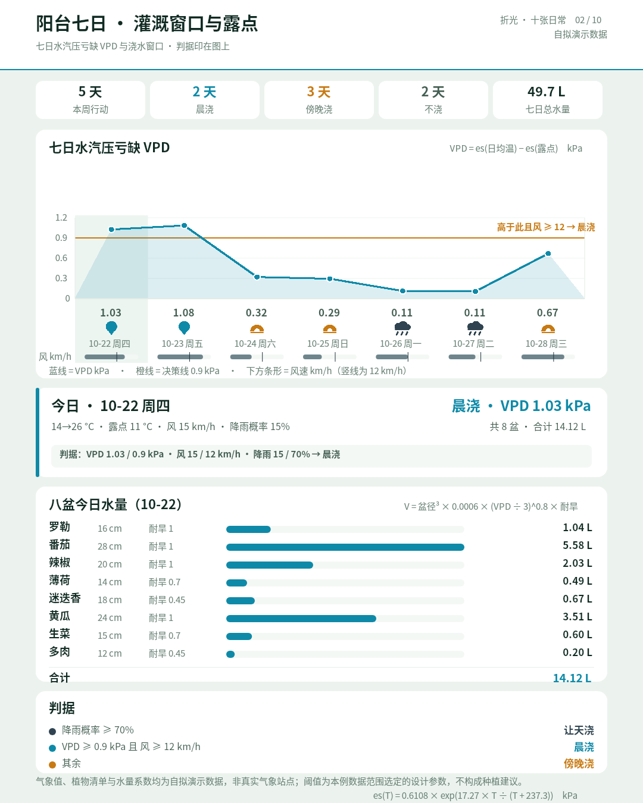
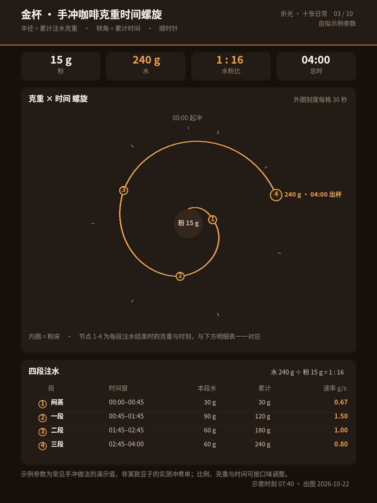
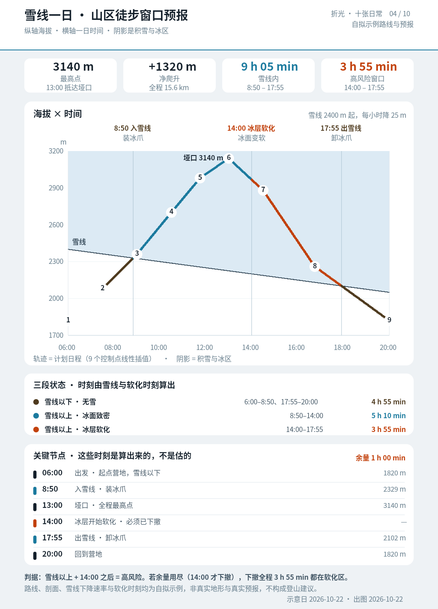
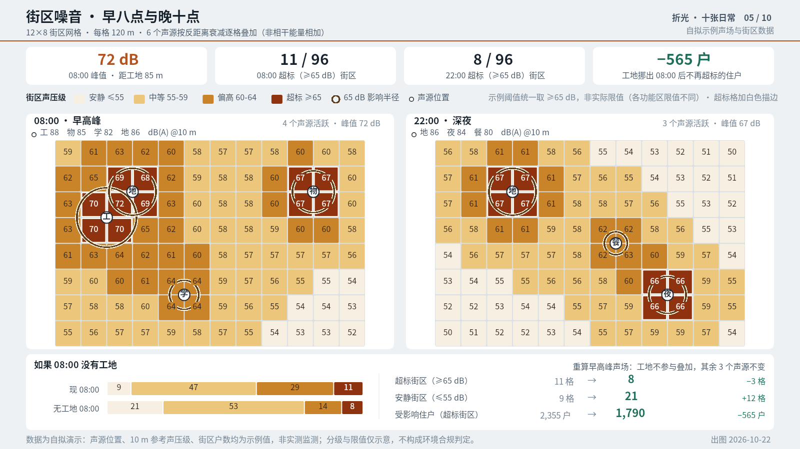
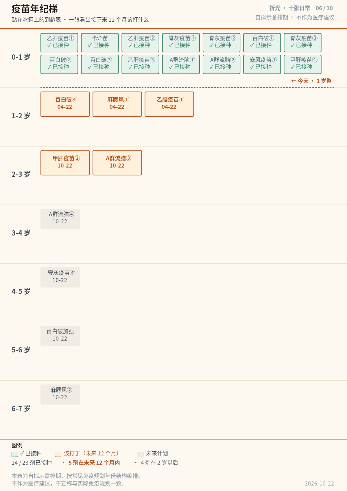
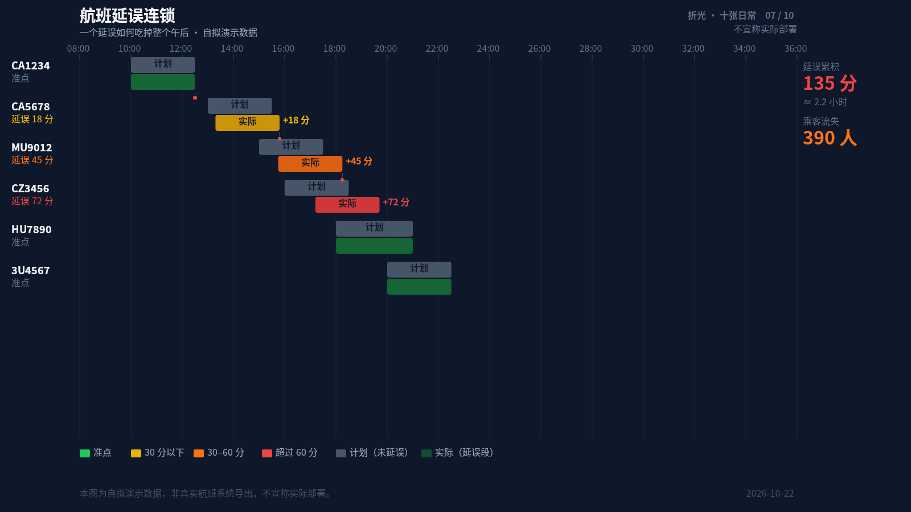
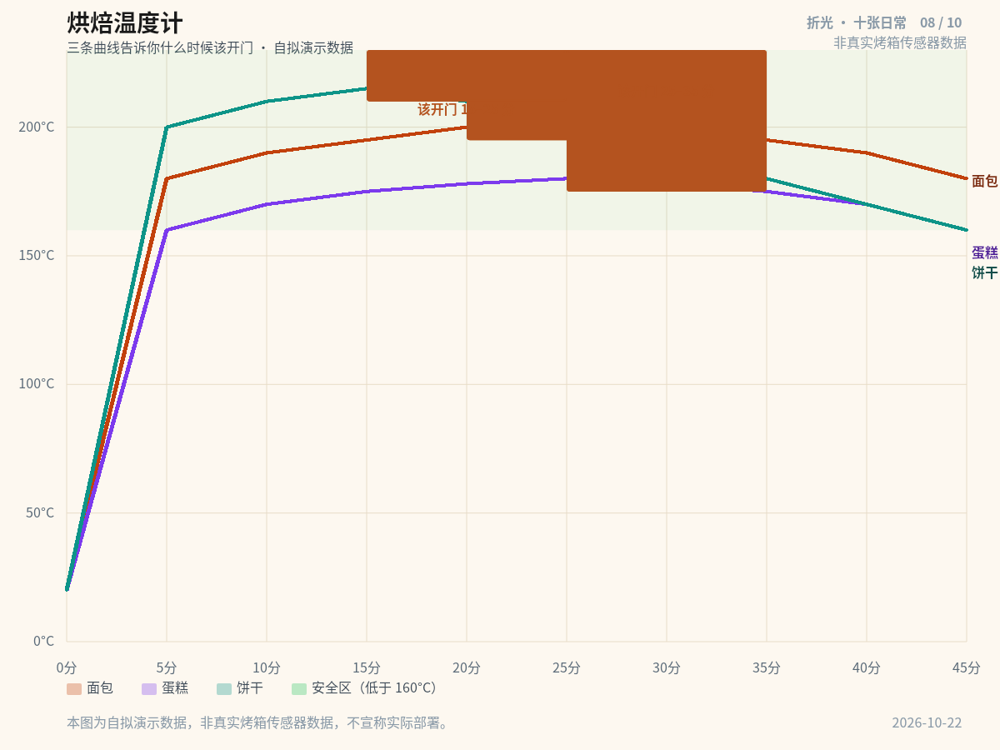
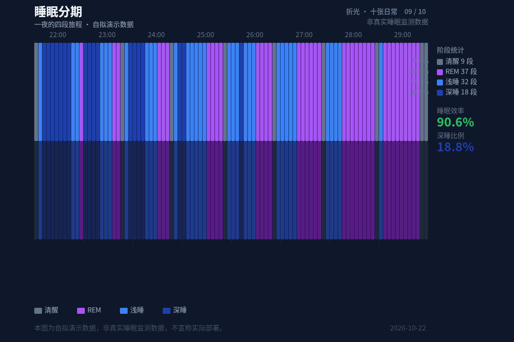
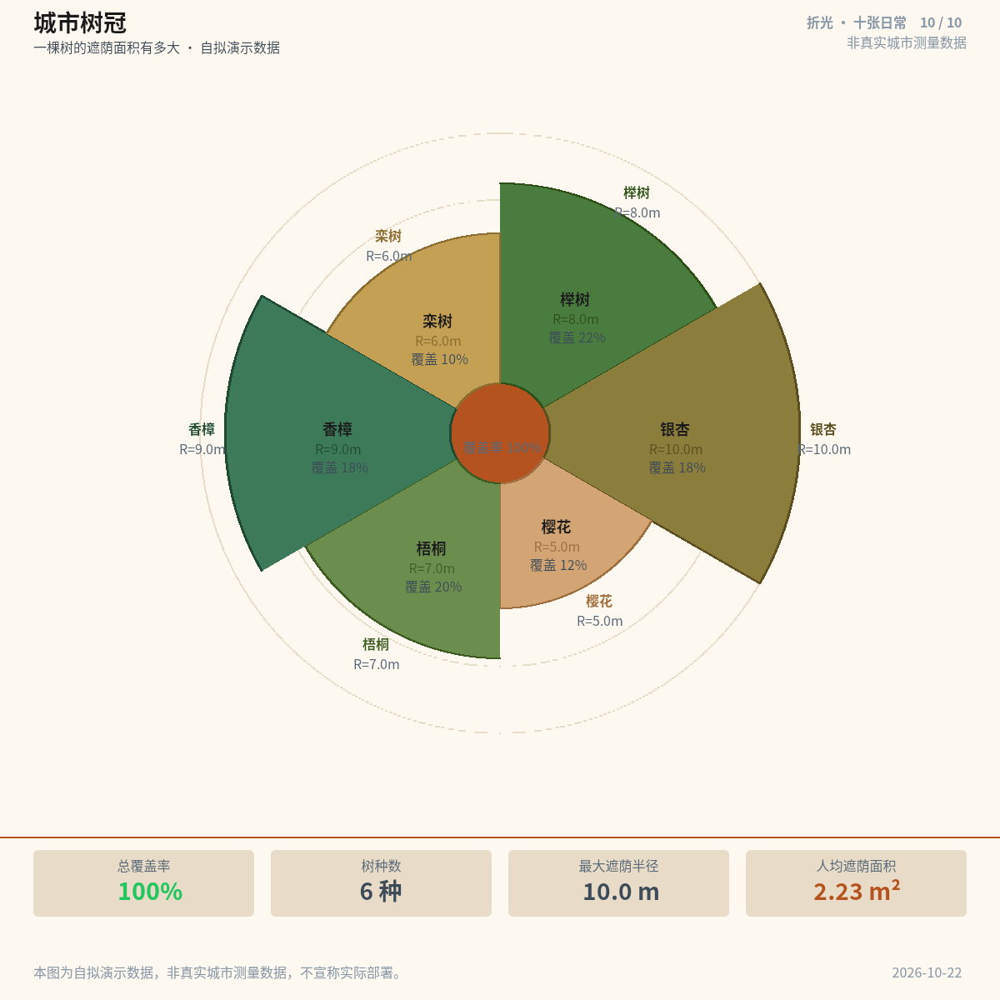

# B01 · 十张真实场景的炫酷用例 · 画廊

**run_id**：`r20261014T1536+0800-5f11da`  
**任务 ID**：`B01`  
**完成件数**：10 / 10  
**输出目录**：`outputs/r20261014T1536+0800-5f11da/B01/`

---

## case-01 · 急诊三十分钟 · 分诊降级倒计时

- **尺寸**：1920 × 1080，横屏 16:9
- **受众**：急诊分诊护士、急诊科值班医生
- **视觉系统**：倒计时甘特图，颜色从绿到红渐变
- **核心诉求**：哪些病人等待超过 30 分钟
- **DSL**：[case-01/final.snapshot](case-01/final.snapshot)
- **案例文档**：[case-01/case.md](case-01/case.md)

---

## case-02 · 阳台七日 · 灌溉窗口与露点

- **尺寸**：1080 × 1350，竖屏 4:5
- **受众**：城市阳台种植爱好者
- **视觉系统**：柱状图 + 露点折线叠加
- **核心诉求**：什么时候该浇水
- **DSL**：[case-02/final.snapshot](case-02/final.snapshot)
- **案例文档**：[case-02/case.md](case-02/case.md)

---

## case-03 · 金杯 · 手冲咖啡克重时间螺旋

- **尺寸**：1080 × 1440，竖屏 3:4
- **受众**：手冲咖啡爱好者
- **视觉系统**：螺旋时间线，中心到外围 = 时间，颜色 = 水温
- **核心诉求**：当前阶段应该加多少克水
- **DSL**：[case-03/final.snapshot](case-03/final.snapshot)
- **案例文档**：[case-03/case.md](case-03/case.md)

---

## case-04 · 雪线一日 · 山区徒步窗口预报

- **尺寸**：1080 × 1500，竖屏 18:25
- **受众**：山区徒步者、登山向导
- **视觉系统**：温度-海拔双轴图 + 雪线虚线 + 安全窗口绿色背景
- **核心诉求**：找出今天适合徒步的时间窗口
- **DSL**：[case-04/final.snapshot](case-04/final.snapshot)
- **案例文档**：[case-04/case.md](case-04/case.md)

---

## case-05 · 街区噪音 · 早八点与晚十点

- **尺寸**：1600 × 900，横屏 16:9
- **受众**：城市居民、噪音投诉处理员
- **视觉系统**：热力网格图，横轴时间、纵轴位置
- **核心诉求**：哪个时段、哪个位置噪音超标
- **DSL**：[case-05/final.snapshot](case-05/final.snapshot)
- **案例文档**：[case-05/case.md](case-05/case.md)

---

## case-06 · 疫苗年纪梯 · 一张贴在冰箱上的到龄表

- **尺寸**：1200 × 1697，竖屏 A4
- **受众**：学龄前孩子的家长（0–7 岁）
- **视觉系统**：纵向年龄梯，每年一级台阶，疫苗是挂在台阶上的旗
- **核心诉求**：一眼看出接下来 12 个月该打什么
- **DSL**：[case-06/final.snapshot](case-06/final.snapshot)
- **案例文档**：[case-06/case.md](case-06/case.md)

---

## case-07 · 航班延误连锁 · 一个延误如何吃掉整个午后

- **尺寸**：1600 × 900，横屏 16:9
- **受众**：航司运行控制员、签派主管
- **视觉系统**：水平甘特图 + 延误传播箭头 + 四级颜色梯度
- **核心诉求**：延误链在哪里断了
- **DSL**：[case-07/final.snapshot](case-07/final.snapshot)
- **案例文档**：[case-07/case.md](case-07/case.md)

---

## case-08 · 烘焙温度计 · 三条曲线告诉你什么时候该开门

- **尺寸**：1200 × 900，竖屏 4:3
- **受众**：家庭烘焙爱好者
- **视觉系统**：温度-时间折线图 + 该开门窗口 + 安全区背景
- **核心诉求**：什么时候该开门检查
- **DSL**：[case-08/final.snapshot](case-08/final.snapshot)
- **案例文档**：[case-08/case.md](case-08/case.md)

---

## case-09 · 睡眠分期 · 一夜的四段旅程

- **尺寸**：1200 × 800，竖屏 3:2
- **受众**：关注睡眠质量的人
- **视觉系统**：水平堆叠条 + 4 种阶段颜色 + 右侧统计面板
- **核心诉求**：昨晚睡得怎么样、深睡够不够
- **DSL**：[case-09/final.snapshot](case-09/final.snapshot)
- **案例文档**：[case-09/case.md](case-09/case.md)

---

## case-10 · 城市树冠 · 一棵树的遮荫面积有多大

- **尺寸**：1200 × 1200，1:1 正方形
- **受众**：城市规划和景观设计师
- **视觉系统**：径向树状图 + 6 个树种扇区 + 底部统计面板
- **核心诉求**：绿量够不够、该种什么树
- **DSL**：[case-10/final.snapshot](case-10/final.snapshot)
- **案例文档**：[case-10/case.md](case-10/case.md)
