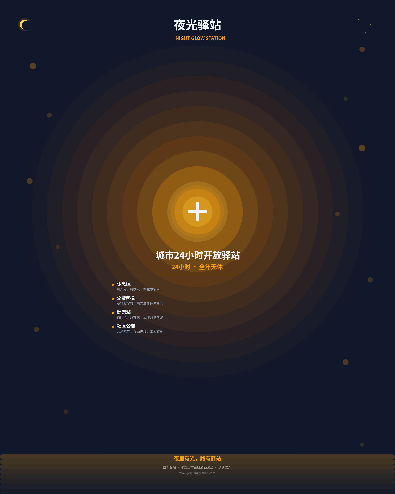
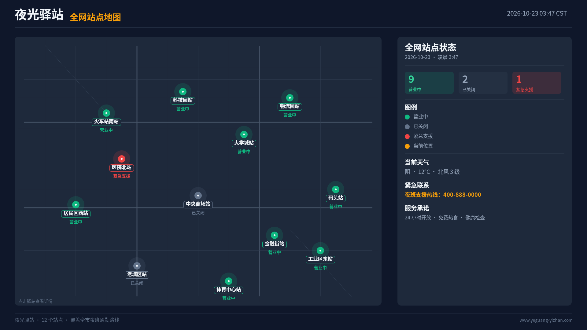
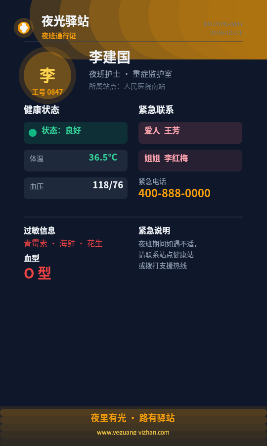
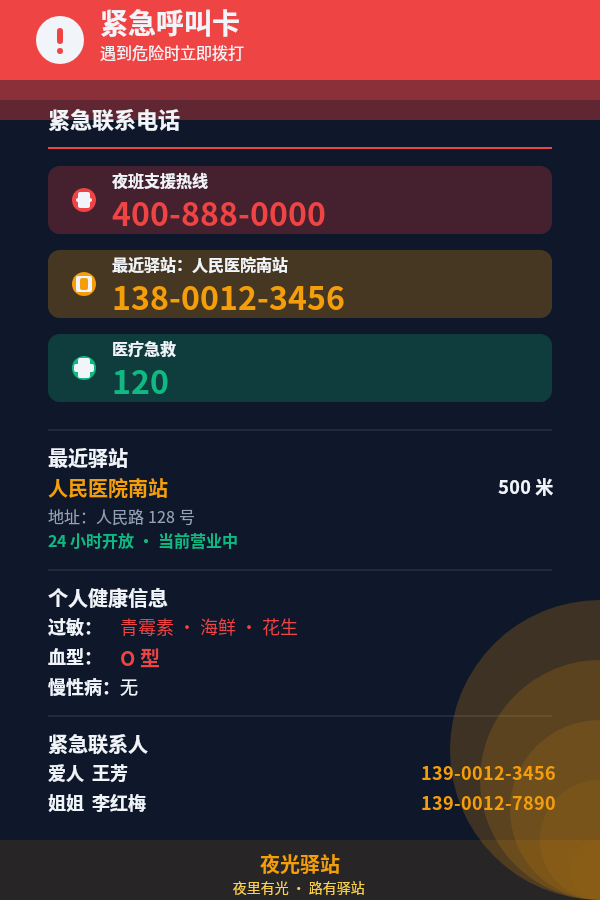
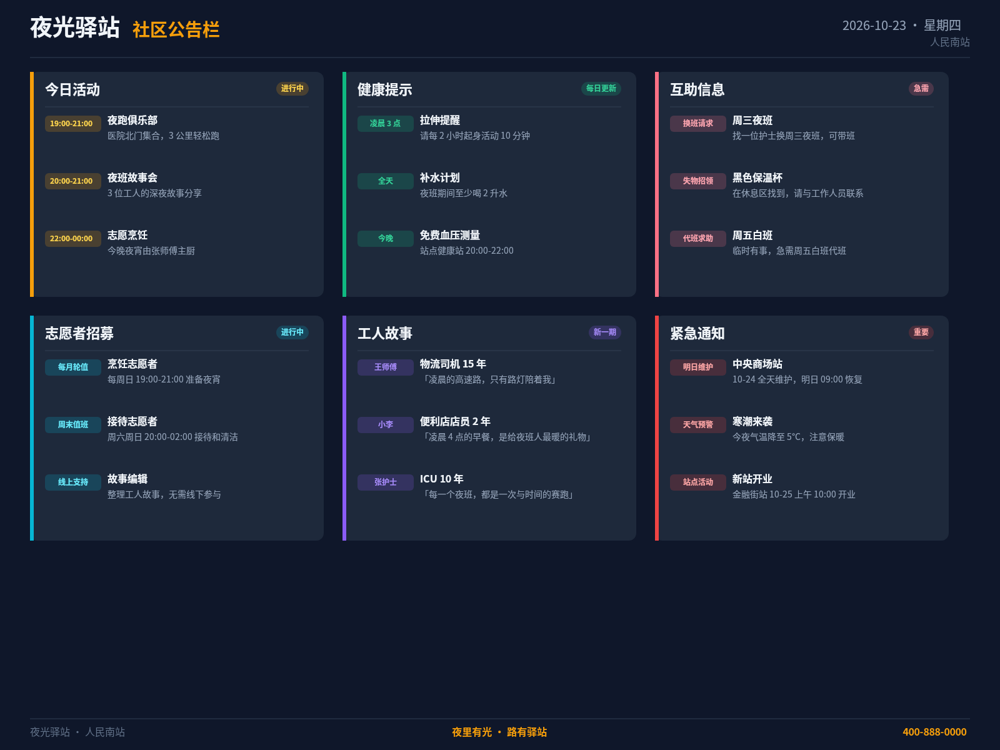
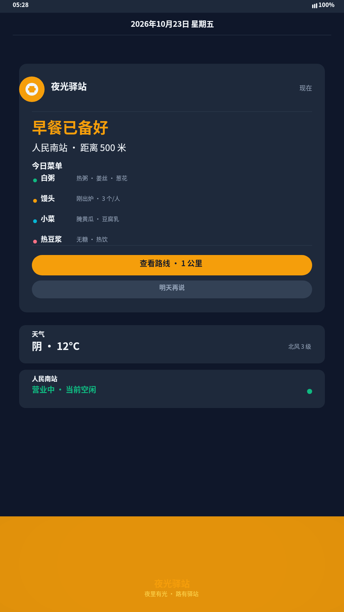
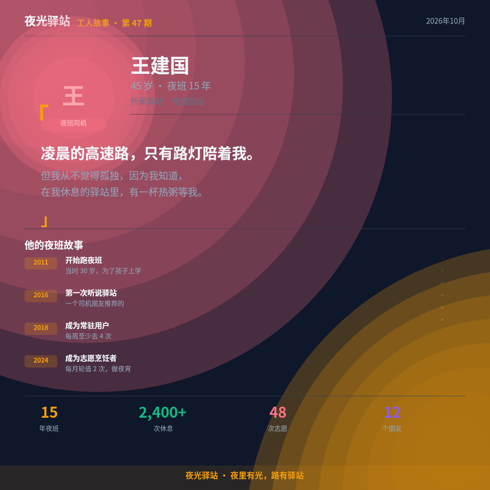
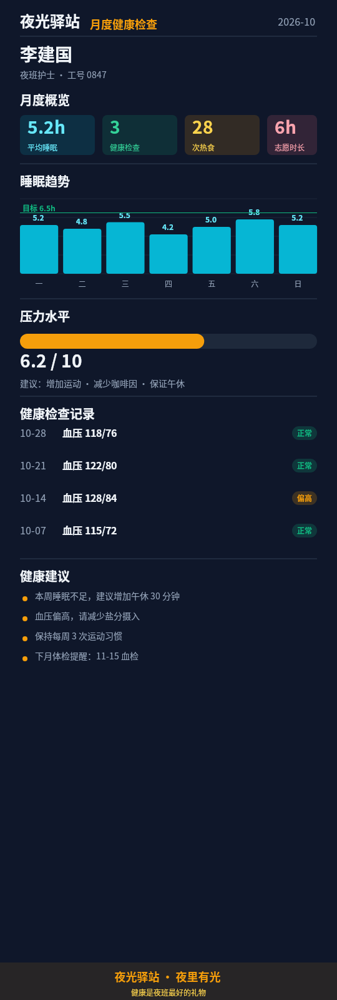
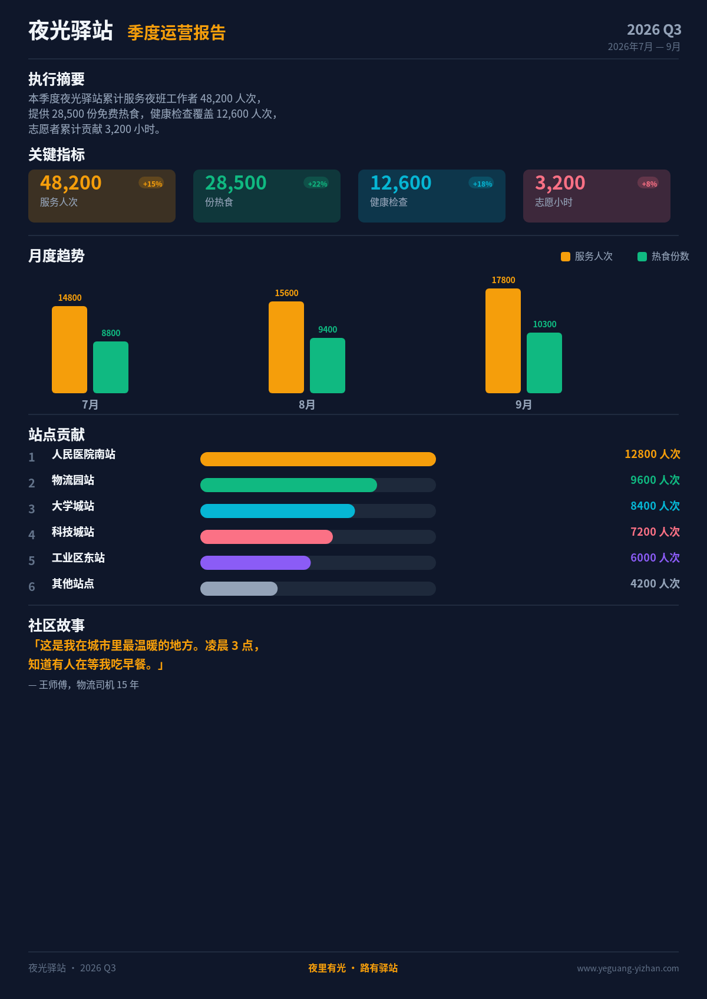
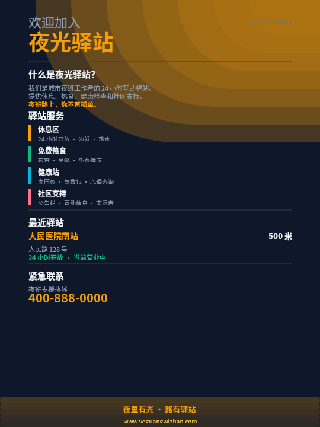

# 夜光驿站 · 作品集画廊

## 项目概览

| 项目 | 内容 |
|------|------|
| 品牌 | 夜光驿站（Night Glow Station） |
| 定位 | 城市夜班工作者24小时互助社区网络 |
| Slogan | 夜里有光，路有驿站 |
| 作品数 | 10件 |
| 设计系统 | 暗色主题 + 暖琥珀调 |
| 媒介覆盖 | 海报、数字屏幕、手机应用、打印报告、社交媒体 |

---

## case-01：驿站品牌标识海报

**尺寸**：2400×3000 | **媒介**：地铁/公交站海报 | **观看距离**：1-3米

- [原PNG](case-01/final.png)
- [DSL](case-01/final.snapshot)
- [详细说明](case-01/case.md)

中心光晕隐喻"夜里有光"的品牌概念，12层同心圆从中心向外扩散，暖琥珀色在深蓝夜色中突出温暖感。品牌名称72px大字号，核心服务列表排列整齐。

---

## case-02：全网站点地图

**尺寸**：1920×1080 | **媒介**：驿站大厅数字屏幕 | **观看距离**：1-2米

- [原PNG](case-02/final.png)
- [DSL](case-02/final.snapshot)
- [详细说明](case-02/case.md)

12个站点按城市区域分布，状态颜色编码（绿=营业中、灰=已关闭、红=紧急援助）。右侧统计面板：9营业/2关闭/1紧急，图例完整，天气和紧急联系电话位置合理。

---

## case-03：夜班通行证

**尺寸**：540×900 | **媒介**：手机数字证件 | **观看距离**：近距（手机屏幕）

- [原PNG](case-03/final.png)
- [DSL](case-03/final.snapshot)
- [详细说明](case-03/case.md)

信息密集型个人身份卡。头像圆形居中，姓名职位醒目，健康信息卡片化展示（体温、血压、过敏、血型），紧急联系人信息清晰。

---

## case-04：紧急呼叫卡

**尺寸**：600×900 | **媒介**：钱包卡片 | **观看距离**：近距（钱包卡片）

- [原PNG](case-04/final.png)
- [DSL](case-04/final.snapshot)
- [详细说明](case-04/case.md)

红色警告标题醒目，3个紧急电话卡片（支援热线、最近站点、医疗急救）突出显示，大号电话号码快速辨识。站点信息、健康信息、紧急联系人分区明确。

---

## case-05：社区公告栏

**尺寸**：1600×1200 | **媒介**：驿站内部公告栏屏幕 | **观看距离**：3-4米

- [原PNG](case-05/final.png)
- [DSL](case-05/final.snapshot)
- [详细说明](case-05/case.md)

6个分类卡片（活动公告、健康信息、互助信息、志愿招募、社区故事、紧急通知），每卡片3条信息。颜色编码区分，布局整齐，信息层级分明。

---

## case-06：每日早餐提醒

**尺寸**：1080×1920 | **媒介**：手机锁屏通知 | **观看距离**：近距（手机屏幕）

- [原PNG](case-06/final.png)
- [DSL](case-06/final.snapshot)
- [详细说明](case-06/case.md)

模拟手机UI，状态栏+通知卡片。"早餐已备好"大标题突出，4个菜品菜单清晰，主按钮和次按钮层级分明。天气和站点状态快捷信息卡。

---

## case-07：工人故事特写

**尺寸**：1200×1200 | **媒介**：社交媒体帖子 | **观看距离**：20-50cm（手机屏幕）

- [原PNG](case-07/final.png)
- [DSL](case-07/final.snapshot)
- [详细说明](case-07/case.md)

人物头像+职业标签，引语36px大字号突出（"凌晨的高速路，只有路灯陪着我"），时间线展示2011-2024成长历程，4项统计数据量化贡献。

---

## case-08：月度健康检查卡

**尺寸**：540×1600 | **媒介**：手机健康应用 | **观看距离**：近距（手机屏幕）

- [原PNG](case-08/final.png)
- [DSL](case-08/final.snapshot)
- [详细说明](case-08/case.md)

数据可视化专业呈现：月度概览4个指标卡片，7天睡眠趋势柱状图含目标线，压力水平进度条（6.2/10），4条血压检查记录含状态标签，4条健康建议。

---

## case-09：季度运营报告

**尺寸**：1200×1697（A4比例） | **媒介**：A4打印/PDF | **观看距离**：20-50cm

- [原PNG](case-09/final.png)
- [DSL](case-09/final.snapshot)
- [详细说明](case-09/case.md)

专业报告风格：执行摘要、4个KPI卡片（含变化标签）、3个月双系列柱状图（服务人次+热食数量）、6个站点贡献进度条、社区故事引语。

---

## case-10：新工人引导卡

**尺寸**：540×720 | **媒介**：入职欢迎卡片 | **观看距离**：近距（卡片）

- [原PNG](case-10/final.png)
- [DSL](case-10/final.snapshot)
- [详细说明](case-10/case.md)

信息分层：欢迎语→驿站介绍→4项服务（颜色编码）→最近驿站位置→紧急联系电话（大号突出）。底部品牌条完整，暖色光晕增加温馨感。

---

## 统计摘要

| 指标 | 数值 |
|------|------|
| 总作品数 | 10 |
| 总PNG大小 | 1,461,813 字节 |
| 总DSL大小 | 164,419 字节 |
| 总渲染请求 | 10 |
| 成功请求 | 10 |
| 实际看图次数 | 10 |
| 完整视觉迭代 | 5 |
| 门禁总数 | 60 |
| 门禁通过 | 60 |
