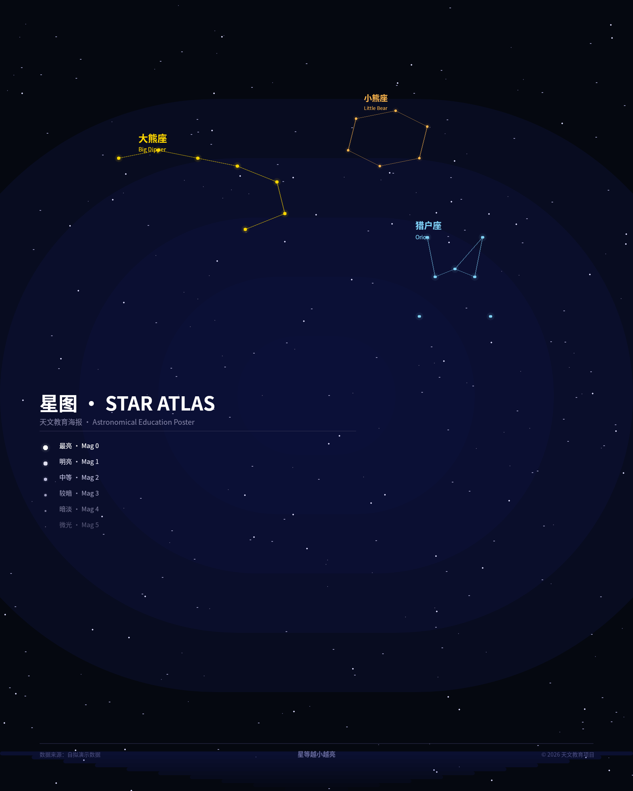
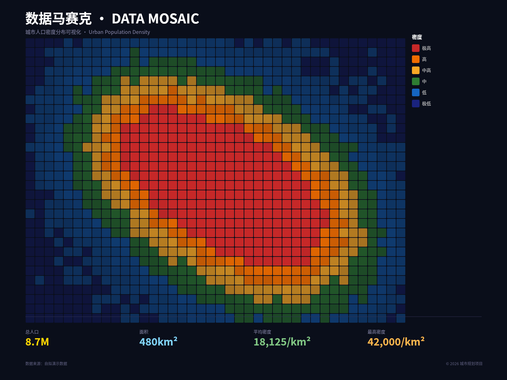
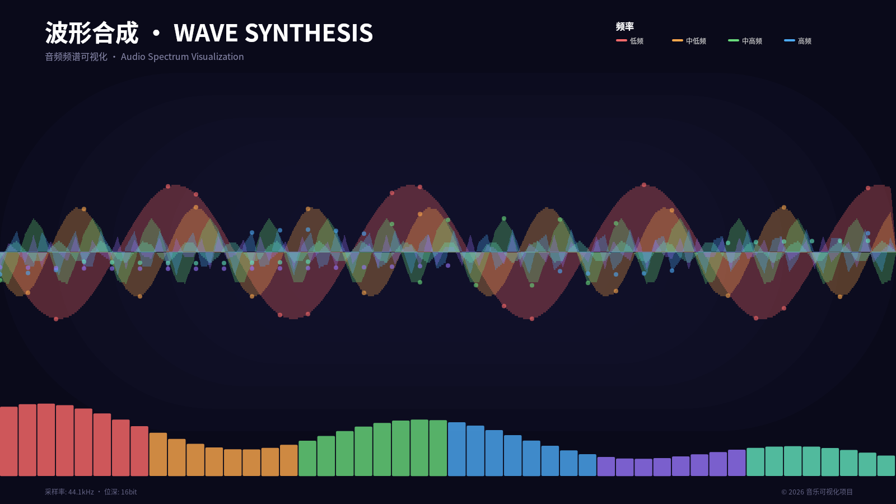
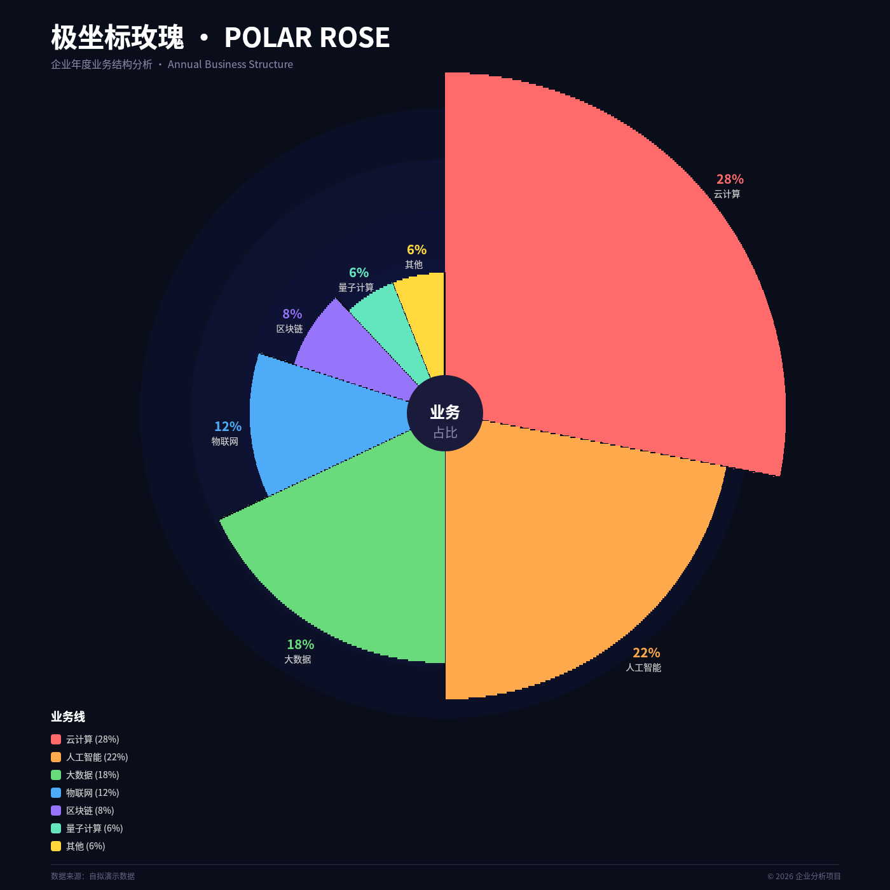
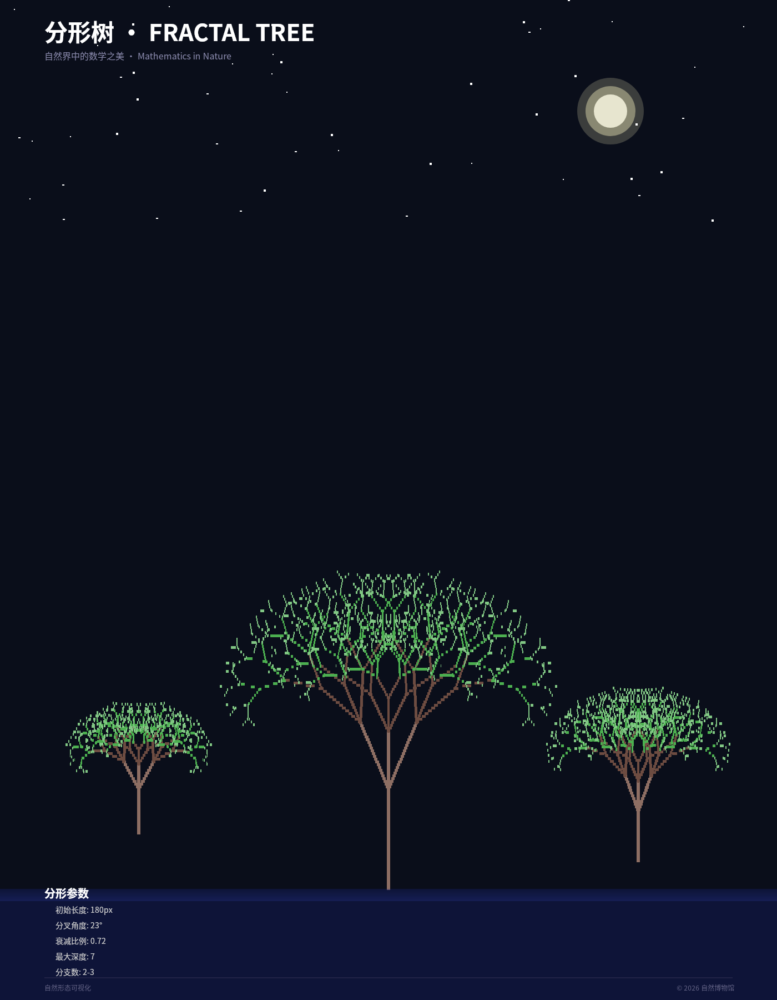
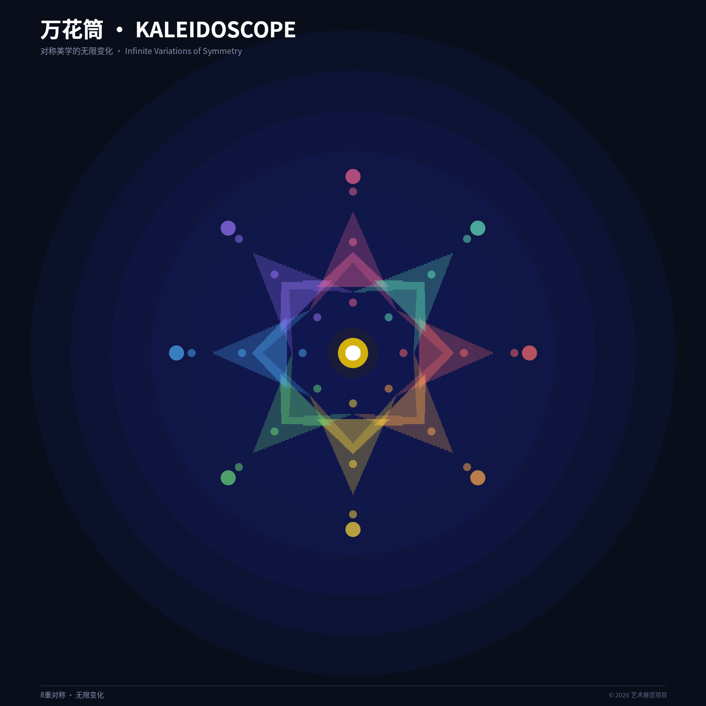
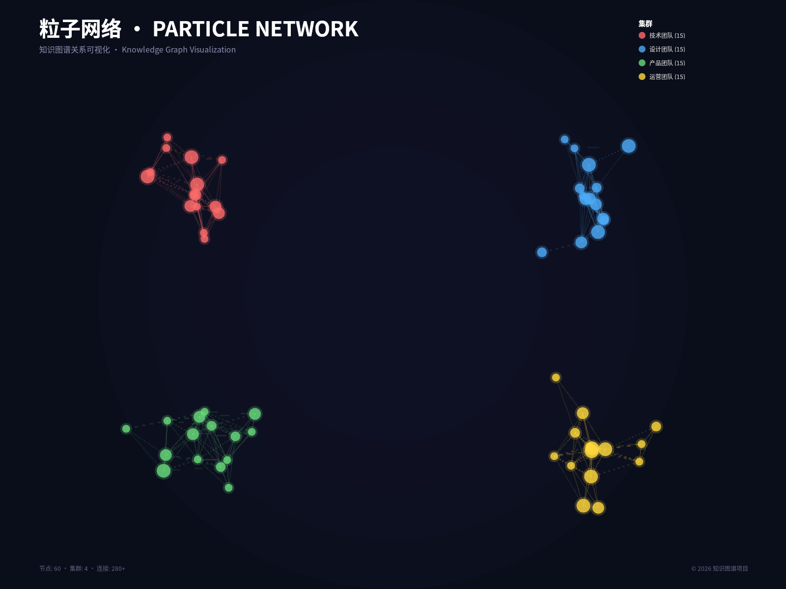
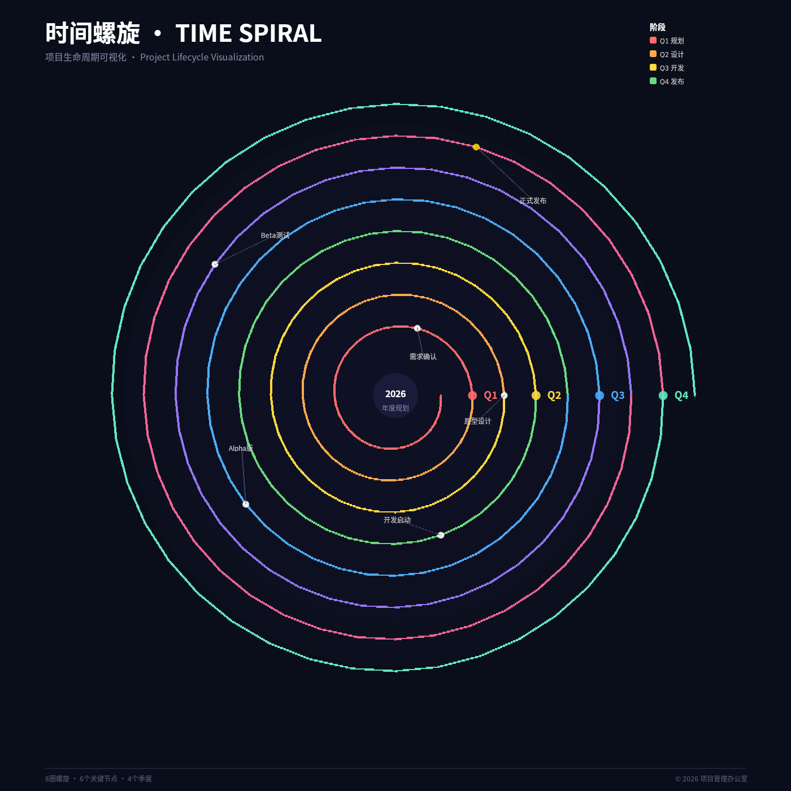
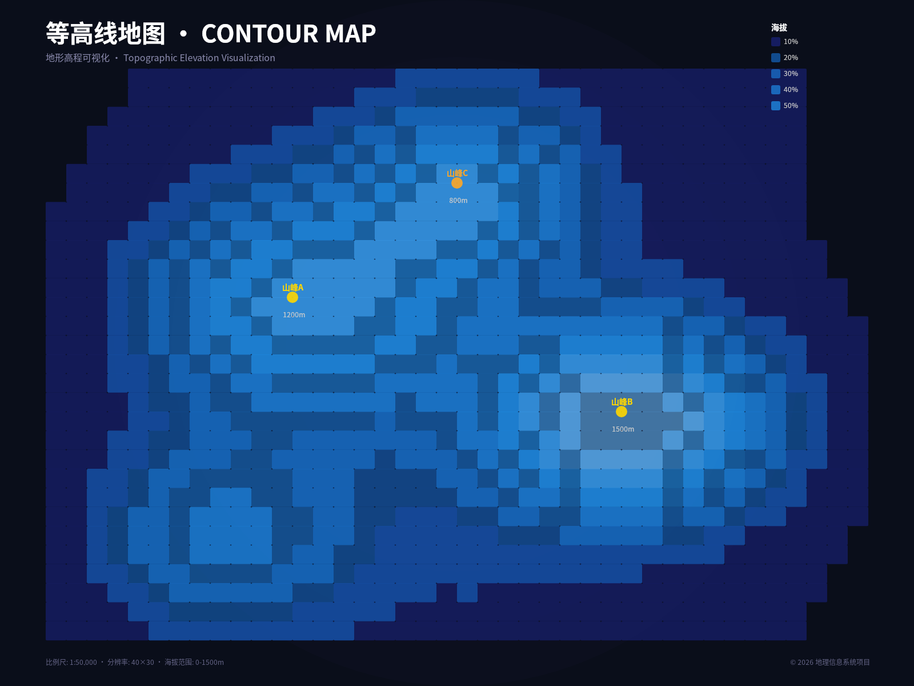
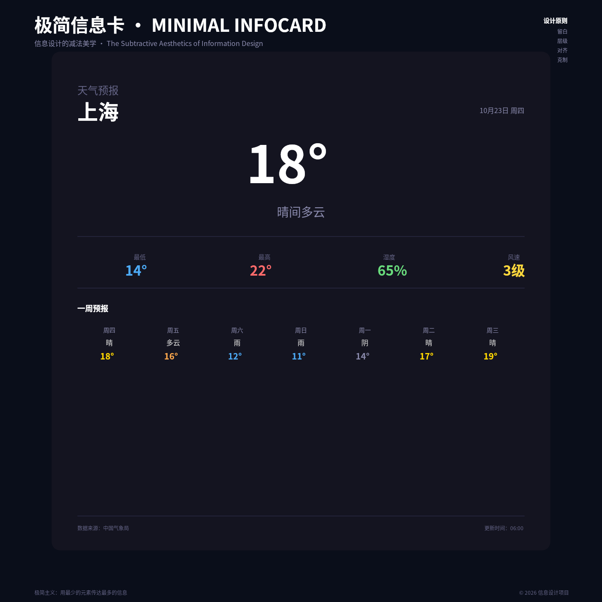

# B03 画廊：DSL创意边界探索

本画廊展示十件独立作品，每件作品探索一种独特的DSL视觉技法。

---

## case-01: 星图（Star Atlas）

**尺寸**: 1600 × 2000 px | **技法**: 背景星空生成、星座连线、星等标尺

- **PNG**: [case-01/final.png](case-01/final.png)
- **DSL**: [case-01/final.snapshot](case-01/final.snapshot)

**场景**: 天文馆展览、学校科普海报

---

## case-02: 数据马赛克（Data Mosaic）

**尺寸**: 1600 × 1200 px | **技法**: 程序化网格生成、高斯密度模型、颜色编码

- **PNG**: [case-02/final.png](case-02/final.png)
- **DSL**: [case-02/final.snapshot](case-02/final.snapshot)

**场景**: 城市规划报告、GIS分析

---

## case-03: 波形合成（Wave Synthesis）

**尺寸**: 1600 × 900 px | **技法**: 程序化波形生成、频率叠加、fill多边形填充

- **PNG**: [case-03/final.png](case-03/final.png)
- **DSL**: [case-03/final.snapshot](case-03/final.snapshot)

**场景**: 音乐节海报、音频分析工具

---

## case-04: 极坐标玫瑰（Polar Rose）

**尺寸**: 1400 × 1400 px | **技法**: 极坐标扇形填充、分类数据编码

- **PNG**: [case-04/final.png](case-04/final.png)
- **DSL**: [case-04/final.snapshot](case-04/final.snapshot)

**场景**: 企业年度业务分析、业务线占比展示

---

## case-05: 分形树（Fractal Tree）

**尺寸**: 1400 × 1800 px | **技法**: 递归线段生成、角度衰减、颜色渐变

- **PNG**: [case-05/final.png](case-05/final.png)
- **DSL**: [case-05/final.snapshot](case-05/final.snapshot)

**场景**: 自然博物馆教育海报、数学课程辅助材料

---

## case-06: 万花筒（Kaleidoscope）

**尺寸**: 1400 × 1400 px | **技法**: 旋转对称、几何重复、颜色渐变

- **PNG**: [case-06/final.png](case-06/final.png)
- **DSL**: [case-06/final.snapshot](case-06/final.snapshot)

**场景**: 艺术展览海报、对称美学研究

---

## case-07: 粒子网络（Particle Network）

**尺寸**: 1600 × 1200 px | **技法**: 节点定位算法、距离衰减连线、集群着色

- **PNG**: [case-07/final.png](case-07/final.png)
- **DSL**: [case-07/final.snapshot](case-07/final.snapshot)

**场景**: 组织架构可视化、社交网络分析

---

## case-08: 时间螺旋（Time Spiral）

**尺寸**: 1400 × 1400 px | **技法**: 极坐标参数化螺旋、时间轴映射、事件标记

- **PNG**: [case-08/final.png](case-08/final.png)
- **DSL**: [case-08/final.snapshot](case-08/final.snapshot)

**场景**: 项目管理时间线、年度回顾

---

## case-09: 等高线地图（Contour Map）

**尺寸**: 1600 × 1200 px | **技法**: 网格高度场生成、等值线追踪、颜色编码海拔

- **PNG**: [case-09/final.png](case-09/final.png)
- **DSL**: [case-09/final.snapshot](case-09/final.snapshot)

**场景**: 地理信息系统、城市规划

---

## case-10: 极简信息卡（Minimal Infocard）

**尺寸**: 1400 × 1400 px | **技法**: 大量留白、精确对齐、有限色彩、字体层级

- **PNG**: [case-10/final.png](case-10/final.png)
- **DSL**: [case-10/final.snapshot](case-10/final.snapshot)

**场景**: 天气预报卡片、数据统计卡片

---

## 汇总统计

| 作品 | 技法 | 尺寸 | 渲染结果 |
|------|------|------|----------|
| case-01 星图 | 星座连线 | 1600×2000 | ✓ HTTP 200 |
| case-02 数据马赛克 | 高斯密度 | 1600×1200 | ✓ HTTP 200 |
| case-03 波形合成 | 频率叠加 | 1600×900 | ✓ HTTP 200 |
| case-04 极坐标玫瑰 | 扇形填充 | 1400×1400 | ✓ HTTP 200 |
| case-05 分形树 | 递归生成 | 1400×1800 | ✓ HTTP 200 |
| case-06 万花筒 | 旋转对称 | 1400×1400 | ✓ HTTP 200 |
| case-07 粒子网络 | 距离衰减 | 1600×1200 | ✓ HTTP 200 |
| case-08 时间螺旋 | 极坐标螺旋 | 1400×1400 | ✓ HTTP 200 |
| case-09 等高线地图 | 高度场 | 1600×1200 | ✓ HTTP 200 |
| case-10 极简信息卡 | 字体层级 | 1400×1400 | ✓ HTTP 200 |

**总计**: 10件作品，10种技法，全部渲染成功
