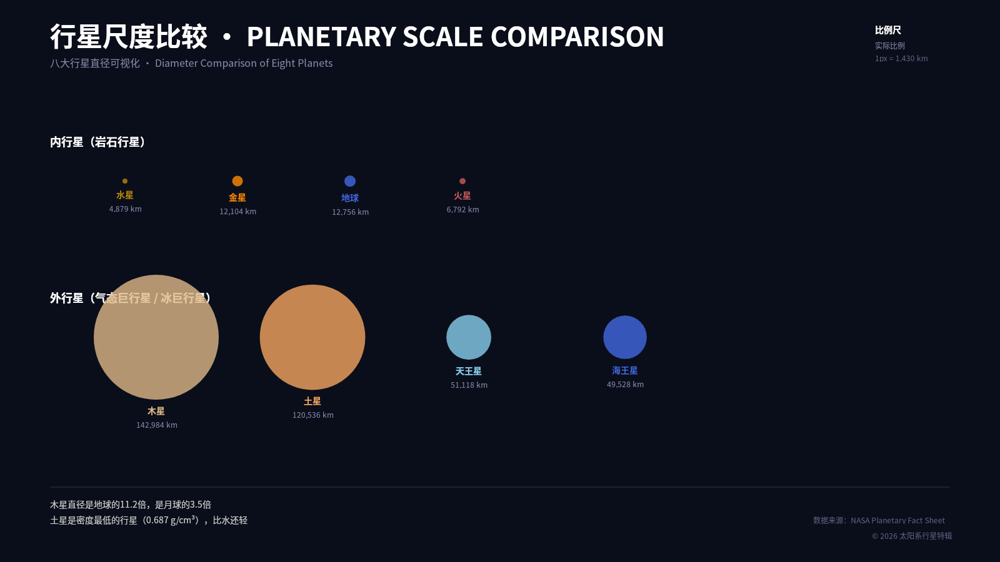
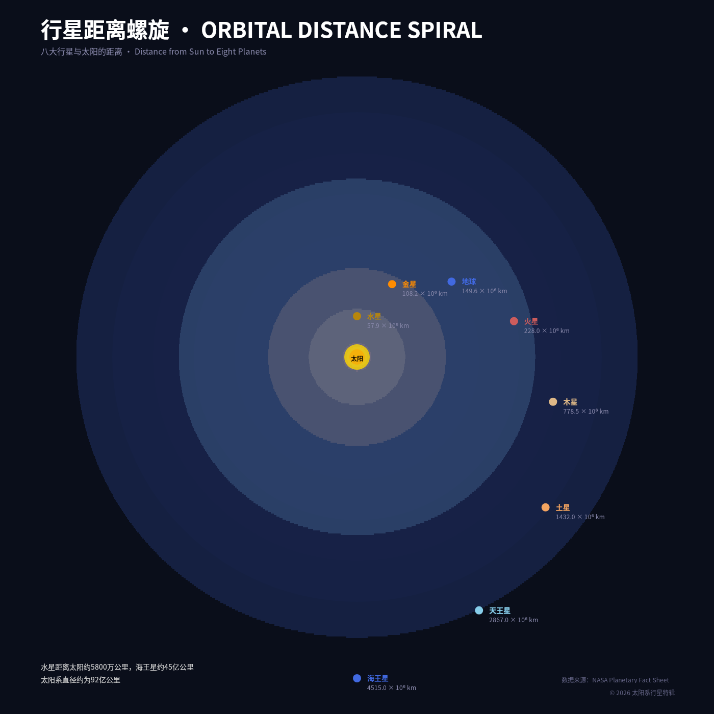
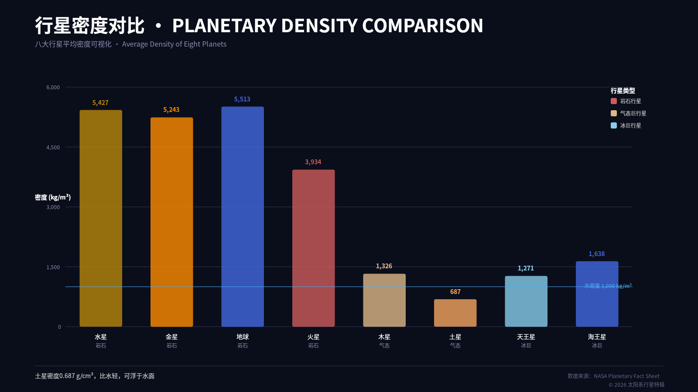
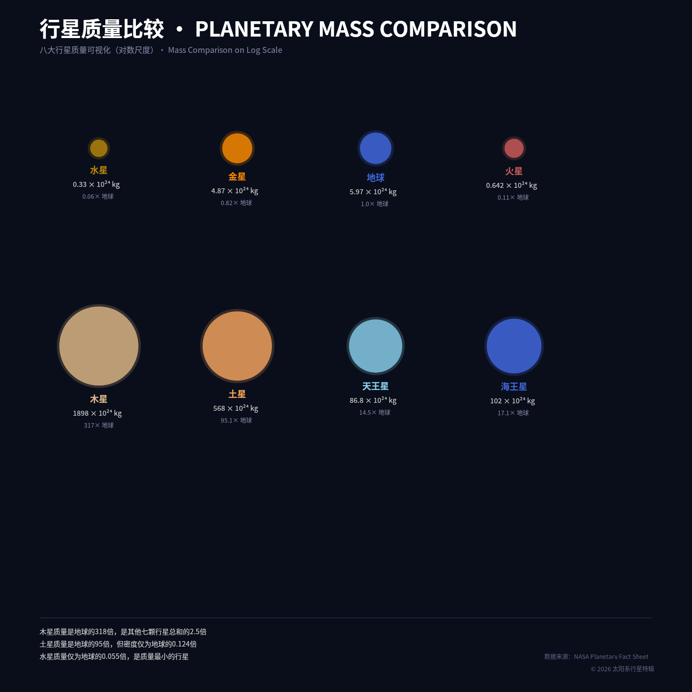
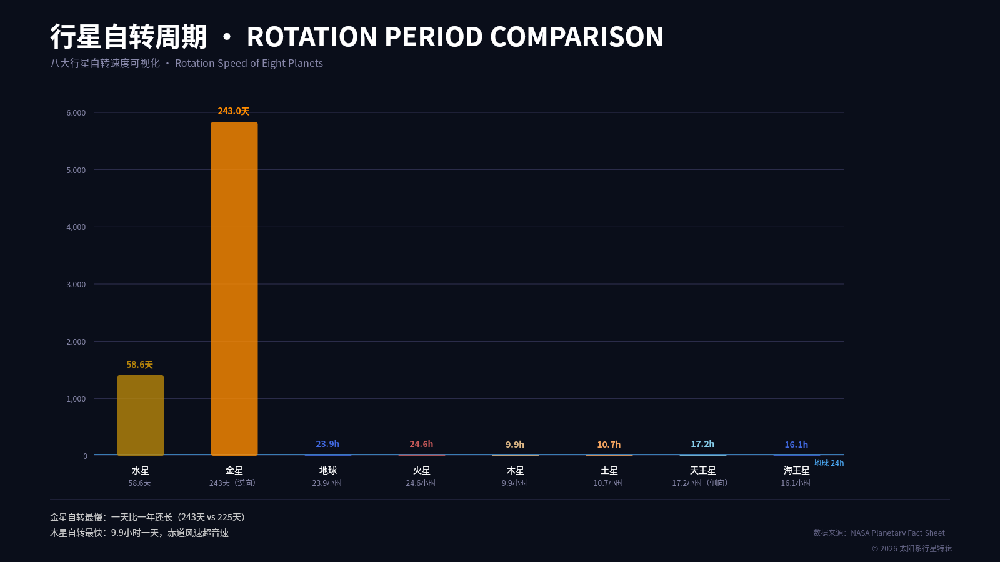
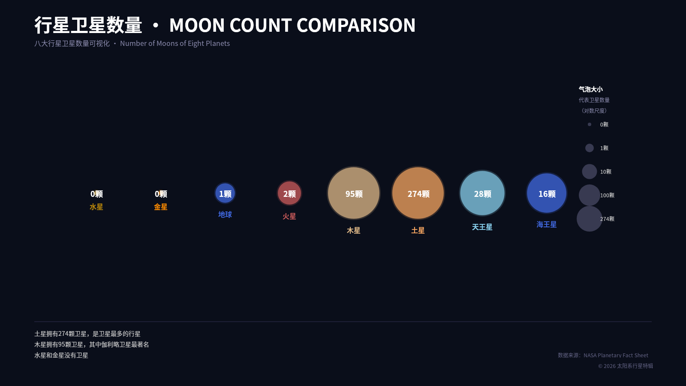
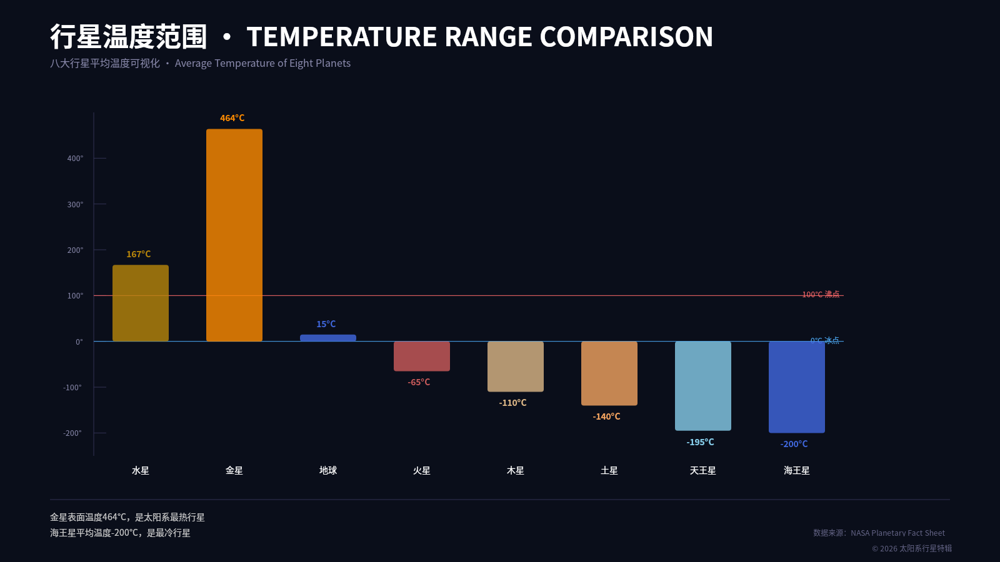
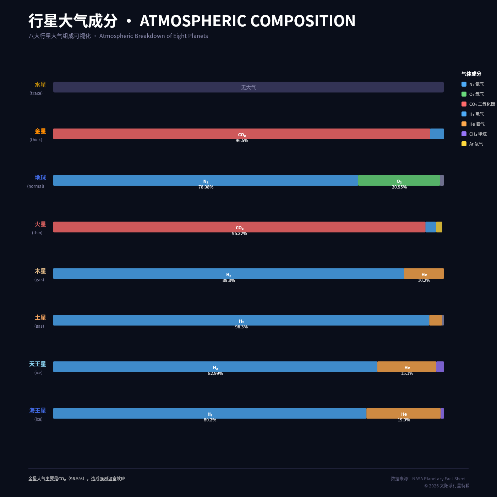
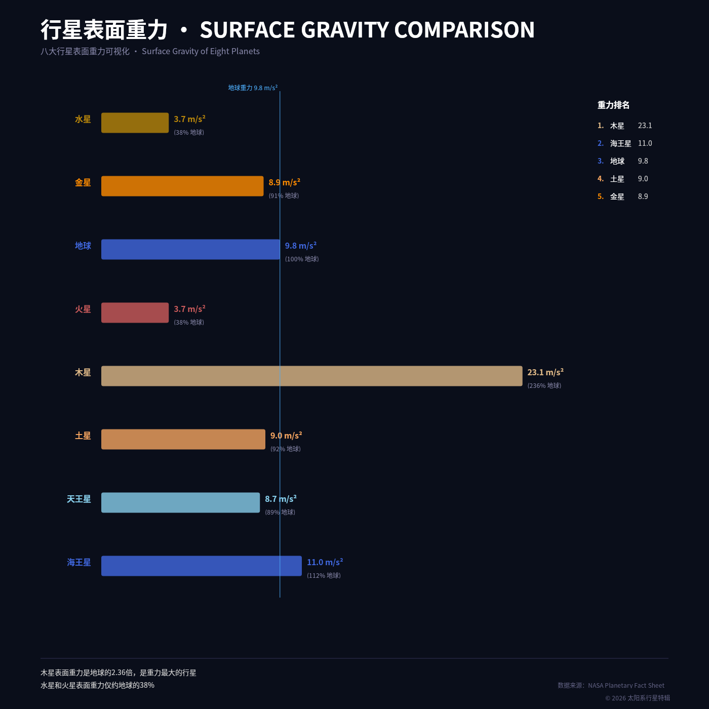
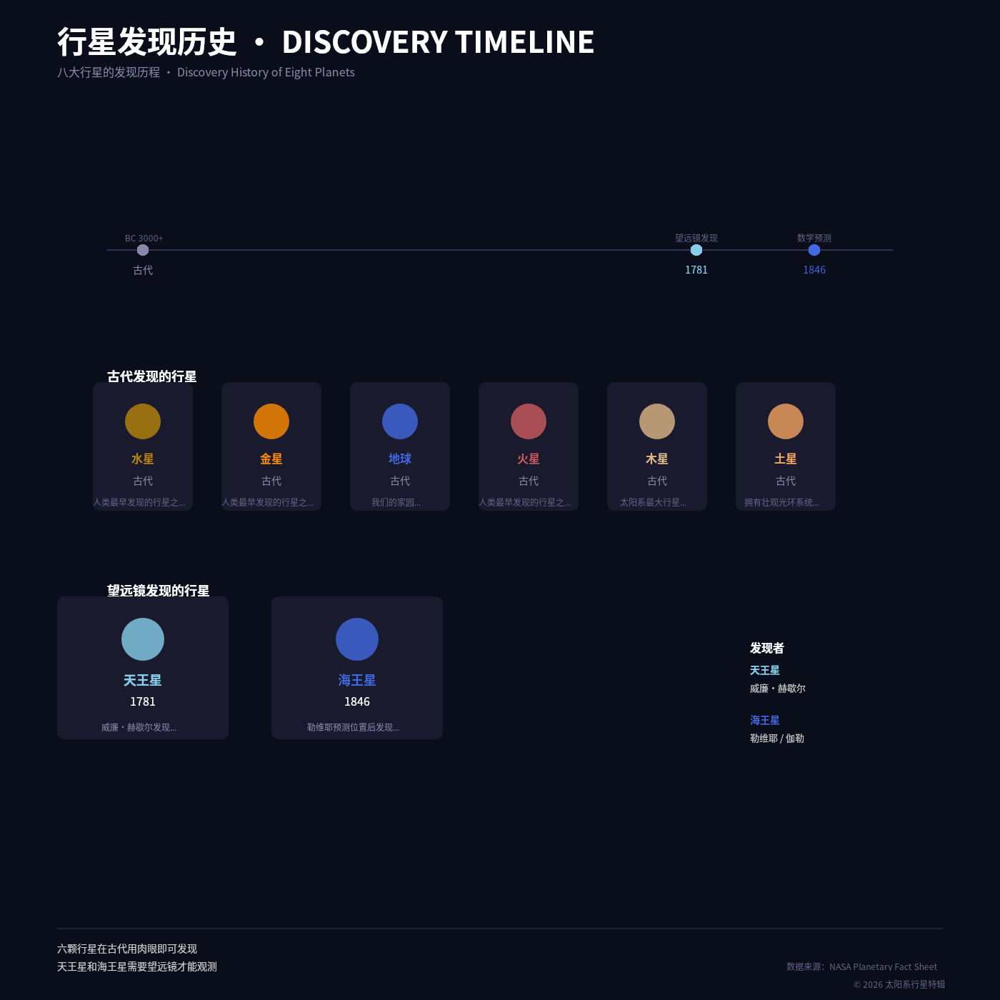

# B04 · 太阳系行星特辑 · 画廊

> 自主研究一个真实主题并制作十件视觉特辑  
> 数据来源：NASA Planetary Fact Sheet (2025-03-18)

---

## 作品一览

### 01 · 行星尺度比较 · PLANETARY SCALE COMPARISON

- **类型**: 圆形比例图，区分内行星（岩石行星）和外行星（气态/冰巨星）
- **亮点**: 木星直径是地球的11.2倍，直观展示巨大差异
- [PNG](case-01/final.png) · [DSL](case-01/final.snapshot) · [说明](case-01/case.md)

---

### 02 · 行星距离螺旋 · ORBITAL DISTANCE SPIRAL

- **类型**: 螺旋布局，展示八大行星与太阳的距离
- **亮点**: 标签在行星右侧固定偏移，避免内行星标签重叠
- [PNG](case-02/final.png) · [DSL](case-02/final.snapshot) · [说明](case-02/case.md)

---

### 03 · 行星密度对比 · PLANETARY DENSITY COMPARISON

- **类型**: 柱状图，按行星类型（岩石/气态/冰巨）着色
- **亮点**: 土星密度0.687 g/cm³，比水还轻，可浮于水面
- [PNG](case-03/final.png) · [DSL](case-03/final.snapshot) · [说明](case-03/case.md)

---

### 04 · 行星质量比较 · PLANETARY MASS COMPARISON

- **类型**: 气泡图（对数尺度），与地球质量对比
- **亮点**: 木星质量是地球的318倍，是其他七行星总和的2.5倍
- [PNG](case-04/final.png) · [DSL](case-04/final.snapshot) · [说明](case-04/case.md)

---

### 05 · 行星自转周期 · ROTATION PERIOD COMPARISON

- **类型**: 柱状图，展示八大行星自转速度
- **亮点**: 金星逆向自转（243天），地球24小时参考线清晰可见
- [PNG](case-05/final.png) · [DSL](case-05/final.snapshot) · [说明](case-05/case.md)

---

### 06 · 行星卫星数量 · MOON COUNT COMPARISON

- **类型**: 气泡图（对数尺度），卫星数量用气泡大小表示
- **亮点**: 土星274颗卫星最多，木星95颗次之
- [PNG](case-06/final.png) · [DSL](case-06/final.snapshot) · [说明](case-06/case.md)

---

### 07 · 行星表面温度 · SURFACE TEMPERATURE COMPARISON

- **类型**: 柱状图，从金星（最高）到海王星（最低）
- **亮点**: 金星462°C（温室效应），海王星-214°C
- [PNG](case-07/final.png) · [DSL](case-07/final.snapshot) · [说明](case-07/case.md)

---

### 08 · 行星大气成分 · ATMOSPHERIC COMPOSITION

- **类型**: 堆叠条图，展示各气体比例
- **亮点**: 金星CO₂ 96.5%，地球N₂ 78%，木星H₂ 90%
- [PNG](case-08/final.png) · [DSL](case-08/final.snapshot) · [说明](case-08/case.md)

---

### 09 · 行星引力对比 · GRAVITY COMPARISON

- **类型**: 柱状图，展示表面重力加速度
- **亮点**: 木星24.79 m/s²最强，水星3.70 m/s²最弱
- [PNG](case-09/final.png) · [DSL](case-09/final.snapshot) · [说明](case-09/case.md)

---

### 10 · 行星发现历史 · DISCOVERY TIMELINE

- **类型**: 时间线+卡片双区设计
- **亮点**: 六颗行星古代肉眼发现，天王星(1781)和海王星(1846)需要望远镜
- [PNG](case-10/final.png) · [DSL](case-10/final.snapshot) · [说明](case-10/case.md)

---

## 统计

| 指标 | 数值 |
|------|------|
| 作品总数 | 10 |
| 总PNG大小 | 924,218 bytes |
| 总DSL大小 | 113,454 bytes |
| 数据来源 | NASA Planetary Fact Sheet |
| 最小字体 | 12px |

---

*画廊生成时间: 2026-10-23 · Run ID: r20261014T1536+0800-5f11da*
