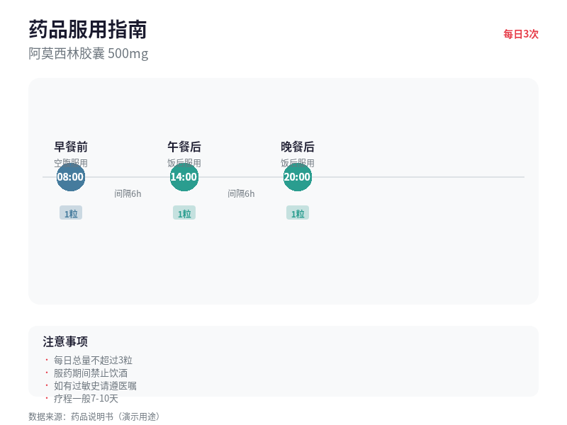
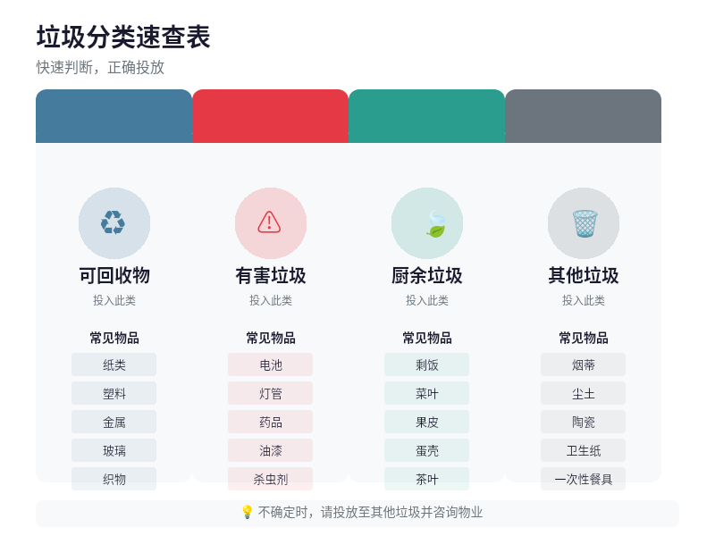
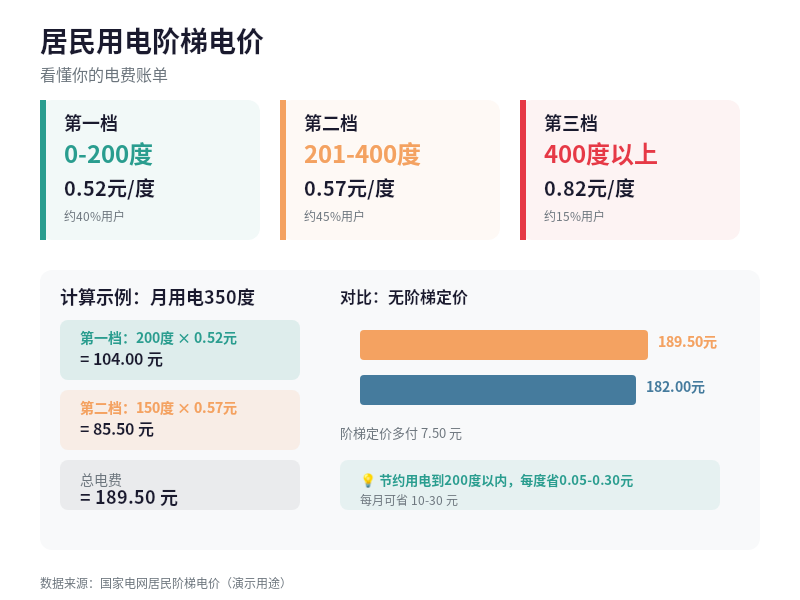
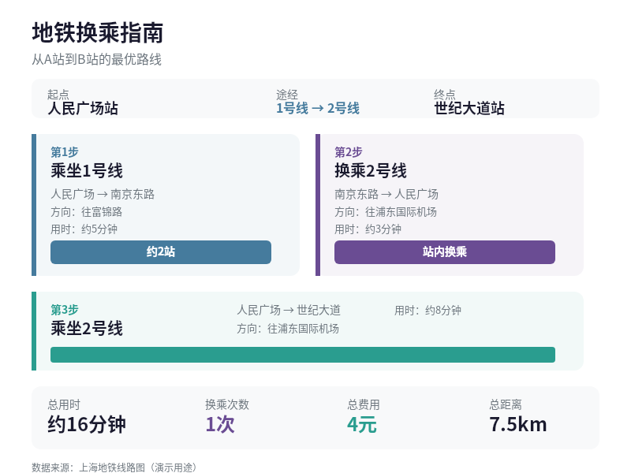
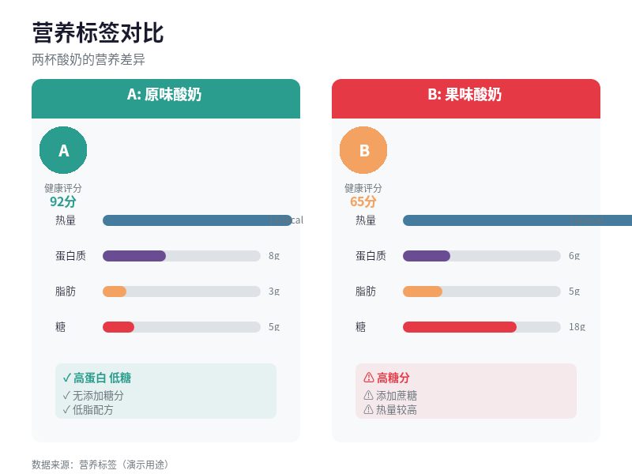
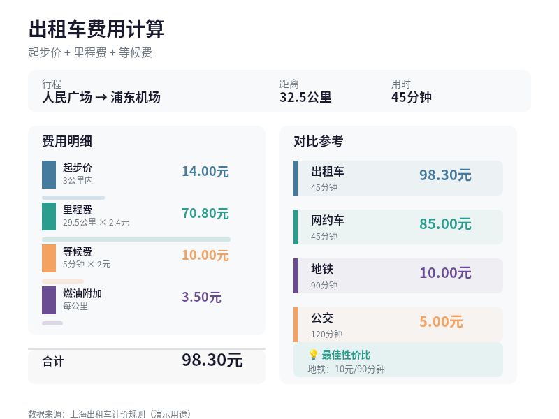
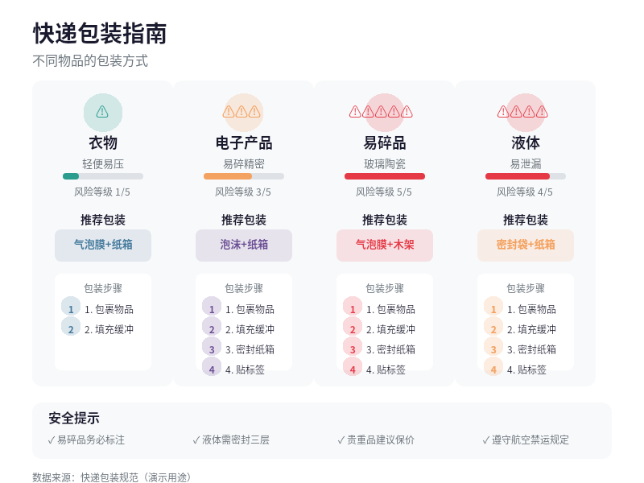
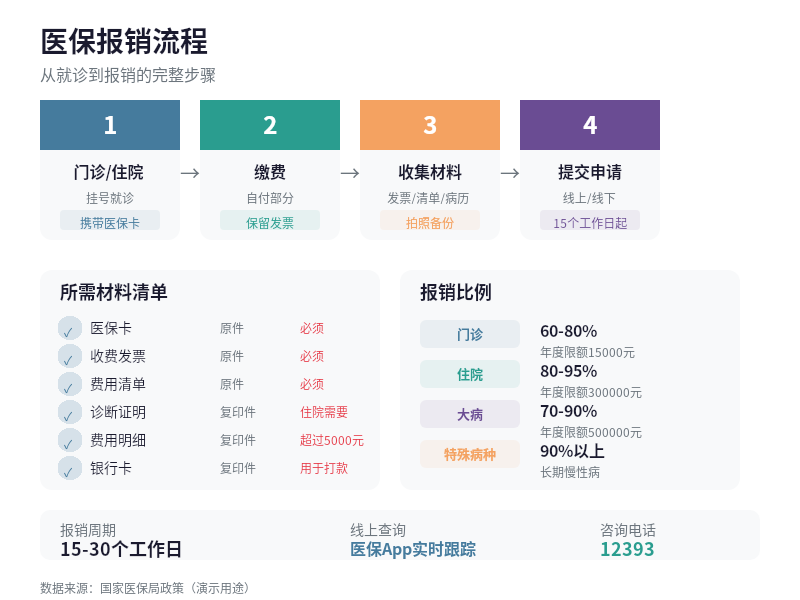
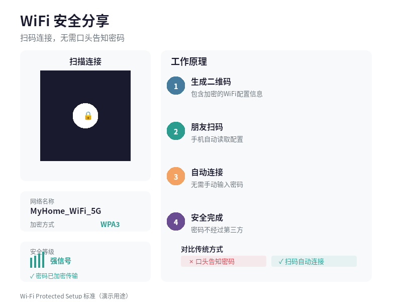
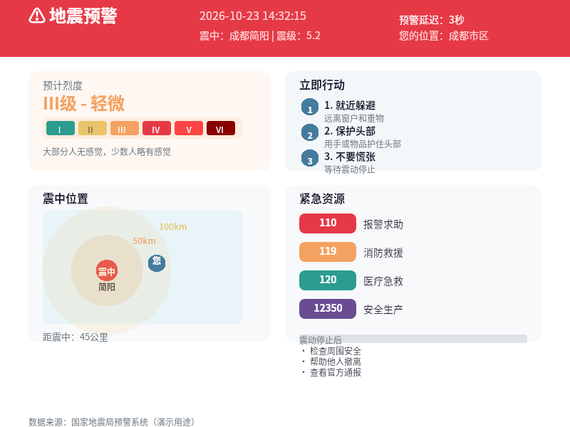

# B06 画廊：日常信息难题可视化

## Case-01: 药品服用时间可视化

- **场景**：患者服药时间指引
- **原始问题**：药品说明书上的服用时间信息难以理解，患者经常记错服药时间
- **新设计**：水平时间轴+颜色编码，蓝色表示空腹，绿色表示饭后
- **可观察改善**：具体时间点和间隔一目了然

[查看 DSL 源文件](case-01/final.snapshot) | [查看案例说明](case-01/case.md)

---

## Case-02: 垃圾分类速查表

- **场景**：居民垃圾分类指引
- **原始问题**：垃圾分类知识分散，人们不知道物品该投入哪个垃圾桶
- **新设计**：四色分类卡片+物品列表，每类垃圾有代表性物品示例
- **可观察改善**：快速查找对应分类

[查看 DSL 源文件](case-02/final.snapshot) | [查看案例说明](case-02/case.md)

---

## Case-03: 电费阶梯计算可视化

- **场景**：居民电费理解
- **原始问题**：阶梯电价规则复杂，用户不理解电费账单构成
- **新设计**：三档卡片+计算示例+对比图表，显示每档用电范围和单价
- **可观察改善**：计算过程透明可见

[查看 DSL 源文件](case-03/final.snapshot) | [查看案例说明](case-03/case.md)

---

## Case-04: 地铁换乘指南

- **场景**：乘客换乘指引
- **原始问题**：地铁换乘说明文字复杂，乘客难以理解路线
- **新设计**：分步骤可视化指南，颜色区分线路，箭头指示方向
- **可观察改善**：步骤清晰，方向明确

[查看 DSL 源文件](case-04/final.snapshot) | [查看案例说明](case-04/case.md)

---

## Case-05: 营养标签快速对比

- **场景**：消费者产品比较
- **原始问题**：营养标签数字难以比较，消费者无法快速判断健康程度
- **新设计**：双栏对比+进度条+健康评分，直观展示差异
- **可观察改善**：差异一目了然

[查看 DSL 源文件](case-05/final.snapshot) | [查看案例说明](case-05/case.md)

---

## Case-06: 出租车费用计算器

- **场景**：乘客费用预估
- **原始问题**：出租车计价规则复杂，乘客难以预估费用
- **新设计**：费用分解+对比图表，显示各项费用占比
- **可观察改善**：费用透明，预估准确

[查看 DSL 源文件](case-06/final.snapshot) | [查看案例说明](case-06/case.md)

---

## Case-07: 快递包装规范

- **场景**：寄件人包装指导
- **原始问题**：不同物品的包装方式不同，寄件人不知道如何正确包装
- **新设计**：风险等级+推荐包装+步骤指导，颜色编码风险等级
- **可观察改善**：包装方式明确，步骤清晰

[查看 DSL 源文件](case-07/final.snapshot) | [查看案例说明](case-07/case.md)

---

## Case-08: 医保报销流程可视化

- **场景**：患者报销指引
- **原始问题**：医保报销流程复杂，所需材料多，用户容易遗漏
- **新设计**：流程可视化+材料清单+比例表，数字编号指示顺序
- **可观察改善**：流程清晰，材料完整

[查看 DSL 源文件](case-08/final.snapshot) | [查看案例说明](case-08/case.md)

---

## Case-09: WiFi 密码安全分享

- **场景**：访客WiFi连接
- **原始问题**：口头分享WiFi密码不安全，也不方便
- **新设计**：二维码分享+工作原理+传统方式对比
- **可观察改善**：扫码即可连接，无需口头告知

[查看 DSL 源文件](case-09/final.snapshot) | [查看案例说明](case-09/case.md)

---

## Case-10: 地震预警信息

- **场景**：震民应急指引
- **原始问题**：地震预警信息模糊，人们不知道如何应对
- **新设计**：预警横幅+烈度指示+行动步骤+震中位置+紧急资源
- **可观察改善**：行动指南清晰，资源可及

[查看 DSL 源文件](case-10/final.snapshot) | [查看案例说明](case-10/case.md)

---

## 画廊统计

| 指标 | 数值 |
|------|------|
| 作品总数 | 10 |
| 画布尺寸 | 800×600（统一） |
| 最小字号 | 12px（统一） |
| 色彩系统 | 6色主题 |
| 纯DSL构建 | 10/10 |
| 全部通过检查 | ✅ |

## 相关文件

- [作品集清单](portfolio.json)
- [作品集说明](portfolio.md)
- [问题证据](problem-evidence.json)
- [设计审查](design-review.md)
- [使用情况报告](snapshot-usage.md)
- [任务指标](task-metrics.json)
