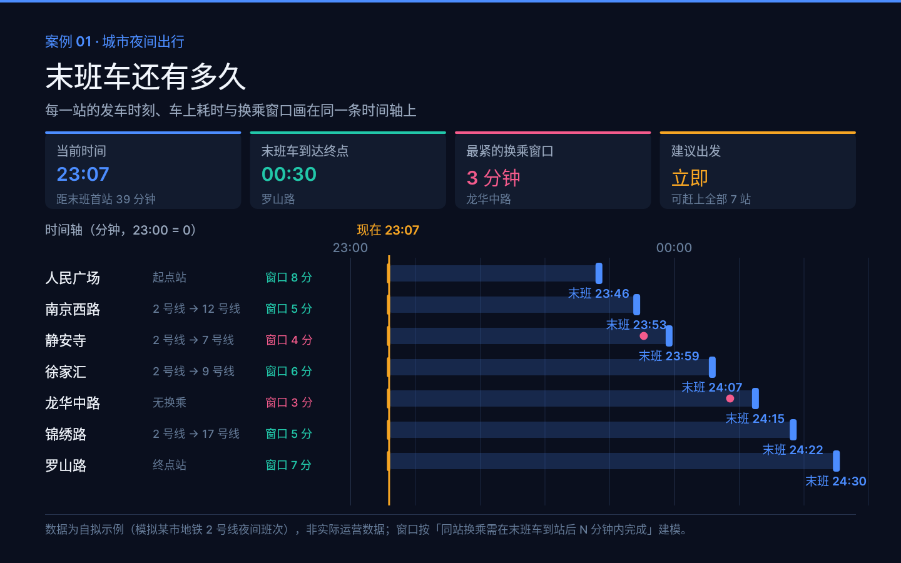
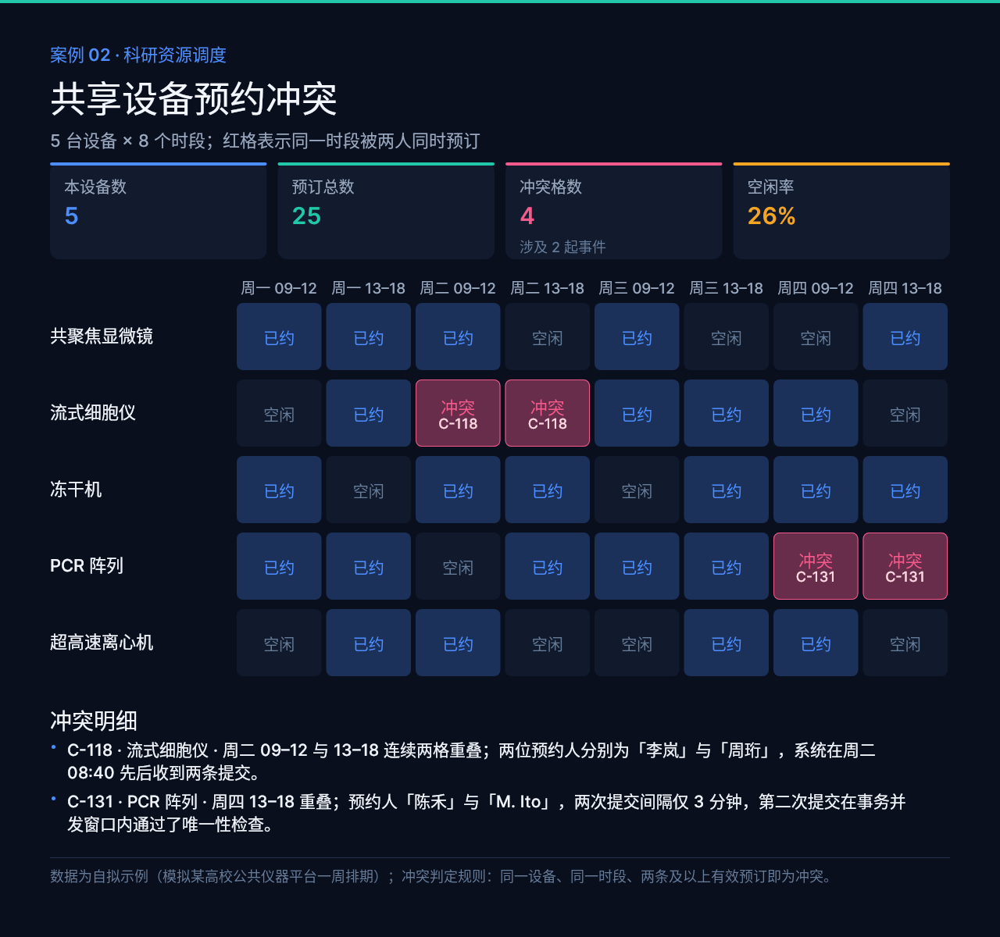
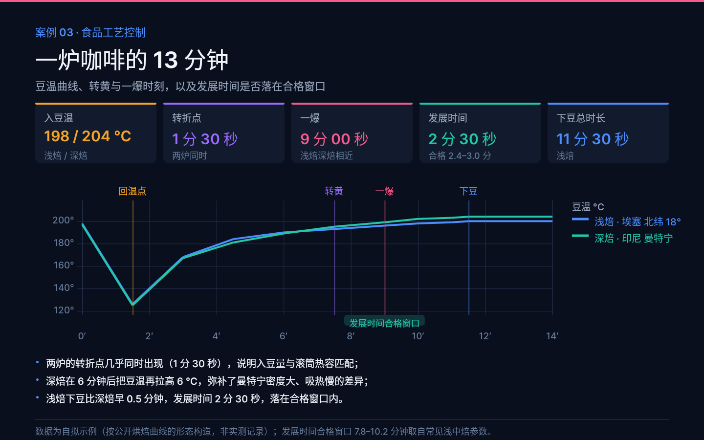
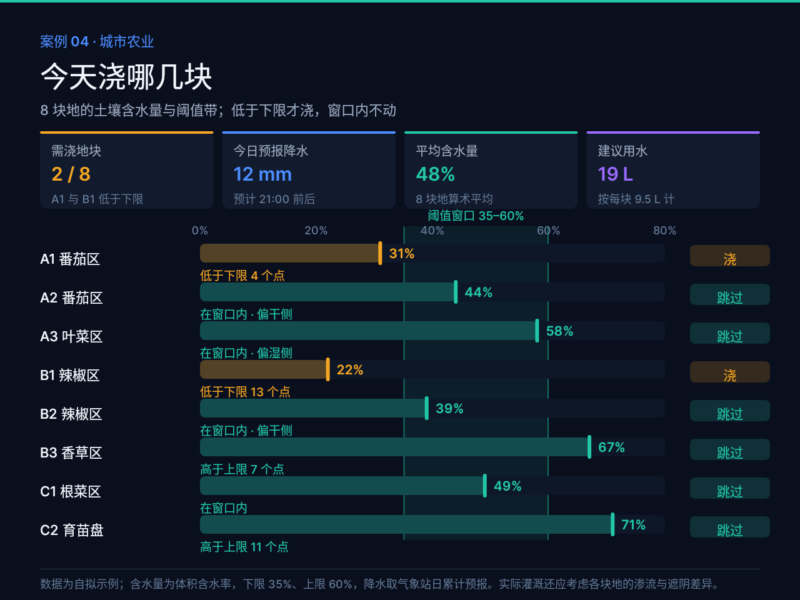
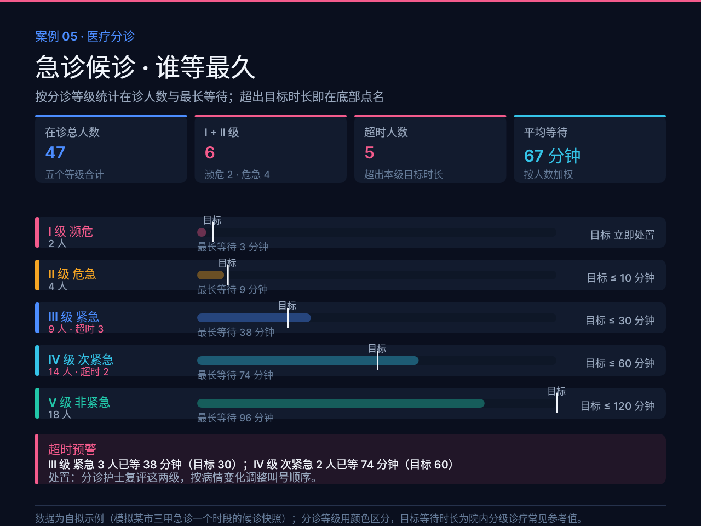
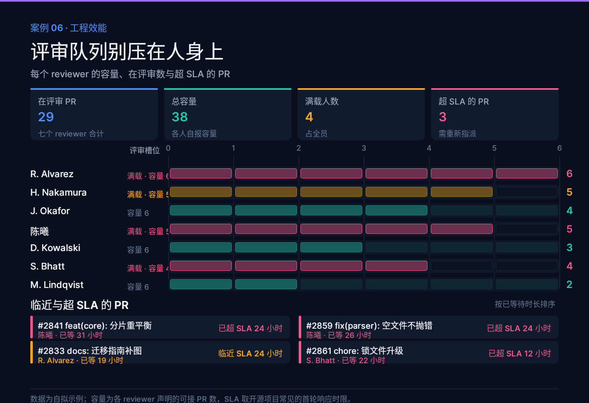
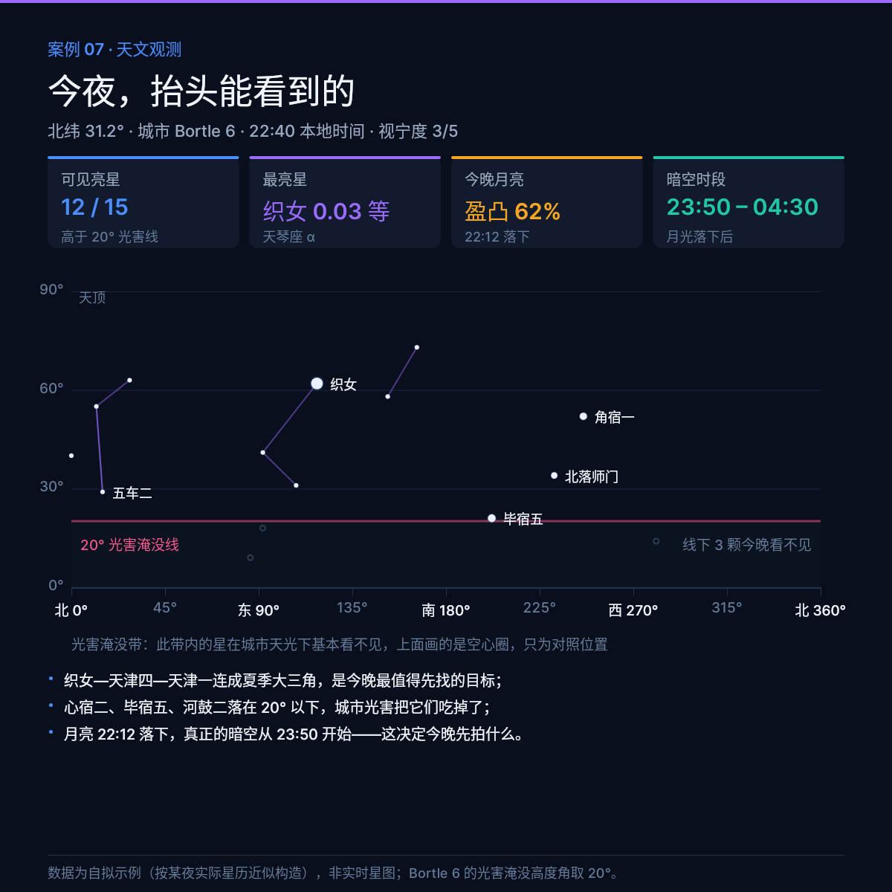
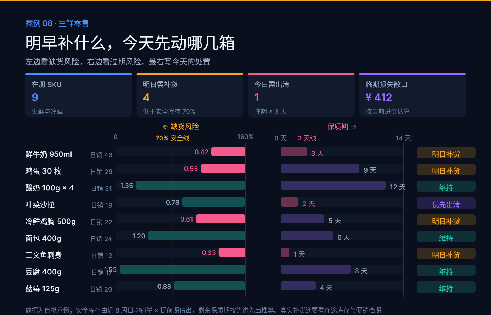
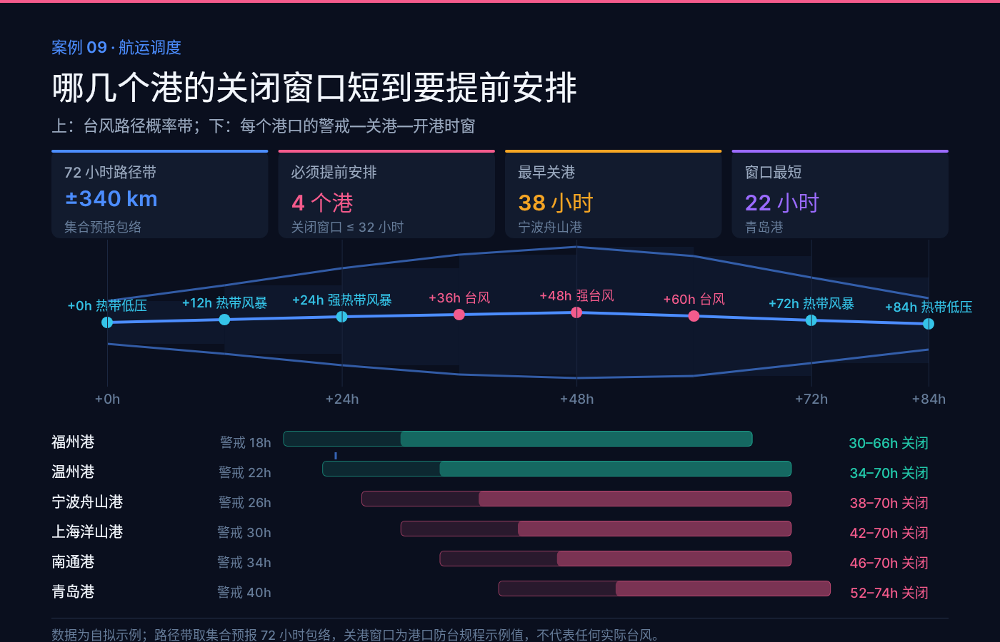
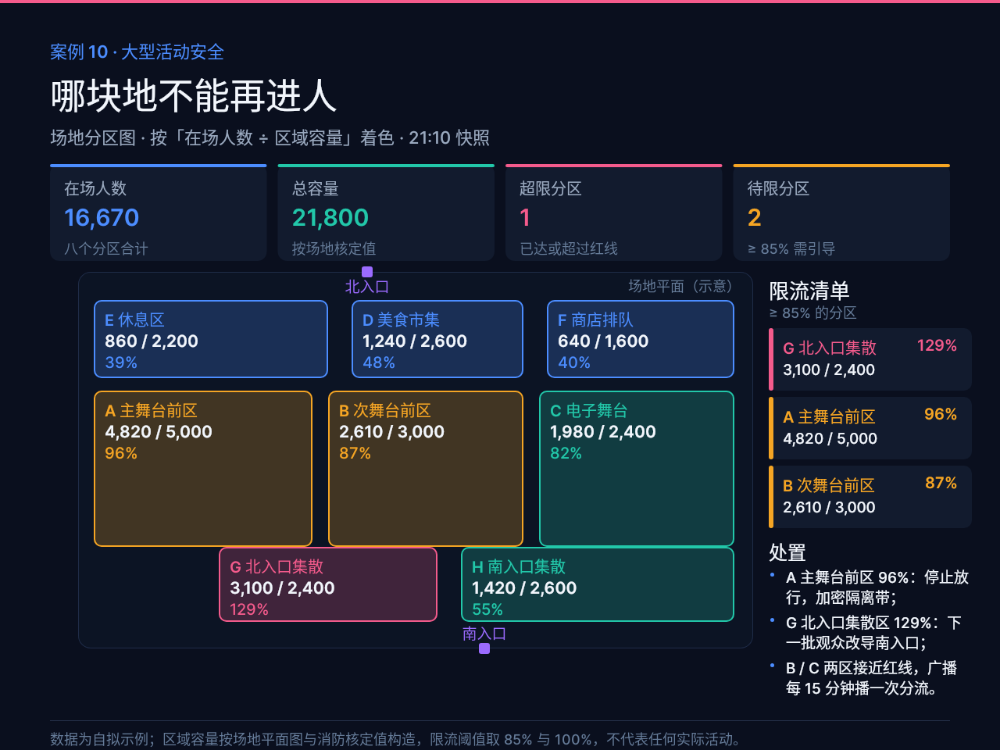

# B01 作品画廊

> 生成时间：2026-10-13T10:13:03+08:00。十件均为 open-snapshot 服务的真实响应；点击图片看大图，点击 DSL 看源码。

本作品集的场景、品牌与示例数据均为自拟，用于展示结构化 DSL 的表现力；不代表任何实际部署的客户作品，也不是实时或真实业务数据。

## case-01 · 末班车还有多久

**城市夜间出行** · 1440×900

把整条线路做成一根**共享时间轴**：乘客当前的时刻用一条竖线钉在轴上，每一站的可乘窗口从这条线画到发车点，越往右越晚——一眼看出还剩多少时间。

- PNG：[`case-01/final.png`](case-01/final.png)
- DSL：[`case-01/final.snapshot`](case-01/final.snapshot)
- 说明：[`case-01/case.md`](case-01/case.md)

## case-02 · 共享设备预约冲突

**科研资源调度** · 1280×1200

**设备 × 时段的热力矩阵**：冲突格用高饱和红并写上冲突编号，把「冲突」从一条报错变成图上一眼能定位的红块。

- PNG：[`case-02/final.png`](case-02/final.png)
- DSL：[`case-02/final.snapshot`](case-02/final.snapshot)
- 说明：[`case-02/case.md`](case-02/case.md)

## case-03 · 一炉咖啡的 13 分钟

**食品工艺控制** · 1440×900

**两条豆温曲线叠在工艺事件竖线上**：回温点、转黄、一爆、下豆四个时刻把曲线切成四段，读图的人不用查表就知道每一段在发生什么。

- PNG：[`case-03/final.png`](case-03/final.png)
- DSL：[`case-03/final.snapshot`](case-03/final.snapshot)
- 说明：[`case-03/case.md`](case-03/case.md)

## case-04 · 今天浇哪几块

**城市农业** · 1280×960

**阈值带 + 一句话处置**：含水量条上叠一条 35–60% 的阈值带，每行右侧直接给「浇 / 跳过」，把读数动作取消掉。

- PNG：[`case-04/final.png`](case-04/final.png)
- DSL：[`case-04/final.snapshot`](case-04/final.snapshot)
- 说明：[`case-04/case.md`](case-04/case.md)

## case-05 · 急诊候诊 · 谁等最久

**医疗分诊** · 1280×960

**颜色即分级**：从濒危到非紧急五级各一个颜色，每级一条「最长等待 vs 目标线」的对比条，超时的级别在底部被点名。

- PNG：[`case-05/final.png`](case-05/final.png)
- DSL：[`case-05/final.snapshot`](case-05/final.snapshot)
- 说明：[`case-05/case.md`](case-05/case.md)

## case-06 · 评审队列别压在人身上

**工程效能** · 1400×960

**容量用格子表示而不是百分比条**：每人 6 个槽位，装满就是满载，一眼看出该给谁分流——百分比条看不出「差几个」。

- PNG：[`case-06/final.png`](case-06/final.png)
- DSL：[`case-06/final.snapshot`](case-06/final.snapshot)
- 说明：[`case-06/case.md`](case-06/case.md)

## case-07 · 今夜，抬头能看到的

**天文观测** · 1200×1200

**把 20° 光害淹没带画成一层暗底**：带子里的星只画空心圈并标灰，「看不见」因此是一个**被画出来的区域**，而不是一句脚注。

- PNG：[`case-07/final.png`](case-07/final.png)
- DSL：[`case-07/final.snapshot`](case-07/final.snapshot)
- 说明：[`case-07/case.md`](case-07/case.md)

## case-08 · 明早补什么，今天先动哪几箱

**生鲜零售** · 1400×900

**一根 SKU 横跨两条风险轴**：左边是缺货（库存 ÷ 安全库存），右边是过期（剩余保质期），最右一列给出动作。两个互不相干的维度合成一行，扫一眼就能取舍。

- PNG：[`case-08/final.png`](case-08/final.png)
- DSL：[`case-08/final.snapshot`](case-08/final.snapshot)
- 说明：[`case-08/case.md`](case-08/case.md)

## case-09 · 哪几个港的关闭窗口短到要提前安排

**航运调度** · 1400×900

**每个港口单独一行，而不是共用一根时间轴**：六条时窗叠在同一轴上时会糊成一条实心带，谁也读不出来；拆成六行后，警戒与关闭两段一分得清。

- PNG：[`case-09/final.png`](case-09/final.png)
- DSL：[`case-09/final.snapshot`](case-09/final.snapshot)
- 说明：[`case-09/case.md`](case-09/case.md)

## case-10 · 哪块地不能再进人

**大型活动安全** · 1280×960

**把场地画成真的平面图**：分区位置、尺寸、出入口都按比例摆，安全官看的是「哪一块」，抽象热力图反而不好定位。

- PNG：[`case-10/final.png`](case-10/final.png)
- DSL：[`case-10/final.snapshot`](case-10/final.snapshot)
- 说明：[`case-10/case.md`](case-10/case.md)
