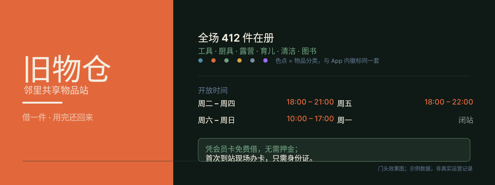
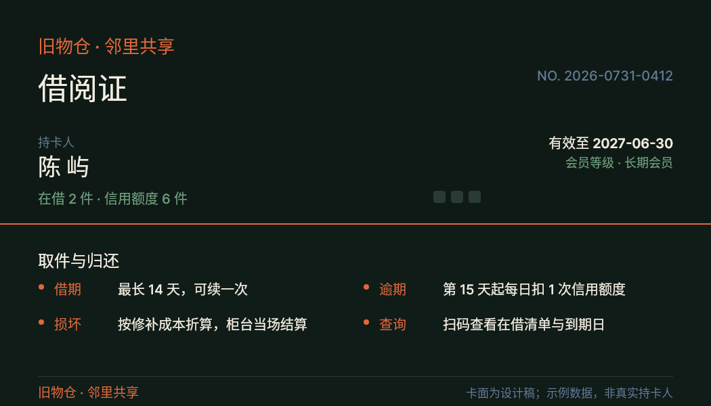
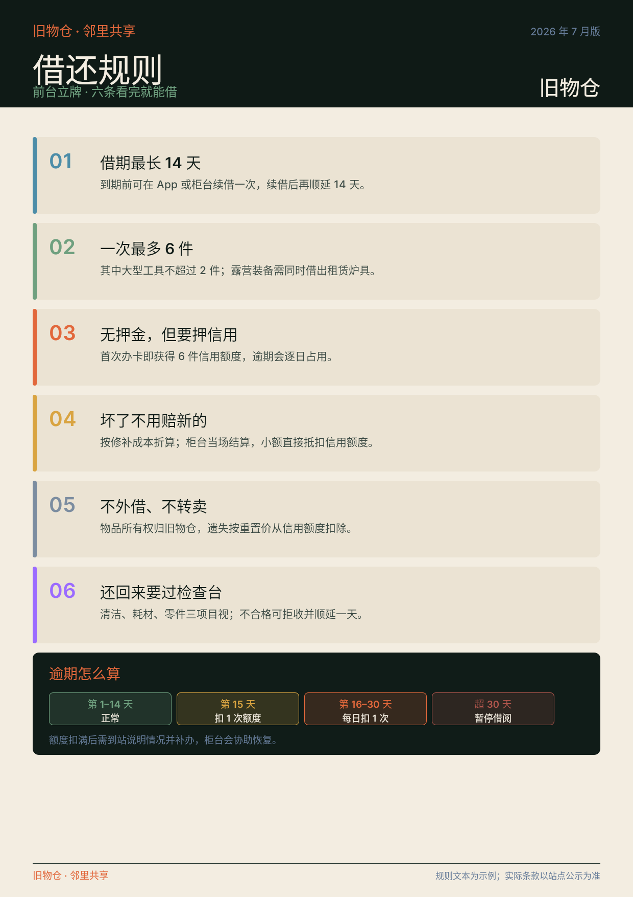
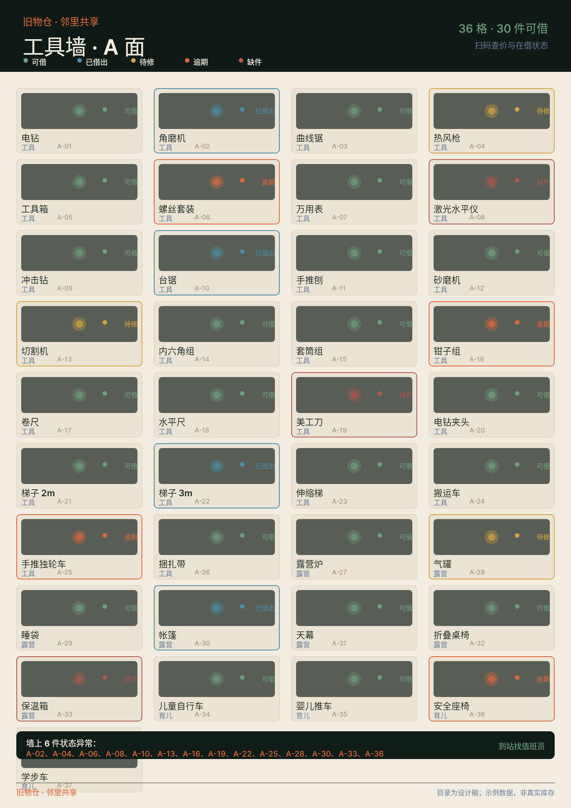
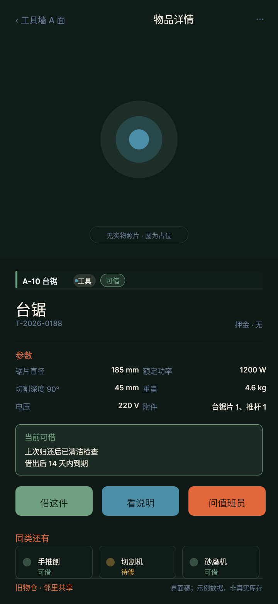
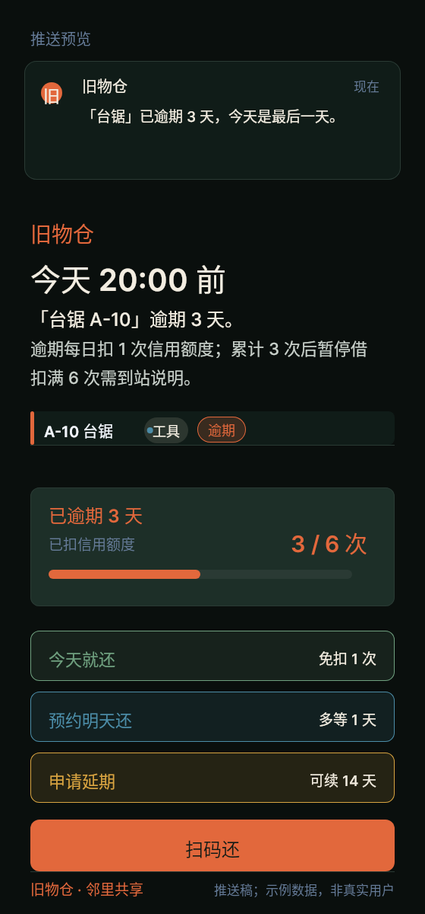
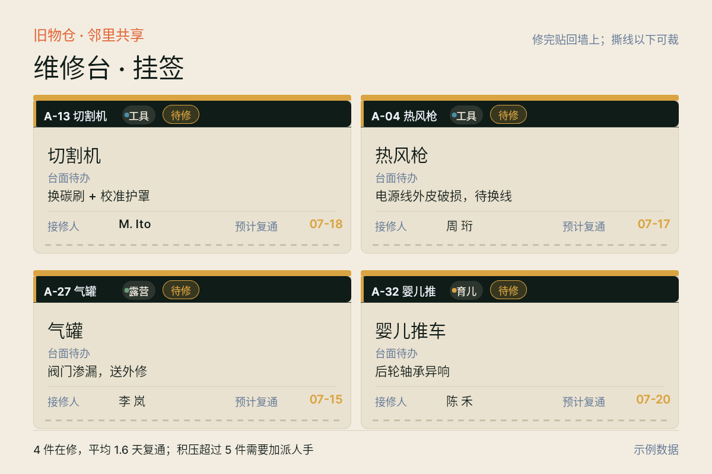
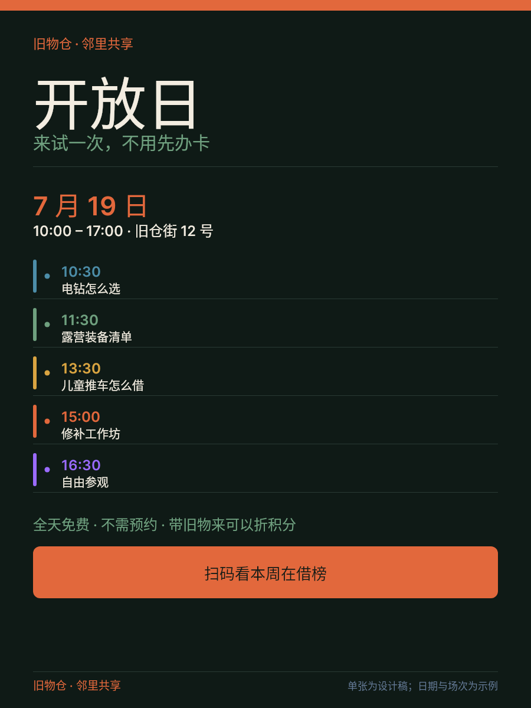
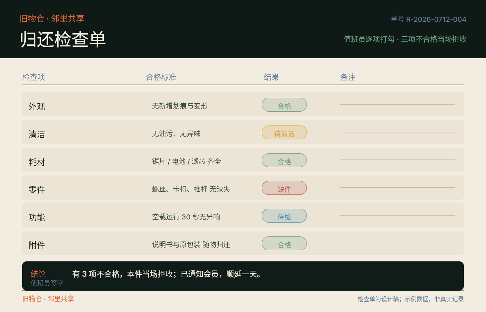
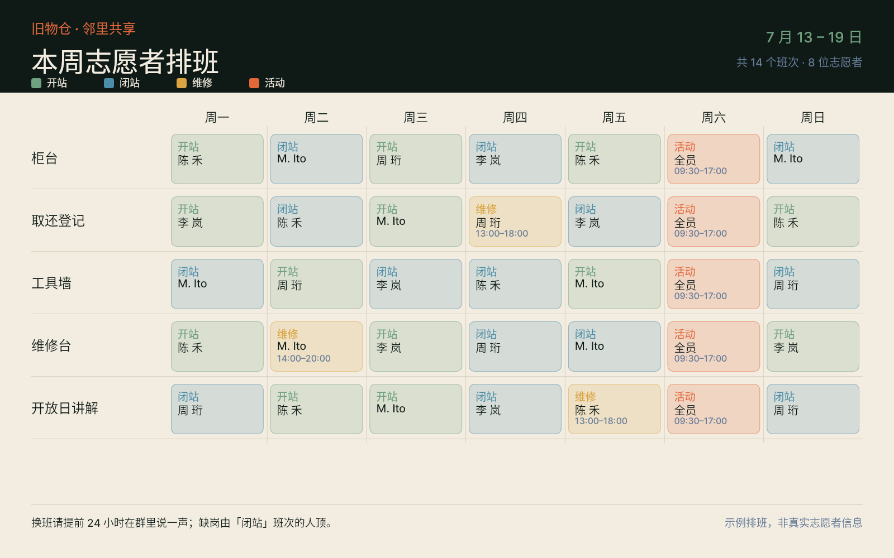

# 旧物仓 · 视觉生态画廊

> 生成时间：2026-10-13T11:03:05+08:00。十件均为服务真实响应。

项目、品牌、数据均为自拟，用于展示一套视觉生态的设计规则；不是真实运营记录。

## case-01 · 门头招牌

**街角门头** · 1600×600 · 正文最小 18px

标题放大到 96px——整套里唯一按「远观」设计的字号；品类色点与 App 内分类徽标同色，看过一次就认得。

- PNG：[`case-01/final.png`](case-01/final.png) · DSL：[`case-01/final.snapshot`](case-01/final.snapshot) · 说明：[`case-01/case.md`](case-01/case.md)

## case-02 · 借阅证

**口袋里的卡** · 1050×600 · 正文最小 18px

正反双面：正面给持卡人（姓名/等级/额度），背面给店员（取件与归还四条）；信息密度比门头高一档但字号下限不变。

- PNG：[`case-02/final.png`](case-02/final.png) · DSL：[`case-02/final.snapshot`](case-02/final.snapshot) · 说明：[`case-02/case.md`](case-02/case.md)

## case-03 · 借还规则

**前台立牌 A4** · 1240×1754 · 正文最小 19px

六条规则各配一个独立色条，颜色与状态色系统同源；底部「逾期怎么算」用四段时间条，把最常被问的一条单独拎出来。

- PNG：[`case-03/final.png`](case-03/final.png) · DSL：[`case-03/final.snapshot`](case-03/final.snapshot) · 说明：[`case-03/case.md`](case-03/case.md)

## case-04 · 工具墙目录

**站在墙前 1.5 m** · 1400×1980 · 正文最小 16px

**整套密度最高的一件**，用来检验组件在高密度下是否还成立：4 列 × 9 行共 36 格，每格只有编号、名称、分类、状态点四层信息，标签条与状态点仍按同一套规则渲染。

- PNG：[`case-04/final.png`](case-04/final.png) · DSL：[`case-04/final.snapshot`](case-04/final.snapshot) · 说明：[`case-04/case.md`](case-04/case.md)

## case-05 · App 物品详情

**手机单手握持** · 720×1560 · 正文最小 17px

三个动作按钮（借 / 看说明 / 问值班员）全部落在拇指可达区；顶部实物位用几何占位并明写「无实物照片」，不假装有图。

- PNG：[`case-05/final.png`](case-05/final.png) · DSL：[`case-05/final.snapshot`](case-05/final.snapshot) · 说明：[`case-05/case.md`](case-05/case.md)

## case-06 · 逾期提醒

**锁屏推送** · 560×1200 · 正文最小 17px

**整套最窄的一件**，用来检验字号层级在 560px 下是否还站得住；信用额度条把「3 / 6 次」画成进度条，损失是可见的。

- PNG：[`case-06/final.png`](case-06/final.png) · DSL：[`case-06/final.snapshot`](case-06/final.snapshot) · 说明：[`case-06/case.md`](case-06/case.md)

## case-07 · 维修台挂签

**工作台上的标签** · 1200×800 · 正文最小 18px

四张可撕标签，每张带撕线；标签只在维修台出现，因此字号比面向顾客的页面更大。

- PNG：[`case-07/final.png`](case-07/final.png) · DSL：[`case-07/final.snapshot`](case-07/final.snapshot) · 说明：[`case-07/case.md`](case-07/case.md)

## case-08 · 开放日单张

**社区公告栏 A3** · 900×1200 · 正文最小 19px

受众是**路人不是会员**，所以标题（96px）比说明重要、开门时间比规则重要；全场免费写在最显眼处。

- PNG：[`case-08/final.png`](case-08/final.png) · DSL：[`case-08/final.snapshot`](case-08/final.snapshot) · 说明：[`case-08/case.md`](case-08/case.md)

## case-09 · 归还检查单

**归还台** · 1400×900 · 正文最小 18px

合格/待清洁/缺件/待检 四种结果复用同一套状态色；结论行直接写「有 3 项不合格，当场拒收」，和表里的勾选一一对应。

- PNG：[`case-09/final.png`](case-09/final.png) · DSL：[`case-09/final.snapshot`](case-09/final.snapshot) · 说明：[`case-09/case.md`](case-09/case.md)

## case-10 · 志愿者排班板

**上墙的看板** · 1600×1000 · 正文最小 16px

整套里唯一同时用时间轴与颜色编码的一件：班次类型即颜色，周六周日整列是「活动」班次，一眼看出哪两天最缺人。

- PNG：[`case-10/final.png`](case-10/final.png) · DSL：[`case-10/final.snapshot`](case-10/final.snapshot) · 说明：[`case-10/case.md`](case-10/case.md)
