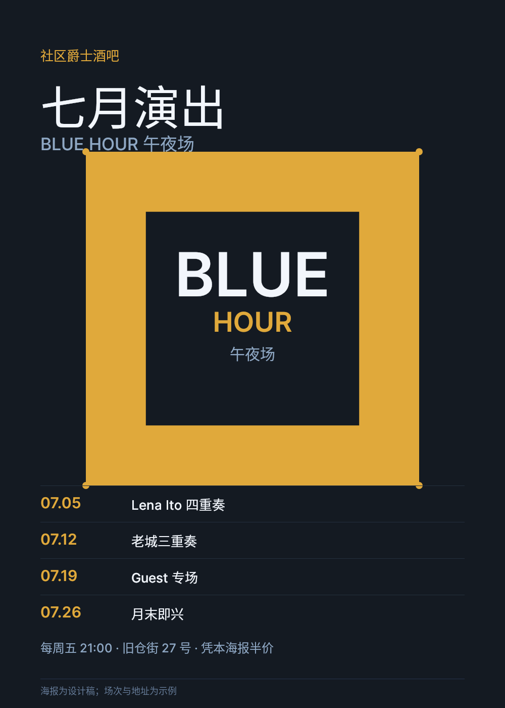
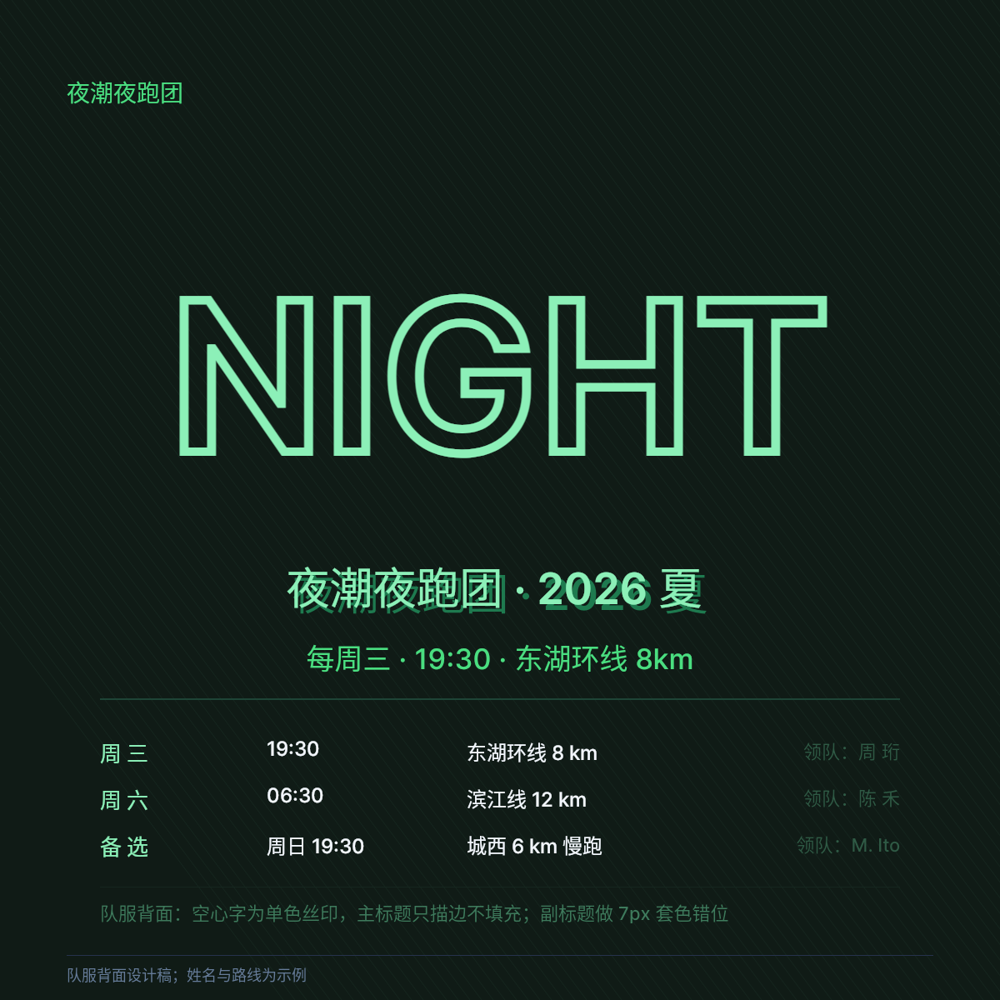
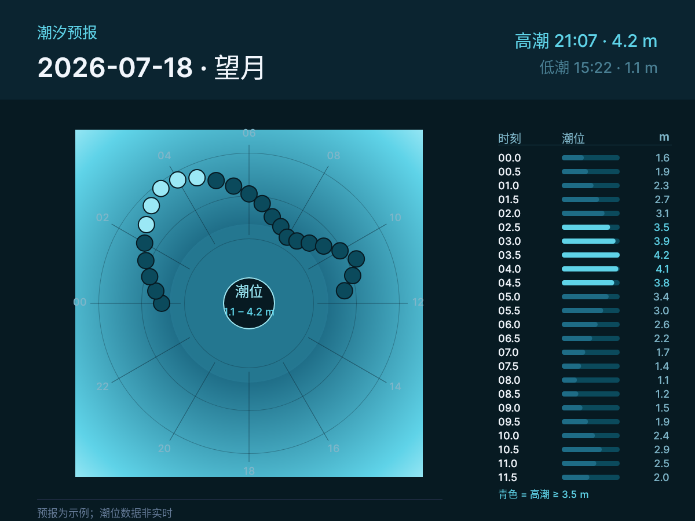
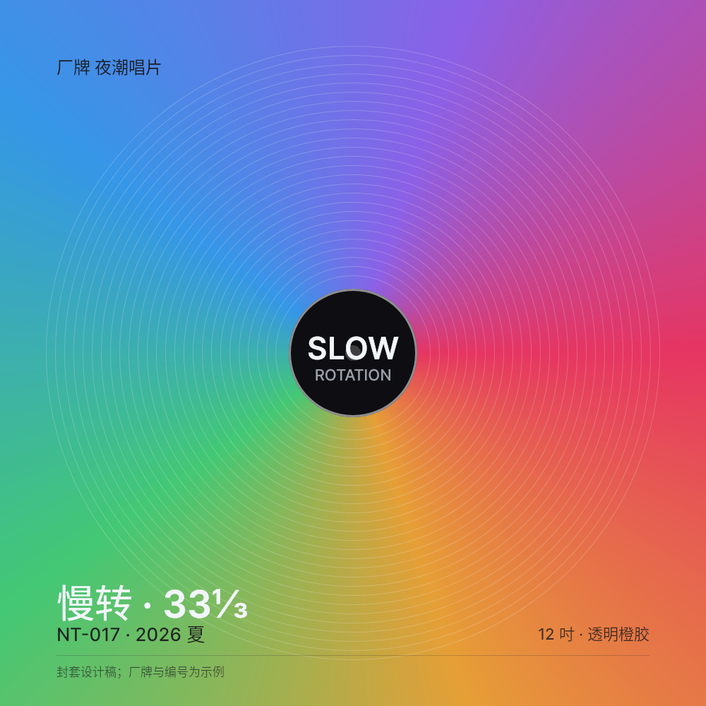
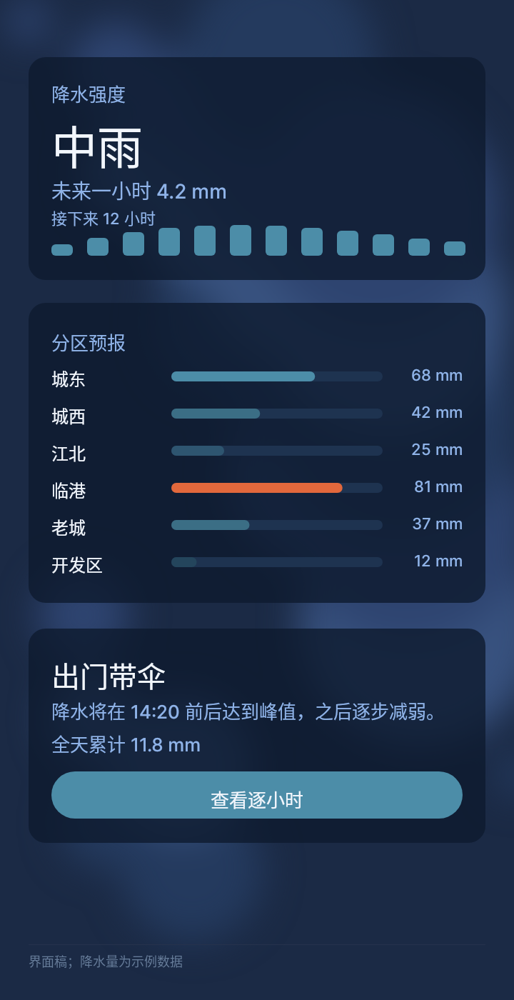
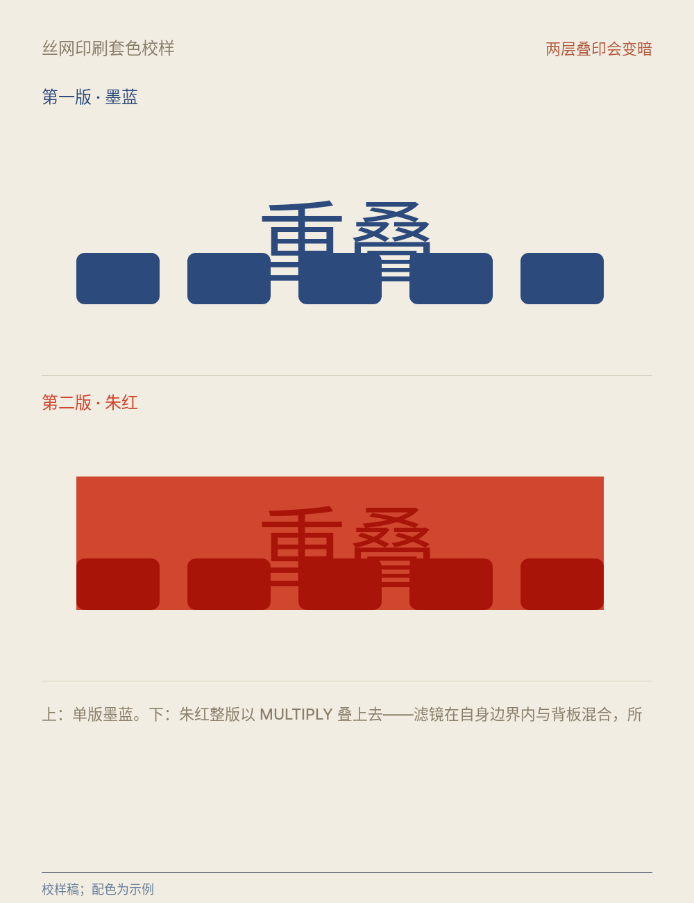
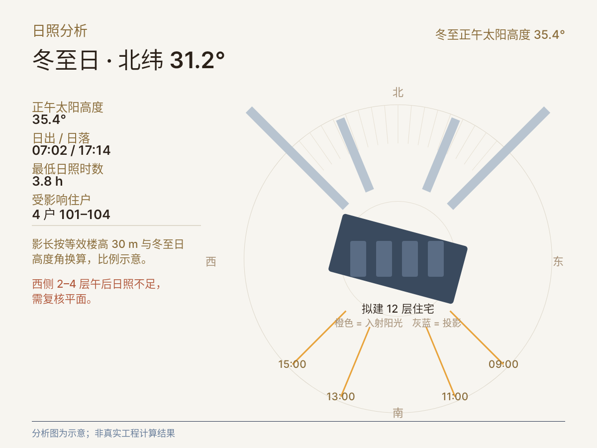
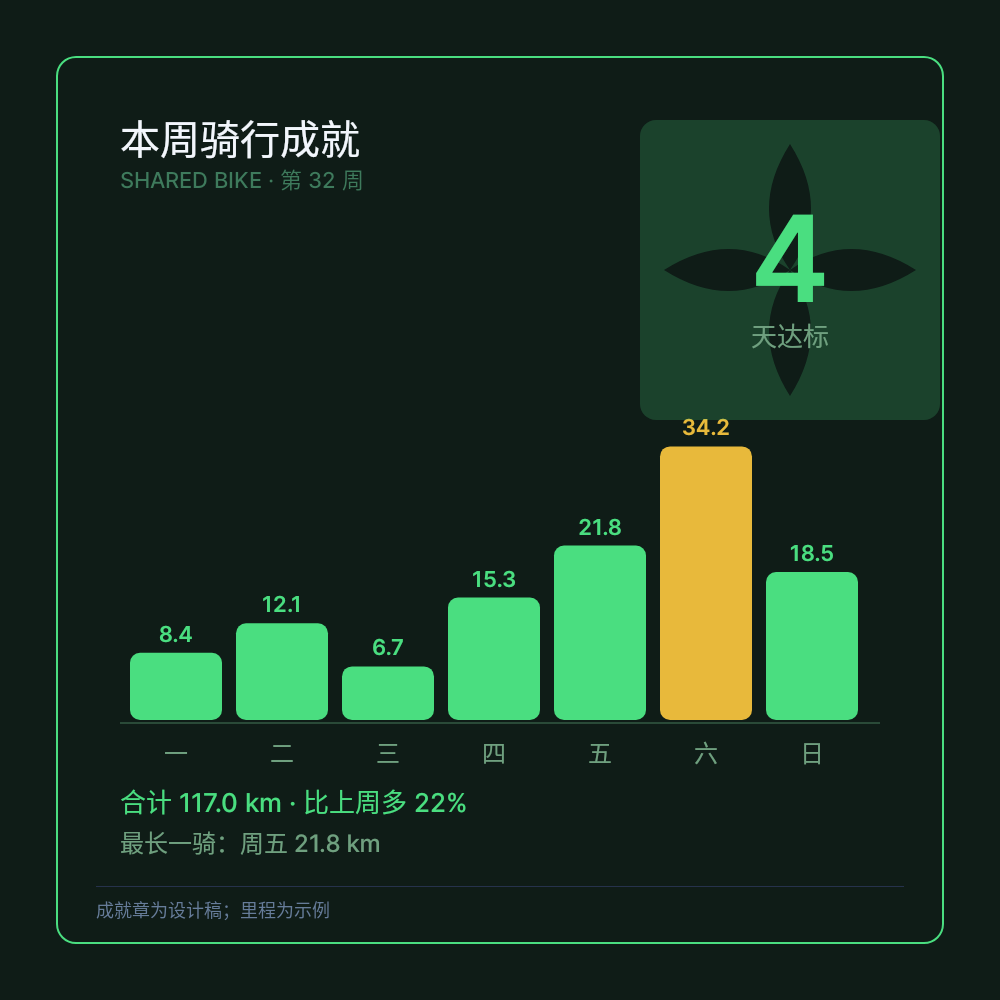
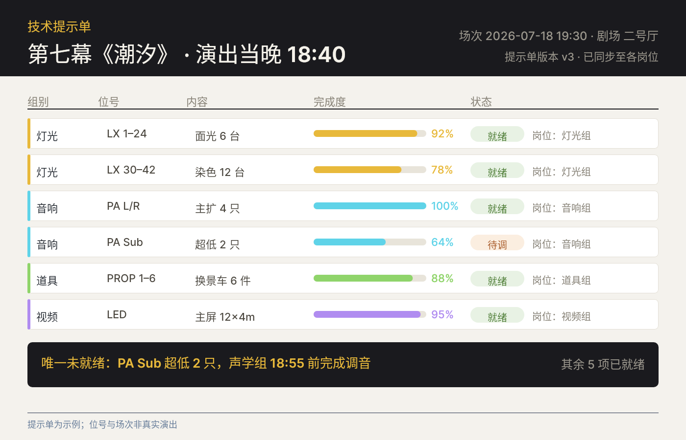

# B03 画廊 · DSL 创意边界十件

> 生成时间：2026-10-14T10:14:40+08:00

十件的场景、品牌与数据均为自拟示例，不代表任何真实记录；全部为纯 DSL，无 <Image> 与外部素材。

## case-01 · 七月演出海报

**场景**：社区爵士酒吧的月度演出海报

**手法**：ClipPath 双轮廓 + fillRule="EVEN_ODD" 挖出方环，镂空处直接放标题

**边界**：EVEN_ODD 依赖轮廓**同向**；反向轮廓在 NON_ZERO 下才是镂空。

- PNG：[`case-01/final.png`](case-01/final.png) · DSL：[`case-01/final.snapshot`](case-01/final.snapshot) · 笔记：[`case-01/case.md`](case-01/case.md)

## case-02 · 夜跑队服背面

**场景**：夜跑团的队服背面大字

**手法**：Text 的 foregroundMode="STROKE" 出空心描边字，再叠一层实心字错位 6px，做出「套色没对准」的印刷感

**边界**：**描边层不能压在同位置的实心层之上**——描边宽度是绝对像素，被填色盖住后只剩半个线宽的晕圈。另外中文细笔画在 3px 下会粘连，8px 以上才清晰（第 10 件把最底层描边给到 26px 就是这个原因）。

- PNG：[`case-02/final.png`](case-02/final.png) · DSL：[`case-02/final.snapshot`](case-02/final.snapshot) · 笔记：[`case-02/case.md`](case-02/case.md)

## case-03 · 潮汐预报卡

**场景**：海滨城市的每日潮汐

**手法**：gradientType="RADIAL" 把每小时潮位映射成从中心向外的半径，半径越长潮越高，渐变把高潮与低潮自然分开

**边界**：渐变 Container **不透明**，必须画在所有数据之前；gradientCenter/gradientFocal 想偏心只能把 Container 缩到想要的大小再摆位（第 04 件就是这么处理的）。

- PNG：[`case-03/final.png`](case-03/final.png) · DSL：[`case-03/final.snapshot`](case-03/final.snapshot) · 笔记：[`case-03/case.md`](case-03/case.md)

## case-04 · 慢转 33⅓ 唱片封套

**场景**：独立厂牌的黑胶唱片封套

**手法**：gradientType="SWEEP" 画扇形色盘 + 同心圆环，模拟黑胶旋转的视觉隐喻

**边界**：SWEEP 的中心同样只能给对齐常量，所以渐变中心必须与唱片中心重合；`gradientEndAngle` 要大于 `gradientStartAngle`，全周用 6.2832。

- PNG：[`case-04/final.png`](case-04/final.png) · DSL：[`case-04/final.snapshot`](case-04/final.snapshot) · 笔记：[`case-04/case.md`](case-04/case.md)

## case-05 · 降水强度浮层

**场景**：天气 App 的分区降水浮层

**手法**：ImageFiltered 高斯模糊作用在**同一份 DSL 里真实存在的底层图元**上，换数据时模糊自动跟着变

**边界**：**滤镜只作用于自身子树**——想模糊的图元必须是子节点，放在外面等于没写。另外 ImageFiltered **只支持高斯模糊**，其它滤镜 Parser 里没有。

- PNG：[`case-05/final.png`](case-05/final.png) · DSL：[`case-05/final.snapshot`](case-05/final.snapshot) · 笔记：[`case-05/case.md`](case-05/case.md)

## case-06 · 丝网印刷套色校样

**场景**：独立书店海报的印刷校样

**手法**：ColorFiltered + Skia blendMode="MULTIPLY" 模拟油墨叠印，交叠处自然变深

**边界**：blendMode 在**滤镜自身边界内**与背板混合，所以整块版区都会上色——这恰好等于丝印的整版上墨；只想让图元变暗则必须让滤镜边界等于图元包围盒。

- PNG：[`case-06/final.png`](case-06/final.png) · DSL：[`case-06/final.snapshot`](case-06/final.snapshot) · 笔记：[`case-06/case.md`](case-06/case.md)

## case-07 · 冬至日日照分析

**场景**：住宅方案的日照分析图

**手法**：用 `Transform` 把**投影带**绕楼体中心摆成 09/11/13/15 四个真实太阳方位角（135°/157.5°/202.5°/225°），影长按等效楼高 30 m 与冬至日高度角换算

**边界**：Transform 只有 2D、没有透视矩阵；matrix 的旋转角是**局部 x 轴的去向**，要让盒子沿方向 u=(-sin az, cos az) 摆，角度必须传 az+90，别直接传 az。本件只做平面方位与影长，属示意而非工程计算。

- PNG：[`case-07/final.png`](case-07/final.png) · DSL：[`case-07/final.snapshot`](case-07/final.snapshot) · 笔记：[`case-07/case.md`](case-07/case.md)

## case-08 · 本周骑行成就章

**场景**：共享单车的周成就卡

**手法**：ClipPath 用带 Q/C 命令的**曲线轮廓** + EVEN_ODD 挖出四瓣花形章面

**边界**：ClipPath 的坐标在本地坐标系，**没有布局作用**——必须自己给 SizedBox/父盒子定尺寸（这里靠外层 Positioned 的 width/height）。

- PNG：[`case-08/final.png`](case-08/final.png) · DSL：[`case-08/final.snapshot`](case-08/final.snapshot) · 笔记：[`case-08/case.md`](case-08/case.md)

## case-09 · 技术提示单

**场景**：剧场演出当晚的岗位提示表

**手法**：把同一套「状态条 + 标签 + 数值」塞进 6 行 × 5 列高密度表格，每格再嵌一层进度条——组件在最小尺寸下的极端用例

**边界**：这个密度已经是纯 DSL 的上限：再密就得缩字号，而**文字溢出盒子会被静默裁掉**；同时**后画的实心图元会盖住先画的文字**，这一列必须靠手工算 x 避让，DSL 不会替你排版。

- PNG：[`case-09/final.png`](case-09/final.png) · DSL：[`case-09/final.snapshot`](case-09/final.snapshot) · 笔记：[`case-09/case.md`](case-09/case.md)

## case-10 · 年度十佳展陈主视觉

**场景**：独立书店的年度书单展陈

**手法**：同一句话用四层 STROKE（不同粗细、透明度）叠出层次，并把最底层整体旋转 6°，做出丝印的套版错位

**边界**：描边宽度是绝对像素，不会随画布缩放；同一句话叠四层意味着四份 Text，字号或位置改一处要同步改四处。

- PNG：[`case-10/final.png`](case-10/final.png) · DSL：[`case-10/final.snapshot`](case-10/final.snapshot) · 笔记：[`case-10/case.md`](case-10/case.md)
