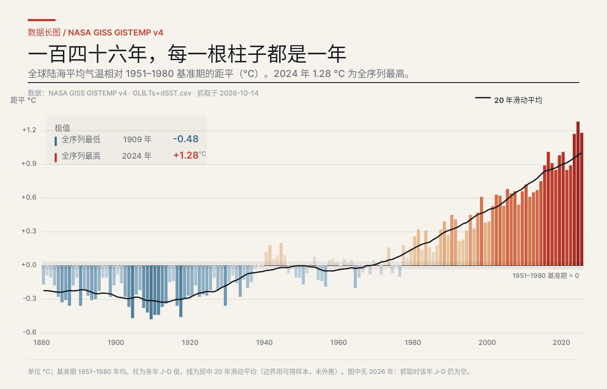
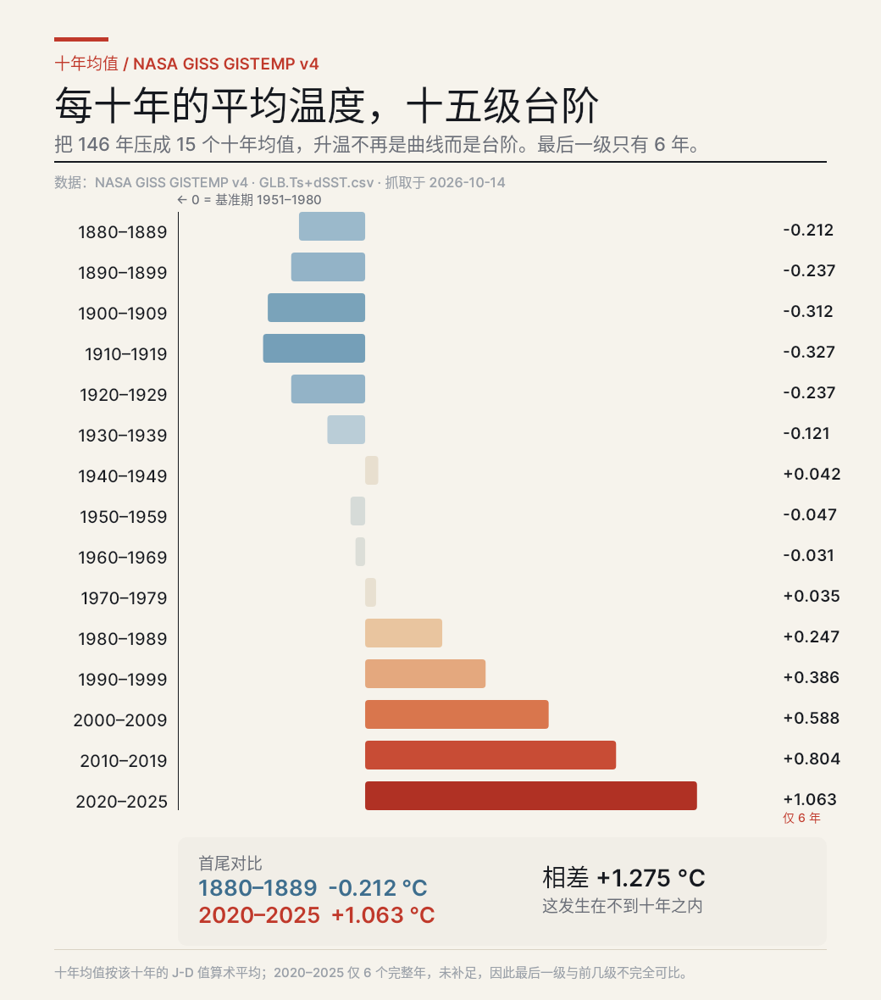
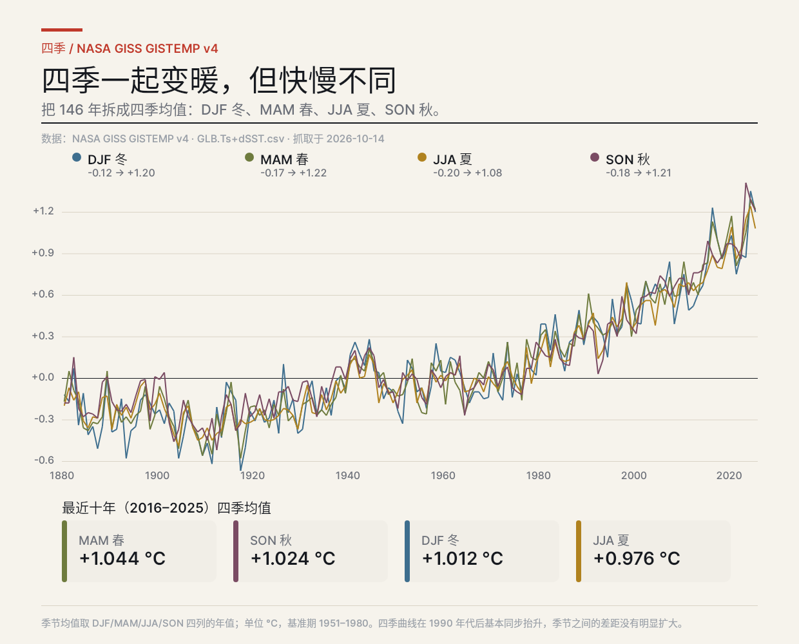
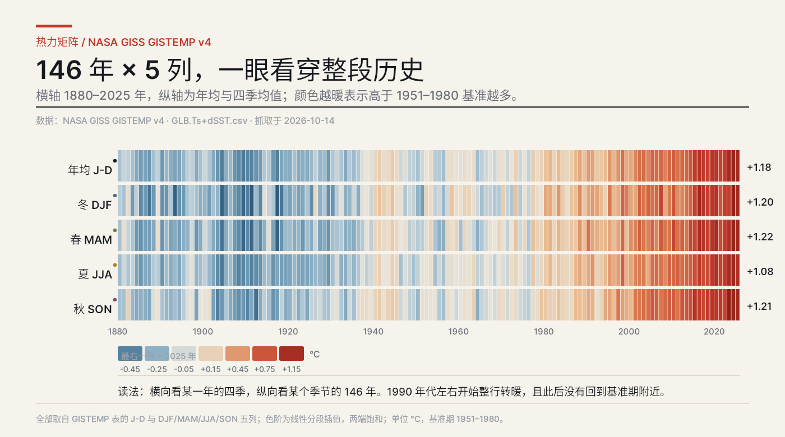
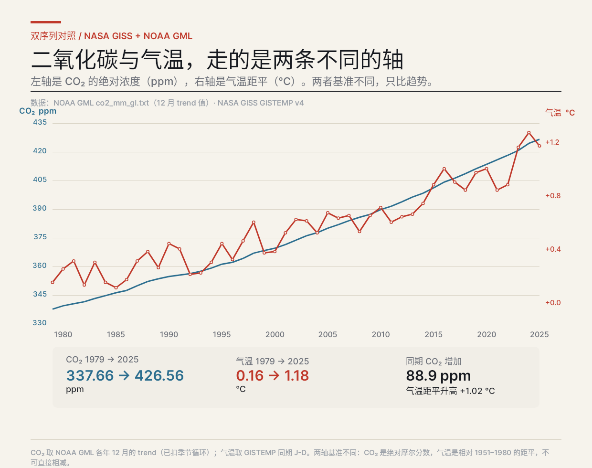
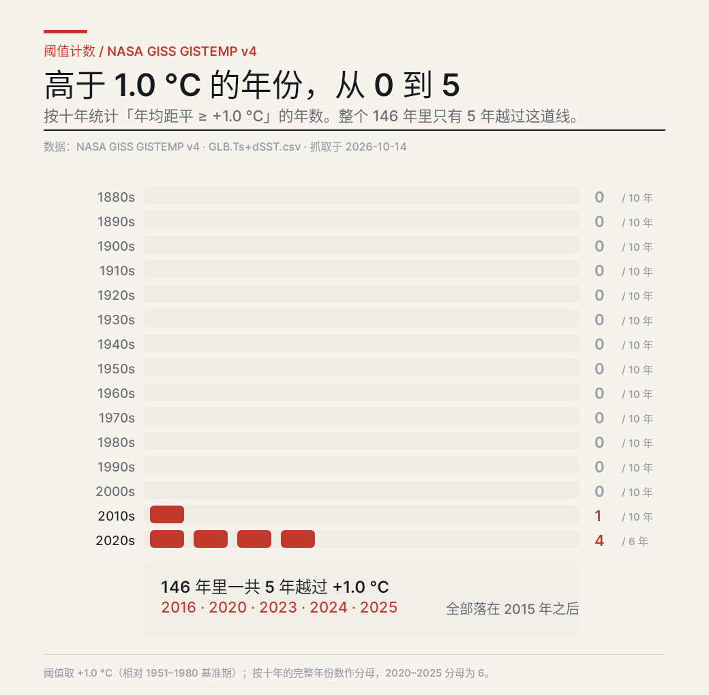
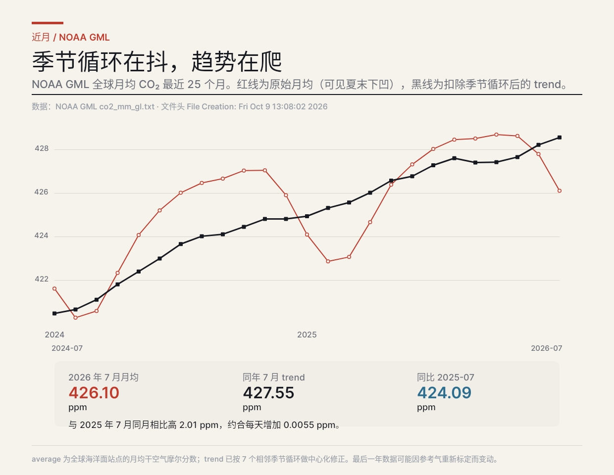
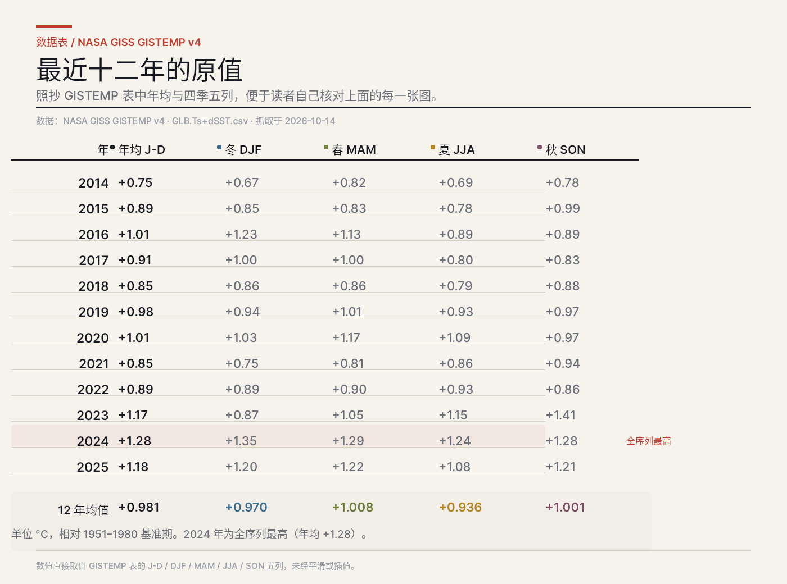
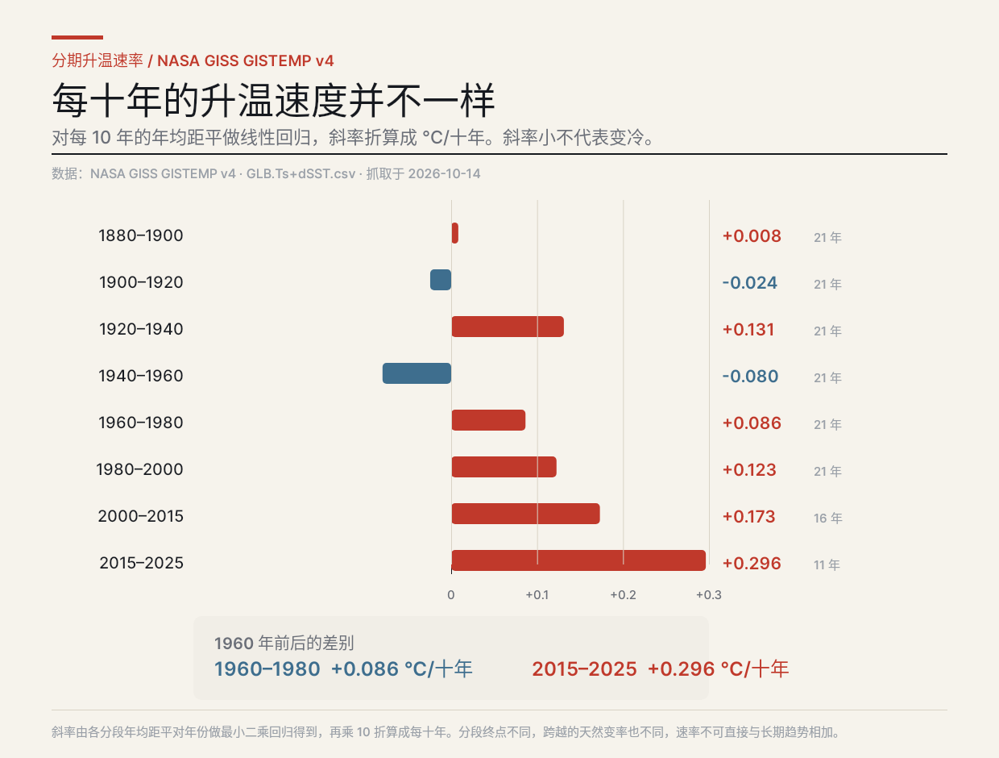
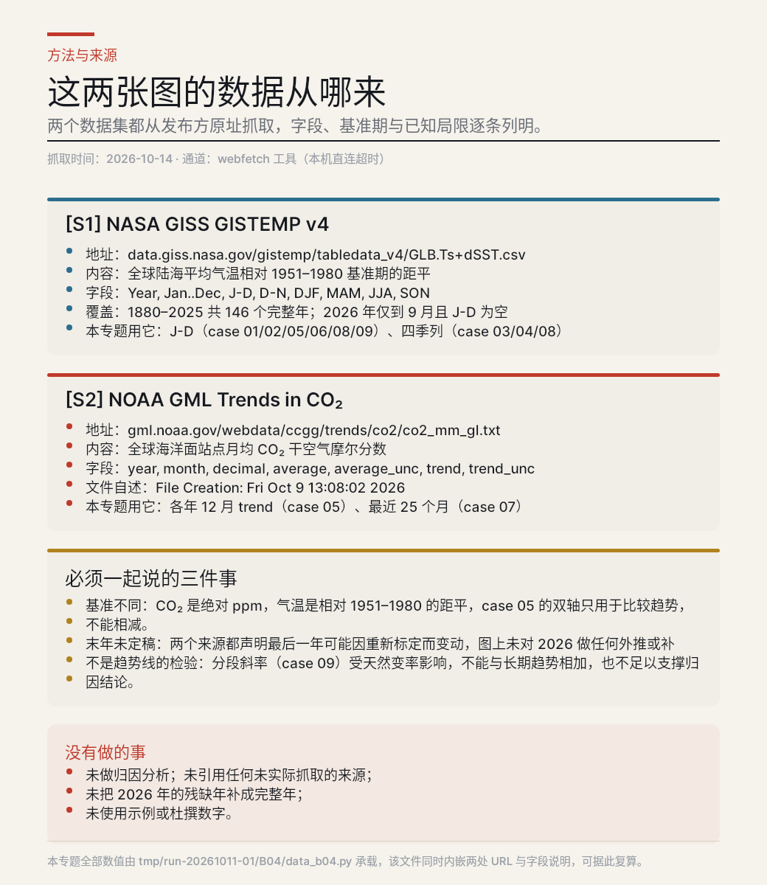

# B04 画廊 · 研究型视觉专题

> 生成时间：2026-10-14T10:40:36+08:00

本专题全部数值来自 2026-10-14 抓取的 NASA GISS 与 NOAA GML 公开数据集，非示例数据；纯 DSL，无 <Image>。

## case-01 · 一百四十六年，每一根柱子都是一年

**形式**：全序列长图　**来源**：`S1`

**结论**：1880–2025 年均距平逐年的走势；全序列最低 1909 年 −0.48 °C，最高 2024 年 +1.28 °C

- PNG：[`case-01/final.png`](case-01/final.png) · DSL：[`case-01/final.snapshot`](case-01/final.snapshot) · 笔记：[`case-01/case.md`](case-01/case.md)

## case-02 · 每十年的平均温度，十五级台阶

**形式**：分箱均值　**来源**：`S1`

**结论**：15 个十年均值的序列；1880–1889 为 −0.212 °C，2020–2025 为 +1.063 °C，相差 +1.275 °C

- PNG：[`case-02/final.png`](case-02/final.png) · DSL：[`case-02/final.snapshot`](case-02/final.snapshot) · 笔记：[`case-02/case.md`](case-02/case.md)

## case-03 · 四季一起变暖，但快慢不同

**形式**：多序列折线　**来源**：`S1`

**结论**：四季均值的长期变化相互同步；最近十年四季均值介于 +0.936 与 +1.034 °C 之间

- PNG：[`case-03/final.png`](case-03/final.png) · DSL：[`case-03/final.snapshot`](case-03/final.snapshot) · 笔记：[`case-03/case.md`](case-03/case.md)

## case-04 · 146 年 × 5 列，一眼看穿整段历史

**形式**：热力矩阵　**来源**：`S1`

**结论**：把 730 个数值按年份铺开；1990 年代前后整行转暖，此后未回到基准期附近

- PNG：[`case-04/final.png`](case-04/final.png) · DSL：[`case-04/final.snapshot`](case-04/final.snapshot) · 笔记：[`case-04/case.md`](case-04/case.md)

## case-05 · 二氧化碳与气温，走的是两条不同的轴

**形式**：双轴对照　**来源**：`S1`, `S2`

**结论**：1979–2025 年 CO₂ 由 337.66 升至 426.56 ppm（+88.9），同期气温距平由 +0.16 升至 +1.18 °C

- PNG：[`case-05/final.png`](case-05/final.png) · DSL：[`case-05/final.snapshot`](case-05/final.snapshot) · 笔记：[`case-05/case.md`](case-05/case.md)

## case-06 · 高于 1.0 °C 的年份，从 0 到 5

**形式**：阈值计数　**来源**：`S1`

**结论**：146 年中只有 5 个年份的年均距平 ≥ +1.0 °C：2016、2020、2023、2024、2025

- PNG：[`case-06/final.png`](case-06/final.png) · DSL：[`case-06/final.snapshot`](case-06/final.snapshot) · 笔记：[`case-06/case.md`](case-06/case.md)

## case-07 · 季节循环在抖，趋势在爬

**形式**：近月序列　**来源**：`S2`

**结论**：2026 年 7 月全球月均 426.10 ppm，trend 427.55 ppm；与 2025 年 7 月同月相比高 2.01 ppm

- PNG：[`case-07/final.png`](case-07/final.png) · DSL：[`case-07/final.snapshot`](case-07/final.snapshot) · 笔记：[`case-07/case.md`](case-07/case.md)

## case-08 · 最近十二年的原值

**形式**：数据表　**来源**：`S1`

**结论**：2014–2025 五列原值；12 年均值为年均 +0.981、四季 +0.970/+1.008/+0.936/+1.001 °C

- PNG：[`case-08/final.png`](case-08/final.png) · DSL：[`case-08/final.snapshot`](case-08/final.snapshot) · 笔记：[`case-08/case.md`](case-08/case.md)

## case-09 · 每十年的升温速度并不一样

**形式**：分段回归　**来源**：`S1`

**结论**：各分段年均距平对年份做最小二乘回归的斜率；2015–2025 为 +0.296 °C/十年，1960–1980 为 +0.086

- PNG：[`case-09/final.png`](case-09/final.png) · DSL：[`case-09/final.snapshot`](case-09/final.snapshot) · 笔记：[`case-09/case.md`](case-09/case.md)

## case-10 · 这两张图的数据从哪来

**形式**：方法与来源　**来源**：`S1`, `S2`

**结论**：两个数据集的出处、字段、基准期与三条必须同时说明的限制；未做归因、未补 2026 残缺年

- PNG：[`case-10/final.png`](case-10/final.png) · DSL：[`case-10/final.snapshot`](case-10/final.snapshot) · 笔记：[`case-10/case.md`](case-10/case.md)
