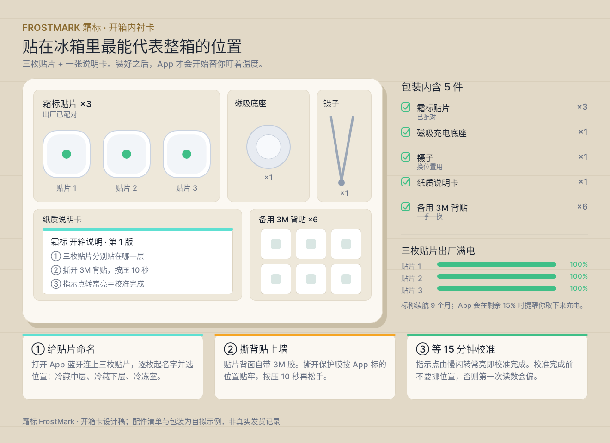
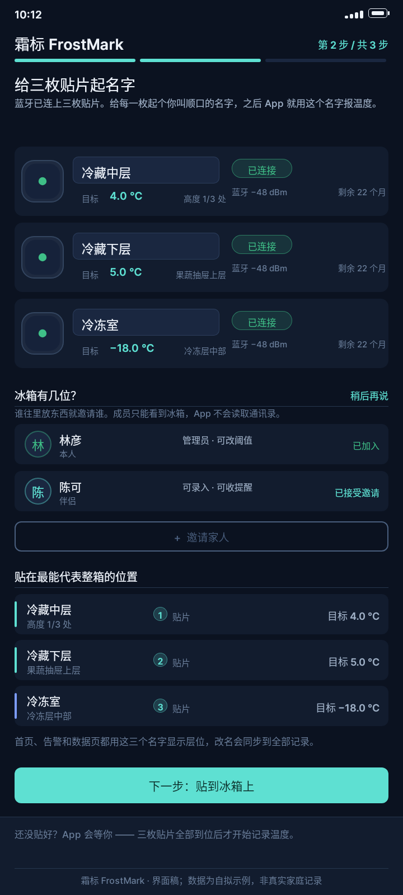
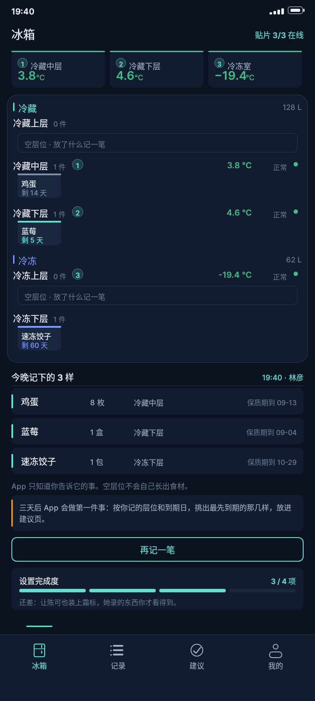
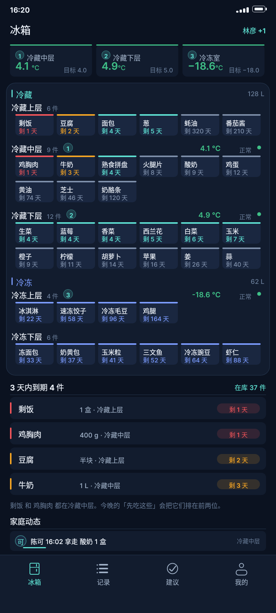
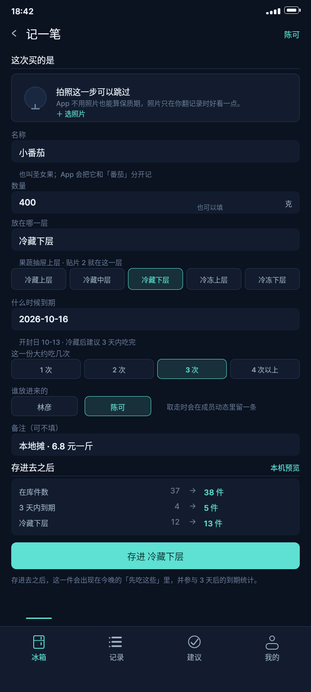
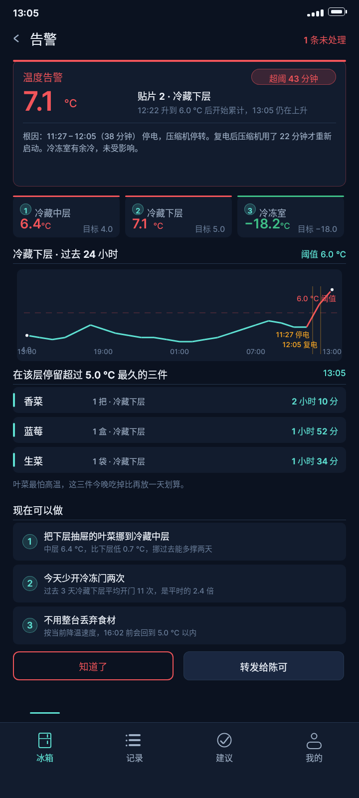
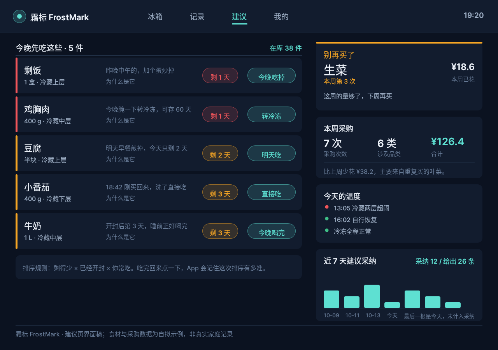
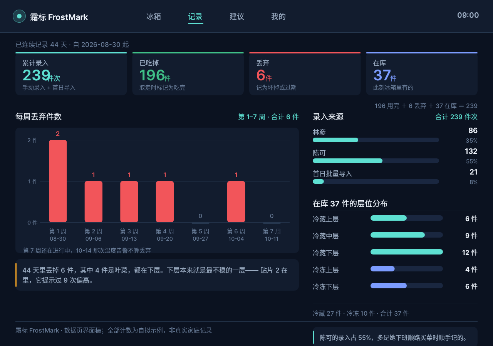
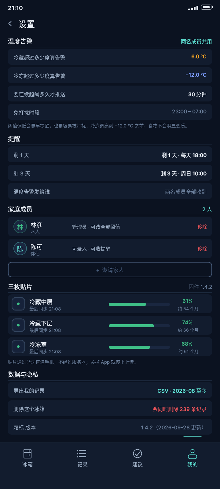
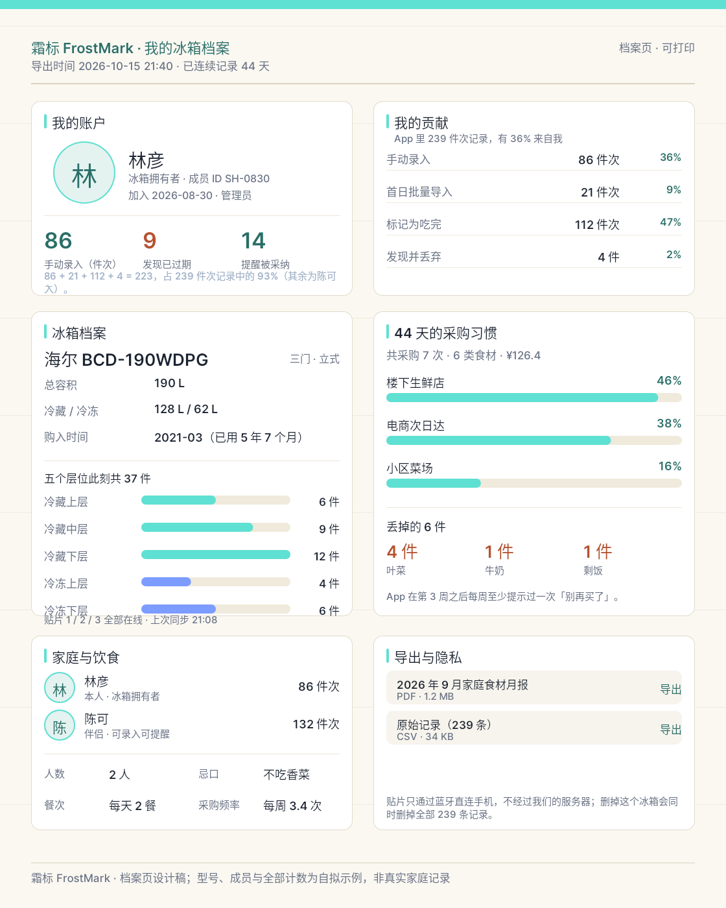

# B05 画廊 · 霜标 FrostMark 十张界面

> 生成时间：2026-10-15T09:13:54+08:00

霜标 FrostMark 为自拟产品；型号、编号与全部记录为自拟示例，非真实家庭数据。纯 DSL，无 <Image> 与外部素材。

## case-01 · 开箱内衬卡

**首次 · 未安装**　开箱内衬卡（非 App 界面）

> 装好之后，App 才开始替你盯着温度

用户任务：开箱前把贴片分别贴在哪一层说清楚

**承接**：起点：产品还不知道任何数据，只有你手上有三枚贴片和一张纸

- PNG：[`case-01/final.png`](case-01/final.png) · DSL：[`case-01/final.snapshot`](case-01/final.snapshot) · 笔记：[`case-01/case.md`](case-01/case.md)

## case-02 · 首次配对

**2026-08-30 10:12**　手机 · 配对页

> 蓝牙发现三枚贴片，逐枚命名并选层位

用户任务：把硬件变成账号里的设备

**承接**：承接 case-01：纸上写的「贴片 1/2/3」在这里变成 App 里的三台设备

- PNG：[`case-02/final.png`](case-02/final.png) · DSL：[`case-02/final.snapshot`](case-02/final.snapshot) · 笔记：[`case-02/case.md`](case-02/case.md)

## case-03 · 装机后首次查看

**2026-08-30 19:40**　手机 · 首次读数

> 装好 5 小时后第一次看到三个温度

用户任务：确认贴片真的在报数

**承接**：承接 case-02：三枚贴片各就各位，第一次出现真实读数

- PNG：[`case-03/final.png`](case-03/final.png) · DSL：[`case-03/final.snapshot`](case-03/final.snapshot) · 笔记：[`case-03/case.md`](case-03/case.md)

## case-04 · 满载冰箱首页

**2026-10-13 16:20**　手机 · 首页

> 37 件在库、4 件临期、三枚贴片读数

用户任务：一眼看清冰箱里还有什么

**承接**：时间跳到第 44 天，库存从 0 长到 37 件

- PNG：[`case-04/final.png`](case-04/final.png) · DSL：[`case-04/final.snapshot`](case-04/final.snapshot) · 笔记：[`case-04/case.md`](case-04/case.md)

## case-05 · 录入一件新食材

**2026-10-13 18:42**　手机 · 录入

> 刚买的小番茄 400 g，放冷藏下层

用户任务：把一样东西加进库存

**承接**：承接 case-04：录完变 38 件、冷藏下层 13 件、临期从 4 件变 5 件

- PNG：[`case-05/final.png`](case-05/final.png) · DSL：[`case-05/final.snapshot`](case-05/final.snapshot) · 笔记：[`case-05/case.md`](case-05/case.md)

## case-06 · 温度告警

**2026-10-14 13:05**　手机 · 告警页

> 停电 38 分钟后冷藏两层超阈，冷冻正常

用户任务：现在要不要动一下

**承接**：承接 case-05：11:27 停电、12:05 复电，13:05 下层累计超阈 43 分钟

- PNG：[`case-06/final.png`](case-06/final.png) · DSL：[`case-06/final.snapshot`](case-06/final.snapshot) · 笔记：[`case-06/case.md`](case-06/case.md)

## case-07 · 先吃这些 / 别再买了

**2026-10-14 19:20**　平板横屏

> 5 件该先吃，生菜是第 3 次提醒

用户任务：今晚吃什么、还要不要买菜

**承接**：承接 case-06：看完告警，晚上给出可执行的下一步

- PNG：[`case-07/final.png`](case-07/final.png) · DSL：[`case-07/final.snapshot`](case-07/final.snapshot) · 笔记：[`case-07/case.md`](case-07/case.md)

## case-08 · 44 天数据

**2026-10-15 09:00**　平板横屏

> 239 件次的录入、消耗与丢弃

用户任务：这个冰箱到底在浪费什么

**承接**：承接 case-07：把「别再买了」背后的 44 天摊开成数据

- PNG：[`case-08/final.png`](case-08/final.png) · DSL：[`case-08/final.snapshot`](case-08/final.snapshot) · 笔记：[`case-08/case.md`](case-08/case.md)

## case-09 · 设置

**2026-10-15 21:10**　手机 · 设置

> 阈值、成员权限、三枚贴片电量

用户任务：调阈值、管人、换电池

**承接**：承接 case-08：看完统计，回头改配置（30 分钟推送、两名成员）

- PNG：[`case-09/final.png`](case-09/final.png) · DSL：[`case-09/final.snapshot`](case-09/final.snapshot) · 笔记：[`case-09/case.md`](case-09/case.md)

## case-10 · 个人档案

**2026-10-15 21:40**　竖版档案页

> 冰箱档案 + 家庭 + 个人贡献

用户任务：这台冰箱是谁在打理

**承接**：收尾：回到「这是我们的冰箱」而不是「这是我的数据」

- PNG：[`case-10/final.png`](case-10/final.png) · DSL：[`case-10/final.snapshot`](case-10/final.snapshot) · 笔记：[`case-10/case.md`](case-10/case.md)
